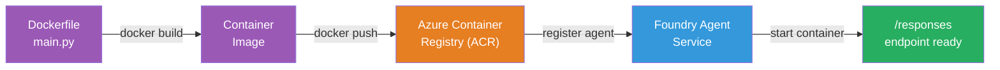
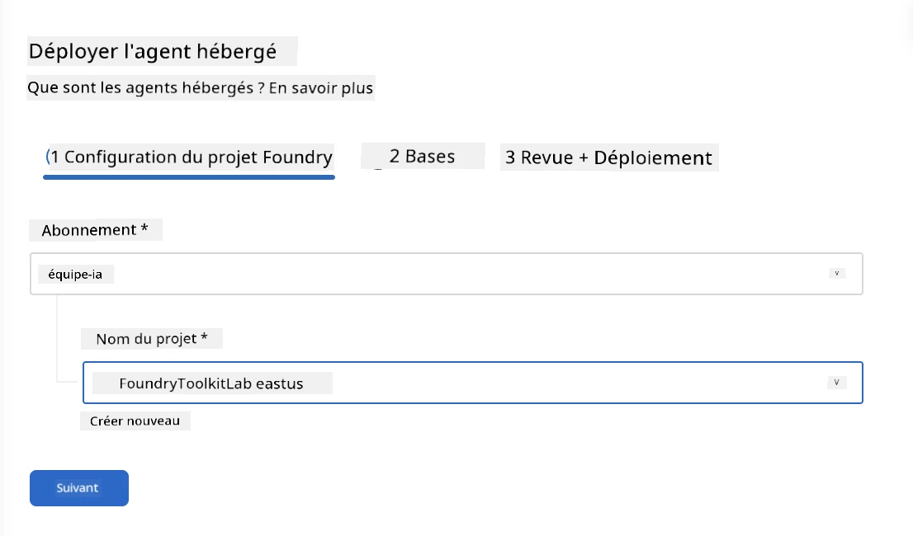
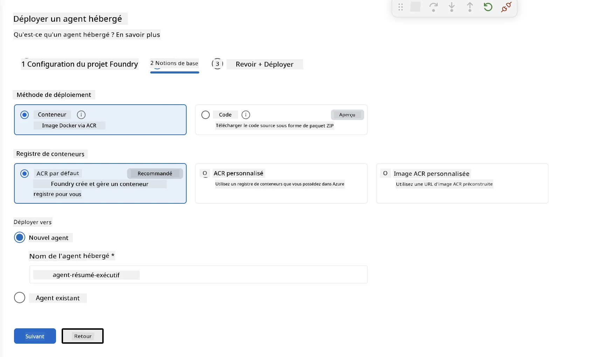
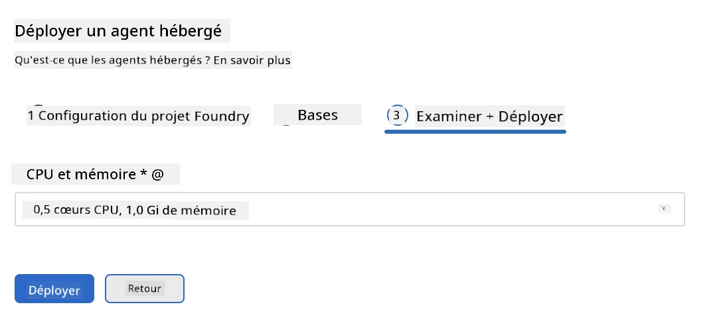
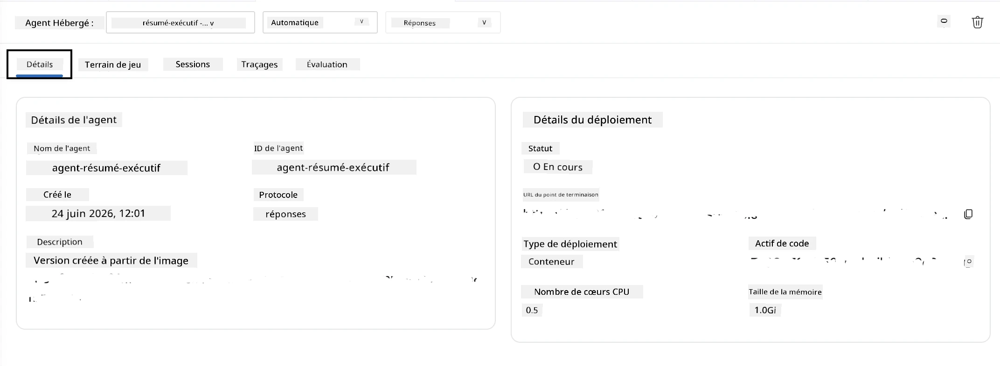

# Module 5 - Déployer vers Foundry Agent Service

⏱️ ~10 min

> ⚠️ **Utilisateurs du chemin B :** Ce module nécessite un abonnement Foundry. Si vous utilisez Foundry Local, passez au [Module 07 - Résumé](07-summary.md). Vous avez réussi à compléter le workflow de développement local !

Dans ce module, vous déployez votre agent testé localement sur Microsoft Foundry en tant qu'**Agent hébergé**. Le déploiement construit une image de conteneur, la pousse vers Azure Container Registry, et démarre l'agent dans l'infrastructure gérée de Foundry.

### Pipeline de déploiement

---

## Vérification des prérequis

Avant de déployer, vérifiez :

- [ ] L'agent réussit tous les 3 scénarios locaux du [Module 04](04-test-locally.md)
- [ ] Vous avez le rôle **Utilisateur Azure AI** au niveau du projet ([Module 01, Attribution RBAC](01-setup.md#deploy-a-model--assign-rbac))
- [ ] Vous êtes connecté à Azure dans VS Code (l'icône Comptes affiche votre nom)

---

## Étape 1 : Démarrer le déploiement

### Option A : Déployer depuis Agent Inspector (recommandé)

Si Agent Inspector est ouvert (suite aux tests) :
1. Cliquez sur le bouton **Déployer** en haut à droite (icône nuage ↑).

### Option B : Déployer depuis la Palette de commandes

1. Appuyez sur `Ctrl+Shift+P` → **Foundry Toolkit : Déployer Agent Hébergé**.

---

## Étape 2 : Configurer le déploiement

L'assistant vous demande :

| Invite | Sélection |
|--------|-----------|
| **Abonnement** | Votre abonnement Azure |
| **Projet cible** | Votre projet Foundry (ex. `workshop-agents`) |

Cliquez sur **suivant** pour configurer votre agent.

| Invite | Sélection |
|--------|-----------|
| **Méthode de déploiement** | Conteneur |
| **Registre de conteneurs** | **ACR par défaut** (Microsoft Foundry en crée et gère un pour vous) |
| **Déployer sur** | Nouvel agent (nom, `executive-summary-agent`) |

Cliquez sur **suivant** pour revoir et déployer votre agent.

| Invite | Sélection |
|--------|-----------|
| **CPU et mémoire** | **0.5 cœurs CPU, 1.0 Gi mémoire** (par défaut - suffisant pour l'atelier) |

---

## Étape 3 : Déployer et surveiller

1. Cliquez sur **Déployer**.
2. Surveillez le panneau **Sortie** (sélectionnez **Microsoft Foundry** dans la liste déroulante).
3. Le déploiement passe par ces étapes :
   - **Construction Docker** - construit le conteneur à partir de votre Dockerfile
   - **Poussée Docker** - pousse l'image vers ACR (1–3 min lors du premier déploiement)
   - **Enregistrement de l'agent** - crée l'agent hébergé dans Foundry
   - **Démarrage du conteneur** - démarre avec identité gérée par le système

4. Une fois terminé, une notification apparaît :
   > **executive-summary-agent est déployé avec succès.** `View logs` `Run agent`

5. Cliquez sur **Exécuter l'agent** pour ouvrir l'Agent Playground.

### Valeurs de statut de déploiement

| Statut | Signification |
|--------|-------------|
| **En cours d'exécution** | Conteneur prêt, agent répondant |
| **En attente** | Conteneur en démarrage - attendre 30–60 secondes |
| **Échec** | Vérifiez les journaux (voir dépannage ci-dessous) |

---

## Erreurs courantes de déploiement

| Erreur | Cause principale | Correction |
|-------|-----------------|------------|
| `agents/write` permission refusée | Rôle **Utilisateur Azure AI** manquant au niveau du projet | [Module 01, Assigner RBAC](01-setup.md#deploy-a-model--assign-rbac) |
| Docker non lancé | Docker Desktop non démarré | Démarrez Docker Desktop → vérifiez `docker info` |
| Autorisation ACR | Identité gérée ne peut pas extraire l'image | Voir [Module 08 - Dépannage](08-troubleshooting.md) |

---

### ✅ Point de contrôle

- [ ] Déploiement complété sans erreurs
- [ ] L’agent apparaît dans l’onglet **Agent Hébergé** lorsque vous cliquez sur **Agents** sous votre projet dans la barre latérale Foundry Toolkit
- [ ] Le statut du conteneur affiche **En cours d'exécution**
- [ ] Onglet Agent Playground ouvert affichant les détails de l’agent et l'URL du point de terminaison

---

**Précédent :** [04 - Tester localement](04-test-locally.md) · **Suivant :** [06 - Vérifier dans Playground →](06-verify-in-playground.md)

---

<!-- CO-OP TRANSLATOR DISCLAIMER START -->
**Avertissement** :
Ce document a été traduit à l'aide du service de traduction automatique [Co-op Translator](https://github.com/Azure/co-op-translator). Bien que nous nous efforçions d'assurer l'exactitude, veuillez noter que les traductions automatisées peuvent contenir des erreurs ou des inexactitudes. Le document original dans sa langue native doit être considéré comme la source faisant autorité. Pour les informations critiques, il est recommandé de recourir à une traduction professionnelle réalisée par un humain. Nous ne saurions être tenus responsables des malentendus ou erreurs d'interprétation découlant de l'utilisation de cette traduction.
<!-- CO-OP TRANSLATOR DISCLAIMER END -->