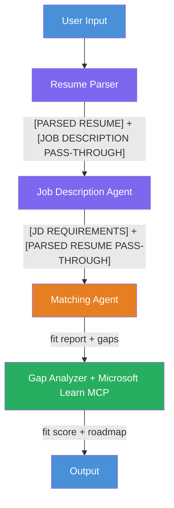

# Laboratoire 02 - Workflow Multi-Agent : Évaluateur d'Adéquation CV → Poste

## Aperçu

Dans ce laboratoire pratique, vous allez créer une **application multi-agent orientée workflow** en utilisant Foundry Toolkit dans VS Code et la déployer sur Microsoft Foundry Agent Service.

**Ce que vous allez construire :** un Évaluateur d'Adéquation CV → Poste qui analyse un CV et une description de poste, évalue la pertinence et produit une feuille de route d'apprentissage personnalisée utilisant les ressources Microsoft Learn.

---

## Architecture

**Comment ça fonctionne :**
1. L'utilisateur colle un CV et une description de poste.
2. **ResumeParser** analyse le CV et copie la description de poste telle quelle dans une section `[JOB DESCRIPTION PASS-THROUGH]`.
3. **JD Agent** extrait les exigences structurées du passage, puis transmet le `[PARSED RESUME]` en tant que `[PARSED RESUME PASS-THROUGH]`.
4. **MatchingAgent** compare `[PARSED RESUME PASS-THROUGH]` vs `[JD REQUIREMENTS]` et produit un score d'adéquation.
5. **GapAnalyzer** transforme les écarts en feuille de route pratique et récupère de vrais liens Microsoft Learn via MCP.

---

## Prérequis

Terminer d'abord le Laboratoire 01 :

- [Laboratoire 01 - Agent Unique](../lab01-single-agent/README.md)

---

## Partie 1 : Lisez les modules dans l'ordre

Consultez le parcours d'apprentissage complet dans :

- [Docs Lab 2 - Prérequis](docs/00-prerequisites.md)
- [Docs Lab 2 - Parcours d’Apprentissage Complet](docs/README.md)
- [Guide d'exécution PersonalCareerCopilot](PersonalCareerCopilot/README.md)

---

## Partie 2 : Construisez et testez le workflow

1. Utilisez l'assistant Foundry Toolkit pour structurer le projet basé sur le workflow.
2. Copiez les blocs de prompt et le graphe du workflow depuis `PersonalCareerCopilot/main.py` dans votre espace de travail.
3. Exécutez localement avec l'Agent Inspector et vérifiez les quatre agents ainsi que l'outil MCP.
4. Déployez l'agent hébergé sur Foundry après validation des tests locaux.

---

## Modèles d'orchestration

Le laboratoire 02 utilise un **pipeline séquentiel** : la sortie de chaque agent est la source d'entrée pour le suivant, et le workflow renvoie la réponse finale du dernier agent. Deux modèles rendent cela possible :

- **Chaîne séquentielle** - `WorkflowBuilder` connecte ResumeParser → JD Agent → MatchingAgent → GapAnalyzer avec un appel `add_edge()` par étape
- **Relais de contenu** - puisque chaque agent ne voit que la sortie directe de son prédécesseur, ResumeParser et JD Agent copient les données nécessaires pour les agents en aval dans des sections de passage étiquetées

La documentation explique aussi pourquoi le laboratoire n'utilise pas le fan-out/fan-in, et comment étendre le graphe avec un autre agent.

Voir [docs/04-orchestration-patterns.md](docs/04-orchestration-patterns.md).

---

**Précédent :** [Laboratoire 01 - Agent Unique](../lab01-single-agent/README.md) · **Retour à :** [Accueil Atelier](../../README.md)

---

<!-- CO-OP TRANSLATOR DISCLAIMER START -->
**Avertissement** :
Ce document a été traduit à l'aide du service de traduction automatique [Co-op Translator](https://github.com/Azure/co-op-translator). Bien que nous nous efforçions d'assurer l'exactitude, veuillez noter que les traductions automatisées peuvent contenir des erreurs ou des inexactitudes. Le document original dans sa langue native doit être considéré comme la source faisant autorité. Pour les informations critiques, il est recommandé de recourir à une traduction professionnelle réalisée par un humain. Nous ne saurions être tenus responsables des malentendus ou erreurs d'interprétation découlant de l'utilisation de cette traduction.
<!-- CO-OP TRANSLATOR DISCLAIMER END -->