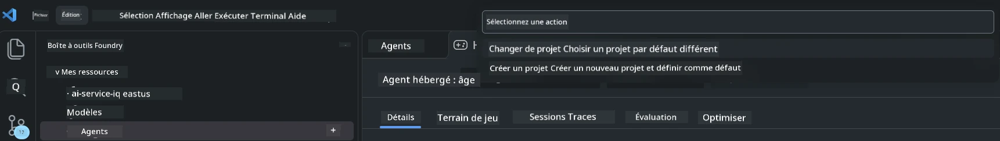

# Module 0 - Introduction

⏱️ ~10 min

> [!WARNING]
> **Aperçu & Limitations :** [Hosted Agents](https://learn.microsoft.com/azure/foundry/agents/concepts/hosted-agents) sont actuellement en **aperçu public** - non recommandés pour les charges de travail en production. Certaines fonctionnalités présentées dans cet atelier peuvent évoluer à mesure que le service progresse vers la disponibilité générale.

## Ce que vous allez construire

Dans ce laboratoire, vous étendez les compétences de l’agent unique du Lab 01 pour construire un **flux de travail multi-agent** - l’Évaluateur de Correspondance CV → Poste.

Vous collez un **CV** et une **description de poste**. Quatre agents spécialisés traitent les entrées de manière séquentielle, puis retournent :
- Un score de correspondance (0–100 avec une ventilation des scores)
- Une liste d’écarts de compétences et de certifications
- Une feuille de route d’apprentissage personnalisée avec des liens réels Microsoft Learn pour chaque écart

**Le flux de travail utilise :**
- **Microsoft Agent Framework** - `WorkflowBuilder` pour l’orchestration séquentielle de la pipeline
- **Foundry Toolkit pour VS Code** - structurer, tester localement, déployer
- **Un modèle d’IA** (par exemple, `gpt-4.1-mini`) - utilisé par les quatre agents
- **Serveur Microsoft Learn MCP** - fournit de vrais liens vers des ressources d’apprentissage pour chaque écart de compétence

---

## Choisissez votre chemin

> ⚠️ **Poursuivez avec le même chemin que vous avez utilisé dans le Lab 01.**

<details open>
<summary><strong>🅰️ Chemin A - Cloud Azure (requiert un abonnement Azure)</strong></summary>

| | Détails |
|---|---|
| **Pour qui ?** | Vous avez complété le Lab 01 en utilisant un abonnement Azure |
| **Modèle** | Azure OpenAI via Foundry (par exemple `gpt-4.1-mini`) |
| **Modules couverts** | Tous les modules (00–09) |
| **Déploiement sur le cloud ?** | ✅ Oui - déploiement complet de bout en bout |

</details>

<details open>
<summary><strong>🅱️ Chemin B - Foundry Local (aucun abonnement Azure requis)</strong></summary>

| | Détails |
|---|---|
| **Pour qui ?** | Vous avez complété le Lab 01 en utilisant Foundry Local |
| **Modèle** | Foundry Local (gratuit, fonctionne sur votre machine) |
| **Modules couverts** | Modules 00–05 (sauter 06–07 - déploiement & vérification cloud) |
| **Déploiement sur le cloud ?** | ❌ Non - tests locaux uniquement via Agent Inspector |

</details>

---

## Vérification du Lab 01

Le Lab 02 s’appuie directement sur le Lab 01. Complétez le Lab 01 avant de commencer ici.

Vous n’avez pas encore fait le Lab 01 ? Commencez ici : [Lab 01 - Introduction](../../lab01-single-agent/docs/00-prerequisites.md)

<details open>
<summary><strong>🅰️ Chemin A - Cloud Azure</strong></summary>

```powershell
az account show --query "{name:name, id:id}" --output table
```

Si cela échoue, exécutez `az login`. Ensuite, vérifiez dans VS Code :

1. `Ctrl+Shift+P` → tapez **Foundry Toolkit** → confirmez que les commandes apparaissent.
2. Cliquez sur l’icône **Foundry Toolkit** → votre projet et le modèle déployé montrent **Succès**.



> **RBAC :** Vous avez attribué **Foundry User** dans le Lab 01. Si vous devez la réattribuer, consultez [Lab 01, Module 1](../../lab01-single-agent/docs/01-setup.md#deploy-a-model--assign-rbac). Le rôle s’appelait auparavant **Azure AI User** - mêmes permissions.

</details>

<details open>
<summary><strong>🅱️ Chemin B - Foundry Local</strong></summary>

```powershell
Invoke-WebRequest -Uri "http://localhost:5273/v1/health" -UseBasicParsing | Select-Object StatusCode
```

Attendu : `StatusCode: 200`. Sinon, redémarrez Foundry Local depuis la barre latérale Foundry Toolkit.

> Tous les traitements s’exécutent sur votre machine. Le seul appel sortant est l’outil MCP vers `https://learn.microsoft.com/api/mcp`.

</details>

---

## Nouveautés du Lab 02

| | Lab 01 | Lab 02 |
|--|--------|--------|
| Agents | 1 | 4 (enchaînés avec WorkflowBuilder) |
| Modèle de structure | Basique - Agent Framework | Workflows - Agent Framework |
| Nouveau package | - | `mcp` |
| Orchestration | Agent conversationnel unique | Pipeline séquentielle (WorkflowBuilder) |
| Nouvel outil | - | `search_microsoft_learn_for_plan` (MCP) |

---

**Suivant :** [01 - Comprendre l’architecture →](01-understand-multi-agent.md)

---

<!-- CO-OP TRANSLATOR DISCLAIMER START -->
**Avertissement** :
Ce document a été traduit à l'aide du service de traduction automatique [Co-op Translator](https://github.com/Azure/co-op-translator). Bien que nous nous efforçions d'assurer l'exactitude, veuillez noter que les traductions automatisées peuvent contenir des erreurs ou des inexactitudes. Le document original dans sa langue native doit être considéré comme la source faisant autorité. Pour les informations critiques, il est recommandé de recourir à une traduction professionnelle réalisée par un humain. Nous ne saurions être tenus responsables des malentendus ou erreurs d'interprétation découlant de l'utilisation de cette traduction.
<!-- CO-OP TRANSLATOR DISCLAIMER END -->