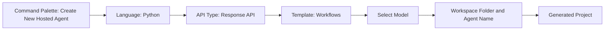
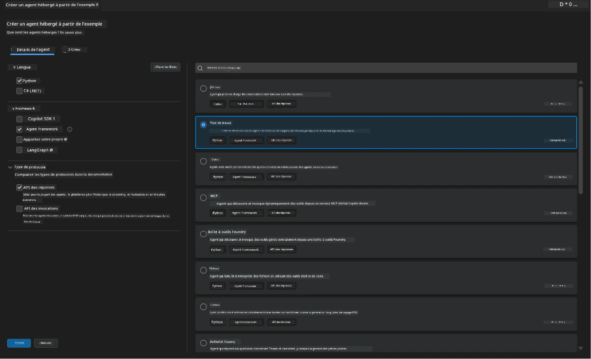
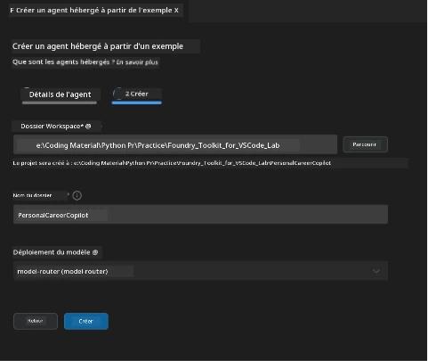

# Module 2 - Échafauder le projet multi-agent

⏱️ ~5 min

Dans ce module, vous utilisez [Foundry Toolkit for VS Code](https://aka.ms/foundrytk) pour **échafauder un projet multi-agent**. L’assistant génère `agent.yaml`, `main.py`, `Dockerfile`, `requirements.txt`, `.env`, et la configuration de débogage VS Code - afin que vous puissiez vous concentrer sur le câblage du flux de travail à 4 agents dans le Module 3.

> **Concept clé :** L’échafaudage est un stub fonctionnel avec un agent. Vous remplacez la logique placeholder par le graphe `WorkflowBuilder` dans le Module 3. Vous ne codez pas le boilerplate depuis zéro.

> **Implémentation de référence :** [`PersonalCareerCopilot/`](../../../../../workshop/lab02-multi-agent/PersonalCareerCopilot) est un exemple complet fonctionnel. Utilisez-le pour comparer votre travail au fur et à mesure.

### Flux de l’assistant d’échafaudage



---

## Étape 1 : Ouvrir l’assistant Créer un agent hébergé

1. Appuyez sur `Ctrl+Shift+P` pour ouvrir la **Palette de commandes**.
2. Tapez : **Foundry Toolkit : Créer un nouvel agent hébergé** et sélectionnez-le.
3. L’assistant s’ouvre sur l’onglet **Détails de l’agent**.

> **Alternative :** Cliquez sur l’icône **Foundry Toolkit** dans la barre d’activité → cliquez sur l’icône **+** à côté de **Agents hébergés** → **Créer un nouvel agent hébergé**.

---

## Étape 2 : Choisir les paramètres



1. Dans la section de navigation/options à gauche, sélectionnez ce qui suit :

| Menu | Sélection | Remarques |
|--------|-----------|-------|
| **Langage** | Python | C# (.NET) est aussi supporté |
| **Framework** | Framework Agent | Fournit `Agent`, `AgentExecutor`, `WorkflowBuilder` |
| **Type d’API** | API de réponse | `POST /responses` - historique géré par la plateforme, support du streaming |
| **Modèle** | **Workflows** | Traite les requêtes via plusieurs agents en séquence |

2. Une fois sélectionné, cliquez sur **Suivant**



3. Dans la fenêtre suivante, sélectionnez ce qui suit :

| Menu | Sélection | Remarques |
|--------|-----------|-------|
| **Dossier de l’espace de travail** | Parcourir jusqu’au dossier cible | par ex. `workshop/lab02-multi-agent/` dans ce dépôt |
| **Nom de l’agent** | `PersonalCareerCopilot` | Cela devient le nom du répertoire du projet |
| **Déploiement du modèle** | Sélectionnez votre modèle déployé | par ex. `gpt-4.1-mini` du Lab 01 |

4. Cliquez sur **Créer** pour échafauder le projet. VS Code génère les fichiers et ouvre le dossier.

> **Astuce :** [`gpt-4.1-mini`](https://learn.microsoft.com/azure/foundry/foundry-models/concepts/models-sold-directly-by-azure#gpt-41-series) équilibre bien vitesse et qualité pour le développement multi-agent.

---

## Étape 3 : Inspecter le projet généré

Après l’échafaudage, vérifiez que vous voyez ces fichiers dans l’Explorateur (`Ctrl+Shift+E`) :

```
📂 <your-agent-name>/
├── .azdignore          ← Files excluded from Azure Developer CLI deployments
├── .dockerignore       ← Files excluded from Docker builds
├── .env                ← Environment variables (placeholders - fill in Module 3)
├── .vscode/
│   ├── launch.json     ← Debug config (F5 → run + Agent Inspector)
│   └── tasks.json      ← VS Code task definitions
├── agent.yaml          ← Agent definition (kind: hosted, protocol: responses)
├── Dockerfile          ← Container config for deployment
├── main.py             ← Stub agent entry point (replace with WorkflowBuilder in Module 3)
└── requirements.txt    ← Python dependencies
```

> **Important :** Ouvrez ce dossier échafaudé directement dans VS Code pour que `.vscode/launch.json` et `tasks.json` s’appliquent correctement lors du débogage avec F5.

### Explication des fichiers clés

| Fichier | But |
|------|---------|
| `agent.yaml` | Déclare `kind: hosted`, mappe les variables d’environnement, définit le protocole `/responses` |
| `main.py` | Stub : un `FoundryChatClient` → `Agent` → `ResponsesHostServer`. Vous le remplacez par 4 agents + `WorkflowBuilder` dans le Module 3 |
| `Dockerfile` | `python:3.12-slim`, installe `requirements.txt`, expose le port 8088, exécute `python main.py` |
| `requirements.txt` | `agent-framework-foundry`, `agent-framework-foundry-hosting`, `mcp<2,>=1.24.0`, `debugpy` |

> **Référence :** Voir [`PersonalCareerCopilot/agent.yaml`](../../../../../workshop/lab02-multi-agent/PersonalCareerCopilot/agent.yaml) et [`PersonalCareerCopilot/requirements.txt`](../../../../../workshop/lab02-multi-agent/PersonalCareerCopilot/requirements.txt) pour le contenu généré complet.

---

### ✅ Point de contrôle

- [ ] Assistant d’échafaudage terminé - nouveau dossier de projet visible dans l’Explorateur
- [ ] Tous les fichiers attendus présents : `agent.yaml`, `main.py`, `Dockerfile`, `requirements.txt`, `.env`
- [ ] `agent.yaml` montre `kind: hosted` et `protocol: responses`
- [ ] `main.py` importe `Agent`, `FoundryChatClient`, `ResponsesHostServer`
- [ ] Le dossier échafaudé est ouvert en tant que racine de l’espace de travail VS Code
- [ ] Vous comprenez que `main.py` est un stub - `WorkflowBuilder` est ajouté dans le Module 3

---

**Précédent :** [01 - Comprendre l’architecture multi-agent](01-understand-multi-agent.md) · **Suivant :** [03 - Configurer les agents et l’environnement →](03-configure-agents.md)

---

<!-- CO-OP TRANSLATOR DISCLAIMER START -->
**Avertissement** :
Ce document a été traduit à l'aide du service de traduction automatique [Co-op Translator](https://github.com/Azure/co-op-translator). Bien que nous nous efforçions d'assurer l'exactitude, veuillez noter que les traductions automatisées peuvent contenir des erreurs ou des inexactitudes. Le document original dans sa langue native doit être considéré comme la source faisant autorité. Pour les informations critiques, il est recommandé de recourir à une traduction professionnelle réalisée par un humain. Nous ne saurions être tenus responsables des malentendus ou erreurs d'interprétation découlant de l'utilisation de cette traduction.
<!-- CO-OP TRANSLATOR DISCLAIMER END -->