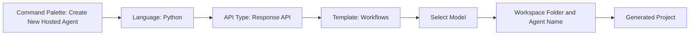

# Module 2 - Générer l'ossature du projet multi-agents

⏱️ ~5 min

Dans ce module, vous utilisez [Foundry Toolkit for VS Code](https://aka.ms/foundrytk) pour **générer l'ossature d'un projet multi-agents**. L'assistant génère `agent.yaml`, `main.py`, `Dockerfile`, `requirements.txt`, `.env`, et la configuration de débogage VS Code - afin que vous puissiez vous concentrer sur le câblage du flux de travail à 4 agents dans le Module 3.

> **Concept clé :** L'ossature est une ébauche fonctionnelle avec un agent. Vous remplacez la logique factice par le graphe `WorkflowBuilder` dans le Module 3. Vous ne réécrivez pas le code de base depuis zéro.

> **Implémentation de référence :** [`PersonalCareerCopilot/`](../../../../../workshop/lab02-multi-agent/PersonalCareerCopilot) est un exemple complet et fonctionnel. Servez-vous-en pour comparer votre travail au fur et à mesure.

### Déroulement de l'assistant de génération



---

## Étape 1 : Ouvrez l'assistant Create Hosted Agent

1. Appuyez sur `Ctrl+Shift+P` pour ouvrir la **Palette de commandes**.
2. Tapez : **Foundry Toolkit: Create a New Hosted Agent** et sélectionnez-le.
3. L'assistant s'ouvre sur l'onglet **Détails de l'agent**.

> **Alternative :** Cliquez sur l'icône **Foundry Toolkit** dans la Barre d'activités → cliquez sur l'icône **+** à côté de **Hosted Agents** → **Create New Hosted Agent**.

---

## Étape 2 : Choisir les paramètres


1. Dans la section de navigation/options à gauche, sélectionnez les éléments suivants :

| Menu | Sélection | Remarques |
|--------|-----------|-------|
| **Langue** | Python | C# (.NET) également pris en charge |
| **Framework** | Agent Framework | Fournit `Agent`, `AgentExecutor`, `WorkflowBuilder` |
| **Type d'API** | Response API | `POST /responses` - historique géré par la plateforme, prise en charge du streaming |
| **Modèle** | **Workflows** | Traite les requêtes via plusieurs agents en séquence |

2. Une fois sélectionné, cliquez sur **Next**


3. Dans la fenêtre suivante, sélectionnez les éléments suivants :

| Menu | Sélection | Remarques |
|--------|-----------|-------|
| **Dossier de l'espace de travail** | Parcourez jusqu'au dossier cible | p. ex., `workshop/lab02-multi-agent/` dans ce dépôt |
| **Nom de l'agent** | `PersonalCareerCopilot` | Ceci devient le nom du répertoire du projet |
| **Déploiement du modèle** | Sélectionnez votre modèle déployé | p. ex., `gpt-4.1-mini` du Lab 01 |

4. Cliquez sur **Create** pour générer l'ossature du projet. VS Code génère les fichiers et ouvre le dossier.

> **Astuce :** [`gpt-4.1-mini`](https://learn.microsoft.com/azure/foundry/foundry-models/concepts/models-sold-directly-by-azure#gpt-41-series) offre un bon compromis entre rapidité et qualité pour le développement multi-agent.

---

## Étape 3 : Inspecter le projet généré

Après la génération, vérifiez que vous voyez ces fichiers dans l'Explorateur (`Ctrl+Shift+E`) :

```
📂 <your-agent-name>/
├── .azdignore          ← Files excluded from Azure Developer CLI deployments
├── .dockerignore       ← Files excluded from Docker builds
├── .env                ← Environment variables (placeholders - fill in Module 3)
├── .vscode/
│   ├── launch.json     ← Debug config (F5 → run + Agent Inspector)
│   └── tasks.json      ← VS Code task definitions
├── agent.yaml          ← Agent definition (kind: hosted, protocol: responses)
├── Dockerfile          ← Container config for deployment
├── main.py             ← Stub agent entry point (replace with WorkflowBuilder in Module 3)
└── requirements.txt    ← Python dependencies
```

> **Important :** Ouvrez ce dossier généré directement dans VS Code afin que `.vscode/launch.json` et `tasks.json` s'appliquent correctement pour le débogage F5.

### Fichiers clés expliqués

| Fichier | Objectif |
|------|---------|
| `agent.yaml` | Déclare `kind: hosted`, mappe les variables d'environnement, définit le protocole `/responses` |
| `main.py` | Stub : un `FoundryChatClient` → `Agent` → `ResponsesHostServer`. Vous remplacez ceci par 4 agents + `WorkflowBuilder` dans le Module 3 |
| `Dockerfile` | `python:3.12-slim`, installe `requirements.txt`, expose le port 8088, exécute `python main.py` |
| `requirements.txt` | `agent-framework-foundry`, `agent-framework-foundry-hosting`, `mcp<2,>=1.24.0`, `debugpy` |

> **Référence :** Voir [`PersonalCareerCopilot/agent.yaml`](../../../../../workshop/lab02-multi-agent/PersonalCareerCopilot/agent.yaml) et [`PersonalCareerCopilot/requirements.txt`](../../../../../workshop/lab02-multi-agent/PersonalCareerCopilot/requirements.txt) pour le contenu complet généré.

---

### ✅ Point de contrôle

- [ ] Assistant de génération terminé - le nouveau dossier du projet est visible dans l'Explorateur
- [ ] Tous les fichiers attendus sont présents : `agent.yaml`, `main.py`, `Dockerfile`, `requirements.txt`, `.env`
- [ ] `agent.yaml` affiche `kind: hosted` et `protocol: responses`
- [ ] `main.py` importe `Agent`, `FoundryChatClient`, `ResponsesHostServer`
- [ ] Le dossier généré est ouvert en tant que racine de l'espace de travail VS Code
- [ ] Vous comprenez que `main.py` est une ébauche - `WorkflowBuilder` est ajouté dans le Module 3

---

**Précédent :** [01 - Comprendre l'architecture multi-agents](01-understand-multi-agent.md) · **Suivant :** [03 - Configurer les agents et l'environnement →](03-configure-agents.md)

---

<!-- CO-OP TRANSLATOR DISCLAIMER START -->
**Avertissement** :
Ce document a été traduit à l'aide du service de traduction automatique [Co-op Translator](https://github.com/Azure/co-op-translator). Bien que nous nous efforçions d'assurer l'exactitude, veuillez noter que les traductions automatisées peuvent contenir des erreurs ou des inexactitudes. Le document original dans sa langue native doit être considéré comme la source faisant autorité. Pour les informations critiques, il est recommandé de recourir à une traduction professionnelle réalisée par un humain. Nous ne saurions être tenus responsables des malentendus ou erreurs d'interprétation découlant de l'utilisation de cette traduction.
<!-- CO-OP TRANSLATOR DISCLAIMER END -->