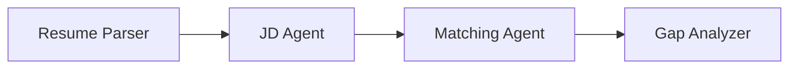
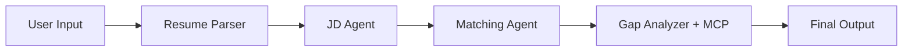

# Module 4 - Modèles d'orchestration

⏱️ ~10 min

Dans ce module, vous explorez les modèles d'orchestration utilisés dans le Resume Job Fit Evaluator et apprenez à lire, modifier et étendre le graphique de workflow. Comprendre ces modèles est essentiel pour déboguer les problèmes de flux de données et construire vos propres [workflows multi-agents](https://learn.microsoft.com/agent-framework/workflows/).

---

## Modèle 1 : Chaîne séquentielle

Le modèle fondamental dans le workflow est une **chaîne séquentielle** - la sortie de chaque agent alimente directement le suivant.



En code, chaque appel `add_edge()` crée une étape dans la chaîne :

```python
.add_edge(resume_executor, jd_executor)       # ResumeParser output → JD Agent
.add_edge(jd_executor, matching_executor)     # JD Agent output → MatchingAgent
.add_edge(matching_executor, gap_executor)    # MatchingAgent output → GapAnalyzer
```

> **Pourquoi séquentiel, pas en étoile/fusion ?** `WorkflowBuilder` utilise une **sémantique OU** pour les arêtes entrantes : un exécuteur en aval se déclenche dès que **n'importe quel** prédécesseur se termine. Si `matching_executor` avait deux arêtes entrantes (de `resume_executor` et `jd_executor`), il se déclencherait deux fois - une fois à la fin de ResumeParser et une fois à celle de JD Agent - ce qui ferait aussi exécuter GapAnalyzer deux fois et afficher deux fois la sortie. La pipeline séquentielle évite cela entièrement.

## Modèle 2 : Relais de contenu

Parce que `context_mode="last_agent"` signifie que chaque exécuteur ne voit que la sortie **de son prédécesseur direct**, les agents dans une chaîne séquentielle doivent explicitement transmettre tout contenu que les agents en aval nécessitent.

Dans ce workflow :
- **ResumeParser** copie le JD tel quel dans `[JOB DESCRIPTION PASS-THROUGH]` (pour que JD Agent puisse le retrouver).
- **JD Agent** copie le `[PARSED RESUME]` mot pour mot dans `[PARSED RESUME PASS-THROUGH]` (pour que MatchingAgent puisse comparer les deux profils).

```
ResumeParser output
└─ [PARSED RESUME]               ← extracted by JD Agent
└─ [JOB DESCRIPTION PASS-THROUGH] ← extracted by JD Agent

JD Agent output
└─ [JD REQUIREMENTS]             ← extracted by MatchingAgent
└─ [PARSED RESUME PASS-THROUGH]  ← extracted by MatchingAgent
```

Chaque section de relais doit être copiée **mot à mot** - la résumer ou la paraphraser casse l'agent en aval qui en dépend.

---

## Le graphique complet

Combiner les modèles de chaîne séquentielle et de relais de contenu produit le workflow complet :



L'Agent Inspector affiche cette même structure graphique lorsque l'agent fonctionne localement. Référez-vous au [Module 5 - Test Localement](05-test-locally.md) pour des captures d'écran.

---

## Lecture du code WorkflowBuilder

Le graphe du workflow est construit dans la fonction `main()` dans [`PersonalCareerCopilot/main.py`](../../../../../workshop/lab02-multi-agent/PersonalCareerCopilot/main.py). Les trois appels `add_edge()` construisent la pipeline séquentielle :

| # | Arête | Effet |
|---|-------|--------|
| 1 | `resume_executor → jd_executor` | JD Agent reçoit `[PARSED RESUME]` + `[JOB DESCRIPTION PASS-THROUGH]` |
| 2 | `jd_executor → matching_executor` | MatchingAgent reçoit `[JD REQUIREMENTS]` + `[PARSED RESUME PASS-THROUGH]` |
| 3 | `matching_executor → gap_executor` | GapAnalyzer reçoit rapport d'adéquation + liste de lacunes |

---

## Modification du graphe

### Ajouter un nouvel agent

Pour ajouter un cinquième agent (par ex. un **InterviewPrepAgent** après GapAnalyzer) :

1. Définir une constante `INTERVIEW_PREP_INSTRUCTIONS`.
2. Créer des objets `Agent` + `AgentExecutor` (même modèle que les quatre existants).
3. Ajouter `.add_edge(gap_executor, interview_exec)` dans `WorkflowBuilder`.
4. Mettre à jour `output_executors=[interview_exec]`.

> **Important :** `start_executor` est le seul agent recevant les entrées utilisateur brutes. Tous les autres agents reçoivent la sortie de leur arête en amont.

---

## Erreurs courantes dans le graphe

| Erreur | Symptom | Correction |
|--------|---------|------------|
| Arête manquante vers `output_executors` | L'agent tourne mais la sortie est vide | Assurez-vous qu'il y a un chemin de `start_executor` vers chaque agent dans `output_executors` |
| Dépendance circulaire | Boucle infinie ou délai d'attente | Vérifiez qu'aucun agent ne renvoie de données vers un agent en amont |
| Agent dans `output_executors` sans arête entrante | Sortie vide | Ajoutez au moins une `add_edge(source, that_agent)` |
| Plusieurs `output_executors` sans fusion | La sortie contient uniquement la réponse d'un agent | Utilisez un agent de sortie unique qui agrège, ou acceptez plusieurs sorties |
| `start_executor` manquant | `ValueError` au moment de la construction | Spécifiez toujours `start_executor` dans `WorkflowBuilder()` |

---

## Déboguer le graphe

### Utilisation de l'Agent Inspector

1. Lancez l'agent localement avec F5.
2. Ouvrez Agent Inspector (`Ctrl+Shift+P` → **Foundry Toolkit : Ouvrir Agent Inspector**).
3. Envoyez un message de test.
4. Dans le panneau de réponse de l'Inspector, cherchez la **sortie en streaming** — elle montre la contribution de chaque agent en séquence.


### Utilisation des logs

Ajoutez de la journalisation dans `main.py` pour tracer le flux de données :

```python
import logging
logger = logging.getLogger("resume-job-fit")

# In main(), after building the workflow:
logger.info("Workflow graph built with edges: RP→JD, JD→MA, MA→GA")
```

Les logs serveur montrent l'ordre d'exécution des agents et les appels aux outils MCP :

```
INFO:agent_framework:Executing agent: ResumeParser
INFO:agent_framework:Executing agent: JobDescriptionAgent
INFO:agent_framework:Executing agent: MatchingAgent
INFO:agent_framework:Executing agent: GapAnalyzer
INFO:agent_framework:Tool call: search_microsoft_learn_for_plan(skill="Kubernetes")
POST https://learn.microsoft.com/api/mcp → 200
INFO:agent_framework:Tool call: search_microsoft_learn_for_plan(skill="Terraform")
POST https://learn.microsoft.com/api/mcp → 200
```

---

### Point de contrôle

- [ ] Vous pouvez identifier les deux modèles d'orchestration dans le workflow : chaîne séquentielle et relais de contenu
- [ ] Vous comprenez pourquoi `context_mode="last_agent"` nécessite un relais explicite des données entre agents
- [ ] Vous pouvez lire le code `WorkflowBuilder` et associer chaque appel `add_edge()` au graphe visuel
- [ ] Vous savez comment ajouter un nouvel agent à la fin de la pipeline
- [ ] Vous pouvez identifier les erreurs communes dans un graphe et leurs symptômes

---

**Précédent :** [03 - Configurer Agents & Environnement](03-configure-agents.md) · **Suivant :** [05 - Tester Localement →](05-test-locally.md)

---

<!-- CO-OP TRANSLATOR DISCLAIMER START -->
**Avertissement** :
Ce document a été traduit à l'aide du service de traduction automatique [Co-op Translator](https://github.com/Azure/co-op-translator). Bien que nous nous efforçions d'assurer l'exactitude, veuillez noter que les traductions automatisées peuvent contenir des erreurs ou des inexactitudes. Le document original dans sa langue native doit être considéré comme la source faisant autorité. Pour les informations critiques, il est recommandé de recourir à une traduction professionnelle réalisée par un humain. Nous ne saurions être tenus responsables des malentendus ou erreurs d'interprétation découlant de l'utilisation de cette traduction.
<!-- CO-OP TRANSLATOR DISCLAIMER END -->