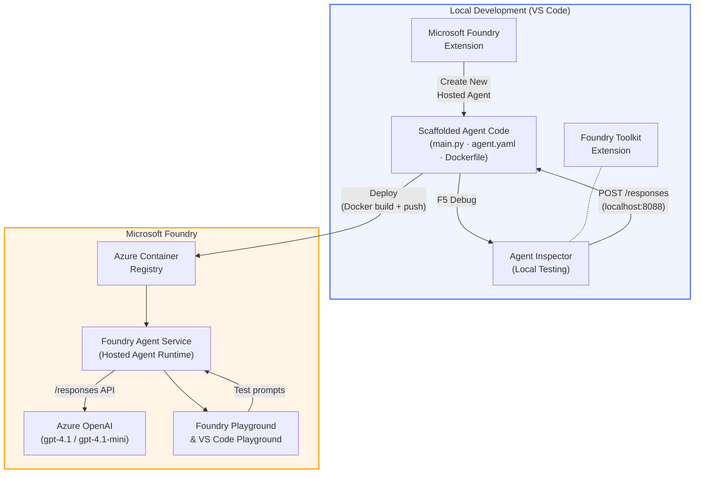

# Foundry Toolkit + סדנה: סוכנים מאוחסנים (Hosted Agents) של Foundry

[](https://www.python.org/)
[](https://github.com/microsoft/agents)
[](https://learn.microsoft.com/azure/foundry/agents/concepts/hosted-agents)
[](https://ai.azure.com/)
[](https://learn.microsoft.com/azure/ai-services/openai/)
[](https://learn.microsoft.com/cli/azure/install-azure-cli)
[](https://learn.microsoft.com/azure/developer/azure-developer-cli/install-azd)
[](https://www.docker.com/)
[](https://marketplace.visualstudio.com/items?itemName=ms-windows-ai-studio.windows-ai-studio)
[](../../LICENSE)

בנו, בדקו ופרסו סוכני בינה מלאכותית לשירות **Microsoft Foundry Agent Service** כ**סוכנים מאוחסנים** — הכל מתוך VS Code באמצעות התוסף **Microsoft Foundry** ו-**Foundry Toolkit**.

> **סוכנים מאוחסנים כרגע בגרסת תצוגה מקדימה.** האזורים הנתמכים מוגבלים - ראה [זמינות לפי אזור](https://learn.microsoft.com/azure/foundry/agents/concepts/hosted-agents#region-availability).

> התיקיה `agent/` בתוך כל מעבדה נוצרת **באופן אוטומטי** על ידי תוסף Foundry - לאחר מכן אתם מתאימים את הקוד, בודקים מקומית, ומפרסים.

### 🌐 תמיכה בריבוי שפות

#### נתמך דרך GitHub Action (ממוכן ומתעדכן תמיד)

<!-- CO-OP TRANSLATOR LANGUAGES TABLE START -->
[ערבית](../ar/README.md) | [בנגלית](../bn/README.md) | [בולגרית](../bg/README.md) | [בורמזית (מיאנמר)](../my/README.md) | [סינית (מפושטת)](../zh-CN/README.md) | [סינית (מסורתית, הונג קונג)](../zh-HK/README.md) | [סינית (מסורתית, מקאו)](../zh-MO/README.md) | [סינית (מסורתית, טייוואן)](../zh-TW/README.md) | [קרואטית](../hr/README.md) | [צ'כית](../cs/README.md) | [דנית](../da/README.md) | [הולנדית](../nl/README.md) | [אסטונית](../et/README.md) | [פינית](../fi/README.md) | [צרפתית](../fr/README.md) | [גרמנית](../de/README.md) | [יוונית](../el/README.md) | [עברית](./README.md) | [הינדי](../hi/README.md) | [הונגרית](../hu/README.md) | [אינדונזית](../id/README.md) | [איטלקית](../it/README.md) | [יפנית](../ja/README.md) | [Kannada](../kn/README.md) | [חמרית](../km/README.md) | [קוריאנית](../ko/README.md) | [ליטאית](../lt/README.md) | [מלאית](../ms/README.md) | [מלאיאלאם](../ml/README.md) | [מראטי](../mr/README.md) | [נפאלית](../ne/README.md) | [ניגרית פיג'ין](../pcm/README.md) | [נורווגית](../no/README.md) | [פרסית (פארסי)](../fa/README.md) | [פולנית](../pl/README.md) | [פורטוגזית (ברזילאית)](../pt-BR/README.md) | [פורטוגזית (פורטוגל)](../pt-PT/README.md) | [פנג'אבי (גורמוקי)](../pa/README.md) | [רומנית](../ro/README.md) | [רוסית](../ru/README.md) | [סרבית (קירילית)](../sr/README.md) | [סלובקית](../sk/README.md) | [סלובנית](../sl/README.md) | [ספרדית](../es/README.md) | [סווהילי](../sw/README.md) | [שוודית](../sv/README.md) | [טגלוג (פיליפינית)](../tl/README.md) | [טמילית](../ta/README.md) | [טלוגו](../te/README.md) | [תאית](../th/README.md) | [טורקית](../tr/README.md) | [אוקראינית](../uk/README.md) | [אורדו](../ur/README.md) | [וייטנאמית](../vi/README.md)

> **מעדיפים לשכפל באופן מקומי?**
>
> מאגר זה כולל מעל 50 תרגומים לשפות, מה שמגדיל משמעותית את גודל ההורדה. כדי לשכפל ללא תרגומים, השתמשו ב-sparse checkout:
>
> **Bash / macOS / Linux:**
> ```bash
> git clone --filter=blob:none --sparse https://github.com/microsoft-foundry/Foundry_Toolkit_for_VSCode_Lab.git
> cd Foundry_Toolkit_for_VSCode_Lab
> git sparse-checkout set --no-cone '/*' '!translations' '!translated_images'
> ```
>
> **CMD (Windows):**
> ```cmd
> git clone --filter=blob:none --sparse https://github.com/microsoft-foundry/Foundry_Toolkit_for_VSCode_Lab.git
> cd Foundry_Toolkit_for_VSCode_Lab
> git sparse-checkout set --no-cone "/*" "!translations" "!translated_images"
> ```
>
> זה נותן לכם את כל מה שאתם צריכים כדי להשלים את הקורס עם הורדה מהירה יותר.
<!-- CO-OP TRANSLATOR LANGUAGES TABLE END -->

---

## ארכיטקטורה



**תהליך:** תוסף Foundry יוצר את השלד של הסוכן → אתם מתאימים את הקוד וההוראות → בודקים מקומית עם Agent Inspector → מפרסים ל-Foundry (תמונת Docker נדחפת ל-ACR) → מאמתים ב-Playground.

---

## מה שתבנו

| מעבדה | תיאור | סטטוס |
|-----|-------------|--------|
| **Lab 01 - Single Agent** | בנו את הסוכן **"הסבר כאילו אני מנהל בכיר"**, בדקו אותו מקומית והפרסו ל-Foundry | ✅ זמין |
| **Lab 02 - Multi-Agent Workflow** | בנו את **"מבדק התאמת קורות חיים למשרה"** - ארבעה סוכנים משתפים פעולה כדי לדרג את התאמת הקורות וליצור מפת דרכים ללמידה | ✅ זמין |

---

## הכירו את הסוכן למנהלים

בסדנה זו תבנו את הסוכן **"הסבר כאילו אני מנהל בכיר"** — סוכן בינה מלאכותית שלוקח ז'רגון טכני מסובך ומתרגם אותו לסיכומים רגועים, מוכנים לחדר הישיבות. כי בואו נודה על האמת, אף אחד בדרג הניהולי הבכיר לא רוצה לשמוע על "thread pool exhaustion שנגרמה על ידי קריאות סינכרוניות שהוכנסו ב-v3.2."

בניתי את הסוכן הזה אחרי יותר מדי תקריות שבהן הפוסט־מורתם שהכנתי בקפידה קיבל את התגובה: *"אז... האתר למטה או לא?"*

### איך זה עובד

אתם מזינים עדכון טכני. הוא מחזיר סיכום למנהלים - שלוש נקודות בולטות, בלי ז'רגון, בלי stack traces, בלי תחושת אימה קיומית. רק **מה קרה**, **השפעה עסקית**, ו**הצעד הבא**.

### ראו זאת בפעולה

**אתה אומר:**
> "The API latency increased due to thread pool exhaustion caused by synchronous calls introduced in v3.2."

**הסוכן משיב:**

> **סיכום למנהלים:**
> - **מה קרה:** לאחר השחרור האחרון, המערכת האטה.
> - **השפעה עסקית:** חלק מהמשתמשים חוו עיכובים בשימוש בשירות.
> - **הצעד הבא:** השינוי הוחזר וכעת מתכוננים תיקון לפני פריסה מחודשת.

### למה הסוכן הזה?

זה סוכן פשוט להפליא, מטרה יחידה — מושלם ללמידת תהליך העבודה של סוכנים מאוחסנים מקצה לקצה מבלי להיקשר בשרשראות כלים מורכבות. ובכנות? כל צוות הנדסי יכול להיעזר באחד כזה.

---

## מבנה הסדנה

```
📂 Foundry_Toolkit_for_VSCode_Lab/
├── 📄 README.md                      ← You are here
└── 📂 workshop/
    ├── 📂 lab01-single-agent/        ← Full lab: docs + agent code
    │   ├── README.md                 ← Hands-on lab instructions
    │   ├── 📂 docs/                  ← Step-by-step tutorial modules
    │   │   ├── 00-prerequisites.md
    │   │   ├── 01-setup.md
    │   │   ├── 02-create-hosted-agent.md
    │   │   ├── 03-configure-and-code.md
    │   │   ├── 04-test-locally.md
    │   │   ├── 05-deploy-to-foundry.md
    │   │   ├── 06-verify-in-playground.md
    │   │   ├── 07-summary.md
    │   │   └── 08-troubleshooting.md
    │   └── 📂 agent/                 ← Reference solution (auto-scaffolded by Foundry extension)
    │       ├── agent.yaml
    │       ├── Dockerfile
    │       ├── main.py
    │       └── requirements.txt
    └── 📂 lab02-multi-agent/         ← Resume → Job Fit Evaluator
        ├── README.md                 ← Hands-on lab instructions (end-to-end)
        ├── 📂 docs/                  ← Step-by-step tutorial modules
        │   ├── 00-prerequisites.md
        │   ├── 01-understand-multi-agent.md
        │   ├── 02-scaffold-multi-agent.md
        │   ├── 03-configure-agents.md
        │   ├── 04-orchestration-patterns.md
        │   ├── 05-test-locally.md
        │   ├── 06-deploy-to-foundry.md
        │   ├── 07-verify-in-playground.md
        │   └── 08-troubleshooting.md
        └── 📂 PersonalCareerCopilot/ ← Reference solution (multi-agent workflow)
            ├── agent.yaml
            ├── Dockerfile
            ├── main.py
            └── requirements.txt
```

> **הערה:** התיקיה `agent/` בתוך כל מעבדה היא מה שהתוסף **Microsoft Foundry** מייצר כאשר אתם מריצים את `Microsoft Foundry: Create a New Hosted Agent` מתוך לוח הפקודות. הקבצים לאחר מכן מותאמים עם ההוראות, הכלים והקונפיגורציה של הסוכן שלכם. מעבדה 01 מנחה אתכם כיצד ליצור זאת מאפס.

---

## איך להתחיל

### 1. שכפל את המאגר

```bash
git clone https://github.com/microsoft-foundry/Foundry_Toolkit_for_VSCode_Lab.git
cd Foundry_Toolkit_for_VSCode_Lab
```

### 2. יצירת סביבת Python וירטואלית

```bash
python -m venv venv
```

הפעלו אותה:

- **Windows (PowerShell):**
  ```powershell
  .\venv\Scripts\Activate.ps1
  ```
- **macOS / Linux:**
  ```bash
  source venv/bin/activate
  ```

### 3. התקנת התלויות

```bash
pip install -r workshop/lab01-single-agent/agent/requirements.txt
```

### 4. הגדרת משתני סביבה

העתקו את קובץ הדוגמה `.env` לתוך תיקיית הסוכן ומלאו את הערכים שלכם:

```bash
cp workshop/lab01-single-agent/agent/.env.example workshop/lab01-single-agent/agent/.env
```

ערכו את `workshop/lab01-single-agent/agent/.env`:

```env
AZURE_AI_PROJECT_ENDPOINT=https://<your-account>.services.ai.azure.com/api/projects/<your-project>
AZURE_AI_MODEL_DEPLOYMENT_NAME=<your-model-deployment-name>
```

### 5. עקבו אחר מעבדות הסדנה

כל מעבדה עצמאית עם המודולים שלה. התחילו ב**מעבדה 01** כדי ללמוד את היסודות, ואז עברו ל**מעבדה 02** עבור תהליכי עבודה רב-סוכניים.

#### מעבדה 01 - סוכן יחיד ([הוראות מלאות](workshop/lab01-single-agent/README.md))

| # | מודול | קישור |
|---|--------|------|
| 1 | קראו את הדרישות המקדימות | [00-prerequisites.md](workshop/lab01-single-agent/docs/00-prerequisites.md) |
| 2 | התקינו את Foundry Toolkit ואת תוסף Foundry | [01-setup.md](workshop/lab01-single-agent/docs/01-setup.md) |
| 3 | צרו פרויקט Foundry | [01-setup.md](workshop/lab01-single-agent/docs/01-setup.md) |
| 4 | צרו סוכן מאוחסן | [02-create-hosted-agent.md](workshop/lab01-single-agent/docs/02-create-hosted-agent.md) |
| 5 | קבעו הוראות וסביבה | [03-configure-and-code.md](workshop/lab01-single-agent/docs/03-configure-and-code.md) |
| 6 | בדקו מקומית | [04-test-locally.md](workshop/lab01-single-agent/docs/04-test-locally.md) |
| 7 | פרסו ל-Foundry | [05-deploy-to-foundry.md](workshop/lab01-single-agent/docs/05-deploy-to-foundry.md) |
| 8 | אימתו ב-playground | [06-verify-in-playground.md](workshop/lab01-single-agent/docs/06-verify-in-playground.md) |
| 9 | פתרון בעיות | [08-troubleshooting.md](workshop/lab01-single-agent/docs/08-troubleshooting.md) |

#### מעבדה 02 - תהליך עבודה רב-סוכני ([הוראות מלאות](workshop/lab02-multi-agent/README.md))

| # | מודול | קישור |
|---|--------|------|
| 1 | דרישות מקדימות (מעבדה 02) | [00-prerequisites.md](workshop/lab02-multi-agent/docs/00-prerequisites.md) |
| 2 | הבינו את ארכיטקטורת הריבוי-סוכנים | [01-understand-multi-agent.md](workshop/lab02-multi-agent/docs/01-understand-multi-agent.md) |
| 3 | בנו את השלד לפרויקט רב-סוכני | [02-scaffold-multi-agent.md](workshop/lab02-multi-agent/docs/02-scaffold-multi-agent.md) |
| 4 | קונפיגרו את הסוכנים והסביבה | [03-configure-agents.md](workshop/lab02-multi-agent/docs/03-configure-agents.md) |
| 5 | דפוסי אורקסטרציה | [04-orchestration-patterns.md](workshop/lab02-multi-agent/docs/04-orchestration-patterns.md) |
| 6 | בדקו מקומית (ריבוי-סוכנים) | [05-test-locally.md](workshop/lab02-multi-agent/docs/05-test-locally.md) |
| 7 | פרסו ל-Foundry | [06-deploy-to-foundry.md](workshop/lab02-multi-agent/docs/06-deploy-to-foundry.md) |
| 8 | אימתו ב-playground | [07-verify-in-playground.md](workshop/lab02-multi-agent/docs/07-verify-in-playground.md) |
| 9 | פתרון בעיות (ריבוי-סוכנים) | [08-troubleshooting.md](workshop/lab02-multi-agent/docs/08-troubleshooting.md) |

---

## אחראי תחזוקה

<table>
<tr>
    <td align="center"><a href="https://github.com/ShivamGoyal03">
        <br />
        <sub><b>Shivam Goyal</b></sub>
    </a><br />
    </td>
</tr>
</table>

---

## ההרשאות הנדרשות (עיון מהיר)

| תרחיש | תפקידים נדרשים |
|----------|---------------|
| יצירת פרויקט Foundry חדש | **Azure AI Owner** על משאב Foundry |
| פריסה לפרויקט קיים (משאבים חדשים) | **Azure AI Owner** + **Contributor** על המנוי |
| פריסה לפרויקט מוגדר במלואו | **Reader** על החשבון + **Azure AI User** על הפרויקט |

> **חשוב:** התפקידים Azure `Owner` ו-`Contributor` כוללים רק הרשאות *ניהוליות*, לא הרשאות *פיתוח* (פעולות נתונים). אתם זקוקים ל-**Azure AI User** או **Azure AI Owner** כדי לבנות ולפרוס סוכנים.

---

## מקורות

- [התחלה מהירה: פרוס את הסוכן המאוחסן הראשון שלך (VS Code)](https://learn.microsoft.com/azure/foundry/agents/quickstarts/quickstart-hosted-agent)
- [מהם סוכנים מאוחסנים?](https://learn.microsoft.com/azure/foundry/agents/concepts/hosted-agents)
- [צור זרימות עבודה של סוכנים מאוחסנים ב-VS Code](https://learn.microsoft.com/azure/foundry/agents/how-to/vs-code-agents-workflow-pro-code)
- [פרוס סוכן מאוחסן](https://learn.microsoft.com/azure/foundry/agents/how-to/deploy-hosted-agent)
- [RBAC עבור Microsoft Foundry](https://learn.microsoft.com/azure/foundry/concepts/rbac-foundry)
- [דוגמת סוכן לסקירת ארכיטקטורה](https://github.com/Azure-Samples/agent-architecture-review-sample) - סוכן מאוחסן מהעולם האמיתי עם כלי MCP, דיאגרמות Excalidraw ופריסה כפולה

---


## רישיון

[MIT](../../LICENSE)

---

<!-- CO-OP TRANSLATOR DISCLAIMER START -->
**כתב ויתור**:
מסמך זה תורגם באמצעות שירות תרגום אוטומטי [Co-op Translator](https://github.com/Azure/co-op-translator). למרות שאנו שואפים לדיוק, יש לקחת בחשבון שתרגומים אוטומטיים עלולים להכיל שגיאות או אי-דיוקים. יש להחשיב את המסמך המקורי בשפתו הטבעית כמקור הסמכות. למידע קריטי מומלץ להשתמש בתרגום מקצועי על ידי מתרגם אדם. אנו לא אחראים לכל אי-הבנה או פירוש שגוי הנובע מהשימוש בתרגום זה.
<!-- CO-OP TRANSLATOR DISCLAIMER END -->
