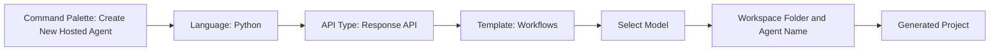

# מודול 2 - בניית תשתית לפרויקט רב-סוכנים

⏱️ ~5 דקות

במודול זה, השתמשו ב[Foundry Toolkit עבור VS Code](https://aka.ms/foundrytk) כדי **ליצור תבנית לפרויקט רב-סוכנים**. האשף יוצר `agent.yaml`, `main.py`, `Dockerfile`, `requirements.txt`, `.env`, ותצורת ניפוי שגיאות ל‑VS Code — כך תוכלו להתמקד בחיבור תהליך העבודה של 4 סוכנים במודול 3.

> **מושג מרכזי:** התבנית היא דוגמת עבודה עם סוכן אחד. תחליפו את הלוגיקה הממלאת מקום בגרף `WorkflowBuilder` במודול 3. לא תצטרכו לכתוב את הקוד השגרתי מאפס.

> **מימוש לדוגמה:** [`PersonalCareerCopilot/`](../../../../../workshop/lab02-multi-agent/PersonalCareerCopilot) הוא דוגמה עובדת מלאה. השתמשו בו כדי להשוות את עבודתכם תוך כדי עבודה.

### מהלך אשף יצירת התבנית



---

## שלב 1: פתח את אשף יצירת סוכן מאוחסן

1. לחץ על `Ctrl+Shift+P` כדי לפתוח את **לוח הפקודות**.
2. Type: **Foundry Toolkit: Create a New Hosted Agent** and select it.
3. האשף נפתח בכרטיסיית **פרטי הסוכן**.

> **חלופה:** לחץ על סמל **Foundry Toolkit** בסרגל הפעילויות → לחץ על סמל **+** לצד **סוכנים מאוחסנים** → **Create New Hosted Agent**.

---

## שלב 2: בחר הגדרות


1. בחלק הניווט/אפשרויות משמאל בחר את הפריטים הבאים:

| תפריט | בחירה | הערות |
|--------|-----------|-------|
| **שפה** | Python | תומך גם ב‑C# (.NET) |
| **מסגרת עבודה** | Agent Framework | מספקת `Agent`, `AgentExecutor`, `WorkflowBuilder` |
| **סוג API** | Response API | `POST /responses` - היסטוריה מנוהלת על ידי הפלטפורמה, תמיכה בסטרימינג |
| **תבנית** | **Workflows** | מעבד בקשות דרך מספר סוכנים ברצף |

2. לאחר הבחירה, לחץ על **Next**


3. בחלון הבא, בחר את הפריטים הבאים:

| תפריט | בחירה | הערות |
|--------|-----------|-------|
| **תיקיית עבודה** | דפדף אל תיקיית היעד | לדוגמה, `workshop/lab02-multi-agent/` במאגר זה |
| **שם הסוכן** | `PersonalCareerCopilot` | זה יהפוך לשם תיקיית הפרויקט |
| **פריסת המודל** | בחר את המודל שהפרסת | לדוגמה, `gpt-4.1-mini` מ‑Lab 01 |

4. Click **Create** to scaffold the project. VS Code generates the files and opens the folder.

> **טיפ:** [`gpt-4.1-mini`](https://learn.microsoft.com/azure/foundry/foundry-models/concepts/models-sold-directly-by-azure#gpt-41-series) מאזנת היטב בין מהירות לאיכות לפיתוח רב-סוכני.

---

## שלב 3: בדקו את הפרויקט שנוצר

לאחר השלמת יצירת התבנית, וודאו שאתם רואים קבצים אלה ב‑Explorer (`Ctrl+Shift+E`):

```
📂 <your-agent-name>/
├── .azdignore          ← Files excluded from Azure Developer CLI deployments
├── .dockerignore       ← Files excluded from Docker builds
├── .env                ← Environment variables (placeholders - fill in Module 3)
├── .vscode/
│   ├── launch.json     ← Debug config (F5 → run + Agent Inspector)
│   └── tasks.json      ← VS Code task definitions
├── agent.yaml          ← Agent definition (kind: hosted, protocol: responses)
├── Dockerfile          ← Container config for deployment
├── main.py             ← Stub agent entry point (replace with WorkflowBuilder in Module 3)
└── requirements.txt    ← Python dependencies
```

> **חשוב:** פתחו את התיקייה שהתבנית נוצרה בה ישירות ב‑VS Code כך ש־`.vscode/launch.json` ו‑`tasks.json` יחולו כראוי עבור ניפוי שגיאות ב‑F5.

### הסבר על הקבצים המרכזיים

| קובץ | מטרה |
|------|---------|
| `agent.yaml` | מכריז על `kind: hosted`, ממפה משתני סביבה, ומגדיר את פרוטוקול `/responses` |
| `main.py` | סטאב: אחד `FoundryChatClient` → `Agent` → `ResponsesHostServer`. החלף זאת ב-4 סוכנים + `WorkflowBuilder` במודול 3 |
| `Dockerfile` | `python:3.12-slim`, מתקין `requirements.txt`, חושף פורט 8088, מריץ `python main.py` |
| `requirements.txt` | `agent-framework-foundry`, `agent-framework-foundry-hosting`, `mcp<2,>=1.24.0`, `debugpy` |

> **הפניה:** ראה [`PersonalCareerCopilot/agent.yaml`](../../../../../workshop/lab02-multi-agent/PersonalCareerCopilot/agent.yaml) ו-[`PersonalCareerCopilot/requirements.txt`](../../../../../workshop/lab02-multi-agent/PersonalCareerCopilot/requirements.txt) לתוכן המלא שנוצר.

---

### ✅ נקודת בדיקה

- [ ] אשף ה-Scaffold הושלם - תיקיית הפרויקט החדשה נראית ב-Explorer
- [ ] כל הקבצים הצפויים קיימים: `agent.yaml`, `main.py`, `Dockerfile`, `requirements.txt`, `.env`
- [ ] `agent.yaml` מציג `kind: hosted` ו-`protocol: responses`
- [ ] `main.py` מייבא `Agent`, `FoundryChatClient`, `ResponsesHostServer`
- [ ] תיקיית ה-scaffold פתוחה כשורש סביבת העבודה ב-VS Code
- [ ] יש להבין כי `main.py` הוא סטאב - `WorkflowBuilder` נוסף במודול 3

---

**הקודם:** [01 - הבן את ארכיטקטורת רב-סוכנים](01-understand-multi-agent.md) · **הבא:** [03 - הגדר סוכנים וסביבה →](03-configure-agents.md)

---

<!-- CO-OP TRANSLATOR DISCLAIMER START -->
**כתב ויתור**:
מסמך זה תורגם באמצעות שירות תרגום אוטומטי [Co-op Translator](https://github.com/Azure/co-op-translator). למרות שאנו שואפים לדיוק, יש לקחת בחשבון שתרגומים אוטומטיים עלולים להכיל שגיאות או אי-דיוקים. יש להחשיב את המסמך המקורי בשפתו הטבעית כמקור הסמכות. למידע קריטי מומלץ להשתמש בתרגום מקצועי על ידי מתרגם אדם. אנו לא אחראים לכל אי-הבנה או פירוש שגוי הנובע מהשימוש בתרגום זה.
<!-- CO-OP TRANSLATOR DISCLAIMER END -->