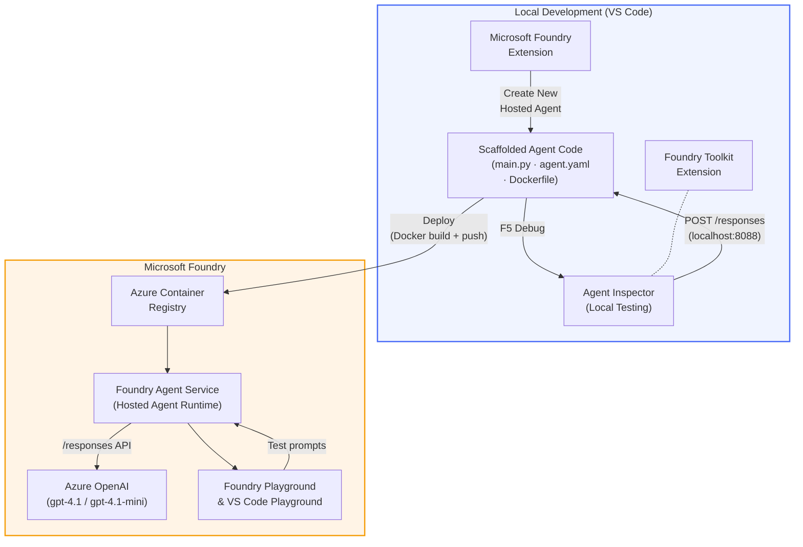

# Foundry Toolkit + Foundry Hosted Agents कार्यशाला

[](https://www.python.org/)
[](https://learn.microsoft.com/agent-framework/)
[](https://learn.microsoft.com/azure/foundry/agents/concepts/hosted-agents)
[](https://ai.azure.com/)
[](https://learn.microsoft.com/azure/ai-services/openai/)
[](https://learn.microsoft.com/cli/azure/install-azure-cli)
[](https://learn.microsoft.com/azure/developer/azure-developer-cli/install-azd)
[](https://www.docker.com/)
[](https://marketplace.visualstudio.com/items?itemName=ms-windows-ai-studio.windows-ai-studio)
[](LICENSE)

AI एजेंट्स को **Microsoft Foundry Agent Service** पर **Hosted Agents** के रूप में बिल्ड, टेस्ट और डिप्लॉय करें - पूरी तरह से VS Code का उपयोग करके **Microsoft Foundry एक्सटेंशन** और **Foundry Toolkit** के साथ।

> **Hosted Agents वर्तमान में प्रीव्यू में हैं।** समर्थित क्षेत्र सीमित हैं - देखें [क्षेत्र उपलब्धता](https://learn.microsoft.com/azure/foundry/agents/concepts/hosted-agents#region-availability)।

> प्रत्येक लैब के अंदर `agent/` फ़ोल्डर को Foundry एक्सटेंशन द्वारा **स्वचालित रूप से स्कैफोल्ड किया जाता है** - आप फिर कोड को अनुकूलित करते हैं, स्थानीय रूप से परीक्षण करते हैं, और डिप्लॉय करते हैं।

### 🌐 मल्टी-भाषा समर्थन

#### GitHub Action के माध्यम से समर्थित (स्वचालित और हमेशा अपडेट)

<!-- CO-OP TRANSLATOR LANGUAGES TABLE START -->
[Arabic](../ar/README.md) | [Bengali](../bn/README.md) | [Bulgarian](../bg/README.md) | [Burmese (Myanmar)](../my/README.md) | [Chinese (Simplified)](../zh-CN/README.md) | [Chinese (Traditional, Hong Kong)](../zh-HK/README.md) | [Chinese (Traditional, Macau)](../zh-MO/README.md) | [Chinese (Traditional, Taiwan)](../zh-TW/README.md) | [Croatian](../hr/README.md) | [Czech](../cs/README.md) | [Danish](../da/README.md) | [Dutch](../nl/README.md) | [Estonian](../et/README.md) | [Finnish](../fi/README.md) | [French](../fr/README.md) | [German](../de/README.md) | [Greek](../el/README.md) | [Hebrew](../he/README.md) | [Hindi](./README.md) | [Hungarian](../hu/README.md) | [Indonesian](../id/README.md) | [Italian](../it/README.md) | [Japanese](../ja/README.md) | [Kannada](../kn/README.md) | [Khmer](../km/README.md) | [Korean](../ko/README.md) | [Lithuanian](../lt/README.md) | [Malay](../ms/README.md) | [Malayalam](../ml/README.md) | [Marathi](../mr/README.md) | [Nepali](../ne/README.md) | [Nigerian Pidgin](../pcm/README.md) | [Norwegian](../no/README.md) | [Persian (Farsi)](../fa/README.md) | [Polish](../pl/README.md) | [Portuguese (Brazil)](../pt-BR/README.md) | [Portuguese (Portugal)](../pt-PT/README.md) | [Punjabi (Gurmukhi)](../pa/README.md) | [Romanian](../ro/README.md) | [Russian](../ru/README.md) | [Serbian (Cyrillic)](../sr/README.md) | [Slovak](../sk/README.md) | [Slovenian](../sl/README.md) | [Spanish](../es/README.md) | [Swahili](../sw/README.md) | [Swedish](../sv/README.md) | [Tagalog (Filipino)](../tl/README.md) | [Tamil](../ta/README.md) | [Telugu](../te/README.md) | [Thai](../th/README.md) | [Turkish](../tr/README.md) | [Ukrainian](../uk/README.md) | [Urdu](../ur/README.md) | [Vietnamese](../vi/README.md)

> **स्थानीय रूप से क्लोन करना पसंद है?**
>
> इस रिपॉजिटरी में 50+ भाषा अनुवाद शामिल हैं जो डाउनलोड आकार को काफी बढ़ाते हैं। बिना अनुवाद के क्लोन करने के लिए, sparse checkout का उपयोग करें:
>
> **Bash / macOS / Linux:**
> ```bash
> git clone --filter=blob:none --sparse https://github.com/microsoft-foundry/Foundry_Toolkit_for_VSCode_Lab.git
> cd Foundry_Toolkit_for_VSCode_Lab
> git sparse-checkout set --no-cone '/*' '!translations' '!translated_images'
> ```
>
> **CMD (Windows):**
> ```cmd
> git clone --filter=blob:none --sparse https://github.com/microsoft-foundry/Foundry_Toolkit_for_VSCode_Lab.git
> cd Foundry_Toolkit_for_VSCode_Lab
> git sparse-checkout set --no-cone "/*" "!translations" "!translated_images"
> ```
>
> यह आपको कोर्स पूरा करने के लिए आवश्यक सभी चीजें देता है लेकिन बहुत तेजी से डाउनलोड के साथ।
<!-- CO-OP TRANSLATOR LANGUAGES TABLE END -->

---

## वास्तुकला



**प्रवाह:** Foundry एक्सटेंशन एजेंट का स्कैफोल्ड करता है → आप कोड और निर्देश अनुकूलित करते हैं → Agent Inspector के साथ स्थानीय रूप से परीक्षण करते हैं → Foundry पर डिप्लॉय करते हैं (Docker इमेज ACR पर पुश) → Playground में सत्यापित करते हैं।

---

## आप क्या बनाएंगे

| लैब | विवरण | स्थिति |
|-----|-------------|--------|
| **लैब 01 - सिंगल एजेंट** | **"Explain Like I'm an Executive" एजेंट** बनाएँ, स्थानीय रूप से टेस्ट करें, और Foundry पर डिप्लॉय करें | ✅ उपलब्ध |
| **लैब 02 - मल्टी-एजेंट वर्कफ़्लो** | **"Resume → Job Fit Evaluator"** बनाएं - 4 एजेंट्स मिलकर फिर से शुरू फिट को स्कोर करते हैं और एक सीखने का रोडमैप तैयार करते हैं | ✅ उपलब्ध |

---

## Executive Agent से मिलें

इस कार्यशाला में आप **"Explain Like I'm an Executive" एजेंट** बनाएंगे - एक AI एजेंट जो पेचीदा तकनीकी भाषावली को सरल, बोर्डरूम में प्रस्तुत करने योग्य सारांशों में अनुवादित करता है। क्योंकि असल में, C-suite में कोई भी "थ्रेड पूल एक्सॉर्शन जिसकी वजह से v3.2 में सिंक्रोनस कॉल्स हुईं" जैसी बातें सुनना नहीं चाहता।

मैंने यह एजेंट कई बार अनुचित प्रतिक्रियाओं के कारण बनाया जब मेरी पूरी तरह से तैयार पोस्ट-मार्टेम का जवाब था: *"तो... वेबसाइट डाउन है या नहीं?"*

### यह कैसे काम करता है

आप इसे तकनीकी अपडेट देते हैं। यह एक कार्यकारी सारांश देता है - तीन बुलेट पॉइंट्स, बिना जटिल शब्दों, बिना स्टैक ट्रेसेस, बिना निराशा के। सिर्फ **क्या हुआ**, **व्यापार पर प्रभाव**, और **अगला कदम**।

### इसे क्रियाशील देखें

**आप कहते हैं:**
> "API विलंबता v3.2 में पेश किये गए सिंक्रोनस कॉल्स की वजह से थ्रेड पूल एक्सॉर्शन के कारण बढ़ गई।"

**एजेंट जवाब देता है:**

> **कार्यकारी सारांश:**
> - **क्या हुआ:** नवीनतम रिलीज के बाद सिस्टम धीमा हो गया।
> - **व्यापार प्रभाव:** कुछ उपयोगकर्ताओं को सेवा के उपयोग में देरी का सामना करना पड़ा।
> - **अगला कदम:** परिवर्तन को वापस ले लिया गया है और फिर से डिप्लॉयमेंट से पहले समाधान तैयार किया जा रहा है।

### यह एजेंट क्यों?

यह एक आसान, एकल उद्देश्य एजेंट है - होस्टेड एजेंट वर्कफ़्लो को बिना जटिल टूल चेन में उलझे अंत से अंत तक सीखने के लिए परिपूर्ण। और ईमानदारी से कहूं? हर इंजीनियरिंग टीम को इनमें से एक की जरूरत होती है।

---

## कार्यशाला संरचना

```
📂 Foundry_Toolkit_for_VSCode_Lab/
├── 📄 README.md                      ← You are here
└── 📂 workshop/
    ├── 📂 lab01-single-agent/        ← Full lab: docs + agent code
    │   ├── README.md                 ← Hands-on lab instructions
    │   ├── 📂 docs/                  ← Step-by-step tutorial modules
    │   │   ├── 00-prerequisites.md
    │   │   ├── 01-setup.md
    │   │   ├── 02-create-hosted-agent.md
    │   │   ├── 03-configure-and-code.md
    │   │   ├── 04-test-locally.md
    │   │   ├── 05-deploy-to-foundry.md
    │   │   ├── 06-verify-in-playground.md
    │   │   ├── 07-summary.md
    │   │   └── 08-troubleshooting.md
    │   └── 📂 agent/                 ← Reference solution (auto-scaffolded by Foundry extension)
    │       ├── agent.yaml
    │       ├── Dockerfile
    │       ├── main.py
    │       └── requirements.txt
    └── 📂 lab02-multi-agent/         ← Resume → Job Fit Evaluator
        ├── README.md                 ← Hands-on lab instructions (end-to-end)
        ├── 📂 docs/                  ← Step-by-step tutorial modules
        │   ├── 00-prerequisites.md
        │   ├── 01-understand-multi-agent.md
        │   ├── 02-scaffold-multi-agent.md
        │   ├── 03-configure-agents.md
        │   ├── 04-orchestration-patterns.md
        │   ├── 05-test-locally.md
        │   ├── 06-deploy-to-foundry.md
        │   ├── 07-verify-in-playground.md
        │   ├── 08-troubleshooting.md
        │   └── 09-summary.md
        └── 📂 PersonalCareerCopilot/ ← Reference solution (multi-agent workflow)
            ├── agent.yaml
            ├── Dockerfile
            ├── main.py
            └── requirements.txt
```

> **टिप्पणी:** प्रत्येक लैब के अंदर `agent/` फ़ोल्डर वह है जो **Microsoft Foundry एक्सटेंशन** कमांड पैलेट से `Microsoft Foundry: Create a New Hosted Agent` चलाने पर जनरेट करता है। फिर उन फ़ाइलों को आपके एजेंट के निर्देश, टूल्स, और कॉन्फ़िगरेशन के साथ अनुकूलित किया जाता है। लैब 01 आपको इसे सम्पूर्ण रूप से स्क्रैच से पुनः बनाने के लिए मार्गदर्शन करता है।

---

## शुरू करते हैं

### 1. रिपॉजिटरी क्लोन करें

```bash
git clone https://github.com/microsoft-foundry/Foundry_Toolkit_for_VSCode_Lab.git
cd Foundry_Toolkit_for_VSCode_Lab
```

### 2. Python वर्चुअल एनवायरनमेंट सेटअप करें

```bash
python -m venv venv
```

इसे सक्रिय करें:

- **Windows (PowerShell):**
  ```powershell
  .\venv\Scripts\Activate.ps1
  ```
- **macOS / Linux:**
  ```bash
  source venv/bin/activate
  ```

### 3. डिपेंडेंसीज इंस्टॉल करें

```bash
pip install -r workshop/lab01-single-agent/agent/requirements.txt
```

### 4. एनवायरनमेंट वेरिएबल्स कॉन्फ़िगर करें

एजेंट फ़ोल्डर के अंदर उदाहरण `.env` फ़ाइल कॉपी करें और अपने मान भरें:

```bash
cp workshop/lab01-single-agent/agent/.env.example workshop/lab01-single-agent/agent/.env
```

`workshop/lab01-single-agent/agent/.env` संपादित करें:

```env
FOUNDRY_PROJECT_ENDPOINT=https://<your-account>.services.ai.azure.com/api/projects/<your-project>
AZURE_AI_MODEL_DEPLOYMENT_NAME=<your-model-deployment-name>
```

### 5. कार्यशाला के लैब्स का पालन करें

प्रत्येक लैब अपने मॉड्यूल के साथ स्व-निहित है। मूल बातें सीखने के लिए **लैब 01** से शुरू करें, फिर मल्टी-एजेंट वर्कफ़्लो के लिए **लैब 02** पर जाएं।

#### लैब 01 - सिंगल एजेंट ([पूर्ण निर्देश](workshop/lab01-single-agent/README.md))

| # | मॉड्यूल | लिंक |
|---|--------|------|
| १ | आवश्यकताएँ पढ़ें | [00-prerequisites.md](workshop/lab01-single-agent/docs/00-prerequisites.md) |
| २ | Foundry Toolkit & Foundry एक्सटेंशन इंस्टॉल करें | [01-setup.md](workshop/lab01-single-agent/docs/01-setup.md) |
| ३ | एक Foundry प्रोजेक्ट बनाएं | [01-setup.md](workshop/lab01-single-agent/docs/01-setup.md) |
| ४ | एक होस्टेड एजेंट बनाएं | [02-create-hosted-agent.md](workshop/lab01-single-agent/docs/02-create-hosted-agent.md) |
| ५ | निर्देश और एनवायरनमेंट कॉन्फ़िगर करें | [03-configure-and-code.md](workshop/lab01-single-agent/docs/03-configure-and-code.md) |
| ६ | स्थानीय रूप से टेस्ट करें | [04-test-locally.md](workshop/lab01-single-agent/docs/04-test-locally.md) |
| ७ | Foundry पर डिप्लॉय करें | [05-deploy-to-foundry.md](workshop/lab01-single-agent/docs/05-deploy-to-foundry.md) |
| ८ | प्लेग्राउंड में सत्यापित करें | [06-verify-in-playground.md](workshop/lab01-single-agent/docs/06-verify-in-playground.md) |
| ९ | सारांश और अगले कदम | [07-summary.md](workshop/lab01-single-agent/docs/07-summary.md) |
| १० | समस्या निवारण | [08-troubleshooting.md](workshop/lab01-single-agent/docs/08-troubleshooting.md) |

#### लैब 02 - मल्टी-एजेंट वर्कफ़्लो ([पूर्ण निर्देश](workshop/lab02-multi-agent/README.md))

| # | मॉड्यूल | लिंक |
|---|--------|------|
| १ | पूर्वापेक्षाएँ (लैब 02) | [00-prerequisites.md](workshop/lab02-multi-agent/docs/00-prerequisites.md) |
| २ | मल्टी-एजेंट वास्तुकला समझें | [01-understand-multi-agent.md](workshop/lab02-multi-agent/docs/01-understand-multi-agent.md) |
| ३ | मल्टी-एजेंट प्रोजेक्ट स्कैफोल्ड करें | [02-scaffold-multi-agent.md](workshop/lab02-multi-agent/docs/02-scaffold-multi-agent.md) |
| ४ | एजेंट्स और एनवायरनमेंट कॉन्फ़िगर करें | [03-configure-agents.md](workshop/lab02-multi-agent/docs/03-configure-agents.md) |
| ५ | ऑर्केस्ट्रेशन पैटर्न | [04-orchestration-patterns.md](workshop/lab02-multi-agent/docs/04-orchestration-patterns.md) |
| ६ | स्थानीय रूप से टेस्ट करें (मल्टी-एजेंट) | [05-test-locally.md](workshop/lab02-multi-agent/docs/05-test-locally.md) |
| ७ | Foundry पर डिप्लॉय करें | [06-deploy-to-foundry.md](workshop/lab02-multi-agent/docs/06-deploy-to-foundry.md) |
| ८ | प्लेग्राउंड में सत्यापित करें | [07-verify-in-playground.md](workshop/lab02-multi-agent/docs/07-verify-in-playground.md) |
| ९ | समस्या निवारण (मल्टी-एजेंट) | [08-troubleshooting.md](workshop/lab02-multi-agent/docs/08-troubleshooting.md) |
| १० | सारांश और अगले कदम | [09-summary.md](workshop/lab02-multi-agent/docs/09-summary.md) |

---

## मेंटेनर

<table>
<tr>
    <td align="center"><a href="https://github.com/ShivamGoyal03">
        <br />
        <sub><b>शिवम गोयल</b></sub>
    </a><br />
    </td>
</tr>
</table>

---

## आवश्यक अनुमतियाँ (सारांश संदर्भ)

| परिदृश्य | आवश्यक भूमिकाएँ |
|----------|---------------|
| नया Foundry प्रोजेक्ट बनाएं | Foundry संसाधन पर **Azure AI Owner** |
| मौजूदा प्रोजेक्ट पर डिप्लॉय करें (नए संसाधन) | सब्सक्रिप्शन पर **Azure AI Owner** + **Contributor** |
| पूरी तरह से कॉन्फ़िगर प्रोजेक्ट पर डिप्लॉय करें | खाता पर **Reader** + प्रोजेक्ट पर **Azure AI User** |

> **महत्वपूर्ण:** Azure `Owner` और `Contributor` भूमिकाओं में केवल *प्रबंधन* अनुमतियाँ शामिल हैं, *विकास* (डेटा क्रिया) अनुमतियाँ नहीं। एजेंट बनाने और तैनात करने के लिए आपको **Azure AI User** या **Azure AI Owner** की आवश्यकता है।

---

## संदर्भ

- [त्वरित शुरुआत: अपना पहला होस्टेड एजेंट तैनात करें (VS Code)](https://learn.microsoft.com/azure/foundry/agents/quickstarts/quickstart-hosted-agent)
- [होस्टेड एजेंट क्या हैं?](https://learn.microsoft.com/azure/foundry/agents/concepts/hosted-agents)
- [VS Code में होस्टेड एजेंट वर्कफ़्लोज़ बनाएं](https://learn.microsoft.com/azure/foundry/agents/how-to/vs-code-agents-workflow-pro-code)
- [होस्टेड एजेंट तैनात करें](https://learn.microsoft.com/azure/foundry/agents/how-to/deploy-hosted-agent)
- [Microsoft Foundry के लिए RBAC](https://learn.microsoft.com/azure/foundry/concepts/rbac-foundry)
- [आर्किटेक्चर समीक्षा एजेंट नमूना](https://github.com/Azure-Samples/agent-architecture-review-sample) - MCP टूल्स, Excalidraw आरेखों, और द्वैध तैनाती के साथ वास्तविक दुनिया का होस्टेड एजेंट

---


## लाइसेंस

[MIT](../../LICENSE)

---

<!-- CO-OP TRANSLATOR DISCLAIMER START -->
**अस्वीकरण**:
इस दस्तावेज़ का अनुवाद AI अनुवाद सेवा [Co-op Translator](https://github.com/Azure/co-op-translator) का उपयोग करके किया गया है। जबकि हम सटीकता के लिए प्रयास करते हैं, कृपया ध्यान दें कि स्वचालित अनुवादों में त्रुटियाँ या अशुद्धियाँ हो सकती हैं। मूल दस्तावेज़ अपनी मूल भाषा में ही प्रामाणिक स्रोत माना जाना चाहिए। महत्वपूर्ण जानकारी के लिए, पेशेवर मानव अनुवाद की सिफारिश की जाती है। इस अनुवाद के उपयोग से उत्पन्न किसी भी गलतफहमी या गलत व्याख्या के लिए हम उत्तरदायी नहीं हैं।
<!-- CO-OP TRANSLATOR DISCLAIMER END -->