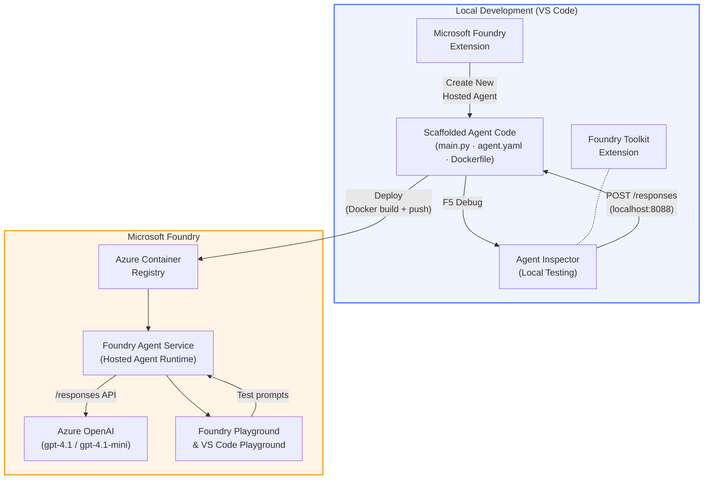

# Foundry Toolkit + Foundry Hosted Agents कार्यशाला

[](https://www.python.org/)
[](https://github.com/microsoft/agents)
[](https://learn.microsoft.com/azure/foundry/agents/concepts/hosted-agents)
[](https://ai.azure.com/)
[](https://learn.microsoft.com/azure/ai-services/openai/)
[](https://learn.microsoft.com/cli/azure/install-azure-cli)
[](https://learn.microsoft.com/azure/developer/azure-developer-cli/install-azd)
[](https://www.docker.com/)
[](https://marketplace.visualstudio.com/items?itemName=ms-windows-ai-studio.windows-ai-studio)
[](LICENSE)

एआई एजेंट्स को **Microsoft Foundry Agent Service** पर **Hosted Agents** के रूप में बनाएं, परीक्षण करें, और तैनात करें - पूरी तरह से वीएस कोड का उपयोग करके **Microsoft Foundry एक्सटेंशन** और **Foundry Toolkit** के माध्यम से।

> **Hosted Agents फिलहाल पूर्वावलोकन में हैं।** समर्थित क्षेत्र सीमित हैं - देखें [क्षेत्र उपलब्धता](https://learn.microsoft.com/azure/foundry/agents/concepts/hosted-agents#region-availability)।

> प्रत्येक लैब के अंदर `agent/` फोल्डर **Foundry एक्सटेंशन द्वारा स्वचालित रूप से तैयार किया गया है** - आप कोड को अनुकूलित करते हैं, स्थानीय रूप से परीक्षण करते हैं, और तैनात करते हैं।

### 🌐 बहुभाषी समर्थन

#### GitHub Action के माध्यम से समर्थित (स्वचालित और हमेशा अद्यतित)

<!-- CO-OP TRANSLATOR LANGUAGES TABLE START -->
[Arabic](../ar/README.md) | [Bengali](../bn/README.md) | [Bulgarian](../bg/README.md) | [Burmese (Myanmar)](../my/README.md) | [Chinese (Simplified)](../zh-CN/README.md) | [Chinese (Traditional, Hong Kong)](../zh-HK/README.md) | [Chinese (Traditional, Macau)](../zh-MO/README.md) | [Chinese (Traditional, Taiwan)](../zh-TW/README.md) | [Croatian](../hr/README.md) | [Czech](../cs/README.md) | [Danish](../da/README.md) | [Dutch](../nl/README.md) | [Estonian](../et/README.md) | [Finnish](../fi/README.md) | [French](../fr/README.md) | [German](../de/README.md) | [Greek](../el/README.md) | [Hebrew](../he/README.md) | [Hindi](./README.md) | [Hungarian](../hu/README.md) | [Indonesian](../id/README.md) | [Italian](../it/README.md) | [Japanese](../ja/README.md) | [Kannada](../kn/README.md) | [Khmer](../km/README.md) | [Korean](../ko/README.md) | [Lithuanian](../lt/README.md) | [Malay](../ms/README.md) | [Malayalam](../ml/README.md) | [Manipuri (Meitei Mayek)](../mni/README.md) | [Marathi](../mr/README.md) | [Nepali](../ne/README.md) | [Nigerian Pidgin](../pcm/README.md) | [Norwegian](../no/README.md) | [Persian (Farsi)](../fa/README.md) | [Polish](../pl/README.md) | [Portuguese (Brazil)](../pt-BR/README.md) | [Portuguese (Portugal)](../pt-PT/README.md) | [Punjabi (Gurmukhi)](../pa/README.md) | [Romanian](../ro/README.md) | [Russian](../ru/README.md) | [Serbian (Cyrillic)](../sr/README.md) | [Slovak](../sk/README.md) | [Slovenian](../sl/README.md) | [Spanish](../es/README.md) | [Swahili](../sw/README.md) | [Swedish](../sv/README.md) | [Tagalog (Filipino)](../tl/README.md) | [Tamil](../ta/README.md) | [Telugu](../te/README.md) | [Thai](../th/README.md) | [Turkish](../tr/README.md) | [Ukrainian](../uk/README.md) | [Urdu](../ur/README.md) | [Vietnamese](../vi/README.md)

> **स्थानीय रूप से क्लोन करना पसंद करते हैं?**
>
> इस रिपॉजिटरी में 50+ भाषा अनुवाद शामिल हैं जो डाउनलोड आकार को काफी बढ़ाते हैं। अनुवादों के बिना क्लोन करने के लिए स्पार्स चेकआउट का उपयोग करें:
>
> **Bash / macOS / Linux:**
> ```bash
> git clone --filter=blob:none --sparse https://github.com/microsoft-foundry/Foundry_Toolkit_for_VSCode_Lab.git
> cd Foundry_Toolkit_for_VSCode_Lab
> git sparse-checkout set --no-cone '/*' '!translations' '!translated_images'
> ```
>
> **CMD (Windows):**
> ```cmd
> git clone --filter=blob:none --sparse https://github.com/microsoft-foundry/Foundry_Toolkit_for_VSCode_Lab.git
> cd Foundry_Toolkit_for_VSCode_Lab
> git sparse-checkout set --no-cone "/*" "!translations" "!translated_images"
> ```
>
> इससे आपको कोर्स पूरा करने के लिए आवश्यक सब कुछ मिलता है, और डाउनलोड बहुत तेज़ होता है।
<!-- CO-OP TRANSLATOR LANGUAGES TABLE END -->

---

## वास्तुकला



**प्रवाह:** Foundry एक्सटेंशन एजेंट का खाका तैयार करता है → आप कोड और निर्देश अनुकूलित करते हैं → Agent Inspector के साथ स्थानीय परीक्षण करते हैं → Foundry पर तैनाती करते हैं (Docker इमेज ACR में पुश होती है) → Playground में सत्यापन।

---

## आप क्या बनाएंगे

| लैब | विवरण | स्थिति |
|-----|-------------|--------|
| **Lab 01 - सिंगल एजेंट** | **"Explain Like I'm an Executive" एजेंट** बनाएँ, स्थानीय रूप से परीक्षण करें, और Foundry पर तैनात करें | ✅ उपलब्ध |
| **Lab 02 - मल्टी-एजेंट वर्कफ़्लो** | **"Resume → Job Fit Evaluator"** बनाएं - 4 एजेंट्स मिलकर रिज्यूमे फिट स्कोर करते हैं और सीखने का रोडमैप बनाते हैं | ✅ उपलब्ध |

---

## Executive Agent से मिलें

इस कार्यशाला में आप **"Explain Like I'm an Executive" एजेंट** बनाएंगे - एक एआई एजेंट जो जटिल तकनीकी शब्दजाल को शांत, बोर्डरूम-तैयार सार में अनुवादित करता है। क्योंकि सच कहें, C-सूट में कोई "v3.2 में जोड़े गए समकालीन कॉल्स से थ्रेड पूल समाप्ति" के बारे में सुनना नहीं चाहता।

मैंने यह एजेंट कई बार ऐसी घटनाओं के बाद बनाया जहां मेरा पूरी तरह से तैयार पोस्ट-मोर्टेम जवाब मिला: *"तो... वेबसाइट डाउन है या नहीं?"*

### यह कैसे काम करता है

आप इसे एक तकनीकी अपडेट देते हैं। यह आपको एक कार्यकारी सारांश देता है - तीन बुलेट पॉइंट्स, बिना जार्गन, बिना स्टैक ट्रेस, बिना अस्तित्वगत भय के। केवल **क्या हुआ**, **व्यवसाय पर प्रभाव**, और **अगला कदम**।

### इसे कार्रवाई में देखें

**आप कहते हैं:**
> "API लेटेंसी v3.2 में जोड़े गए समकालीन कॉल्स से थ्रेड पूल समाप्ति के कारण बढ़ गई।"

**एजेंट जवाब देता है:**

> **कार्यकारी सारांश:**
> - **क्या हुआ:** नवीनतम रिलीज़ के बाद सिस्टम धीमा हो गया।
> - **व्यवसाय पर प्रभाव:** कुछ उपयोगकर्ताओं को सेवा उपयोग के दौरान देरी का अनुभव हुआ।
> - **अगला कदम:** बदलाव वापस ले लिया गया है और पुनःविनियोजन से पहले एक सुधार तैयार किया जा रहा है।

### यह एजेंट क्यों?

यह एक सरल, एकल-उद्देश्य एजेंट है - होस्टेड एजेंट वर्कफ़्लो को अंत तक सीखने के लिए बिल्कुल उपयुक्त, बिना जटिल टूल चेन में फंसने के। और बात सच कहें? हर इंजीनियरिंग टीम को ऐसे एजेंट की जरूरत होती है।

---

## कार्यशाला संरचना

```
📂 Foundry_Toolkit_for_VSCode_Lab/
├── 📄 README.md                      ← You are here
└── 📂 workshop/
    ├── 📂 lab01-single-agent/        ← Full lab: docs + agent code
    │   ├── README.md                 ← Hands-on lab instructions
    │   ├── 📂 docs/                  ← Step-by-step tutorial modules
    │   │   ├── 00-prerequisites.md
    │   │   ├── 01-setup.md
    │   │   ├── 02-create-hosted-agent.md
    │   │   ├── 03-configure-and-code.md
    │   │   ├── 04-test-locally.md
    │   │   ├── 05-deploy-to-foundry.md
    │   │   ├── 06-verify-in-playground.md
    │   │   ├── 07-summary.md
    │   │   └── 08-troubleshooting.md
    │   └── 📂 agent/                 ← Reference solution (auto-scaffolded by Foundry extension)
    │       ├── agent.yaml
    │       ├── Dockerfile
    │       ├── main.py
    │       └── requirements.txt
    └── 📂 lab02-multi-agent/         ← Resume → Job Fit Evaluator
        ├── README.md                 ← Hands-on lab instructions (end-to-end)
        ├── 📂 docs/                  ← Step-by-step tutorial modules
        │   ├── 00-prerequisites.md
        │   ├── 01-understand-multi-agent.md
        │   ├── 02-scaffold-multi-agent.md
        │   ├── 03-configure-agents.md
        │   ├── 04-orchestration-patterns.md
        │   ├── 05-test-locally.md
        │   ├── 06-deploy-to-foundry.md
        │   ├── 07-verify-in-playground.md
        │   └── 08-troubleshooting.md
        └── 📂 PersonalCareerCopilot/ ← Reference solution (multi-agent workflow)
            ├── agent.yaml
            ├── Dockerfile
            ├── main.py
            └── requirements.txt
```

> **नोट:** प्रत्येक लैब के अंदर `agent/` फोल्डर वह है जो **Microsoft Foundry एक्सटेंशन** कमांड पैलेट से `Microsoft Foundry: Create a New Hosted Agent` चलाने पर बनाता है। फिर इन फाइलों को आपके एजेंट के निर्देश, टूल, और कॉन्फ़िगरेशन के साथ अनुकूलित किया जाता है। लैब 01 आपको इसे स्क्रैच से बनाने के लिए मार्गदर्शन करता है।

---

## शुरू करना

### 1. रिपॉजिटरी क्लोन करें

```bash
git clone https://github.com/microsoft-foundry/Foundry_Toolkit_for_VSCode_Lab.git
cd Foundry_Toolkit_for_VSCode_Lab
```

### 2. Python वर्चुअल एनवायरनमेंट सेट करें

```bash
python -m venv venv
```

इसे सक्रिय करें:

- **Windows (PowerShell):**
  ```powershell
  .\venv\Scripts\Activate.ps1
  ```
- **macOS / Linux:**
  ```bash
  source venv/bin/activate
  ```

### 3. Dependencies इंस्टॉल करें

```bash
pip install -r workshop/lab01-single-agent/agent/requirements.txt
```

### 4. एनवायरनमेंट वेरिएबल्स कॉन्फ़िगर करें

एजेंट फोल्डर के अंदर उदाहरण `.env` फ़ाइल कॉपी करें और अपनी मान भरें:

```bash
cp workshop/lab01-single-agent/agent/.env.example workshop/lab01-single-agent/agent/.env
```

`workshop/lab01-single-agent/agent/.env` संपादित करें:

```env
AZURE_AI_PROJECT_ENDPOINT=https://<your-account>.services.ai.azure.com/api/projects/<your-project>
AZURE_AI_MODEL_DEPLOYMENT_NAME=<your-model-deployment-name>
```

### 5. कार्यशाला लैब्स का पालन करें

प्रत्येक लैब अपने मॉड्यूल के साथ स्व-निहित है। बुनियादी बातों को सीखने के लिए **Lab 01** से शुरू करें, फिर **Lab 02** में मल्टी-एजेंट वर्कफ़्लो के लिए आगे बढ़ें।

#### Lab 01 - सिंगल एजेंट ([पूर्ण निर्देश](workshop/lab01-single-agent/README.md))

| # | मॉड्यूल | लिंक |
|---|---------|-------|
| 1 | पूर्वापेक्षाएँ पढ़ें | [00-prerequisites.md](workshop/lab01-single-agent/docs/00-prerequisites.md) |
| 2 | Foundry Toolkit & Foundry एक्सटेंशन स्थापित करें | [01-setup.md](workshop/lab01-single-agent/docs/01-setup.md) |
| 3 | Foundry प्रोजेक्ट बनाएं | [01-setup.md](workshop/lab01-single-agent/docs/01-setup.md) |
| 4 | एक होस्टेड एजेंट बनाएं | [02-create-hosted-agent.md](workshop/lab01-single-agent/docs/02-create-hosted-agent.md) |
| 5 | निर्देश और पर्यावरण कॉन्फ़िगर करें | [03-configure-and-code.md](workshop/lab01-single-agent/docs/03-configure-and-code.md) |
| 6 | स्थानीय परीक्षण करें | [04-test-locally.md](workshop/lab01-single-agent/docs/04-test-locally.md) |
| 7 | Foundry पर तैनात करें | [05-deploy-to-foundry.md](workshop/lab01-single-agent/docs/05-deploy-to-foundry.md) |
| 8 | Playground में सत्यापित करें | [06-verify-in-playground.md](workshop/lab01-single-agent/docs/06-verify-in-playground.md) |
| 9 | समस्या निवारण | [08-troubleshooting.md](workshop/lab01-single-agent/docs/08-troubleshooting.md) |

#### Lab 02 - मल्टी-एजेंट वर्कफ़्लो ([पूर्ण निर्देश](workshop/lab02-multi-agent/README.md))

| # | मॉड्यूल | लिंक |
|---|---------|-------|
| 1 | पूर्वापेक्षाएँ (Lab 02) | [00-prerequisites.md](workshop/lab02-multi-agent/docs/00-prerequisites.md) |
| 2 | मल्टी-एजेंट वास्तुकला समझें | [01-understand-multi-agent.md](workshop/lab02-multi-agent/docs/01-understand-multi-agent.md) |
| 3 | मल्टी-एजेंट प्रोजेक्ट Scaffold करें | [02-scaffold-multi-agent.md](workshop/lab02-multi-agent/docs/02-scaffold-multi-agent.md) |
| 4 | एजेंट्स और एनवायरनमेंट कॉन्फ़िगर करें | [03-configure-agents.md](workshop/lab02-multi-agent/docs/03-configure-agents.md) |
| 5 | ऑर्केस्ट्रेशन पैटर्न | [04-orchestration-patterns.md](workshop/lab02-multi-agent/docs/04-orchestration-patterns.md) |
| 6 | स्थानीय परीक्षण (मल्टी-एजेंट) | [05-test-locally.md](workshop/lab02-multi-agent/docs/05-test-locally.md) |
| 7 | Foundry पर तैनात करें | [06-deploy-to-foundry.md](workshop/lab02-multi-agent/docs/06-deploy-to-foundry.md) |
| 8 | Playground में सत्यापित करें | [07-verify-in-playground.md](workshop/lab02-multi-agent/docs/07-verify-in-playground.md) |
| 9 | समस्या निवारण (मल्टी-एजेंट) | [08-troubleshooting.md](workshop/lab02-multi-agent/docs/08-troubleshooting.md) |

---

## मेंटेनर

<table>
<tr>
    <td align="center"><a href="https://github.com/ShivamGoyal03">
        <br />
        <sub><b>शिवम गोयल</b></sub>
    </a><br />
    </td>
</tr>
</table>

---

## आवश्यक अनुमतियाँ (त्वरित संदर्भ)

| परिदृश्य | आवश्यक भूमिकाएँ |
|----------|---------------|
| नया Foundry प्रोजेक्ट बनाएँ | Foundry संसाधन पर **Azure AI Owner** |
| मौजूदा प्रोजेक्ट पर तैनाती (नए संसाधन) | सब्सक्रिप्शन पर **Azure AI Owner** + **Contributor** |
| पूरी तरह से कॉन्फ़िगर प्रोजेक्ट पर तैनाती | खाते पर **Reader** + प्रोजेक्ट पर **Azure AI User** |

> **महत्वपूर्ण:** Azure `Owner` और `Contributor` भूमिकाएँ केवल *प्रबंधन* अनुमतियाँ शामिल करती हैं, *विकास* (डेटा क्रिया) अनुमतियाँ नहीं। एजेंट बनाने और तैनात करने के लिए आपको **Azure AI User** या **Azure AI Owner** की आवश्यकता है।

---

## संदर्भ

- [क्विकस्टार्ट: अपना पहला होस्ट किया गया एजेंट तैनात करें (VS कोड)](https://learn.microsoft.com/azure/foundry/agents/quickstarts/quickstart-hosted-agent)
- [होस्ट किए गए एजेंट क्या हैं?](https://learn.microsoft.com/azure/foundry/agents/concepts/hosted-agents)
- [VS कोड में होस्ट किए गए एजेंट वर्कफ़्लोज़ बनाएं](https://learn.microsoft.com/azure/foundry/agents/how-to/vs-code-agents-workflow-pro-code)
- [एक होस्ट किया गया एजेंट तैनात करें](https://learn.microsoft.com/azure/foundry/agents/how-to/deploy-hosted-agent)
- [Microsoft Foundry के लिए RBAC](https://learn.microsoft.com/azure/foundry/concepts/rbac-foundry)
- [आर्किटेक्चर समीक्षा एजेंट नमूना](https://github.com/Azure-Samples/agent-architecture-review-sample) - MCP टूल्स, Excalidraw आरेखों, और दोहरे तैनाती के साथ वास्तविक दुनिया का होस्ट किया गया एजेंट

---


## लाइसेंस

[MIT](../../LICENSE)

---

<!-- CO-OP TRANSLATOR DISCLAIMER START -->
**अस्वीकरण**:
इस दस्तावेज़ का अनुवाद AI अनुवाद सेवा [Co-op Translator](https://github.com/Azure/co-op-translator) का उपयोग करके किया गया है। जबकि हम सटीकता के लिए प्रयास करते हैं, कृपया ध्यान दें कि स्वचालित अनुवादों में त्रुटियाँ या अशुद्धियाँ हो सकती हैं। मूल दस्तावेज़ अपनी मूल भाषा में ही प्रामाणिक स्रोत माना जाना चाहिए। महत्वपूर्ण जानकारी के लिए, पेशेवर मानव अनुवाद की सिफारिश की जाती है। इस अनुवाद के उपयोग से उत्पन्न किसी भी गलतफहमी या गलत व्याख्या के लिए हम उत्तरदायी नहीं हैं।
<!-- CO-OP TRANSLATOR DISCLAIMER END -->