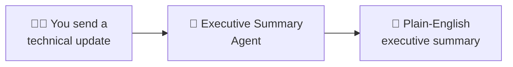

# मॉड्यूल 0 - परिचय

⏱️ ~10 मिनट

> [!WARNING]
> **पूर्वावलोकन और सीमाएँ:** [होस्टेड एजेंट्स](https://learn.microsoft.com/azure/foundry/agents/concepts/hosted-agents) वर्तमान में **पब्लिक प्रीव्यू** में हैं - उत्पादक वर्कलोड के लिए अनुशंसित नहीं हैं। निम्न बातों से अवगत रहें:
> - **समर्थित क्षेत्र सीमित हैं** - संसाधन बनाने से पहले [क्षेत्र उपलब्धता](https://learn.microsoft.com/azure/foundry/agents/concepts/hosted-agents#region-availability) जांचें। यदि आप असमर्थित क्षेत्र चुनते हैं, तो तैनाती विफल हो जाएगी।
> - `agent-framework-foundry-hosting` पैकेज प्री-रिलीज़ है - संस्करणों के बीच API बदल सकते हैं।
> - स्केल सीमाएँ: होस्टेड एजेंट्स 0–5 प्रतिलिपियों का समर्थन करते हैं (स्केल-टू-जीरो सहित)।
> - इस कार्यशाला में दिखाए गए कुछ फीचर सेवा के GA की ओर बढ़ने पर बदल सकते हैं।

## आप क्या बनाएंगे

इस कार्यशाला में, आप एक **"व्याख्या करें जैसे मैं एक कार्यकारी हूँ"** एजेंट बनाएंगे - एक होस्टेड एआई एजेंट जो जटिल तकनीकी अपडेट को लेता है और उन्हें सामान्य अंग्रेज़ी कार्यकारी सारांशों के रूप में पुनर्लेखित करता है।

**एजेंट निम्न का उपयोग करता है:**
- **Microsoft Agent Framework** - एजेंट लॉजिक और संरचना के लिए
- **Foundry Toolkit for VS Code** - स्कैफोल्डिंग, स्थानीय परीक्षण, और तैनाती के लिए
- **एक AI मॉडल** (जैसे `gpt-4.1-mini/gpt-5-mini`) - सारांश बनाने के लिए

इस प्रयोगशाला के अंत तक, आपके पास एक कार्यशील एजेंट होगा जिसे आप स्थानीय रूप से Agent Inspector के माध्यम से परीक्षण कर सकते हैं, और वैकल्पिक रूप से क्लाउड पर तैनात कर सकते हैं।

---

## होस्टेड एजेंट्स क्या हैं?

एक **होस्टेड एजेंट** एक एआई एजेंट है जो Microsoft Foundry में एक प्रबंधित सेवा के रूप में चलता है। अपनी खुद की इंफ्रास्ट्रक्चर का प्रबंधन करने के बजाय, आप अपने एजेंट कोड को एक कंटेनर में पैकेज करते हैं और Foundry स्केलिंग, होस्टिंग, और इसे एक मानक HTTP एंडपॉइंट के माध्यम से एक्सपोज़िंग को संभालता है।

| अवधारणा | इसका मतलब |
|---------|--------------|
| **एजेंट** | आपका Python कोड जो उपयोगकर्ता संदेश प्राप्त करता है, एक AI मॉडल को कॉल करता है, और संरचित प्रतिक्रिया लौटाता है |
| **होस्टेड** | Foundry आपके लिए आपका कंटेनर चलाता है - कोई VM, कोई Kubernetes, कोई इंफ्रास्ट्रक्चर प्रबंधन नहीं |
| **प्रतिक्रियाएँ प्रोटोकॉल** | कोई भी क्लाइंट आपके एजेंट के साथ इंटरैक्ट करने के लिए एक मानक HTTP API (`POST /responses`) को कॉल कर सकता है |
| **Agent Inspector** | एक स्थानीय परीक्षण UI (Foundry Toolkit में निर्मित) जो आपको तैनाती से पहले अपने एजेंट के साथ बातचीत करने देता है |

इस कार्यशाला में, आप शून्य से पूर्ण होस्टेड एजेंट तक जाएंगे - या यदि चाहें तो केवल स्थानीय परीक्षण पर रुक सकते हैं।

---

## अपनी राह चुनें

> ⚠️ **आगे बढ़ने से पहले एक मार्ग चुनें।** आपका चयन निर्धारित करता है कि कौन से उपकरण स्थापित करने हैं और कौन से मॉड्यूल लागू होते हैं। यदि आपके पास सदस्यता है तो आप बाद में Path B → Path A में स्विच कर सकते हैं।

<strong>🅰️ पथ A - Azure क्लाउड (Azure सदस्यता आवश्यक)</strong>

| | विवरण |
|---|---|
| **यह किसके लिए है?** | आपके पास एक सक्रिय Azure सदस्यता है और आप Foundry संसाधन बना सकते हैं |
| **मॉडल** | Foundry के माध्यम से Azure OpenAI (जैसे `gpt-4.1-mini/gpt-5-mini`) |
| **शामिल मॉड्यूल** | सभी मॉड्यूल (00–07) |
| **क्लाउड पर तैनाती?** | ✅ हाँ - पूर्ण अंत-से-अंत तैनाती |

<strong>🅱️ पथ B - स्थानीय / फ्री-टियर (Azure सदस्यता आवश्यक नहीं)</strong>

| | विवरण |
|---|---|
| **यह किसके लिए है?** | MVP, छात्र, या जिनके पास Azure एक्सेस नहीं है |
| **मॉडल** | **Foundry Local** (मुफ़्त, आपकी मशीन पर चलता है) |
| **शामिल मॉड्यूल** | मॉड्यूल 00–04 (तैनाती और क्लाउड सत्यापन छोड़ें) |
| **क्लाउड पर तैनाती?** | ❌ नहीं - केवल Agent Inspector के माध्यम से स्थानीय परीक्षण |

---

## सभी मार्ग: आवश्यक उपकरण

नीचे दिए गए प्रत्येक उपकरण को स्थापित करें। इंस्टॉल करने के बाद, जांचें कि यह कमांड चलाकर काम करता है।

| # | उपकरण | संस्करण | स्थापना | सत्यापन (अपेक्षित आउटपुट) |
|---|------|---------|---------|---------------------------|
| 1 | **Visual Studio Code** | नवीनतम | [code.visualstudio.com](https://code.visualstudio.com/) | बिना त्रुटि के खुलता है |
| 2 | **Python** | 3.12 या उच्चतर | [python.org/downloads](https://www.python.org/downloads/) | `python --version` $\rightarrow$ `Python 3.12.x` |
| 3 | **Foundry Toolkit for VS Code** | नवीनतम | एक्सटेंशन ID: `ms-windows-ai-studio.windows-ai-studio` | Activity Bar में Foundry आइकन |
| 4 | **Python एक्सटेंशन फॉर VS Code** | नवीनतम | एक्सटेंशन ID: `ms-python.python` | एक्सटेंशन्स पैनल में स्थापित |

> [!TIP]
> **इंस्टॉलेशन के प्रो-टिप्स:**
> - **Python PATH (Windows):** Python इंस्टॉलर की पहली स्क्रीन पर हमेशा **"Add Python to PATH"** जांचें। इसके बिना, `python` आपके टर्मिनल में मान्यता प्राप्त नहीं होगा।
> - **कई Python संस्करण:** यदि आपके पास Python 3.10 और 3.12 दोनों स्थापित हैं, तो सुनिश्चित करें कि सही संस्करण आपके वर्चुअल एन्वायरमेंट के लिए उपयोग हो रहा है, इसके लिए `python3.12 -m venv .venv` का उपयोग करें।
> - **Docker WSL 2 (Windows):** Docker Desktop स्थापना के दौरान, सुनिश्चित करें कि **WSL 2 backend** चुना गया है। Hyper-V के साथ Docker धीमा होता है और Foundry कंटेनर बिल्ड्स में समस्या हो सकती है।
> - **Docker नहीं शुरू हो रहा?** Docker Desktop लॉन्च करने के बाद 30–60 सेकंड प्रतीक्षा करें। `docker info` चलाएं - यदि "Cannot connect to the Docker daemon" दिखता है, तो Docker अभी भी आरंभ हो रहा है।
> - **VS Code एक्सटेंशन लोड नहीं हो रहे?** एक्सटेंशन इंस्टॉल करने के बाद विंडो फिर से लोड करें: `Ctrl+Shift+P` → `Developer: Reload Window`।

> **Windows उपयोगकर्ता:** Python इंस्टॉलेशन के दौरान हमेशा **"Add Python to PATH"** जांचें।

**अगला:** [01 - सेटअप →](01-setup.md)

---

<!-- CO-OP TRANSLATOR DISCLAIMER START -->
**अस्वीकरण**:
इस दस्तावेज़ का अनुवाद AI अनुवाद सेवा [Co-op Translator](https://github.com/Azure/co-op-translator) का उपयोग करके किया गया है। जबकि हम सटीकता के लिए प्रयास करते हैं, कृपया ध्यान दें कि स्वचालित अनुवादों में त्रुटियाँ या अशुद्धियाँ हो सकती हैं। मूल दस्तावेज़ अपनी मूल भाषा में ही प्रामाणिक स्रोत माना जाना चाहिए। महत्वपूर्ण जानकारी के लिए, पेशेवर मानव अनुवाद की सिफारिश की जाती है। इस अनुवाद के उपयोग से उत्पन्न किसी भी गलतफहमी या गलत व्याख्या के लिए हम उत्तरदायी नहीं हैं।
<!-- CO-OP TRANSLATOR DISCLAIMER END -->