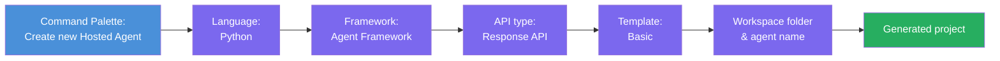
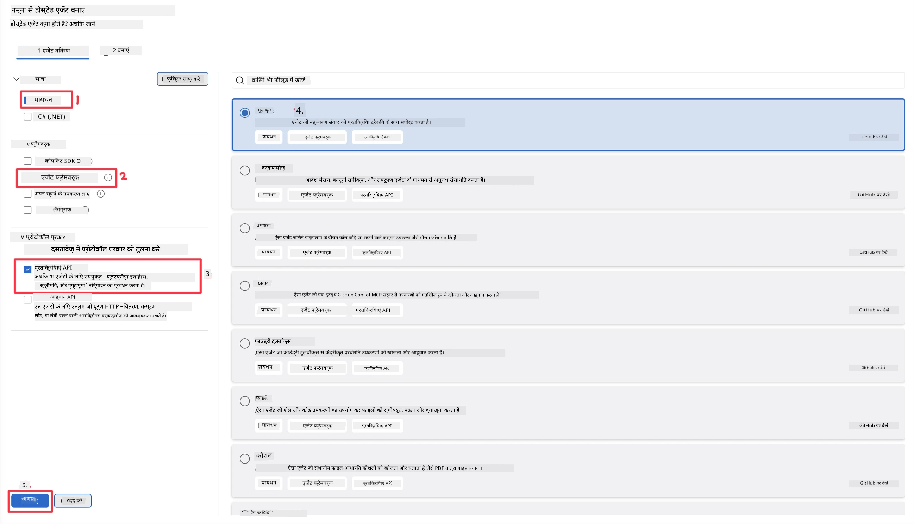
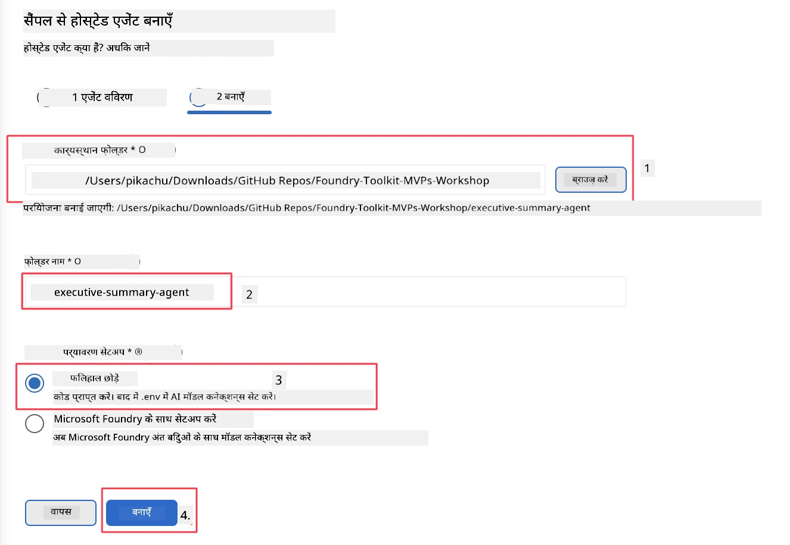

# मॉड्यूल 2 - एक नया होस्टेड एजेंट बनाएं

⏱️ ~5 मिनट

इस मॉड्यूल में, आप Foundry Toolkit का उपयोग करके **एक होस्टेड एजेंट प्रोजेक्ट स्कैफोल्ड करते हैं**। स्कैफोल्ड पूरा प्रोजेक्ट स्ट्रक्चर जनरेट करता है - `agent.yaml`, `main.py`, `Dockerfile`, `requirements.txt`, और VS Code डिबग कॉन्फ़िगरेशन - ताकि आप एजेंट के व्यवहार को कस्टमाइज़ करने पर ध्यान केंद्रित कर सकें।

> **मुख्य अवधारणा:** इस लैब में `agent/` फ़ोल्डर Foundry Toolkit द्वारा जनरेट की गई एक उदाहरण है। आप ये फाइलें शुरू से नहीं लिखते।

### स्कैफोल्ड विज़ार्ड फ़्लो



---

## चरण 1: Create Hosted Agent विज़ार्ड खोलें

1. प्रेस करें `Ctrl+Shift+P` **Command Palette** खोलने के लिए।
2. टाइप करें: **Foundry Toolkit: Create new Hosted Agent** और इसे चुनें।

> **विकल्प: Foundry Portal के माध्यम से बनाएं**
> यदि आप ब्राउज़र पसंद करते हैं, तो आप अपना प्रोजेक्ट [https://ai.azure.com](https://ai.azure.com) पर बना सकते हैं। एक बार प्रोजेक्ट प्रोविजन हो जाने के बाद, VS Code पर वापस आएं और **Foundry Toolkit** साइडबार का उपयोग करके इसे कनेक्ट करें।

> **विकल्प:** Foundry Toolkit साइडबार में, अपने प्रोजेक्ट के अंतर्गत **Agents** पर होवर करें, **+** आइकन पर क्लिक करें, फिर **Create in Code With Template** चुनें।

## चरण 2: सेटिंग्स चुनें



1. बाएँ नेविगेशन/विकल्प अनुभाग में निम्नलिखित चुनें:

| मेनू | चयन | नोट्स |
|--------|-----------|-------|
| **Language** | Python | C# भी समर्थित है |
| **Framework** | Agent Framework | Agent Framework SDK का उपयोग करके सरल प्रारंभिक बिंदु |
| **API type** | Response API | `POST /responses` - वार्तालाप आधारित, प्लेटफ़ॉर्म-प्रबंधित इतिहास के साथ |
| **Template** | Basic | Agent Framework SDK का उपयोग करके सरल प्रारंभिक बिंदु |

2. चयनित करने के बाद, **Next** पर क्लिक करें



3. अगले विंडो में, निम्नलिखित चुनें:

| मेनू | चयन | नोट्स |
|--------|-----------|-------|
| **Workspace folder** | एक लक्ष्य फ़ोल्डर चुनें | उदाहरण के लिए `/workspace/Foundry_Toolkit_for_VSCode_Lab/` या इस रिपॉजिटरी में एक सबफ़ोल्डर |
| **एजेंट नाम** | एक नाम दर्ज करें | जैसे, `executive-summary-agent` |
| **पर्यावरण सेटअप** | अभी सेटअप छोड़ें |  |

क्लिक करें **create** हमारे एजेंट को बनाने के लिए। एक नया फ़ोल्डर होस्टेड एजेंट नाम के साथ बनाया जाएगा।

## चरण 3: जनरेट किए गए प्रोजेक्ट की जांच करें

स्कैफोल्डिंग पूरी होने के बाद, सुनिश्चित करें कि आप एक्सप्लोरर में ये फाइलें देख रहे हैं (`Ctrl+Shift+E`):

```
📂 executive-summary-agent/
├── .env                ← Environment variables (placeholders)
├── .vscode/
│   ├── launch.json     ← Debug config (F5 → run + Agent Inspector)
│   └── tasks.json      ← VS Code task definitions
├── agent.yaml          ← Agent definition (kind: hosted)
├── Dockerfile          ← Container config for deployment
├── main.py             ← Agent entry point (your main code)
└── requirements.txt    ← Python dependencies
```

### प्रमुख फाइलों का विवरण

| फाइल | उद्देश्य |
|------|---------|
| `agent.yaml` | एजेंट को `kind: hosted` के रूप में घोषित करता है, पर्यावरण चर मैप करता है, `/responses` प्रोटोकॉल परिभाषित करता है |
| `main.py` | एक `FoundryChatClient` बनाता है → इसे एक `Agent` में लपेटता है निर्देशों के साथ →  पोर्ट 8088 पर `ResponsesHostServer` के माध्यम से सेवा करता है |
| `Dockerfile` | `python:3.12-slim` का उपयोग करता है, निर्भरता इंस्टॉल करता है, पोर्ट 8088 खोलता है, `main.py` चलाता है |
| `requirements.txt` | `agent-framework-foundry`, `agent-framework-foundry-hosting`, `mcp`, `debugpy` |

> **महत्वपूर्ण:** स्कैफोल्ड किए गए एजेंट फ़ोल्डर को सीधे VS Code में खोलें (खुद `agent/` फ़ोल्डर) ताकि `.vscode/launch.json` और `tasks.json` F5 डिबगिंग के लिए ठीक से काम करें।

---

### ✅ चेकपॉइंट

- [ ] स्कैफोल्डेड प्रोजेक्ट सभी अपेक्षित फाइलों के साथ बनाया गया
- [ ] `agent.yaml` में `kind: hosted` और `protocol: responses` दिखाए जाते हैं
- [ ] `main.py` आयात करता है `Agent`, `FoundryChatClient`, `ResponsesHostServer`
- [ ] एजेंट फ़ोल्डर VS कोड में कार्यक्षेत्र रूट के रूप में खुला है

---

**पिछला:** [01 - सेटअप](01-setup.md) · **अगला:** [03 - कॉन्फ़िगर & कोड →](03-configure-and-code.md)

---

<!-- CO-OP TRANSLATOR DISCLAIMER START -->
**अस्वीकरण**:
इस दस्तावेज़ का अनुवाद AI अनुवाद सेवा [Co-op Translator](https://github.com/Azure/co-op-translator) का उपयोग करके किया गया है। जबकि हम सटीकता के लिए प्रयास करते हैं, कृपया ध्यान दें कि स्वचालित अनुवादों में त्रुटियाँ या अशुद्धियाँ हो सकती हैं। मूल दस्तावेज़ अपनी मूल भाषा में ही प्रामाणिक स्रोत माना जाना चाहिए। महत्वपूर्ण जानकारी के लिए, पेशेवर मानव अनुवाद की सिफारिश की जाती है। इस अनुवाद के उपयोग से उत्पन्न किसी भी गलतफहमी या गलत व्याख्या के लिए हम उत्तरदायी नहीं हैं।
<!-- CO-OP TRANSLATOR DISCLAIMER END -->