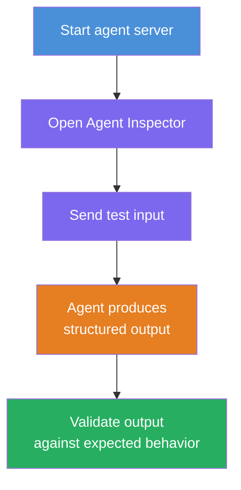
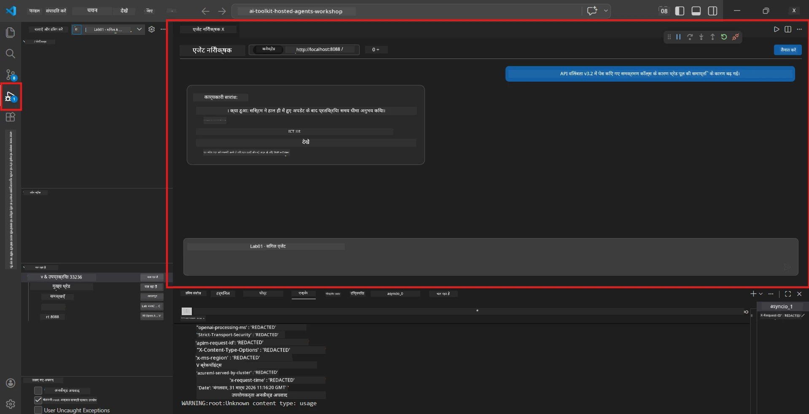
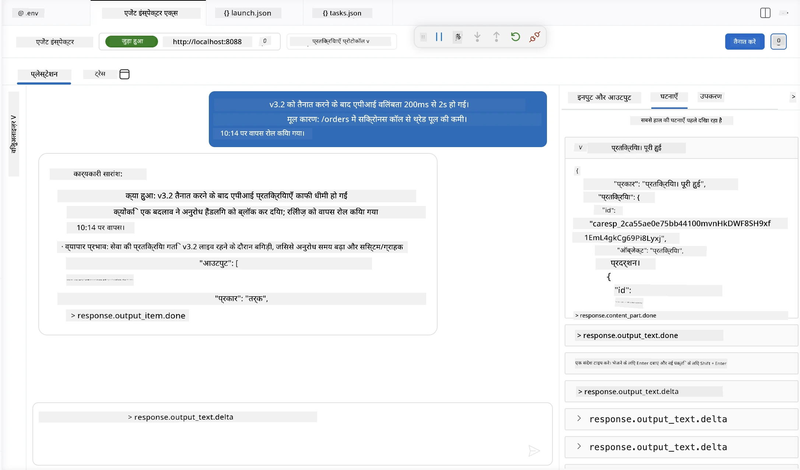

# मॉड्यूल 4 - स्थानीय रूप से परीक्षण करें

⏱️ ~10 मिनट

इस मॉड्यूल में, आप अपने एजेंट को स्थानीय रूप से चलाएंगे और यह सत्यापित करेंगे कि यह सही ढंग से काम करता है **हैप्पी-पाथ फंक्शनल टेस्ट्स** का उपयोग करके। आप एजेंट इंस्पेक्टर (दृश्य यूआई) या सीधे HTTP कॉल का उपयोग करके पुष्टि करेंगे कि एजेंट संरचित, सटीक उत्तर उत्पन्न करता है।

### स्थानीय परीक्षण प्रवाह



---

## विकल्प 1: F5 दबाएं - एजेंट इंस्पेक्टर के साथ डीबग करें (सिफारिश की गई)

### डिबगर शुरू करें

1. सीधे VS कोड में **executive-summary-agent/** फ़ोल्डर खोलें (`File → Open Folder`)।
2. **Run and Debug** पैनल खोलें (`Ctrl+Shift+D`)।
3. ड्रॉपडाउन से **Debug Local Agent HTTP Server** चुनें।
4. **F5** दबाएं (या ▶ स्टार्ट डीबगिंग क्लिक करें)।

> ⚠️ **महत्वपूर्ण: अपना Python Interpreter चुनें**
> यदि आपको "ModuleNotFoundError" मिलता है या डिबगर शुरू नहीं होता है, तो आपको VS कोड को अपनी वर्चुअल एनवायरनमेंट उपयोग करने के लिए बताना होगा:
  > 1. दबाएं `Ctrl+Shift+P` $\rightarrow$ टाइप करें **Python: Select Interpreter**।
  > 2. अपने प्रोजेक्ट के `.venv` फ़ोल्डर में स्थित इंटरप्रेटर चुनें (जैसे, Windows पर `.\.venv\Scripts\python.exe`)।
  > 3. डिबग सेशन को पुनः प्रारंभ करें।
> यदि फिर भी त्रुटियां आ रही हैं, तो अपने `tasks.json` फ़ाइल को मैन्युअल रूप से निम्नानुसार अपडेट करें:
  > 1. `.vscode/tasks.json` फ़ाइल पर जाएं
  > 2. उस टास्क पर जाएं जिसका लेबल है: `Run Agent HTTP Server`
  > 3. कमांड मान को निम्नानुसार अपडेट करें:
  >    - **Windows:** `"value": "${workspaceFolder}/.venv/Scripts/python.exe",`
  >    - **macOS/Linux:** `"value": "${workspaceFolder}/.venv/bin/python",`

### क्या होता है

1. HTTP सर्वर `http://localhost:8088/responses` पर शुरू हो जाता है।
2. **Agent Inspector** पैनल स्वचालित रूप से खुलता है - परीक्षण के लिए एक दृश्य चैट इंटरफ़ेस।
3. ब्रेकपॉइंट्स `main.py` में सक्षम होते हैं।

टर्मिनल देखें:
```
Starting executive summary hosted agent
Executive agent server running on http://localhost:8088
```

> **यदि Agent Inspector नहीं खुलता है:** दबाएं `Ctrl+Shift+P` → **Foundry Toolkit: Open Agent Inspector**।



> *स्क्रीनशॉट पर पुराने 'AI TOOLKIT' ब्रांडिंग की छवि हो सकती है, यह किसी पुराने एक्सटेंशन संस्करण से हो सकती है।*

---

## विकल्प 2: टर्मिनल के माध्यम से परीक्षण (वैकल्पिक)

एक टर्मिनल में एजेंट शुरू करें, दूसरे से अनुरोध भेजें:

```bash
# Terminal 1: Start agent
cd executive-summary-agent/
source .venv/bin/activate
python main.py
```

```bash
# Terminal 2: Send test (curl)
curl -sS -X POST http://localhost:8088/responses \
  -H "Content-Type: application/json" \
  -d '{"input": "The API latency increased due to thread pool exhaustion caused by sync calls in v3.2.", "stream": false}'
```

---

## परिदृश्य परीक्षण: हैप्पी-पाथ फंक्शनल सत्यापन

नीचे दिए गए **तीन** परिदृश्यों को चलाएं। ये सत्यापित करते हैं कि आपका एजेंट वास्तविक इनपुट के लिए सही, संरचित आउटपुट उत्पन्न करता है।



### परिदृश्य 1: IT घटना - API विलंब वृद्धि

**इनपुट:**
```
The API latency increased from 200ms to 2s after deploying v3.2.
Root cause: thread pool starvation from synchronous calls in /orders.
Rolled back at 10:14.
```

**अपेक्षित व्यवहार:**
- ✅ "Executive Summary" संरचना का पालन करता है (क्या हुआ / व्यापार प्रभाव / अगला कदम)
- ✅ कोई तकनीकी शब्दावली नहीं (जैसे "thread pool", "/orders", या "v3.2")
- ✅ स्पष्ट रूप से व्यापार प्रभाव बताता है (जैसे, उपयोगकर्ताओं को देरी का अनुभव हुआ)
- ✅ एक अगला कदम शामिल है (जैसे, फिक्स लागू, निगरानी चालू)

---

### परिदृश्य 2: डेटा पाइपलाइन - ETL विफलता

**इनपुट:**
```
The nightly ETL job failed because the upstream schema changed. APAC dashboards show missing data.
```

**अपेक्षित व्यवहार:**
- ✅ डेटा रिफ्रेश विफलता को सरल भाषा में सारांशित करता है
- ✅ APAC डैशबोर्ड के प्रभाव का उल्लेख करता है
- ✅ सुधार के लिए अगला कदम शामिल है
- ✅ "ETL", "schema", या अन्य तकनीकी शब्दावली का उल्लेख नहीं करता

---

### परिदृश्य 3: सुरक्षा - उजागर क्रेडेंशियल

**इनपुट:**
```
Static analysis flagged a hardcoded secret in the repository.
The secret may have been exposed in commit history.
```

**अपेक्षित व्यवहार:**
- ✅ क्रेडेंशियल/सुरक्षा समस्या को कार्यकारी-मित्र भाषा में वर्णित करता है
- ✅ संभावित जोखिम (अनधिकृत पहुंच) को बताता है
- ✅ सुधारात्मक कार्रवाई बताता है (क्रेडेंशियल रोटेशन, ऑडिट)
- ✅ "static analysis", "commit history", या "hardcoded" जैसे शब्दों का समावेश नहीं करता

---

## सत्यापन मानदंड

प्रत्येक परिदृश्य के लिए जांचें:

| # | मानदंड | उत्तीर्ण स्थिति |
|---|----------|---------------|
| 1 | **संरचना** | प्रतिक्रिया "Executive Summary" फॉर्मेट का उपयोग करती है जिसमें सभी तीन बुलेट शामिल हैं |
| 2 | **सरल भाषा** | कोई तकनीकी शब्दावली नहीं जो एक कार्यकारी न समझ पाए |
| 3 | **सटीकता** | सारांश इनपुट को प्रतिबिंबित करता है - कोई गलत विवरण नहीं |
| 4 | **संक्षिप्तता** | प्रतिक्रिया 100 शब्दों से कम हो |
| 5 | **अगला कदम** | एक स्पष्ट कार्रवाई या निवारण बताया गया हो |

---

## डीबगिंग सुझाव

| समस्या | समाधान |
|-------|-----|
| एजेंट शुरू नहीं होता | `.env` मान जांचें, venv सक्रिय है या नहीं देखें, `pip install -r requirements.txt` चलाएं |
| खाली या सामान्य प्रतिक्रिया | `main.py` में निर्देश देखें - सुनिश्चित करें कि आउटपुट प्रारूप निर्दिष्ट है |
| प्रतिक्रिया में शब्दजाल शामिल है | निर्देशों में "तकनीकी शब्द हटाएं" नियम कड़े करें |
| Agent Inspector नहीं खुलता | `Ctrl+Shift+P` → **Foundry Toolkit: Open Agent Inspector** |
| टर्मिनल में मॉडल त्रुटियाँ | सुनिश्चित करें कि `AZURE_AI_MODEL_DEPLOYMENT_NAME` बिल्कुल मेल खाता है (केस-संवेदनशील) |

---

### ✅ चेकपॉइंट

- [ ] एजेंट स्थानीय रूप से बिना त्रुटि के शुरू होता है
- [ ] Agent Inspector खुलता है और एक चैट इंटरफ़ेस दिखाता है (यदि F5 का उपयोग कर रहे हैं)
- [ ] **परिदृश्य 1** (IT घटना) - संरचित Executive Summary, कोई शब्दजाल नहीं
- [ ] **परिदृश्य 2** (डेटा पाइपलाइन) - व्यापार प्रभाव के साथ प्रासंगिक सारांश
- [ ] **परिदृश्य 3** (सुरक्षा अलर्ट) - उचित जोखिम संचार
- [ ] सभी प्रतिक्रियाएँ परिभाषित आउटपुट संरचना का पालन करें

> **अपनी प्रतिक्रियाएँ सहेजें** (कॉपी या स्क्रीनशॉट लें) - आप उन्हें मॉड्यूल 06 में क्लाउड परिणामों से तुलना करेंगे।

---

**पिछला:** [03 - कॉन्फ़िगर और कोड](03-configure-and-code.md) · **अगला:** [05 - Foundry पर डिप्लॉय करें →](05-deploy-to-foundry.md)

---

<!-- CO-OP TRANSLATOR DISCLAIMER START -->
**अस्वीकरण**:
इस दस्तावेज़ का अनुवाद AI अनुवाद सेवा [Co-op Translator](https://github.com/Azure/co-op-translator) का उपयोग करके किया गया है। जबकि हम सटीकता के लिए प्रयास करते हैं, कृपया ध्यान दें कि स्वचालित अनुवादों में त्रुटियाँ या अशुद्धियाँ हो सकती हैं। मूल दस्तावेज़ अपनी मूल भाषा में ही प्रामाणिक स्रोत माना जाना चाहिए। महत्वपूर्ण जानकारी के लिए, पेशेवर मानव अनुवाद की सिफारिश की जाती है। इस अनुवाद के उपयोग से उत्पन्न किसी भी गलतफहमी या गलत व्याख्या के लिए हम उत्तरदायी नहीं हैं।
<!-- CO-OP TRANSLATOR DISCLAIMER END -->