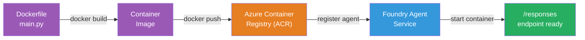
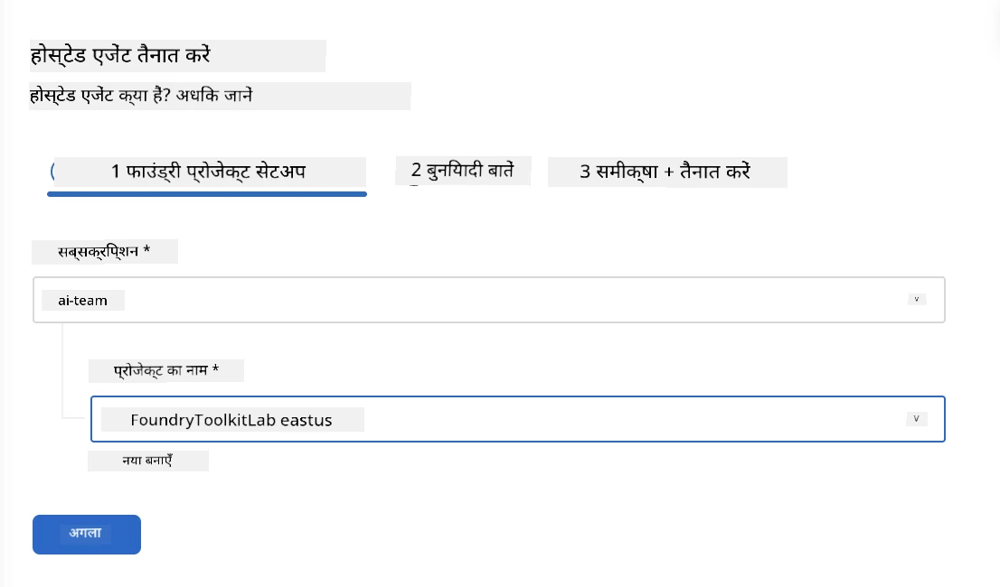
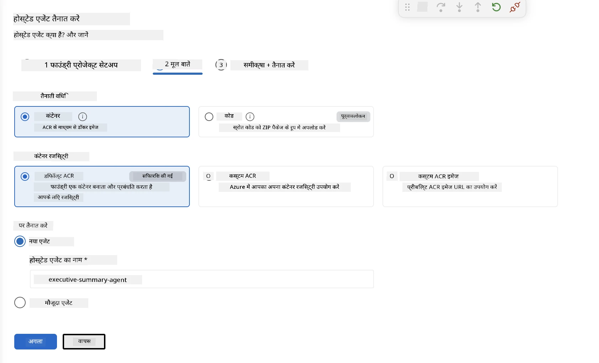
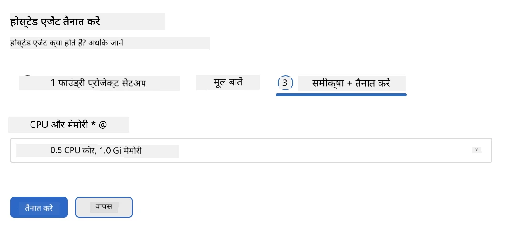
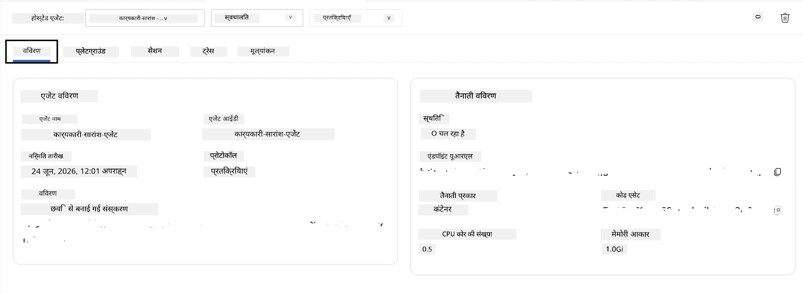

# मॉड्यूल 5 - Foundry एजेंट सेवा में तैनाती

⏱️ ~10 मिनट

> ⚠️ **Path B उपयोगकर्ता:** इस मॉड्यूल के लिए Foundry सदस्यता आवश्यक है। यदि आप Foundry Local का उपयोग कर रहे हैं, तो [मॉड्यूल 07 - सारांश](07-summary.md) पर जाएं। आपने स्थानीय विकास वर्कफ़्लो सफलतापूर्वक पूरा कर लिया है!

इस मॉड्यूल में, आप अपने स्थानीय रूप से परीक्षण किए गए एजेंट को Microsoft Foundry पर **Hosted Agent** के रूप में डिप्लॉय करते हैं। यह तैनाती एक कंटेनर इमेज बनाती है, उसे Azure Container Registry में पुश करती है, और Foundry के प्रबंधित इन्फ्रास्ट्रक्चर में एजेंट को शुरू करती है।

### तैनाती पाइपलाइन

---

## पूर्वापेक्षाएँ जांच

तैनाती से पहले, सुनिश्चित करें:

- [ ] एजेंट सभी 3 स्थानीय परिदृश्यों से सफलतापूर्वक गुजरता है [मॉड्यूल 04](04-test-locally.md)
- [ ] आपके पास प्रोजेक्ट स्तर पर **Azure AI User** भूमिका है ([मॉड्यूल 01, RBAC सौंपें](01-setup.md#deploy-a-model--assign-rbac))
- [ ] आप VS Code में Azure में साइन इन हैं (Accounts आइकन आपके नाम को दिखाता है)

---

## कदम 1: तैनाती शुरू करें

### विकल्प A: Agent Inspector से तैनात करें (अनुशंसित)

यदि Agent Inspector खुला है (परीक्षण से):
1. ऊपर-दाएं कोने में **Deploy** बटन पर क्लिक करें (बादल आइकन ↑)।

### विकल्प B: कमांड पैलेट से तैनात करें

1. दबाएं `Ctrl+Shift+P` → **Foundry Toolkit: Deploy Hosted Agent**।

---

## कदम 2: तैनाती कॉन्फ़िगर करें

विज़ार्ड आपसे पूछेगा:

| संकेत | चयन |
|--------|-----------|
| **सदस्यता** | आपकी Azure सदस्यता |
| **लक्ष्य प्रोजेक्ट** | आपका Foundry प्रोजेक्ट (जैसे, `workshop-agents`) |

अपने एजेंट को कॉन्फ़िगर करने के लिए **next** पर क्लिक करें।

| संकेत | चयन |
|--------|-----------|
| **तैनाती विधि** | कंटेनर |
| **कंटेनर रजिस्ट्री** | **डिफ़ॉल्ट ACR** (Microsoft Foundry आपके लिए एक बनाता और प्रबंधित करता है) |
| **पर तैनात करें** | नया एजेंट (नाम, `executive-summary-agent`) |

अपने एजेंट की समीक्षा और तैनाती के लिए **next** पर क्लिक करें।

| संकेत | चयन |
|--------|-----------|
| **CPU और मेमोरी** | **0.5 CPU कोर, 1.0 Gi मेमोरी** (डिफ़ॉल्ट - कार्यशाला के लिए पर्याप्त) |

---

## कदम 3: तैनात करें और निगरानी करें

1. **Deploy** पर क्लिक करें।
2. **Output** पैनल देखें (ड्रॉपडाउन से **Microsoft Foundry** चुनें)।
3. तैनाती निम्न चरणों से गुजरती है:
   - **Docker build** - आपके Dockerfile से कंटेनर बनाता है
   - **Docker push** - इमेज को ACR में पुश करता है (पहली तैनाती पर 1–3 मिनट)
   - **Agent registration** - Foundry में होस्टेड एजेंट बनाता है
   - **Container start** - सिस्टम-प्रबंधित पहचान के साथ शुरू करता है

4. पूर्ण होने पर, एक सूचना प्रकट होती है:
   > **executive-summary-agent सफलतापूर्वक तैनात हो गया है।** `View logs` `Run agent`

5. एजेंट प्लेग्राउंड खोलने के लिए **Run agent** पर क्लिक करें।

### तैनाती स्थिति मान

| स्थिति | अर्थ |
|--------|---------|
| **Running** | कंटेनर तैयार, एजेंट प्रतिक्रिया दे रहा है |
| **Pending** | कंटेनर शुरू हो रहा है - 30–60 सेकंड प्रतीक्षा करें |
| **Failed** | लॉग जांचें (नीचे समस्या निवारण देखें) |

---

## सामान्य तैनाती त्रुटियाँ

| त्रुटि | मुख्य कारण | सुधार |
|-------|-----------|-----|
| `agents/write` अनुमति अस्वीकृत | प्रोजेक्ट स्तर पर **Azure AI User** भूमिका गायब है | [मॉड्यूल 01, RBAC सौंपें](01-setup.md#deploy-a-model--assign-rbac) |
| Docker नहीं चल रहा | Docker Desktop शुरू नहीं हुआ | Docker Desktop शुरू करें → पुष्टि करें `docker info` |
| ACR प्राधिकरण | प्रबंधित पहचान छवि खींच नहीं सकती | देखें [मॉड्यूल 08 - समस्या निवारण](08-troubleshooting.md) |

---

### ✅ जांच बिंदु

- [ ] तैनाती बिना त्रुटि के पूरी हुई
- [ ] Foundry Toolkit साइडबार में अपने प्रोजेक्ट के तहत **Agents** पर क्लिक करने पर एजेंट **Hosted Agent** टैब में दिखाई देता है
- [ ] कंटेनर स्थिति **Running** दिखाती है
- [ ] एजेंट प्लेग्राउंड टैब खुला है जिसमें एजेंट विवरण और एंडपॉइंट URL दिख रहा है

---

**पिछला:** [04 - स्थानीय परीक्षण](04-test-locally.md) · **अगला:** [06 - प्लेग्राउंड में सत्यापित करें →](06-verify-in-playground.md)

---

<!-- CO-OP TRANSLATOR DISCLAIMER START -->
**अस्वीकरण**:
इस दस्तावेज़ का अनुवाद AI अनुवाद सेवा [Co-op Translator](https://github.com/Azure/co-op-translator) का उपयोग करके किया गया है। जबकि हम सटीकता के लिए प्रयास करते हैं, कृपया ध्यान दें कि स्वचालित अनुवादों में त्रुटियाँ या अशुद्धियाँ हो सकती हैं। मूल दस्तावेज़ अपनी मूल भाषा में ही प्रामाणिक स्रोत माना जाना चाहिए। महत्वपूर्ण जानकारी के लिए, पेशेवर मानव अनुवाद की सिफारिश की जाती है। इस अनुवाद के उपयोग से उत्पन्न किसी भी गलतफहमी या गलत व्याख्या के लिए हम उत्तरदायी नहीं हैं।
<!-- CO-OP TRANSLATOR DISCLAIMER END -->