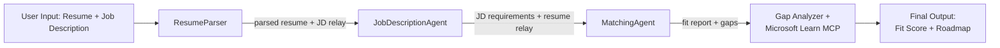

# PersonalCareerCopilot - रिज्यूमे → नौकरी फिट मूल्यांकनकर्ता

एक वर्कफ़्लो-प्रथम मल्टी-एजेंट ऐप जो यह मूल्यांकन करता है कि रिज्यूमे नौकरी विवरण से कितनी अच्छी तरह मेल खाता है, और फिर अंतर को पूरा करने के लिए एक व्यक्तिगत सीखने का रोडमैप उत्पन्न करता है।

---

## एजेंट्स

| एजेंट | भूमिका | उपकरण |
|-------|------|-------|
| **ResumeParser** | रिज्यूमे टेक्स्ट से संरचित कौशल, अनुभव, प्रमाणपत्र निकालता है | - |
| **JobDescriptionAgent** | कार्य विवरण से आवश्यक/पसंदीदा कौशल, अनुभव, प्रमाणपत्र निकालता है | - |
| **MatchingAgent** | प्रोफ़ाइल और आवश्यकताओं की तुलना करता है → फिट स्कोर (0-100) + मेल खाते/अपेक्षित कौशल | - |
| **GapAnalyzer** | Microsoft Learn संसाधनों के साथ व्यक्तिगत सीखने का रोडमैप बनाता है | `search_microsoft_learn_for_plan` (MCP) |

## वर्कफ़्लो



---

## त्वरित शुरुआत

### 1. पर्यावरण सेटअप करें

यह फ़ोल्डर वर्कफ़्लो-आधारित लैब 02 ढाँचे के लिए संदर्भ कार्यान्वयन है। इसका `main.py` मौजूदा प्रॉम्प्ट ब्लॉकों का उपयोग करता है और चार एजेंट्स को जोड़ने के लिए `WorkflowBuilder` का उपयोग करता है।

```powershell
cd workshop\lab02-multi-agent\PersonalCareerCopilot
python -m venv .venv
.\.venv\Scripts\Activate.ps1          # Windows PowerShell
# source .venv/bin/activate            # macOS / Linux
pip install -r requirements.txt
```

### 2. प्रमाणीकरण कॉन्फ़िगर करें

इस फ़ोल्डर में एक `.env` फाइल बनाएं:

```powershell
copy .env .env.bak 2>$null; echo $null > .env
```

`.env` संपादित करें:

```env
FOUNDRY_PROJECT_ENDPOINT=https://<your-account>.services.ai.azure.com/api/projects/<your-project>
AZURE_AI_MODEL_DEPLOYMENT_NAME=gpt-4.1-mini
```

| मान | इसे कहाँ ढूंढें |
|-------|------------------|
| `FOUNDRY_PROJECT_ENDPOINT` | Foundry टूलकिट साइडबार → अपने प्रोजेक्ट पर राइट-क्लिक करें → **प्रोजेक्ट एंडपॉइंट कॉपी करें** |
| `AZURE_AI_MODEL_DEPLOYMENT_NAME` | Foundry साइडबार → प्रोजेक्ट विस्तार करें → **मॉडल्स + एंडपॉइंट्स** → डिप्लॉयमेंट नाम |

### 3. लोकल चलाएं

```powershell
python -m debugpy --listen 127.0.0.1:5679 main.py --port 8088
```

या VS कोड टास्क का उपयोग करें: `Ctrl+Shift+P` → **टास्क: रन टास्क** → **एजेंट HTTP सर्वर चलाएं**।

F5 डिबगिंग के लिए, **डिबग लोकल एजेंट HTTP सर्वर** का उपयोग करें।

### 4. एजेंट इंस्पेक्टर के साथ टेस्ट करें

एजेंट इंस्पेक्टर खोलें: `Ctrl+Shift+P` → **Foundry टूलकिट: एजेंट इंस्पेक्टर खोलें**।

यह परीक्षण प्रॉम्प्ट पेस्ट करें:

```
Resume:
Jane Doe
Senior Software Engineer with 5 years of experience in Python, Django, and AWS.
Built microservices handling 10K+ requests/second. Led a team of 4 developers.
Certifications: AWS Solutions Architect Associate.
Education: B.S. Computer Science, State University.

Job Description:
Senior Cloud Engineer at Contoso Ltd.
Required: Python, Azure, Kubernetes, Terraform, CI/CD pipelines.
Preferred: Go, monitoring (Prometheus/Grafana), cost optimization.
Experience: 5+ years in cloud infrastructure.
Certifications: Azure Solutions Architect Expert preferred.
```

**अपेक्षित:** एक फिट स्कोर (0-100), मेल खाते/गुम हुए कौशल, और Microsoft Learn URLs के साथ एक व्यक्तिगत सीखने का रोडमैप।

### 5. Foundry में डिप्लॉय करें

`Ctrl+Shift+P` → **Foundry टूलकिट: होस्टेड एजेंट डिप्लॉय करें** → अपना प्रोजेक्ट चुनें → पुष्टि करें।

---

## प्रोजेक्ट संरचना

```
PersonalCareerCopilot/
├── .env                ← Your credentials (git-ignored)
├── agent.yaml          ← Hosted agent definition (name, resources, env vars)
├── Dockerfile          ← Container image for Foundry deployment
├── main.py             ← 4-agent workflow (instructions, MCP tool, WorkflowBuilder)
└── requirements.txt    ← Python dependencies
```

## महत्वपूर्ण फाइलें

### `agent.yaml`

Foundry एजेंट सेवा के लिए होस्टेड एजेंट को परिभाषित करता है:
- `kind: hosted` - प्रबंधित कंटेनर के रूप में चलता है
- `protocols` - `responses` प्रोटोकॉल के साथ `version: 2.0.0`, `/responses` HTTP एंडपॉइंट को एक्सपोज़ करता है
- `environment_variables` - यहाँ `AZURE_AI_MODEL_DEPLOYMENT_NAME` घोषित है; `FOUNDRY_PROJECT_ENDPOINT` डिप्लॉय के समय स्वचालित रूप से प्रविष्ट होता है

### `main.py`

इसमें शामिल हैं:
- **एजेंट निर्देश** - चार `*_INSTRUCTIONS` स्थिरांक, प्रत्येक एजेंट के लिए एक
- **MCP उपकरण** - `search_microsoft_learn_for_plan()` स्ट्रीमेबल HTTP के माध्यम से `https://learn.microsoft.com/api/mcp` को कॉल करता है
- **एजेंट निर्माण** - चार `Agent()` + `AgentExecutor()` उदाहरण जो एक `FoundryChatClient` साझा करते हैं
- **वर्कफ़्लो ग्राफ़** - `WorkflowBuilder` एजेंट्स को एक अनुक्रमिक पाइपलाइन के रूप में जोड़ता है: ResumeParser → JD Agent → MatchingAgent → GapAnalyzer
- **सर्वर स्टार्टअप** - `ResponsesHostServer` पोर्ट 8088 पर चलता है

### `requirements.txt`

| पैकेज | प्रयोजन |
|---------|----------|
| `agent-framework-foundry` | कोर रनटाइम: `Agent`, `AgentExecutor`, `WorkflowBuilder`, `@tool`, `FoundryChatClient` |
| `agent-framework-foundry-hosting` | `ResponsesHostServer` + Foundry होस्टिंग एकीकरण |
| `mcp<2,>=1.24.0` | GapAnalyzer के लिए MCP क्लाइंट (`streamable_http_client`) |
| `debugpy` | पायथन डिबगिंग (VS कोड में F5) |

---

## समस्या निवारण

| समस्या | समाधान |
|-------|-----|
| `KeyError: 'FOUNDRY_PROJECT_ENDPOINT'` या `KeyError: 'AZURE_AI_MODEL_DEPLOYMENT_NAME'` | एक `.env` बनाएँ जिसमें `FOUNDRY_PROJECT_ENDPOINT` और `AZURE_AI_MODEL_DEPLOYMENT_NAME` दोनों सेट हों |
| `ModuleNotFoundError: No module named 'agent_framework'` | venv सक्रिय करें और `pip install -r requirements.txt` चलाएं |
| आउटपुट में कोई Microsoft Learn URLs नहीं | इंटरनेट कनेक्टिविटी जांचें `https://learn.microsoft.com/api/mcp` से |
| केवल 1 गैप कार्ड (कटाया हुआ) | जांचें कि `GAP_ANALYZER_INSTRUCTIONS` में `CRITICAL:` ब्लॉक शामिल है |
| पोर्ट 8088 उपयोग में है | अन्य सर्वरों को रोकें: `netstat -ano \| findstr :8088` |

विस्तृत समस्या निवारण के लिए, देखें [मॉड्यूल 8 - समस्या निवारण](../docs/08-troubleshooting.md)।

---

**पूर्ण मार्गदर्शन:** [लैब 02 डॉक्स](../docs/README.md) · **वापस जाएं:** [लैब 02 README](../README.md) · [कार्यशाला मुख्य पृष्ठ](../../../README.md)

---

<!-- CO-OP TRANSLATOR DISCLAIMER START -->
**अस्वीकरण**:
इस दस्तावेज़ का अनुवाद AI अनुवाद सेवा [Co-op Translator](https://github.com/Azure/co-op-translator) का उपयोग करके किया गया है। जबकि हम सटीकता के लिए प्रयास करते हैं, कृपया ध्यान दें कि स्वचालित अनुवादों में त्रुटियाँ या अशुद्धियाँ हो सकती हैं। मूल दस्तावेज़ अपनी मूल भाषा में ही प्रामाणिक स्रोत माना जाना चाहिए। महत्वपूर्ण जानकारी के लिए, पेशेवर मानव अनुवाद की सिफारिश की जाती है। इस अनुवाद के उपयोग से उत्पन्न किसी भी गलतफहमी या गलत व्याख्या के लिए हम उत्तरदायी नहीं हैं।
<!-- CO-OP TRANSLATOR DISCLAIMER END -->