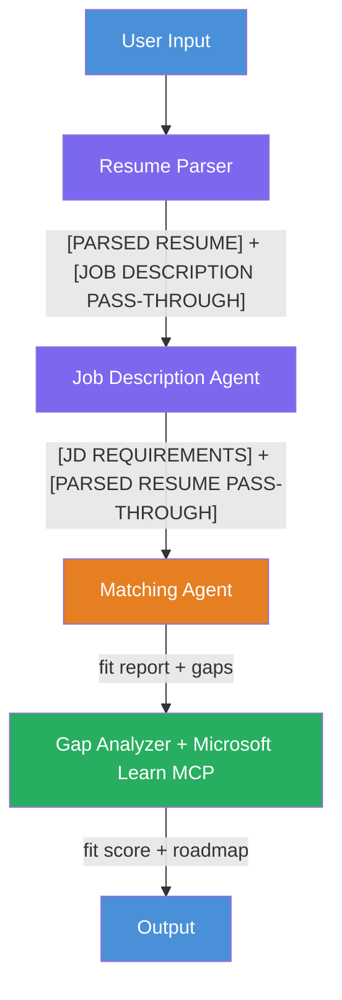

# लैब 02 - मल्टी-एजेंट वर्कफ़्लो: रिज्यूमे → नौकरी फिट मूल्यांकनकर्ता

## अवलोकन

इस प्रायोगिक लैब में, आप VS कोड में Foundry Toolkit का उपयोग करके एक **वर्कफ़्लो-प्रथम मल्टी-एजेंट ऐप** बनाएंगे और इसे Microsoft Foundry Agent Service पर परिनियोजित करेंगे।

**आप जो बनाएंगे:** एक रिज्यूमे → नौकरी फिट मूल्यांकनकर्ता जो रिज्यूमे और नौकरी विवरण का विश्लेषण करता है, मेल का स्कोर देता है, और Microsoft Learn संसाधनों का उपयोग करके एक व्यक्तिगत सीखने का रोडमैप उत्पन्न करता है।

---

## वास्तुकला

**यह कैसे काम करता है:**
1. उपयोगकर्ता एक रिज्यूमे और नौकरी विवरण चिपकाता है।
2. **ResumeParser** रिज्यूमे को पार्स करता है और नौकरी विवरण को वर्बेटिम `[JOB DESCRIPTION PASS-THROUGH]` अनुभाग में कॉपी करता है।
3. **JD Agent** पास-थ्रू से संरचित आवश्यकताएँ निकालता है, फिर `[PARSED RESUME]` को अगले चरण के लिए `[PARSED RESUME PASS-THROUGH]` के रूप में अग्रेषित करता है।
4. **MatchingAgent** `[PARSED RESUME PASS-THROUGH]` बनाम `[JD REQUIREMENTS]` की तुलना करता है और फिट स्कोर उत्पन्न करता है।
5. **GapAnalyzer** गेप्स को व्यावहारिक रोडमैप में बदलता है और MCP के माध्यम से असली Microsoft Learn लिंक प्राप्त करता है।

---

## पूर्वापेक्षाएँ

पहले लैब 01 पूरा करें:

- [लैब 01 - सिंगल एजेंट](../lab01-single-agent/README.md)

---

## भाग 1: मॉड्यूल को क्रम में पढ़ें

पूर्ण सीखने का रास्ता देखें:

- [लैब 2 दस्तावेज़ - पूर्वापेक्षाएँ](docs/00-prerequisites.md)
- [लैब 2 दस्तावेज़ - पूर्ण सीखने का रास्ता](docs/README.md)
- [PersonalCareerCopilot रन गाइड](PersonalCareerCopilot/README.md)

---

## भाग 2: वर्कफ़्लो बनाएं और परीक्षण करें

1. Foundry Toolkit विज़ार्ड का उपयोग करके वर्कफ़्लो-आधारित प्रोजेक्ट का फेसाड तैयार करें।
2. प्रॉम्प्ट ब्लॉक्स और वर्कफ़्लो ग्राफ को `PersonalCareerCopilot/main.py` से अपनी वर्कस्पेस में कॉपी करें।
3. लोकली एजेंट इंस्पेक्टर के साथ चलाएं और चारों एजेंट्स के साथ-साथ MCP टूल को सत्यापित करें।
4. स्थानीय परीक्षण सफल होने पर होस्टेड एजेंट को Foundry पर तैनात करें।

---

## ऑर्केस्ट्रेशन पैटर्न

लैब 02 एक **क्रमिक पाइपलाइन** का उपयोग करती है: प्रत्येक एजेंट का आउटपुट अगले को मिलता है, और वर्कफ़्लो अंतिम एजेंट की प्रतिक्रिया लौटाता है। दो पैटर्न इसे संभव बनाते हैं:

- **क्रमिक श्रृंखला** - `WorkflowBuilder` ResumeParser → JD Agent → MatchingAgent → GapAnalyzer को जोड़ता है, प्रत्येक चरण के लिए एक `add_edge()` कॉल के साथ
- **सामग्री रिले** - क्योंकि प्रत्येक एजेंट केवल अपने पिछले एजेंट का आउटपुट देखता है, ResumeParser और JD Agent डाउनस्ट्रीम एजेंट्स को आवश्यक डेटा लेबल किए गए पास-थ्रू सेक्शन्स में कॉपी करते हैं

दस्तावेज़ यह भी समझाते हैं कि लैब में फैन-आउट/फैन-इन क्यों नहीं इस्तेमाल होता है, और ग्राफ़ में दूसरे एजेंट को कैसे जोड़ा जा सकता है।

देखें [docs/04-orchestration-patterns.md](docs/04-orchestration-patterns.md)।

---

**पिछला:** [लैब 01 - सिंगल एजेंट](../lab01-single-agent/README.md) · **वापस जाएं:** [कार्यशाला होम](../../README.md)

---

<!-- CO-OP TRANSLATOR DISCLAIMER START -->
**अस्वीकरण**:
इस दस्तावेज़ का अनुवाद AI अनुवाद सेवा [Co-op Translator](https://github.com/Azure/co-op-translator) का उपयोग करके किया गया है। जबकि हम सटीकता के लिए प्रयास करते हैं, कृपया ध्यान दें कि स्वचालित अनुवादों में त्रुटियाँ या अशुद्धियाँ हो सकती हैं। मूल दस्तावेज़ अपनी मूल भाषा में ही प्रामाणिक स्रोत माना जाना चाहिए। महत्वपूर्ण जानकारी के लिए, पेशेवर मानव अनुवाद की सिफारिश की जाती है। इस अनुवाद के उपयोग से उत्पन्न किसी भी गलतफहमी या गलत व्याख्या के लिए हम उत्तरदायी नहीं हैं।
<!-- CO-OP TRANSLATOR DISCLAIMER END -->