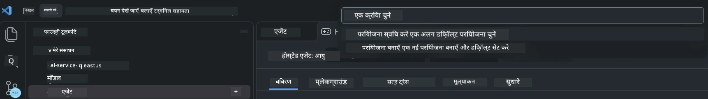

# मॉड्यूल 0 - परिचय

⏱️ ~10 मिनट

> [!WARNING]
> **पूर्वावलोकन और सीमाएं:** [Hosted Agents](https://learn.microsoft.com/azure/foundry/agents/concepts/hosted-agents) वर्तमान में **सार्वजनिक पूर्वावलोकन** में हैं - उत्पादन कार्यभार के लिए अनुशंसित नहीं। इस कार्यशाला में दिखाए गए कुछ फीचर सेवा के GA की ओर बढ़ने के साथ बदल सकते हैं।

## आप क्या बनाएंगे

इस लैब में, आप Lab 01 से एकल-एजेंट कौशल को बढ़ाकर एक **मल्टी-एजेंट वर्कफ़्लो** बनाते हैं - Resume → Job Fit Evaluator.

आप एक **रिज़्यूमे** और एक **नौकरी का विवरण** चिपकाते हैं। चार विशेषज्ञ एजेंट इनपुट को क्रमिक रूप से प्रोसेस करते हैं, फिर लौटाते हैं:
- एक फिट स्कोर (0–100 स्कोरिंग ब्रेकडाउन के साथ)
- एक कौशल और प्रमाणपत्र अंतर सूची
- प्रत्येक अंतर के लिए वास्तविक Microsoft Learn लिंक के साथ एक व्यक्तिगत सीखने का रोडमैप

**वर्कफ़्लो उपयोग करता है:**
- **Microsoft Agent Framework** - `WorkflowBuilder` के लिए अनुक्रमिक पाइपलाइन ऑर्केस्ट्रेशन
- **Foundry Toolkit for VS Code** - स्कैफ़ोल्ड, स्थानीय परीक्षण, तैनाती
- **एक AI मॉडल** (जैसे `gpt-4.1-mini`) - सभी चार एजेंटों द्वारा उपयोग किया जाता है
- **Microsoft Learn MCP सर्वर** - प्रत्येक कौशल अंतर के लिए वास्तविक शिक्षण संसाधन लिंक प्रदान करता है

---

## अपनी मार्ग चुनें

> ⚠️ **वही मार्ग जारी रखें जो आपने Lab 01 में उपयोग किया था।**

<details open>
<summary><strong>🅰️ पथ A - Azure क्लाउड (Azure सदस्यता आवश्यक)</strong></summary>

| | विवरण |
|---|---|
| **यह किसके लिए है?** | आपने Azure सदस्यता का उपयोग करके Lab 01 पूरा किया है |
| **मॉडल** | Foundry के माध्यम से Azure OpenAI (जैसे `gpt-4.1-mini`) |
| **शामिल मॉड्यूल** | सभी मॉड्यूल (00–09) |
| **क्लाउड पर तैनात करें?** | ✅ हाँ - पूर्ण एंड-टू-एंड तैनाती |

</details>

<details open>
<summary><strong>🅱️ पथ B - Foundry Local (कोई Azure सदस्यता आवश्यक नहीं)</strong></summary>

| | विवरण |
|---|---|
| **यह किसके लिए है?** | आपने Foundry Local का उपयोग करके Lab 01 पूरा किया है |
| **मॉडल** | Foundry Local (मुफ़्त, आपके कंप्यूटर पर चलता है) |
| **शामिल मॉड्यूल** | मॉड्यूल 00–05 (06–07 छोड़ें - तैनाती और क्लाउड सत्यापन) |
| **क्लाउड पर तैनात करें?** | ❌ नहीं - केवल Agent Inspector के माध्यम से स्थानीय परीक्षण |

</details>

---

## Lab 01 जांच

Lab 02 सीधे Lab 01 पर आधारित है। यहाँ शुरू करने से पहले पहले Lab 01 पूरा करें।

अभी तक Lab 01 नहीं किया? यहाँ से शुरू करें: [Lab 01 - Introduction](../../lab01-single-agent/docs/00-prerequisites.md)

<details open>
<summary><strong>🅰️ पथ A - Azure क्लाउड</strong></summary>

```powershell
az account show --query "{name:name, id:id}" --output table
```

यदि यह असफल हो, तो `az login` चलाएँ। फिर VS कोड में सत्यापित करें:

1. `Ctrl+Shift+P` → **Foundry Toolkit** टाइप करें → पुष्टि करें कि कमांड दिख रही हैं।
2. **Foundry Toolkit** आइकन पर क्लिक करें → आपका प्रोजेक्ट और तैनात मॉडल **सफल** दिखाए।



> **RBAC:** आप ने Lab 01 में **Foundry User** असाइन किया था। अगर पुनः असाइन करना है, तो देखें [Lab 01, Module 1](../../lab01-single-agent/docs/01-setup.md#deploy-a-model--assign-rbac)। भूमिका पहले **Azure AI User** नाम से थी - समान अनुमतियाँ।

</details>

<details open>
<summary><strong>🅱️ पथ B - Foundry Local</strong></summary>

```powershell
Invoke-WebRequest -Uri "http://localhost:5273/v1/health" -UseBasicParsing | Select-Object StatusCode
```

अपेक्षित: `StatusCode: 200`। यदि नहीं, तो Foundry Toolkit साइडबार से Foundry Local पुनः प्रारंभ करें।

> सभी अनुमानीकरण आपके कंप्यूटर पर चलता है। केवल बाहरी कॉल MCP टूल के लिए `https://learn.microsoft.com/api/mcp` को होती है।

</details>

---

## Lab 02 में क्या नया है

| | Lab 01 | Lab 02 |
|--|--------|--------|
| एजेंट्स | 1 | 4 (WorkflowBuilder के साथ क्रमबद्ध) |
| स्कैफ़ोल्ड टेम्पलेट | बेसिक - एजेंट फ्रेमवर्क | वर्कफ़्लोज़ - एजेंट फ्रेमवर्क |
| नया पैकेज | - | `mcp` |
| ऑर्केस्ट्रेशन | एकल वार्तालाप एजेंट | अनुक्रमिक पाइपलाइन (WorkflowBuilder) |
| नया टूल | - | `search_microsoft_learn_for_plan` (MCP) |

---

**अगला:** [01 - आर्किटेक्चर को समझें →](01-understand-multi-agent.md)

---

<!-- CO-OP TRANSLATOR DISCLAIMER START -->
**अस्वीकरण**:
इस दस्तावेज़ का अनुवाद AI अनुवाद सेवा [Co-op Translator](https://github.com/Azure/co-op-translator) का उपयोग करके किया गया है। जबकि हम सटीकता के लिए प्रयास करते हैं, कृपया ध्यान दें कि स्वचालित अनुवादों में त्रुटियाँ या अशुद्धियाँ हो सकती हैं। मूल दस्तावेज़ अपनी मूल भाषा में ही प्रामाणिक स्रोत माना जाना चाहिए। महत्वपूर्ण जानकारी के लिए, पेशेवर मानव अनुवाद की सिफारिश की जाती है। इस अनुवाद के उपयोग से उत्पन्न किसी भी गलतफहमी या गलत व्याख्या के लिए हम उत्तरदायी नहीं हैं।
<!-- CO-OP TRANSLATOR DISCLAIMER END -->