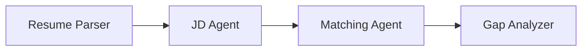
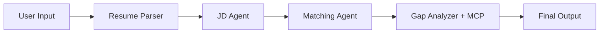

# मॉड्यूल 4 - ऑर्केस्ट्रेशन पैटर्न

⏱️ ~10 मिनट

इस मॉड्यूल में, आप Resume Job Fit Evaluator में उपयोग किए गए ऑर्केस्ट्रेशन पैटर्न का पता लगाते हैं और सीखते हैं कि वर्कफ़्लो ग्राफ को कैसे पढ़ें, संशोधित करें, और बढ़ाएं। इन पैटर्न्स को समझना डेटा फ्लो मुद्दों को डिबग करने और अपने स्वयं के [मल्टी-एजेंट वर्कफ़्लोज़](https://learn.microsoft.com/agent-framework/workflows/) बनाने के लिए आवश्यक है।

---

## पैटर्न 1: अनुक्रमिक श्रृंखला

वर्कफ़्लो में मौलिक पैटर्न एक **अनुक्रमिक श्रृंखला** है - प्रत्येक एजेंट का आउटपुट सीधे अगले में जाता है।



कोड में, प्रत्येक `add_edge()` कॉल श्रृंखला में एक चरण बनाता है:

```python
.add_edge(resume_executor, jd_executor)       # ResumeParser output → JD Agent
.add_edge(jd_executor, matching_executor)     # JD Agent output → MatchingAgent
.add_edge(matching_executor, gap_executor)    # MatchingAgent output → GapAnalyzer
```

> **क्यों अनुक्रमिक, फैन-आउट/फैन-इन नहीं?** `WorkflowBuilder` इनकमिंग एजेस के लिए **OR-सेमान्टिक्स** का उपयोग करता है: एक डाउनस्ट्रीम निष्पादक तुरंत सक्रिय हो जाता है जब **कोई भी** पूर्ववर्ती पूरा हो जाता है। यदि `matching_executor` के दो इनकमिंग एजेस होते (दोनों `resume_executor` और `jd_executor` से), तो यह दो बार ट्रिगर होता - एक बार ResumeParser खत्म होने पर और एक बार JD Agent खत्म होने पर - जिससे GapAnalyzer भी दो बार चले और आउटपुट दो बार दिखाई दे। अनुक्रमिक पाइपलाइन इससे पूरी तरह बचती है।

## पैटर्न 2: सामग्री रिले

क्योंकि `context_mode="last_agent"` का मतलब है कि प्रत्येक निष्पादक केवल अपने **प्रत्यक्ष पूर्ववर्ती के आउटपुट** को देखता है, इसलिए अनुक्रमिक श्रृंखला में एजेंटों को स्पष्ट रूप से आगे कोई भी डेटा पास करना होता है जिसकी डाउनस्ट्रीम एजेंटों को आवश्यकता होती है।

इस वर्कफ़्लो में:
- **ResumeParser** JD को बिल्कुल वैसा का वैसा `[JOB DESCRIPTION PASS-THROUGH]` में कॉपी करता है (ताकि JD Agent इसे खोज सके)।
- **JD Agent** `[PARSED RESUME]` को बिल्कुल वैसा का वैसा `[PARSED RESUME PASS-THROUGH]` में कॉपी करता है (ताकि MatchingAgent दोनों प्रोफाइलों की तुलना कर सके)।

```
ResumeParser output
└─ [PARSED RESUME]               ← extracted by JD Agent
└─ [JOB DESCRIPTION PASS-THROUGH] ← extracted by JD Agent

JD Agent output
└─ [JD REQUIREMENTS]             ← extracted by MatchingAgent
└─ [PARSED RESUME PASS-THROUGH]  ← extracted by MatchingAgent
```

प्रत्येक रिले सेक्शन को **बिल्कुल वैसा का वैसा** कॉपी किया जाना चाहिए - इसका सारांश या पुनर्लेखन डाउनस्ट्रीम एजेंट को तोड़ देता है जो इस पर निर्भर करता है।

---

## पूरा ग्राफ

अनुक्रमिक श्रृंखला और सामग्री रिले पैटर्न को मिलाकर पूरा वर्कफ़्लो बनता है:



एजेंट इंस्पेक्टर यह समान ग्राफ संरचना तब दिखाता है जब एजेंट स्थानीय रूप से चल रहा होता है। स्क्रीनशॉट्स के लिए [मॉड्यूल 5 - लोकल टेस्ट](05-test-locally.md) देखें।

---

## WorkflowBuilder कोड पढ़ना

वर्कफ़्लो ग्राफ `main()` फ़ंक्शन में बनाया जाता है [`PersonalCareerCopilot/main.py`](../../../../../workshop/lab02-multi-agent/PersonalCareerCopilot/main.py) में। तीन `add_edge()` कॉल अनुक्रमिक पाइपलाइन बनाते हैं:

| # | एज | प्रभाव |
|---|------|--------|
| 1 | `resume_executor → jd_executor` | JD Agent को `[PARSED RESUME]` + `[JOB DESCRIPTION PASS-THROUGH]` प्राप्त होते हैं |
| 2 | `jd_executor → matching_executor` | MatchingAgent को `[JD REQUIREMENTS]` + `[PARSED RESUME PASS-THROUGH]` प्राप्त होते हैं |
| 3 | `matching_executor → gap_executor` | GapAnalyzer को फिट रिपोर्ट + गैप लिस्ट मिलती है |

---

## ग्राफ संशोधित करना

### नया एजेंट जोड़ना

पांचवां एजेंट जोड़ने के लिए (जैसे GapAnalyzer के बाद एक **InterviewPrepAgent**):

1. एक `INTERVIEW_PREP_INSTRUCTIONS` कॉन्स्टेंट परिभाषित करें।
2. `Agent` + `AgentExecutor` ऑब्जेक्ट्स बनाएं (मौजूदा चार के समान पैटर्न)।
3. `.add_edge(gap_executor, interview_exec)` में जोड़ें `WorkflowBuilder`।
4. अपडेट करें `output_executors=[interview_exec]`।

> **महत्वपूर्ण:** `start_executor` एकमात्र एजेंट है जो कच्चे उपयोगकर्ता इनपुट को प्राप्त करता है। सभी अन्य एजेंट अपने अपस्ट्रीम एज से आउटपुट प्राप्त करते हैं।

---

## सामान्य ग्राफ गलतियाँ

| गलती | लक्षण | समाधान |
|---------|---------|-----|
| `output_executors` के लिए एज मिसिंग एज | एजेंट चलता है लेकिन आउटपुट खाली है | सुनिश्चित करें कि `start_executor` से हर एजेंट तक पथ है `output_executors` में |
| परिपत्र निर्भरता | अनंत लूप या टाइमआउट | जांच करें कि कोई भी एजेंट अपने अपस्ट्रीम एजेंट को वापस न खिलाए |
| `output_executors` में एजेंट जिसके पास कोई इनकमिंग एज नहीं है | खाली आउटपुट | कम से कम एक `add_edge(source, that_agent)` जोड़ें |
| फैन-इन के बिना एक से अधिक `output_executors` | आउटपुट में केवल एक एजेंट का जवाब होता है | एक सिंगल आउटपुट एजेंट का उपयोग करें जो समेकित करे, या कई आउटपुट स्वीकार करें |
| `start_executor` मिसिंग | बिल्ड समय पर `ValueError` | हमेशा `start_executor` को निर्दिष्ट करें `WorkflowBuilder()` में |

---

## ग्राफ डिबगिंग

### एजेंट इंस्पेक्टर का उपयोग करना

1. एजेंट को लोकल पर F5 के साथ शुरू करें।
2. एजेंट इंस्पेक्टर खोलें (`Ctrl+Shift+P` → **Foundry Toolkit: Open Agent Inspector**)।
3. एक परीक्षण संदेश भेजें।
4. इंस्पेक्टर के जवाब पैनल में, **स्ट्रीमिंग आउटपुट** देखें - यह अनुक्रम में प्रत्येक एजेंट का योगदान दिखाता है।


### लॉगिंग का उपयोग करना

डेटा फ्लो को ट्रेस करने के लिए `main.py` में लॉगिंग जोड़ें:

```python
import logging
logger = logging.getLogger("resume-job-fit")

# In main(), after building the workflow:
logger.info("Workflow graph built with edges: RP→JD, JD→MA, MA→GA")
```

सर्वर लॉग्स एजेंट निष्पादन क्रम और MCP टूल कॉल दिखाते हैं:

```
INFO:agent_framework:Executing agent: ResumeParser
INFO:agent_framework:Executing agent: JobDescriptionAgent
INFO:agent_framework:Executing agent: MatchingAgent
INFO:agent_framework:Executing agent: GapAnalyzer
INFO:agent_framework:Tool call: search_microsoft_learn_for_plan(skill="Kubernetes")
POST https://learn.microsoft.com/api/mcp → 200
INFO:agent_framework:Tool call: search_microsoft_learn_for_plan(skill="Terraform")
POST https://learn.microsoft.com/api/mcp → 200
```

---

### चेकपॉइंट

- [ ] आप वर्कफ़्लो में दोनों ऑर्केस्ट्रेशन पैटर्न्स: अनुक्रमिक श्रृंखला और सामग्री रिले की पहचान कर सकते हैं
- [ ] आप समझते हैं कि क्यों `context_mode="last_agent"` एजेंटों के बीच स्पष्ट डेटा रिले की आवश्यकता है
- [ ] आप `WorkflowBuilder` कोड पढ़ सकते हैं और प्रत्येक `add_edge()` कॉल को विज़ुअल ग्राफ से मैप कर सकते हैं
- [ ] आप जानते हैं कि पाइपलाइन के अंत में नया एजेंट कैसे जोड़ा जाता है
- [ ] आप सामान्य ग्राफ गलतियों और उनके लक्षणों की पहचान कर सकते हैं

---

**पिछला:** [03 - एजेंट्स & पर्यावरण कॉन्फ़िगर करें](03-configure-agents.md) · **अगला:** [05 - लोकल टेस्ट →](05-test-locally.md)

---

<!-- CO-OP TRANSLATOR DISCLAIMER START -->
**अस्वीकरण**:
इस दस्तावेज़ का अनुवाद AI अनुवाद सेवा [Co-op Translator](https://github.com/Azure/co-op-translator) का उपयोग करके किया गया है। जबकि हम सटीकता के लिए प्रयास करते हैं, कृपया ध्यान दें कि स्वचालित अनुवादों में त्रुटियाँ या अशुद्धियाँ हो सकती हैं। मूल दस्तावेज़ अपनी मूल भाषा में ही प्रामाणिक स्रोत माना जाना चाहिए। महत्वपूर्ण जानकारी के लिए, पेशेवर मानव अनुवाद की सिफारिश की जाती है। इस अनुवाद के उपयोग से उत्पन्न किसी भी गलतफहमी या गलत व्याख्या के लिए हम उत्तरदायी नहीं हैं।
<!-- CO-OP TRANSLATOR DISCLAIMER END -->