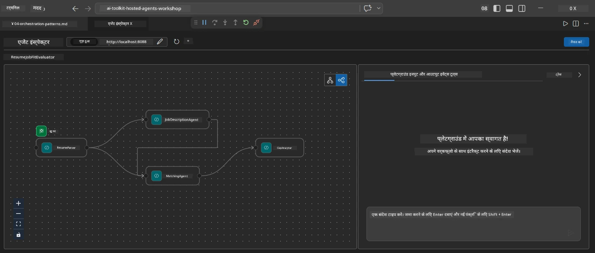
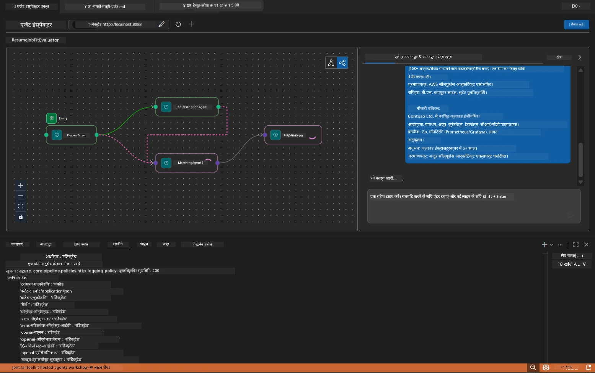
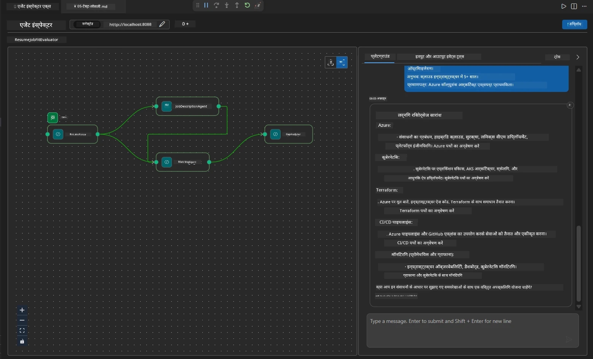

# मॉड्यूल 5 - स्थानीय रूप से परीक्षण करें

⏱️ ~15 मिनट

इस मॉड्यूल में, आप मल्टी-एजेंट वर्कफ़्लो को स्थानीय रूप से चलाते हैं, एजेंट इंस्पेक्टर के साथ इसका परीक्षण करते हैं, और यह सत्यापित करते हैं कि सभी चार एजेंट और MCP टूल सही तरीके से काम करते हैं या नहीं, इसके बाद तैनाती करते हैं।

---

## चरण 1: एजेंट सर्वर शुरू करें

### विकल्प A: VS कोड टास्क का उपयोग करना (अनुशंसित)

1. अपने VS कोड फ़ोल्डर के रूप में `workshop/lab02-multi-agent/PersonalCareerCopilot/` खोलें।
2. `Ctrl+Shift+P` दबाएं → टाइप करें **Tasks: Run Task** → **Run Agent HTTP Server** चुनें।
3. टास्क डिबगपी के साथ पोर्ट `5679` पर सर्वर और पोर्ट `8088` पर एजेंट शुरू करता है।
4. आउटपुट के स्टार्टअप संदेश और सर्वर के रेडी संदेश (अन्य लॉग लाइनें बीच में दिख सकती हैं) का इंतजार करें:

```
INFO:resume-job-fit:Starting Resume -> Job Fit Evaluator HTTP server...
...
INFO:hypercorn.error:Running on http://0.0.0.0:8088 (CTRL + C to quit)
```

### विकल्प B: F5 (डिबग मोड) का उपयोग करना

1. `F5` दबाएं → **Debug Local Agent HTTP Server** चुनें।
2. सर्वर पूर्ण ब्रेकपॉइंट सपोर्ट के साथ शुरू होता है - MCP प्रतिक्रियाओं या एजेंट आउटपुट जांचने के लिए उपयोगी।

---

## चरण 2: एजेंट इंस्पेक्टर खोलें

1. `Ctrl+Shift+P` दबाएं → टाइप करें **Foundry Toolkit: Open Agent Inspector**।
2. एजेंट इंस्पेक्टर एक VS कोड पैनल के रूप में खुलता है जो `http://localhost:8088` से जुड़ा होता है।
3. आपको एजेंट इंटरफ़ेस ऐसे संदेश स्वीकारने के लिए तैयार दिखना चाहिए।



> **अगर एजेंट इंस्पेक्टर नहीं खुलता है:** सुनिश्चित करें कि सर्वर पूरी तरह से शुरू हो चुका है (आप `Running on http://0.0.0.0:8088` लॉग देखते हैं)। अगर पोर्ट 5679 व्यस्त है, तो देखें [मॉड्यूल 8 - समस्या निवारण](08-troubleshooting.md)।

---

## चरण 2b: (वैकल्पिक) वर्कफ़्लो विज़ुअलाइज़र खोलें

Foundry Toolkit में एक वास्तविक समय का **Workflow Visualizer** शामिल है जो दिखाता है कि एजेंट ग्राफ़ के निष्पादन के दौरान कैसे इंटरैक्ट करते हैं। यह विशेष रूप से मल्टी-एजेंट डिबगिंग के लिए उपयोगी है।

1. `Ctrl+Shift+P` दबाएं → टाइप करें **Foundry Toolkit: Open Visualizer for Hosted Agents**।
2. एक नया VS कोड टैब खुलता है जो लाइव निष्पादन ग्राफ दिखाता है।
3. जैसे ही आप एजेंट इंस्पेक्टर में संदेश भेजते हैं, विज़ुअलाइज़र स्वचालित रूप से अपडेट होता है - हरे नोड पूरे किए गए एजेंटों को दर्शाते हैं, और एनिमेटेड एजेस डेटा प्रवाह दिखाते हैं।

> **पोर्ट संघर्ष:** अगर विज़ुअलाइज़र पोर्ट पहले से उपयोग में है, तो इसे VS कोड सेटिंग्स → **Extensions** → **Microsoft Foundry Configuration** → **Hosted Agents: Visualizer Port** में बदलें।

---

## चरण 3: स्मोक टेस्ट चलाएं

इन दो परीक्षणों को क्रम में चलाएं। प्रत्येक परीक्षण धीरे-धीरे वर्कफ़्लो का अधिक हिस्सा जांचता है।

### टेस्ट 1: मूल रिज़्यूमे + नौकरी विवरण

निम्नलिखित एजेंट इंस्पेक्टर में चिपकाएं:

```
Resume:
Jane Doe
Senior Software Engineer with 5 years of experience in Python, Django, and AWS.
Built microservices handling 10K+ requests/second. Led a team of 4 developers.
Certifications: AWS Solutions Architect Associate.
Education: B.S. Computer Science, State University.

Job Description:
Senior Cloud Engineer at Contoso Ltd.
Required: Python, Azure, Kubernetes, Terraform, CI/CD pipelines.
Preferred: Go, monitoring (Prometheus/Grafana), cost optimization.
Experience: 5+ years in cloud infrastructure.
Certifications: Azure Solutions Architect Expert preferred.
```

**अपेक्षित आउटपुट संरचना:**

प्रतिक्रिया में सभी चार एजेंटों का आउटपुट अनुक्रम में होना चाहिए:

1. **रिज़्यूमे पार्सर आउटपुट** - दो लेबल किए गए भाग: `[PARSED RESUME]` (समूहित कौशल के साथ उम्मीदवार प्रोफ़ाइल) और `[JOB DESCRIPTION PASS-THROUGH]` (जेडी एजेंट को फीड करने वाला शब्दशः जॉब डिस्क्रिप्शन टेक्स्ट)
2. **जेडी एजेंट आउटपुट** - आवश्यक बनाम पसंदीदा कौशल विभक्त संरचित आवश्यकताएं
3. **मैचिंग एजेंट आउटपुट** - फिट स्कोर (0-100) ब्रेकडाउन के साथ, मिलाए गए कौशल, गायब कौशल, अंतर
4. **गैप एनालाइज़र आउटपुट** - प्रत्येक गायब कौशल के लिए व्यक्तिगत गैप कार्ड, प्रत्येक के साथ Microsoft Learn URL





### टेस्ट 1 में क्या सत्यापित करें

| जांचें | अपेक्षित | पास? |
|-------|----------|-------|
| प्रतिक्रिया में फिट स्कोर हो | 0-100 के बीच अंक और ब्रेकडाउन | |
| मिलाए गए कौशल सूचीबद्ध हों | Python, CI/CD (आंशिक), आदि | |
| गायब कौशल सूचीबद्ध हों | Azure, Kubernetes, Terraform, आदि | |
| प्रत्येक गायब कौशल के लिए गैप कार्ड मौजूद हों | हर कौशल के लिए एक कार्ड | |
| Microsoft Learn URLs मौजूद हों | वास्तविक `learn.microsoft.com` लिंक | |
| प्रतिक्रिया में कोई त्रुटि संदेश न हो | साफ़-सुथरा संरचित आउटपुट | |

### टेस्ट 2: एज केस - उच्च फिट वाला उम्मीदवार

एक ऐसा रिज़्यूमे चिपकाएं जो जॉब डिस्क्रिप्शन के बहुत करीबी हो, यह सत्यापित करने के लिए कि गैप एनालाइज़र उच्च फिट परिदृश्यों को सही ढंग से संभालता है:

```
Resume:
Alex Chen
Senior Cloud Engineer with 7 years of experience.
Skills: Python, Azure (AKS, Functions, DevOps), Kubernetes, Terraform, CI/CD (GitHub Actions, Azure Pipelines), Go, Prometheus, Grafana, cost optimization.
Certifications: Azure Solutions Architect Expert, Azure DevOps Engineer Expert.
Led infrastructure migration to Azure for 3 enterprise clients.
Education: M.S. Computer Science, Tech University.

Job Description:
Senior Cloud Engineer at Contoso Ltd.
Required: Python, Azure, Kubernetes, Terraform, CI/CD pipelines.
Preferred: Go, monitoring (Prometheus/Grafana), cost optimization.
Experience: 5+ years in cloud infrastructure.
Certifications: Azure Solutions Architect Expert preferred.
```

**अपेक्षित व्यवहार:**
- फिट स्कोर **80+** होना चाहिए (अधिकांश कौशल मेल खाते हैं)
- गैप कार्ड फाउंडेशनल सीखने की बजाय पोलिश/साक्षात्कार की तैयारी पर केंद्रित होने चाहिए
- गैप एनालाइज़र निर्देश कहते हैं: "अगर फिट >= 80, तो पोलिश/साक्षात्कार की तैयारी पर ध्यान दें"

---

## चरण 4: अपने स्वयं के डेटा के साथ परीक्षण करें (वैकल्पिक)

अपना खुद का रिज़्यूमे और एक वास्तविक नौकरी विवरण चिपकाने का प्रयास करें। इससे यह सत्यापित करने में मदद मिलती है:

- एजेंट विभिन्न रिज़्यूमे प्रारूपों (क्रमबद्ध, क्रियात्मक, हाइब्रिड) को संभालते हैं
- जेडी एजेंट विभिन्न जॉब डिस्क्रिप्शन शैलियों (बुलेट पॉइंट, पैराग्राफ़, संरचित) को हैंडल करता है
- MCP टूल वास्तविक कौशलों के लिए प्रासंगिक संसाधन लौटाता है
- गैप कार्ड आपके विशिष्ट पृष्ठभूमि के अनुसार व्यक्तिगत होते हैं

> **गोपनीयता - पथ A (Foundry क्लाउड):** रिज़्यूमे और जेडी टेक्स्ट आपके Azure OpenAI तैनाती के लिए इनफेरेंस हेतु भेजे जाते हैं। यह वर्कशॉप इन्फ्रास्ट्रक्चर द्वारा लॉग या संग्रहित नहीं किया जाता। यदि आप चाहें तो प्लेसहोल्डर नाम (जैसे, "Jane Doe") का उपयोग करें।
> 
> **गोपनीयता - पथ बी (फाउंड्री लोकल):** सभी चार एजेंट अनुमान पूरी तरह से आपके डिवाइस पर चलते हैं। आपका रिज्यूमे और नौकरी विवरण पाठ **कभी भी आपके डिवाइस को छोड़ता नहीं है**। एकमात्र आउटबाउंड कॉल MCP टूल का `https://learn.microsoft.com/api/mcp` से संसाधन प्राप्त करना है; उस क्वेरी में केवल कौशल नाम होता है, आपका व्यक्तिगत डेटा नहीं।

---

### जांच बिंदु

- [ ] सर्वर सफलतापूर्वक पोर्ट `8088` पर शुरू हुआ (लॉग में `Running on http://0.0.0.0:8088` दिखाई देता है)
- [ ] एजेंट इंस्पेक्टर खुला और एजेंट से जुड़ा
- [ ] परीक्षण 1: फिट स्कोर, मेल खाते/अनुपस्थित कौशल, गैप कार्ड, और Microsoft Learn URLs के साथ पूर्ण प्रतिक्रिया
- [ ] परीक्षण 2: उच्च-फिट उम्मीदवार को पॉलिश-केंद्रित सिफारिशों के साथ 80+ स्कोर मिलता है
- [ ] सभी गैप कार्ड मौजूद (प्रत्येक अनुपस्थित कौशल के लिए एक, कोई ट्रंकैशन नहीं)
- [ ] सर्वर टर्मिनल में कोई त्रुटि या स्टैक ट्रेस नहीं

---

**पिछला:** [04 - ऑर्केस्ट्रेशन पैटर्न](04-orchestration-patterns.md) · **अगला:** [06 - फाउंड्री पर तैनात करें →](06-deploy-to-foundry.md)

---

<!-- CO-OP TRANSLATOR DISCLAIMER START -->
**अस्वीकरण**:
इस दस्तावेज़ का अनुवाद AI अनुवाद सेवा [Co-op Translator](https://github.com/Azure/co-op-translator) का उपयोग करके किया गया है। जबकि हम सटीकता के लिए प्रयास करते हैं, कृपया ध्यान दें कि स्वचालित अनुवादों में त्रुटियाँ या अशुद्धियाँ हो सकती हैं। मूल दस्तावेज़ अपनी मूल भाषा में ही प्रामाणिक स्रोत माना जाना चाहिए। महत्वपूर्ण जानकारी के लिए, पेशेवर मानव अनुवाद की सिफारिश की जाती है। इस अनुवाद के उपयोग से उत्पन्न किसी भी गलतफहमी या गलत व्याख्या के लिए हम उत्तरदायी नहीं हैं।
<!-- CO-OP TRANSLATOR DISCLAIMER END -->