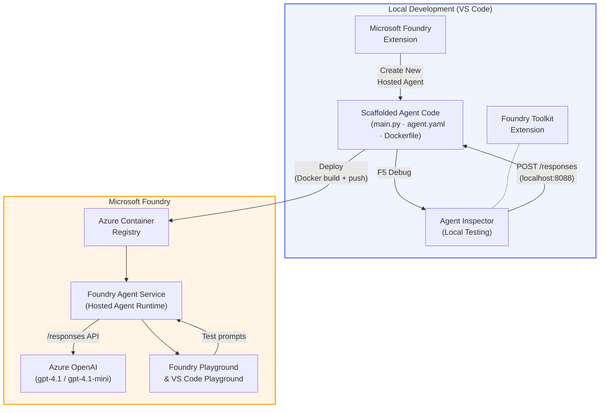

# Radionica Foundry Toolkit i Foundry Hosted Agents

[](https://www.python.org/)
[](https://github.com/microsoft/agents)
[](https://learn.microsoft.com/azure/foundry/agents/concepts/hosted-agents)
[](https://ai.azure.com/)
[](https://learn.microsoft.com/azure/ai-services/openai/)
[](https://learn.microsoft.com/cli/azure/install-azure-cli)
[](https://learn.microsoft.com/azure/developer/azure-developer-cli/install-azd)
[](https://www.docker.com/)
[](https://marketplace.visualstudio.com/items?itemName=ms-windows-ai-studio.windows-ai-studio)
[](../../LICENSE)

Izgradite, testirajte i implementirajte AI agente na **Microsoft Foundry Agent Service** kao **Hosted Agents** - u potpunosti iz VS Code koristeći **Microsoft Foundry extension** i **Foundry Toolkit**.

> **Hosted Agents su trenutno u pretpregledu.** Podržane regije su ograničene - vidi [dostupnost regija](https://learn.microsoft.com/azure/foundry/agents/concepts/hosted-agents#region-availability).

> The `agent/` folder inside each lab is **automatically scaffolded** by the Foundry extension - you then customize the code, test locally, and deploy.

### 🌐 Podrška za više jezika

#### Podržano preko GitHub Action (automatski i uvijek ažurno)

<!-- CO-OP TRANSLATOR LANGUAGES TABLE START -->
[Arapski](../ar/README.md) | [Bengalski](../bn/README.md) | [Bugarski](../bg/README.md) | [Burmanski (Myanmar)](../my/README.md) | [Kineski (pojednostavljeni)](../zh-CN/README.md) | [Kineski (tradicionalni, Hong Kong)](../zh-HK/README.md) | [Kineski (tradicionalni, Macau)](../zh-MO/README.md) | [Kineski (tradicionalni, Taiwan)](../zh-TW/README.md) | [Hrvatski](./README.md) | [Češki](../cs/README.md) | [Danski](../da/README.md) | [Nizozemski](../nl/README.md) | [Estonski](../et/README.md) | [Finski](../fi/README.md) | [Francuski](../fr/README.md) | [Njemački](../de/README.md) | [Grčki](../el/README.md) | [Hebrejski](../he/README.md) | [Hindski](../hi/README.md) | [Mađarski](../hu/README.md) | [Indonezijski](../id/README.md) | [Talijanski](../it/README.md) | [Japanski](../ja/README.md) | [Kannada](../kn/README.md) | [Kmerski](../km/README.md) | [Korejski](../ko/README.md) | [Litvanski](../lt/README.md) | [Malajski](../ms/README.md) | [Malayalam](../ml/README.md) | [Marathi](../mr/README.md) | [Nepalski](../ne/README.md) | [Nigerijski pidgin](../pcm/README.md) | [Norveški](../no/README.md) | [Perzijski (Farsi)](../fa/README.md) | [Poljski](../pl/README.md) | [Portugalski (Brazil)](../pt-BR/README.md) | [Portugalski (Portugal)](../pt-PT/README.md) | [Pandžapski (Gurmukhi)](../pa/README.md) | [Rumunjski](../ro/README.md) | [Ruski](../ru/README.md) | [Srpski (ćirilica)](../sr/README.md) | [Slovački](../sk/README.md) | [Slovenski](../sl/README.md) | [Španjolski](../es/README.md) | [Svahili](../sw/README.md) | [Švedski](../sv/README.md) | [Tagalog (Filipinski)](../tl/README.md) | [Tamil](../ta/README.md) | [Telugu](../te/README.md) | [Tajlandski](../th/README.md) | [Turski](../tr/README.md) | [Ukrajinski](../uk/README.md) | [Urdu](../ur/README.md) | [Vijetnamski](../vi/README.md)

> **Radije biste klonirali lokalno?**
>
> Ovo spremište uključuje preko 50 prijevoda jezika što značajno povećava veličinu preuzimanja. Za kloniranje bez prijevoda, upotrijebite sparse checkout:
>
> **Bash / macOS / Linux:**
> ```bash
> git clone --filter=blob:none --sparse https://github.com/microsoft-foundry/Foundry_Toolkit_for_VSCode_Lab.git
> cd Foundry_Toolkit_for_VSCode_Lab
> git sparse-checkout set --no-cone '/*' '!translations' '!translated_images'
> ```
>
> **CMD (Windows):**
> ```cmd
> git clone --filter=blob:none --sparse https://github.com/microsoft-foundry/Foundry_Toolkit_for_VSCode_Lab.git
> cd Foundry_Toolkit_for_VSCode_Lab
> git sparse-checkout set --no-cone "/*" "!translations" "!translated_images"
> ```
>
> Ovo vam daje sve što trebate za dovršetak tečaja uz mnogo brže preuzimanje.
<!-- CO-OP TRANSLATOR LANGUAGES TABLE END -->

---

## Arhitektura



**Tijek:** Foundry extension generira agenta → vi prilagodite kod i upute → testirate lokalno s Agent Inspectorom → implementirate u Foundry (Docker image gurnut u ACR) → provjerite u Playgroundu.

---

## Što ćete izgraditi

| Laboratorij | Opis | Status |
|-----|-------------|--------|
| **Lab 01 - Jedan agent** | Izradite **"Objasni kao da sam izvršni direktor"** agenta, testirajte ga lokalno i implementirajte u Foundry | ✅ Dostupno |
| **Lab 02 - Više-agentni tijek rada** | Izradite **"Evaluacija životopisa → prikladnost za posao"** - 4 agenta surađuju kako bi ocijenili prikladnost životopisa i generirali plan učenja | ✅ Dostupno |

---

## Upoznajte izvršnog agenta

U ovoj radionici izgradit ćete **"Objasni kao da sam izvršni direktor"** agenta - AI agenta koji preuzima komplicirani tehnički žargon i prevodi ga u smirene, za bord spremne sažetke. Jer budimo iskreni, nitko u C-suiteu ne želi čuti o "thread pool exhaustion caused by synchronous calls introduced in v3.2."

Napravio sam ovog agenta nakon još jedne previše situacija u kojima je moj savršeno sastavljeni post-mortem dobio odgovor: *"Dakle... je li web stranica pala ili nije?"*

### Kako to radi

Unesete tehničko ažuriranje. On vrati izvršni sažetak - tri točke, bez žargona, bez stack traceova, bez egzistencijalnog straha. Samo **što se dogodilo**, **poslovni utjecaj**, i **sljedeći korak**.

### Pogledajte kako radi

**Vi kažete:**
> "Latencija API-ja se povećala zbog isrpljenosti thread pool-a uzrokovane sinkronim pozivima uvedenim u v3.2."

**Agent odgovara:**

> **Izvršni sažetak:**
> - **Što se dogodilo:** Nakon zadnjeg izdanja, sustav se usporio.
> - **Poslovni utjecaj:** Neki su korisnici iskusili kašnjenja pri korištenju usluge.
> - **Sljedeći korak:** Promjena je vraćena (rollback) i priprema se popravak prije ponovne implementacije.

### Zašto ovaj agent?

To je krajnje jednostavan, jednoznačni agent - savršen za učenje tijeka rada hostanih agenata od početka do kraja bez zapinjanja u složene lance alata. I iskreno? Svaki inženjerski tim mogao bi imati jedan ovakav.

---

## Struktura radionice

```
📂 Foundry_Toolkit_for_VSCode_Lab/
├── 📄 README.md                      ← You are here
└── 📂 workshop/
    ├── 📂 lab01-single-agent/        ← Full lab: docs + agent code
    │   ├── README.md                 ← Hands-on lab instructions
    │   ├── 📂 docs/                  ← Step-by-step tutorial modules
    │   │   ├── 00-prerequisites.md
    │   │   ├── 01-setup.md
    │   │   ├── 02-create-hosted-agent.md
    │   │   ├── 03-configure-and-code.md
    │   │   ├── 04-test-locally.md
    │   │   ├── 05-deploy-to-foundry.md
    │   │   ├── 06-verify-in-playground.md
    │   │   ├── 07-summary.md
    │   │   └── 08-troubleshooting.md
    │   └── 📂 agent/                 ← Reference solution (auto-scaffolded by Foundry extension)
    │       ├── agent.yaml
    │       ├── Dockerfile
    │       ├── main.py
    │       └── requirements.txt
    └── 📂 lab02-multi-agent/         ← Resume → Job Fit Evaluator
        ├── README.md                 ← Hands-on lab instructions (end-to-end)
        ├── 📂 docs/                  ← Step-by-step tutorial modules
        │   ├── 00-prerequisites.md
        │   ├── 01-understand-multi-agent.md
        │   ├── 02-scaffold-multi-agent.md
        │   ├── 03-configure-agents.md
        │   ├── 04-orchestration-patterns.md
        │   ├── 05-test-locally.md
        │   ├── 06-deploy-to-foundry.md
        │   ├── 07-verify-in-playground.md
        │   └── 08-troubleshooting.md
        └── 📂 PersonalCareerCopilot/ ← Reference solution (multi-agent workflow)
            ├── agent.yaml
            ├── Dockerfile
            ├── main.py
            └── requirements.txt
```

> **Napomena:** The `agent/` folder inside each lab is what the **Microsoft Foundry extension** generates when you run `Microsoft Foundry: Create a New Hosted Agent` from the Command Palette. The files are then customized with your agent's instructions, tools, and configuration. Lab 01 walks you through recreating this from scratch.

---

## Početak

### 1. Klonirajte spremište

```bash
git clone https://github.com/microsoft-foundry/Foundry_Toolkit_for_VSCode_Lab.git
cd Foundry_Toolkit_for_VSCode_Lab
```

### 2. Postavite Python virtualno okruženje

```bash
python -m venv venv
```

Aktivirajte ga:

- **Windows (PowerShell):**
  ```powershell
  .\venv\Scripts\Activate.ps1
  ```
- **macOS / Linux:**
  ```bash
  source venv/bin/activate
  ```

### 3. Instalirajte ovisnosti

```bash
pip install -r workshop/lab01-single-agent/agent/requirements.txt
```

### 4. Konfigurirajte varijable okruženja

Kopirajte primjer datoteke `.env` unutar mape agenta i ispunite svoje vrijednosti:

```bash
cp workshop/lab01-single-agent/agent/.env.example workshop/lab01-single-agent/agent/.env
```

Uredite `workshop/lab01-single-agent/agent/.env`:

```env
AZURE_AI_PROJECT_ENDPOINT=https://<your-account>.services.ai.azure.com/api/projects/<your-project>
AZURE_AI_MODEL_DEPLOYMENT_NAME=<your-model-deployment-name>
```

### 5. Slijedite laboratorije radionice

Svaki laboratorij je samostalan s vlastitim modulima. Počnite s **Lab 01** kako biste naučili osnove, zatim prijeđite na **Lab 02** za rad s više agenata.

#### Lab 01 - Jedan agent ([pune upute](workshop/lab01-single-agent/README.md))

| # | Modul | Link |
|---|--------|------|
| 1 | Pročitajte preduvjete | [00-prerequisites.md](workshop/lab01-single-agent/docs/00-prerequisites.md) |
| 2 | Instalirajte Foundry Toolkit & Foundry ekstenziju | [01-setup.md](workshop/lab01-single-agent/docs/01-setup.md) |
| 3 | Kreirajte Foundry projekt | [01-setup.md](workshop/lab01-single-agent/docs/01-setup.md) |
| 4 | Kreirajte hostanog agenta | [02-create-hosted-agent.md](workshop/lab01-single-agent/docs/02-create-hosted-agent.md) |
| 5 | Konfigurirajte upute i okruženje | [03-configure-and-code.md](workshop/lab01-single-agent/docs/03-configure-and-code.md) |
| 6 | Testirajte lokalno | [04-test-locally.md](workshop/lab01-single-agent/docs/04-test-locally.md) |
| 7 | Implementirajte u Foundry | [05-deploy-to-foundry.md](workshop/lab01-single-agent/docs/05-deploy-to-foundry.md) |
| 8 | Provjerite u Playgroundu | [06-verify-in-playground.md](workshop/lab01-single-agent/docs/06-verify-in-playground.md) |
| 9 | Rješavanje problema | [08-troubleshooting.md](workshop/lab01-single-agent/docs/08-troubleshooting.md) |

#### Lab 02 - Više-agentni tijek rada ([pune upute](workshop/lab02-multi-agent/README.md))

| # | Modul | Link |
|---|--------|------|
| 1 | Preduvjeti (Lab 02) | [00-prerequisites.md](workshop/lab02-multi-agent/docs/00-prerequisites.md) |
| 2 | Razumjeti arhitekturu s više agenata | [01-understand-multi-agent.md](workshop/lab02-multi-agent/docs/01-understand-multi-agent.md) |
| 3 | Postavite početnu strukturu multi-agent projekta | [02-scaffold-multi-agent.md](workshop/lab02-multi-agent/docs/02-scaffold-multi-agent.md) |
| 4 | Konfigurirajte agente i okruženje | [03-configure-agents.md](workshop/lab02-multi-agent/docs/03-configure-agents.md) |
| 5 | Obrasci orkestracije | [04-orchestration-patterns.md](workshop/lab02-multi-agent/docs/04-orchestration-patterns.md) |
| 6 | Testirajte lokalno (više agenata) | [05-test-locally.md](workshop/lab02-multi-agent/docs/05-test-locally.md) |
| 7 | Implementirajte u Foundry | [06-deploy-to-foundry.md](workshop/lab02-multi-agent/docs/06-deploy-to-foundry.md) |
| 8 | Provjerite u Playgroundu | [07-verify-in-playground.md](workshop/lab02-multi-agent/docs/07-verify-in-playground.md) |
| 9 | Rješavanje problema (više agenata) | [08-troubleshooting.md](workshop/lab02-multi-agent/docs/08-troubleshooting.md) |

---

## Održavatelj

<table>
<tr>
    <td align="center"><a href="https://github.com/ShivamGoyal03">
        <br />
        <sub><b>Shivam Goyal</b></sub>
    </a><br />
    </td>
</tr>
</table>

---

## Potrebne dozvole (brzi pregled)

| Scenarij | Potrebne uloge |
|----------|---------------|
| Kreiranje novog Foundry projekta | **Azure AI Owner** na Foundry resursu |
| Implementacija u postojeći projekt (novi resursi) | **Azure AI Owner** + **Contributor** na pretplati |
| Implementacija u potpuno konfiguriran projekt | **Reader** na računu + **Azure AI User** na projektu |

> **Važno:** Azure `Owner` i `Contributor` uloge uključuju samo *upravljačke* dozvole, ne *razvojne* (dozvole za rad s podacima). Potrebni su vam **Azure AI User** ili **Azure AI Owner** za izgradnju i implementaciju agenata.

---

## Reference

- [Brzi početak: Postavite svog prvog hostiranog agenta (VS Code)](https://learn.microsoft.com/azure/foundry/agents/quickstarts/quickstart-hosted-agent)
- [Što su hostirani agenti?](https://learn.microsoft.com/azure/foundry/agents/concepts/hosted-agents)
- [Kreirajte tokove rada hostiranih agenata u VS Codeu](https://learn.microsoft.com/azure/foundry/agents/how-to/vs-code-agents-workflow-pro-code)
- [Postavite hostiranog agenta](https://learn.microsoft.com/azure/foundry/agents/how-to/deploy-hosted-agent)
- [RBAC za Microsoft Foundry](https://learn.microsoft.com/azure/foundry/concepts/rbac-foundry)
- [Primjer agenta za pregled arhitekture](https://github.com/Azure-Samples/agent-architecture-review-sample) - Hostirani agent iz stvarnog svijeta s MCP alatima, Excalidraw dijagramima i dvostrukim postavljanjem

---


## Licenca

[MIT](../../LICENSE)

---

<!-- CO-OP TRANSLATOR DISCLAIMER START -->
**Napomena**:
Ovaj dokument je preveden korištenjem AI prevoditeljskog servisa [Co-op Translator](https://github.com/Azure/co-op-translator). Iako težimo točnosti, imajte na umu da automatski prijevodi mogu sadržavati greške ili netočnosti. Izvorni dokument na izvornom jeziku treba smatrati autoritativnim izvorom. Za važne informacije preporuča se profesionalni ljudski prijevod. Nismo odgovorni za bilo kakva nesporazumevanja ili pogrešne interpretacije koje proizlaze iz korištenja ovog prijevoda.
<!-- CO-OP TRANSLATOR DISCLAIMER END -->
