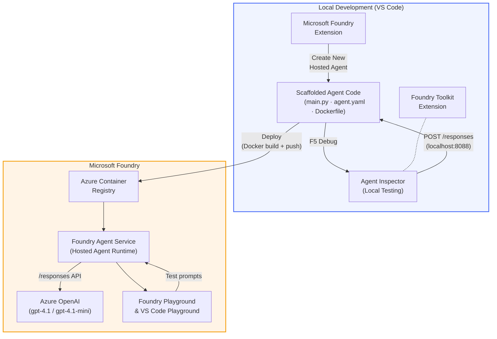

# Foundry Toolkit + Foundry Hosted Agents radionica

[](https://www.python.org/)
[](https://learn.microsoft.com/agent-framework/)
[](https://learn.microsoft.com/azure/foundry/agents/concepts/hosted-agents)
[](https://ai.azure.com/)
[](https://learn.microsoft.com/azure/ai-services/openai/)
[](https://learn.microsoft.com/cli/azure/install-azure-cli)
[](https://learn.microsoft.com/azure/developer/azure-developer-cli/install-azd)
[](https://www.docker.com/)
[](https://marketplace.visualstudio.com/items?itemName=ms-windows-ai-studio.windows-ai-studio)
[](LICENSE)

Izgradite, testirajte i implementirajte AI agente u **Microsoft Foundry Agent Service** kao **Hosted Agents** - u potpunosti iz VS Code-a koristeći **Microsoft Foundry ekstenziju** i **Foundry Toolkit**.

> **Hosted Agents su trenutno u pretpregledu.** Podržane regije su ograničene - pogledajte [dostupnost regija](https://learn.microsoft.com/azure/foundry/agents/concepts/hosted-agents#region-availability).

> `agent/` mapa unutar svakog laboratorija je **automatski generirana** od strane Foundry ekstenzije - zatim prilagodite kod, testirajte lokalno i implementirajte.

### 🌐 Podrška za više jezika

#### Podržano preko GitHub Action (Automatski i uvijek ažurno)

<!-- CO-OP TRANSLATOR LANGUAGES TABLE START -->
[Arabic](../ar/README.md) | [Bengali](../bn/README.md) | [Bulgarian](../bg/README.md) | [Burmese (Myanmar)](../my/README.md) | [Chinese (Simplified)](../zh-CN/README.md) | [Chinese (Traditional, Hong Kong)](../zh-HK/README.md) | [Chinese (Traditional, Macau)](../zh-MO/README.md) | [Chinese (Traditional, Taiwan)](../zh-TW/README.md) | [Croatian](./README.md) | [Czech](../cs/README.md) | [Danish](../da/README.md) | [Dutch](../nl/README.md) | [Estonian](../et/README.md) | [Finnish](../fi/README.md) | [French](../fr/README.md) | [German](../de/README.md) | [Greek](../el/README.md) | [Hebrew](../he/README.md) | [Hindi](../hi/README.md) | [Hungarian](../hu/README.md) | [Indonesian](../id/README.md) | [Italian](../it/README.md) | [Japanese](../ja/README.md) | [Kannada](../kn/README.md) | [Khmer](../km/README.md) | [Korean](../ko/README.md) | [Lithuanian](../lt/README.md) | [Malay](../ms/README.md) | [Malayalam](../ml/README.md) | [Marathi](../mr/README.md) | [Nepali](../ne/README.md) | [Nigerian Pidgin](../pcm/README.md) | [Norwegian](../no/README.md) | [Persian (Farsi)](../fa/README.md) | [Polish](../pl/README.md) | [Portuguese (Brazil)](../pt-BR/README.md) | [Portuguese (Portugal)](../pt-PT/README.md) | [Punjabi (Gurmukhi)](../pa/README.md) | [Romanian](../ro/README.md) | [Russian](../ru/README.md) | [Serbian (Cyrillic)](../sr/README.md) | [Slovak](../sk/README.md) | [Slovenian](../sl/README.md) | [Spanish](../es/README.md) | [Swahili](../sw/README.md) | [Swedish](../sv/README.md) | [Tagalog (Filipino)](../tl/README.md) | [Tamil](../ta/README.md) | [Telugu](../te/README.md) | [Thai](../th/README.md) | [Turkish](../tr/README.md) | [Ukrainian](../uk/README.md) | [Urdu](../ur/README.md) | [Vietnamese](../vi/README.md)

> **Preferirate li klonirati lokalno?**
>
> Ovo spremište uključuje 50+ jezičnih prijevoda što značajno povećava veličinu preuzimanja. Za kloniranje bez prijevoda, koristite sparse checkout:
>
> **Bash / macOS / Linux:**
> ```bash
> git clone --filter=blob:none --sparse https://github.com/microsoft-foundry/Foundry_Toolkit_for_VSCode_Lab.git
> cd Foundry_Toolkit_for_VSCode_Lab
> git sparse-checkout set --no-cone '/*' '!translations' '!translated_images'
> ```
>
> **CMD (Windows):**
> ```cmd
> git clone --filter=blob:none --sparse https://github.com/microsoft-foundry/Foundry_Toolkit_for_VSCode_Lab.git
> cd Foundry_Toolkit_for_VSCode_Lab
> git sparse-checkout set --no-cone "/*" "!translations" "!translated_images"
> ```
>
> Ovo vam daje sve što je potrebno za dovršetak tečaja sa znatno bržim preuzimanjem.
<!-- CO-OP TRANSLATOR LANGUAGES TABLE END -->

---

## Arhitektura



**Tijek:** Foundry ekstenzija generira agenta → vi prilagodite kod i upute → testirate lokalno pomoću Agent Inspector → implementirate u Foundry (Docker slika se gura u ACR) → verifikacija u Playgroundu.

---

## Što ćete izgraditi

| Laboratorij | Opis | Status |
|-----|-------------|--------|
| **Lab 01 - Jedan agent** | Izgradite **"Explain Like I'm an Executive" agenta**, testirajte ga lokalno i implementirajte u Foundry | ✅ Dostupno |
| **Lab 02 - Višeagentski tijek rada** | Izgradite **"Resume → Job Fit Evaluator"** - 4 agenta surađuju za ocjenu prikladnosti životopisa i generiranje plana učenja | ✅ Dostupno |

---

## Upoznajte Executive agenta

U ovoj radionici izgradit ćete **"Explain Like I'm an Executive" agenta** - AI agenta koji uzima zahtjevni tehnički žargon i prevodi ga u smirene, spremne za odbor sažetke. Jer budimo iskreni, nitko u C-suitu ne želi slušati o "iskorištenju thread poola uzrokovanom sinkronim pozivima uvedenim u v3.2."

Izgradio sam ovog agenta nakon previše slučajeva u kojima je moj savršeno složeni post-mortem dobio odgovor: *"Dakle... je li web stranica pala ili nije?"*

### Kako to radi

Unesite mu tehničku nadogradnju. Vraća izvršni sažetak - tri točke, bez žargona, bez stack traceova, bez egzistencijalnog straha. Samo **što se dogodilo**, **utjecaj na poslovanje** i **sljedeći korak**.

### Pogledajte ga u akciji

**Kažete:**
> "API latencija je porasla zbog iscrpljenosti thread poola uzrokovane sinkronim pozivima introduciranim u v3.2."

**Agent odgovara:**

> **Izvršni sažetak:**
> - **Što se dogodilo:** Nakon najnovijeg izdanja, sustav se usporio.
> - **Utjecaj na poslovanje:** Neki korisnici su doživjeli kašnjenja pri korištenju usluge.
> - **Sljedeći korak:** Promjena je poništena i priprema se popravak prije ponovne implementacije.

### Zašto ovaj agent?

To je jednostavan agent s jednom svrhom - savršen za učenje tijeka rada hostiranih agenata od početka do kraja bez zapetljavanja u složenim alatima. I iskreno? Svaki inženjerski tim bi trebao imati jednog ovakvog.

---

## Struktura radionice

```
📂 Foundry_Toolkit_for_VSCode_Lab/
├── 📄 README.md                      ← You are here
└── 📂 workshop/
    ├── 📂 lab01-single-agent/        ← Full lab: docs + agent code
    │   ├── README.md                 ← Hands-on lab instructions
    │   ├── 📂 docs/                  ← Step-by-step tutorial modules
    │   │   ├── 00-prerequisites.md
    │   │   ├── 01-setup.md
    │   │   ├── 02-create-hosted-agent.md
    │   │   ├── 03-configure-and-code.md
    │   │   ├── 04-test-locally.md
    │   │   ├── 05-deploy-to-foundry.md
    │   │   ├── 06-verify-in-playground.md
    │   │   ├── 07-summary.md
    │   │   └── 08-troubleshooting.md
    │   └── 📂 agent/                 ← Reference solution (auto-scaffolded by Foundry extension)
    │       ├── agent.yaml
    │       ├── Dockerfile
    │       ├── main.py
    │       └── requirements.txt
    └── 📂 lab02-multi-agent/         ← Resume → Job Fit Evaluator
        ├── README.md                 ← Hands-on lab instructions (end-to-end)
        ├── 📂 docs/                  ← Step-by-step tutorial modules
        │   ├── 00-prerequisites.md
        │   ├── 01-understand-multi-agent.md
        │   ├── 02-scaffold-multi-agent.md
        │   ├── 03-configure-agents.md
        │   ├── 04-orchestration-patterns.md
        │   ├── 05-test-locally.md
        │   ├── 06-deploy-to-foundry.md
        │   ├── 07-verify-in-playground.md
        │   ├── 08-troubleshooting.md
        │   └── 09-summary.md
        └── 📂 PersonalCareerCopilot/ ← Reference solution (multi-agent workflow)
            ├── agent.yaml
            ├── Dockerfile
            ├── main.py
            └── requirements.txt
```

> **Napomena:** `agent/` mapa unutar svakog laboratorija je ono što **Microsoft Foundry ekstenzija** generira kada pokrenete `Microsoft Foundry: Create a New Hosted Agent` iz Command Palette-a. Datoteke se zatim prilagođavaju uputama, alatima i konfiguracijom vašeg agenta. Laboratorij 01 vas vodi kroz kreiranje ovoga iz temelja.

---

## Početak rada

### 1. Klonirajte spremište

```bash
git clone https://github.com/microsoft-foundry/Foundry_Toolkit_for_VSCode_Lab.git
cd Foundry_Toolkit_for_VSCode_Lab
```

### 2. Postavite Python virtualno okruženje

```bash
python -m venv venv
```

Aktivirajte ga:

- **Windows (PowerShell):**
  ```powershell
  .\venv\Scripts\Activate.ps1
  ```
- **macOS / Linux:**
  ```bash
  source venv/bin/activate
  ```

### 3. Instalirajte ovisnosti

```bash
pip install -r workshop/lab01-single-agent/agent/requirements.txt
```

### 4. Konfigurirajte varijable okruženja

Kopirajte primjer `.env` datoteke unutar mape agenta i ispunite svoje vrijednosti:

```bash
cp workshop/lab01-single-agent/agent/.env.example workshop/lab01-single-agent/agent/.env
```

Uredite `workshop/lab01-single-agent/agent/.env`:

```env
FOUNDRY_PROJECT_ENDPOINT=https://<your-account>.services.ai.azure.com/api/projects/<your-project>
AZURE_AI_MODEL_DEPLOYMENT_NAME=<your-model-deployment-name>
```

### 5. Slijedite laboratorije radionice

Svaki laboratorij je samostalan s vlastitim modulima. Počnite s **Lab 01** da naučite osnove, a zatim prijeđite na **Lab 02** za višeagentske tijekove rada.

#### Lab 01 - Jedan agent ([pune upute](workshop/lab01-single-agent/README.md))

| # | Modul | Link |
|---|--------|------|
| 1 | Pročitajte preduvjete | [00-prerequisites.md](workshop/lab01-single-agent/docs/00-prerequisites.md) |
| 2 | Instalirajte Foundry Toolkit i Foundry ekstenziju | [01-setup.md](workshop/lab01-single-agent/docs/01-setup.md) |
| 3 | Kreirajte Foundry projekt | [01-setup.md](workshop/lab01-single-agent/docs/01-setup.md) |
| 4 | Kreirajte hostiranog agenta | [02-create-hosted-agent.md](workshop/lab01-single-agent/docs/02-create-hosted-agent.md) |
| 5 | Konfigurirajte upute i okruženje | [03-configure-and-code.md](workshop/lab01-single-agent/docs/03-configure-and-code.md) |
| 6 | Testirajte lokalno | [04-test-locally.md](workshop/lab01-single-agent/docs/04-test-locally.md) |
| 7 | Implementirajte u Foundry | [05-deploy-to-foundry.md](workshop/lab01-single-agent/docs/05-deploy-to-foundry.md) |
| 8 | Verificirajte u playgroundu | [06-verify-in-playground.md](workshop/lab01-single-agent/docs/06-verify-in-playground.md) |
| 9 | Sažetak i sljedeći koraci | [07-summary.md](workshop/lab01-single-agent/docs/07-summary.md) |
| 10 | Rješavanje problema | [08-troubleshooting.md](workshop/lab01-single-agent/docs/08-troubleshooting.md) |

#### Lab 02 - Višeagentski tijek rada ([pune upute](workshop/lab02-multi-agent/README.md))

| # | Modul | Link |
|---|--------|------|
| 1 | Preduvjeti (Lab 02) | [00-prerequisites.md](workshop/lab02-multi-agent/docs/00-prerequisites.md) |
| 2 | Razumijevanje višestruke arhitekture agenata | [01-understand-multi-agent.md](workshop/lab02-multi-agent/docs/01-understand-multi-agent.md) |
| 3 | Generirajte višeagentski projekt | [02-scaffold-multi-agent.md](workshop/lab02-multi-agent/docs/02-scaffold-multi-agent.md) |
| 4 | Konfigurirajte agente i okruženje | [03-configure-agents.md](workshop/lab02-multi-agent/docs/03-configure-agents.md) |
| 5 | Obrasci orkestracije | [04-orchestration-patterns.md](workshop/lab02-multi-agent/docs/04-orchestration-patterns.md) |
| 6 | Testirajte lokalno (više agenata) | [05-test-locally.md](workshop/lab02-multi-agent/docs/05-test-locally.md) |
| 7 | Implementirajte u Foundry | [06-deploy-to-foundry.md](workshop/lab02-multi-agent/docs/06-deploy-to-foundry.md) |
| 8 | Verificirajte u playgroundu | [07-verify-in-playground.md](workshop/lab02-multi-agent/docs/07-verify-in-playground.md) |
| 9 | Rješavanje problema (više agenata) | [08-troubleshooting.md](workshop/lab02-multi-agent/docs/08-troubleshooting.md) |
| 10 | Sažetak i sljedeći koraci | [09-summary.md](workshop/lab02-multi-agent/docs/09-summary.md) |

---

## Održavatelj

<table>
<tr>
    <td align="center"><a href="https://github.com/ShivamGoyal03">
        <br />
        <sub><b>Shivam Goyal</b></sub>
    </a><br />
    </td>
</tr>
</table>

---

## Potrebne dozvole (brzi pregled)

| Scenarij | Potrebne uloge |
|----------|---------------|
| Kreiranje novog Foundry projekta | **Azure AI Owner** na Foundry resursu |
| Implementacija u postojeći projekt (novi resursi) | **Azure AI Owner** + **Contributor** na pretplati |
| Implementacija u potpuno konfigurirani projekt | **Reader** na računu + **Azure AI User** na projektu |

> **Važno:** Azure `Owner` i `Contributor` uloge uključuju samo *upravljanje* dozvolama, ne i *razvojne* (dozvole za rad s podacima). Potreban vam je **Azure AI korisnik** ili **Azure AI vlasnik** za izgradnju i implementaciju agenata.

---

## Reference

- [Brzi početak: Implementirajte svog prvog hostiranog agenta (VS Code)](https://learn.microsoft.com/azure/foundry/agents/quickstarts/quickstart-hosted-agent)
- [Što su hostirani agenti?](https://learn.microsoft.com/azure/foundry/agents/concepts/hosted-agents)
- [Izradite tijekove rada hostiranih agenata u VS Code](https://learn.microsoft.com/azure/foundry/agents/how-to/vs-code-agents-workflow-pro-code)
- [Implementirajte hostiranog agenta](https://learn.microsoft.com/azure/foundry/agents/how-to/deploy-hosted-agent)
- [RBAC za Microsoft Foundry](https://learn.microsoft.com/azure/foundry/concepts/rbac-foundry)
- [Primjer agenata za pregled arhitekture](https://github.com/Azure-Samples/agent-architecture-review-sample) - Stvarni hostirani agent s MCP alatima, Excalidraw dijagramima i dvostrukom implementacijom

---


## Licenca

[MIT](../../LICENSE)

---

<!-- CO-OP TRANSLATOR DISCLAIMER START -->
**Napomena**:
Ovaj dokument je preveden korištenjem AI prevoditeljskog servisa [Co-op Translator](https://github.com/Azure/co-op-translator). Iako težimo točnosti, imajte na umu da automatski prijevodi mogu sadržavati greške ili netočnosti. Izvorni dokument na izvornom jeziku treba smatrati autoritativnim izvorom. Za važne informacije preporuča se profesionalni ljudski prijevod. Nismo odgovorni za bilo kakva nesporazumevanja ili pogrešne interpretacije koje proizlaze iz korištenja ovog prijevoda.
<!-- CO-OP TRANSLATOR DISCLAIMER END -->