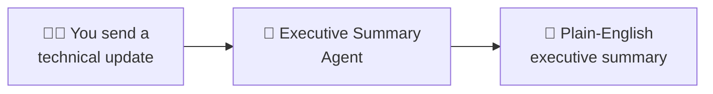

# Modul 0 - Uvod

⏱️ ~10 min

> [!WARNING]
> **Pregled i Ograničenja:** [Hosted Agents](https://learn.microsoft.com/azure/foundry/agents/concepts/hosted-agents) su trenutno u **javnoj verziji za pregled** - nisu preporučeni za produkcijske zadatke. Budite svjesni sljedećeg:
> - **Podržani regije su ograničene** - provjerite [dostupnost regija](https://learn.microsoft.com/azure/foundry/agents/concepts/hosted-agents#region-availability) prije kreiranja resursa. Ako odaberete nepodržanu regiju, implementacija će neuspjeti.
> - Paket `agent-framework-foundry-hosting` je predizdanje - API-ji se mogu mijenjati između verzija.
> - Ograničenja skaliranja: hostani agenti podržavaju 0–5 replika (uključujući skaliranje na nulu).
> - Neke značajke prikazane u ovom radionici se mogu promijeniti kako se servis približava GA.

## Što ćete izraditi

U ovoj radionici ćete izraditi **"Objasni kao da sam izvršni direktor"** agenta - hostanog AI agenta koji uzima složena tehnička izvješća i prepisuje ih kao sažete izvještaje na običnom engleskom jeziku.

**Agent koristi:**
- **Microsoft Agent Framework** - za logiku i strukturu agenta
- **Foundry Toolkit za VS Code** - za izradu okvira, lokalno testiranje i implementaciju
- **AI model** (npr. `gpt-4.1-mini/gpt-5-mini`) - za generiranje sažetaka

Na kraju ovog laboratorijskog rada, imat ćete funkcionalnog agenta kojeg možete testirati lokalno putem Agent Inspectora, a po želji i implementirati u oblak.

---

## Što su hostani agenti?

**Hostani agent** je AI agent koji radi kao upravljana usluga u Microsoft Foundryu. Umjesto da upravljate vlastitom infrastrukturom, pakirate svoj agentni kod u kontejner, a Foundry se brine o skaliranju, hostiranju i izlaganju putem standardne HTTP krajnje točke.

| Pojam | Što znači |
|---------|--------------|
| **Agent** | Vaš Python kod koji prima korisničku poruku, poziva AI model i vraća strukturirani odgovor |
| **Hostano** | Foundry pokreće vaš kontejner za vas - nema VM-ova, nema Kubernetesa, nema infrastrukture za upravljanje |
| **Protokol odgovora** | Standardni HTTP API (`POST /responses`) kojem svaki klijent može pristupiti za interakciju s vašim agentom |
| **Agent Inspector** | Lokalno korisničko sučelje za testiranje (integrirano u Foundry Toolkit) koje vam omogućava komunikaciju s agentom prije implementacije |

U ovoj radionici krenut ćete od nule do potpuno hostanog agenta - ili možete stati na lokalnom testiranju ako želite.

---

## Odaberite svoj put

> ⚠️ **Odaberite jedan put prije nastavka.** Vaš izbor određuje koje alate trebate instalirati i koji moduli se primjenjuju. Kasnije se možete prebaciti s Puta B → Put A ako dobijete pretplatu.

<strong>🅰️ Put A - Azure oblak (zahtijeva Azure pretplatu)</strong>

| | Detalji |
|---|---|
| **Za koga je ovo?** | Imate aktivnu Azure pretplatu i možete kreirati Foundry resurse |
| **Model** | Azure OpenAI putem Foundryja (npr. `gpt-4.1-mini/gpt-5-mini`) |
| **Obuhvaćeni moduli** | Svi moduli (00–07) |
| **Implementacija u oblak?** | ✅ Da - potpuna end-to-end implementacija |

<strong>🅱️ Put B - Lokalno / besplatni sloj (nije potrebna Azure pretplata)</strong>

| | Detalji |
|---|---|
| **Za koga je ovo?** | MVP-ovi, studenti ili bilo tko bez pristupa Azureu |
| **Model** | **Foundry Local** (besplatno, radi na vašem računalu) |
| **Obuhvaćeni moduli** | Moduli 00–04 (preskočite implementaciju i provjeru oblaka) |
| **Implementacija u oblak?** | ❌ Ne - samo lokalno testiranje putem Agent Inspectora |

---

## Svi putevi: potrebni alati

Instalirajte svaki alat dolje. Nakon instalacije, provjerite radi li pokretanjem naredbe za provjeru.

| # | Alat | Verzija | Instalacija | Provjera (Očekivani ishod) |
|---|------|---------|---------|---------------------------|
| 1 | **Visual Studio Code** | Najnovija | [code.visualstudio.com](https://code.visualstudio.com/) | Otvara se bez grešaka |
| 2 | **Python** | 3.12 ili noviji| [python.org/downloads](https://www.python.org/downloads/) | `python --version` $\rightarrow$ `Python 3.12.x` |
| 3 | **Foundry Toolkit za VS Code** | Najnovija | Extension ID: `ms-windows-ai-studio.windows-ai-studio` | Ikona Foundry u Activity Bar |
| 4 | **Python dodatak za VS Code** | Najnovija | Extension ID: `ms-python.python` | Instalirano u panelu ekstenzija |

> [!TIP]
> **Savjeti za instalaciju:**
> - **Python PATH (Windows):** Uvijek označite **"Add Python to PATH"** na prvom ekranu instalacije Pythona. Bez toga terminal neće prepoznati `python`.
> - **Više verzija Pythona:** Ako imate instalirane i Python 3.10 i 3.12, koristite `python3.12 -m venv .venv` kako biste osigurali da se za vaš virtualni okoliš koristi ispravna verzija.
> - **Docker WSL 2 (Windows):** Tijekom instalacije Docker Desktopa odaberite **WSL 2 backend**. Docker s Hyper-V je sporiji i može uzrokovati probleme s izgradnjom Foundry kontejnera.
> - **Docker se ne pokreće?** Pričekajte 30–60 sekundi nakon pokretanja Docker Desktopa. Pokrenite `docker info` - ako vidite "Cannot connect to the Docker daemon," Docker se još uvijek pokreće.
> - **VS Code ekstenzije se ne učitavaju?** Nakon instalacije ekstenzija, ponovo učitajte prozor: `Ctrl+Shift+P` → `Developer: Reload Window`.

> **Korisnici Windowsa:** Provjerite **"Add Python to PATH"** tijekom instalacije Pythona.

**Sljedeće:** [01 - Postavljanje →](01-setup.md)

---

<!-- CO-OP TRANSLATOR DISCLAIMER START -->
**Napomena**:
Ovaj dokument je preveden korištenjem AI prevoditeljskog servisa [Co-op Translator](https://github.com/Azure/co-op-translator). Iako težimo točnosti, imajte na umu da automatski prijevodi mogu sadržavati greške ili netočnosti. Izvorni dokument na izvornom jeziku treba smatrati autoritativnim izvorom. Za važne informacije preporuča se profesionalni ljudski prijevod. Nismo odgovorni za bilo kakva nesporazumevanja ili pogrešne interpretacije koje proizlaze iz korištenja ovog prijevoda.
<!-- CO-OP TRANSLATOR DISCLAIMER END -->