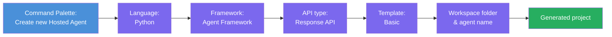
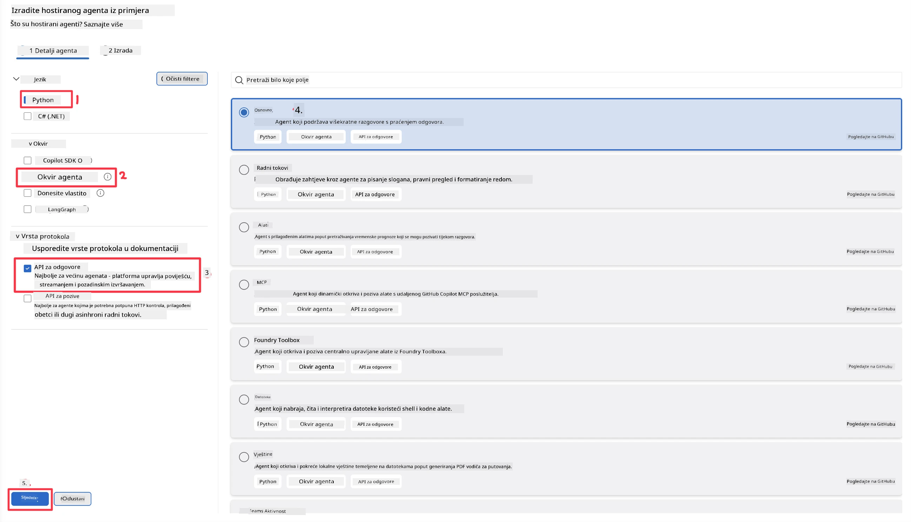
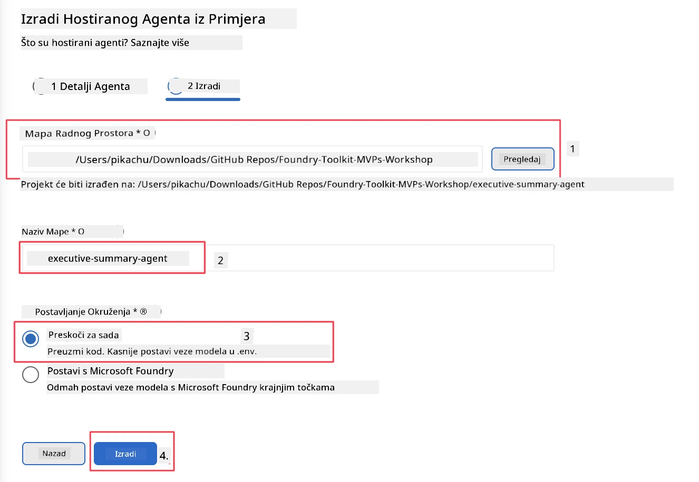

# Modul 2 - Kreirajte novog hostanog agenta

⏱️ ~5 min

U ovom modulu koristite Foundry Toolkit za **izgradnju projekta hostanog agenta**. Šablon generira kompletnu strukturu projekta - `agent.yaml`, `main.py`, `Dockerfile`, `requirements.txt` i konfiguraciju debagera za VS Code - kako biste se mogli usredotočiti na prilagođavanje ponašanja agenta.

> **Ključni koncept:** Mapa `agent/` u ovoj radionici je primjer onoga što Foundry Toolkit generira. Ne pišete ove datoteke od nule.

### Tok čarobnjaka za izgradnju šablona



---

## Korak 1: Otvorite čarobnjak za kreiranje hostanog agenta

1. Pritisnite `Ctrl+Shift+P` da otvorite **Command Palette**.
2. Upisati: **Foundry Toolkit: Create new Hosted Agent** i odaberite ga.

> **Alternativa: Kreirajte putem Foundry Portala**
> Ako više volite preglednik, možete stvoriti svoj projekt na [https://ai.azure.com](https://ai.azure.com). Nakon što je projekt postavljen, vratite se u VS Code i upotrijebite bočni izbornik **Foundry Toolkit** za povezivanje s njim.

> **Alternativa:** U bočnom izborniku Foundry Toolkita, zadržite pokazivač miša iznad **Agents** pod svojim projektom, kliknite ikonu **+**, zatim odaberite **Create in Code With Template**.

## Korak 2: Odaberite postavke



1. U lijevom dijelu navigacije/opcija odaberite sljedeće:

| Izbornik | Odabir | Napomene |
|--------|-----------|-------|
| **Jezik** | Python | Podržan je i C# |
| **Okvir** | Agent Framework | Jednostavna polazna točka koristeći Agent Framework SDK |
| **Tip API-ja** | Response API | `POST /responses` - konverzacijski, s platformom upravljanom poviješću |
| **Šablon** | Basic | Jednostavna polazna točka koristeći Agent Framework SDK |

2. Nakon odabira, kliknite **Next**



3. U sljedećem prozoru odaberite sljedeće:

| Izbornik | Odabir | Napomene |
|--------|-----------|-------|
| **Mapa radnog prostora** | Odaberite ciljani folder | npr., `/workspace/Foundry_Toolkit_for_VSCode_Lab/` ili podmapa u ovom repozitoriju |
| **Ime agenta** | Unesite ime | npr., `executive-summary-agent` |
| **Postavljanje okruženja** | za sada preskočite |  |

Kliknite **create** da stvorite agenta. Kreirat će se nova mapa s imenom hostanog agenta.

## Korak 3: Pregledajte generirani projekt

Nakon što se izgradnja završi, provjerite imate li ove datoteke u Exploreru (`Ctrl+Shift+E`):

```
📂 executive-summary-agent/
├── .env                ← Environment variables (placeholders)
├── .vscode/
│   ├── launch.json     ← Debug config (F5 → run + Agent Inspector)
│   └── tasks.json      ← VS Code task definitions
├── agent.yaml          ← Agent definition (kind: hosted)
├── Dockerfile          ← Container config for deployment
├── main.py             ← Agent entry point (your main code)
└── requirements.txt    ← Python dependencies
```

### Objašnjenje ključnih datoteka

| Datoteka | Svrha |
|------|---------|
| `agent.yaml` | Deklarira agenta kao `kind: hosted`, mapira varijable okruženja, definira `/responses` protokol |
| `main.py` | Stvara `FoundryChatClient` → omotava ga u `Agent` s uputama → posluje preko `ResponsesHostServer` na portu 8088 |
| `Dockerfile` | Koristi `python:3.12-slim`, instalira ovisnosti, otvara port 8088, pokreće `main.py` |
| `requirements.txt` | `agent-framework-foundry`, `agent-framework-foundry-hosting`, `mcp`, `debugpy` |

> **Važno:** Otvorite mapu hostanog agenta direktno u VS Codeu (samo mapu `agent/`) kako bi `.vscode/launch.json` i `tasks.json` ispravno radili za F5 debugiranje.

---

### ✅ Kontrolna točka

- [ ] Šablon projekta je kreiran sa svim očekivanim datotekama
- [ ] `agent.yaml` prikazuje `kind: hosted` i `protocol: responses`
- [ ] `main.py` uvozi `Agent`, `FoundryChatClient`, `ResponsesHostServer`
- [ ] Mapa agenta je otvorena u VS Code kao korijen radnog prostora

---

**Prethodno:** [01 - Setup](01-setup.md) · **Sljedeće:** [03 - Configure & Code →](03-configure-and-code.md)

---

<!-- CO-OP TRANSLATOR DISCLAIMER START -->
**Napomena**:
Ovaj dokument je preveden korištenjem AI prevoditeljskog servisa [Co-op Translator](https://github.com/Azure/co-op-translator). Iako težimo točnosti, imajte na umu da automatski prijevodi mogu sadržavati greške ili netočnosti. Izvorni dokument na izvornom jeziku treba smatrati autoritativnim izvorom. Za važne informacije preporuča se profesionalni ljudski prijevod. Nismo odgovorni za bilo kakva nesporazumevanja ili pogrešne interpretacije koje proizlaze iz korištenja ovog prijevoda.
<!-- CO-OP TRANSLATOR DISCLAIMER END -->