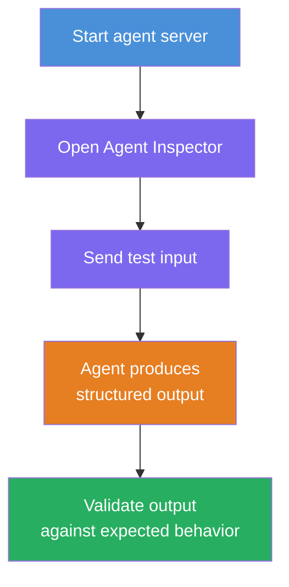
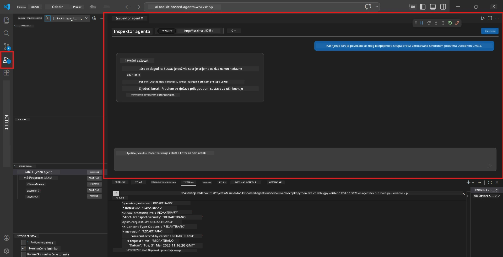
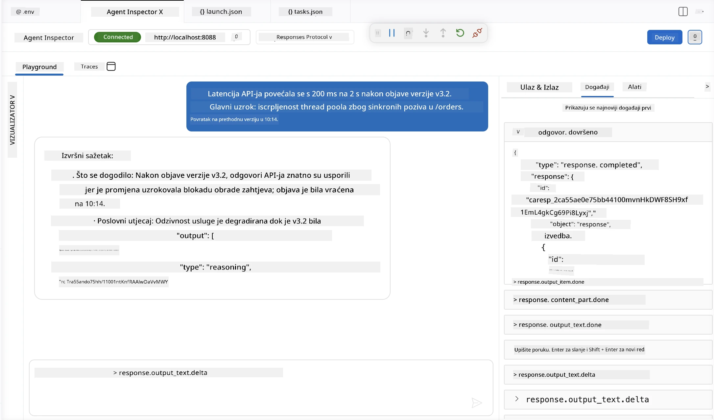

# Modul 4 - Testiraj lokalno

⏱️ ~10 min

U ovom modulu pokrećete svog agenta lokalno i provjeravate da ispravno radi koristeći **funkcionalne testove s pozitivnim ishodom**. Koristit ćete Agent Inspector (vizualno sučelje) ili izravne HTTP pozive kako biste potvrdili da agent proizvodi strukturirane, točne odgovore.

### Tijek lokalnog testiranja



---

## Opcija 1: Pritisnite F5 - Debugiranje s Agent Inspectorom (preporučeno)

### Pokrenite debugger

1. Otvorite mapu **executive-summary-agent/** izravno u VS Code (`File → Open Folder`).
2. Otvorite **Run and Debug** panel (`Ctrl+Shift+D`).
3. Odaberite **Debug Local Agent HTTP Server** iz padajućeg izbornika.
4. Pritisnite **F5** (ili kliknite ▶ Start Debugging).

> ⚠️ **Kritično: Odaberite svoj Python Interpreter**
> Ako dobijete "ModuleNotFoundError" ili debugger ne uspije pokrenuti, morate reći VS Code-u da koristi vaš virtualni okoliš:
  > 1. Pritisnite `Ctrl+Shift+P` $\rightarrow$ upišite **Python: Select Interpreter**.
  > 2. Odaberite interpreter koji se nalazi u mapi `.venv` vašeg projekta (npr., `.\.venv\Scripts\python.exe` na Windowsu).
  > 3. Ponovno pokrenite debug sesiju.
> Ako i dalje dobivate pogreške, ručno ažurirajte datoteku `tasks.json` kako slijedi:
  > 1. Idite na datoteku `.vscode/tasks.json`
  > 2. Idite na zadatak označen s: `Run Agent HTTP Server`
  > 3. Ažurirajte vrijednost naredbe kako slijedi:
  >    - **Windows:** `"value": "${workspaceFolder}/.venv/Scripts/python.exe",`
  >    - **macOS/Linux:** `"value": "${workspaceFolder}/.venv/bin/python",`

### Što se događa

1. HTTP poslužitelj se pokreće na `http://localhost:8088/responses`.
2. Otvara se panel **Agent Inspector** - vizualno sučelje za chat za testiranje.
3. Breakpointi su omogućeni u `main.py`.

Pratite Terminal za:
```
Starting executive summary hosted agent
Executive agent server running on http://localhost:8088
```

> **Ako se Agent Inspector ne otvori:** Pritisnite `Ctrl+Shift+P` → **Foundry Toolkit: Open Agent Inspector**.



> *Snimka zaslona može prikazivati stariji 'AI TOOLKIT' branding iz ranije verzije dodatka.*

---

## Opcija 2: Testiranje putem Terminala (alternativa)

Pokrenite agenta u jednom terminalu, šaljite zahtjeve iz drugog:

```bash
# Terminal 1: Start agent
cd executive-summary-agent/
source .venv/bin/activate
python main.py
```

```bash
# Terminal 2: Send test (curl)
curl -sS -X POST http://localhost:8088/responses \
  -H "Content-Type: application/json" \
  -d '{"input": "The API latency increased due to thread pool exhaustion caused by sync calls in v3.2.", "stream": false}'
```

---

## Scenarijski testovi: Validacija funkcionalnosti sretnog puta

Pokrenite **sva tri** scenarija ispod. Oni provjeravaju proizodi li vaš agent točan, strukturirani izlaz za realne ulaze.



### Scenarij 1: IT incident - Pojava kašnjenja API-ja

**Unos:**
```
The API latency increased from 200ms to 2s after deploying v3.2.
Root cause: thread pool starvation from synchronous calls in /orders.
Rolled back at 10:14.
```

**Očekivano ponašanje:**
- ✅ Prati strukturu "Executive Summary" (Što se dogodilo / Poslovni utjecaj / Sljedeći korak)
- ✅ Nema tehničkog žargona (nema "thread pool", nema "/orders", nema "v3.2")
- ✅ Jasno navodi poslovni utjecaj (npr. korisnici su doživjeli kašnjenja)
- ✅ Uključuje sljedeći korak (npr. ispravak je implementiran, nadzor je uspostavljen)

---

### Scenarij 2: Data Pipeline - Neuspjeh ETL-a

**Unos:**
```
The nightly ETL job failed because the upstream schema changed. APAC dashboards show missing data.
```

**Očekivano ponašanje:**
- ✅ Sažima neuspjeh osvježavanja podataka jasnim jezikom
- ✅ Spominje utjecaj na APAC nadzornu ploču
- ✅ Uključuje korak za ispravljanje
- ✅ NE spominje "ETL", "shemu" ni druge tehničke termine

---

### Scenarij 3: Sigurnost - Izložene vjerodajnice

**Unos:**
```
Static analysis flagged a hardcoded secret in the repository.
The secret may have been exposed in commit history.
```

**Očekivano ponašanje:**
- ✅ Opisuje problem s vjerodajnicama/sigurnošću jezikom prihvatljivim za izvršnu razinu
- ✅ Navodi potencijalni rizik (neovlašteni pristup)
- ✅ Navodi mjeru ispravka (rotacija vjerodajnica, revizija)
- ✅ NE uključuje termine poput "staticka analiza", "povijest commit-a" ili "hardcoded"

---

## Kriteriji validacije

Za svaki scenarij provjerite:

| # | Kriterij | Uvjet prolaza |
|---|----------|---------------|
| 1 | **Struktura** | Odgovor koristi format "Executive Summary" sa sva tri stavka |
| 2 | **Jasan jezik** | Nema tehničkog žargona koji izvršni ne bi razumio |
| 3 | **Točnost** | Sažetak odražava unos - nema izmišljenih detalja |
| 4 | **Kratkoća** | Odgovor je ispod 100 riječi |
| 5 | **Sljedeći korak** | Naveden je jasan akcijski ili ublažavajući korak |

---

## Savjeti za otklanjanje pogrešaka

| Problem | Rješenje |
|-------|-----|
| Agent se ne pokreće | Provjerite vrijednosti `.env`, uvjerite se da je venv aktiviran, pokrenite `pip install -r requirements.txt` |
| Prazan ili generički odgovor | Pregledajte upute u `main.py` - osigurajte da je format izlaza naveden |
| Odgovor uključuje žargon | Pojačajte pravila "ukloniti tehničke termine" u uputama |
| Agent Inspector se ne otvara | `Ctrl+Shift+P` → **Foundry Toolkit: Open Agent Inspector** |
| Pogreške modela u Terminalu | Provjerite da `AZURE_AI_MODEL_DEPLOYMENT_NAME` točno odgovara (uz osjetljivost na velika/mala slova) |

---

### ✅ Kontrolna točka

- [ ] Agent se lokalno pokreće bez pogrešaka
- [ ] Agent Inspector se otvara i pokazuje sučelje za chat (ako se koristi F5)
- [ ] **Scenarij 1** (IT incident) - strukturirani Executive Summary, bez žargona
- [ ] **Scenarij 2** (data pipeline) - relevantan sažetak s poslovnim utjecajem
- [ ] **Scenarij 3** (sigurnosni alarm) - odgovarajuća komunikacija rizika
- [ ] Svi odgovori prate definiranu strukturu izlaza

> **Spremite svoje odgovore** (kopirajte ili napravite snimku zaslona) - usporedit ćete ih s rezultatima u oblaku u Modulu 06.

---

**Prethodno:** [03 - Configure & Code](03-configure-and-code.md) · **Sljedeće:** [05 - Deploy to Foundry →](05-deploy-to-foundry.md)

---

<!-- CO-OP TRANSLATOR DISCLAIMER START -->
**Napomena**:
Ovaj dokument je preveden korištenjem AI prevoditeljskog servisa [Co-op Translator](https://github.com/Azure/co-op-translator). Iako težimo točnosti, imajte na umu da automatski prijevodi mogu sadržavati greške ili netočnosti. Izvorni dokument na izvornom jeziku treba smatrati autoritativnim izvorom. Za važne informacije preporuča se profesionalni ljudski prijevod. Nismo odgovorni za bilo kakva nesporazumevanja ili pogrešne interpretacije koje proizlaze iz korištenja ovog prijevoda.
<!-- CO-OP TRANSLATOR DISCLAIMER END -->