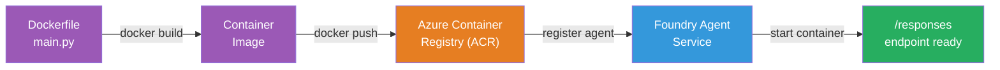

# Modul 5 - Raspoređivanje u Foundry Agent Service

⏱️ ~10 min

> ⚠️ **Korisnici puta B:** Ovaj modul zahtijeva Foundry pretplatu. Ako koristite Foundry Local, preskočite na [Modul 07 - Sažetak](07-summary.md). Uspješno ste dovršili lokalni razvojni tijek!

U ovom modulu raspoređujete lokalno testiranog agenta na Microsoft Foundry kao **Hosted Agent**. Raspoređivanje izgrađuje kontejnersku sliku, šalje je u Azure Container Registry i pokreće agenta u upravljanoj infrastrukturi Foundryja.

### Tijek raspoređivanja

---

## Provjera preduvjeta

Prije raspoređivanja provjerite:

- [ ] Agent prolazi sva 3 lokalna scenarija iz [Modul 04](04-test-locally.md)
- [ ] Imate ulogu **Azure AI User** na razini projekta ([Modul 01, Dodjela RBAC](01-setup.md#implementirajte-model-i-dodijelite-rbac))
- [ ] Prijavljeni ste u Azure u VS Codeu (ikona računa prikazuje vaše ime)

---

## Korak 1: Pokrenite raspoređivanje

### Opcija A: Raspoređivanje iz Agent Inspectora (preporučeno)

Ako je Agent Inspector otvoren (iz testiranja):
1. Kliknite gumb **Deploy** u gornjem desnom kutu (ikona oblaka ↑).

### Opcija B: Raspoređivanje iz Palete naredbi

1. Pritisnite `Ctrl+Shift+P` → **Foundry Toolkit: Deploy Hosted Agent**.

---

## Korak 2: Konfigurirajte raspoređivanje

Čarobnjak će od vas zatražiti:

| Upit | Odabir |
|--------|-----------|
| **Pretplata** | Vaša Azure pretplata |
| **Ciljani projekt** | Vaš Foundry projekt (npr. `workshop-agents`) |

Kliknite **next** za konfiguriranje agenta.

| Upit | Odabir |
|--------|-----------|
| **Metoda raspoređivanja** | Kontejner |
| **Registar kontejnera** | **Default ACR** (Microsoft Foundry za vas stvara i upravlja njime) |
| **Rasporedi na** | Novi agent (ime, `executive-summary-agent`) |

Kliknite **next** za pregled i raspoređivanje agenta.

| Upit | Odabir |
|--------|-----------|
| **CPU i memorija** | **0.25 CPU cores, 0.5 Gi memory** (dovoljno za radionicu) |

---

## Korak 3: Raspoređivanje i nadzor

1. Kliknite **Deploy**.
2. Promatrajte ploču **Output** (odaberite **Microsoft Foundry** iz padajućeg izbornika).
3. Raspoređivanje prolazi kroz ove faze:
   - **Docker build** - gradi kontejner iz vašeg Dockerfile-a
   - **Docker push** - šalje sliku u ACR (1–3 min pri prvom raspoređivanju)
   - **Agent registration** - stvara hosted agenta u Foundryju
   - **Container start** - pokreće se sa sistemski upravljanom identitetom

4. Kad je dovršeno, pojavljuje se obavijest:
   > **my-agent je uspješno raspoređen.** `View logs` `Run agent`

5. Kliknite **Run agent** da otvorite Agent Playground.

### Vrijednosti statusa raspoređivanja

| Status | Značenje |
|--------|---------|
| **Pokrenuto** | Kontejner spreman, agent odgovara |
| **Na čekanju** | Kontejner se pokreće - pričekajte 30–60 sekundi |
| **Neuspjelo** | Provjerite zapise (pogledajte rješavanje problema dolje) |

---

## Uobičajene pogreške pri raspoređivanju

| Pogreška | Uzrok | Popravak |
|-------|-----------|-----|
| `agents/write` pristup odbijen | Nedostaje uloga **Azure AI User** na razini projekta | [Modul 01, Dodjela RBAC](01-setup.md#implementirajte-model-i-dodijelite-rbac) |
| Docker se ne pokreće | Docker Desktop nije pokrenut | Pokrenite Docker Desktop → provjerite `docker info` |
| ACR autorizacija | Managed identity ne može povući sliku | Pogledajte [Modul 08 - Rješavanje problema](08-troubleshooting.md) |

---

### ✅ Kontrolna točka

- [ ] Raspoređivanje dovršeno bez pogrešaka
- [ ] Agent se pojavljuje pod **Hosted Agents (Preview)** u Foundry bočnoj traci
- [ ] Status kontejnera pokazuje **Pokrenuto**
- [ ] Kartica Agent Playground otvorena prikazujući detalje agenta i URL krajnje točke

---

**Prethodno:** [04 - Testiraj lokalno](04-test-locally.md) · **Sljedeće:** [06 - Provjeri u Playgroundu →](06-verify-in-playground.md)

---

<!-- CO-OP TRANSLATOR DISCLAIMER START -->
**Napomena**:
Ovaj dokument je preveden korištenjem AI prevoditeljskog servisa [Co-op Translator](https://github.com/Azure/co-op-translator). Iako težimo točnosti, imajte na umu da automatski prijevodi mogu sadržavati greške ili netočnosti. Izvorni dokument na izvornom jeziku treba smatrati autoritativnim izvorom. Za važne informacije preporuča se profesionalni ljudski prijevod. Nismo odgovorni za bilo kakva nesporazumevanja ili pogrešne interpretacije koje proizlaze iz korištenja ovog prijevoda.
<!-- CO-OP TRANSLATOR DISCLAIMER END -->
