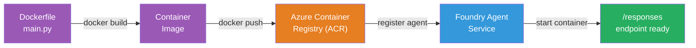
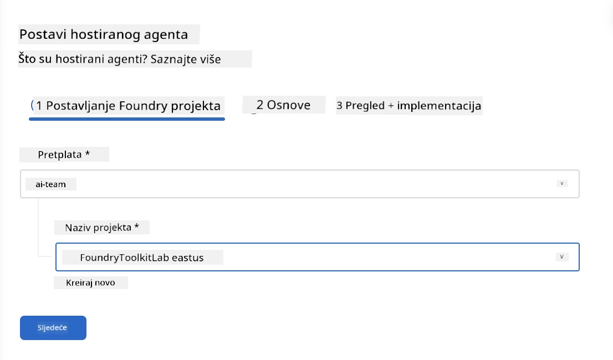
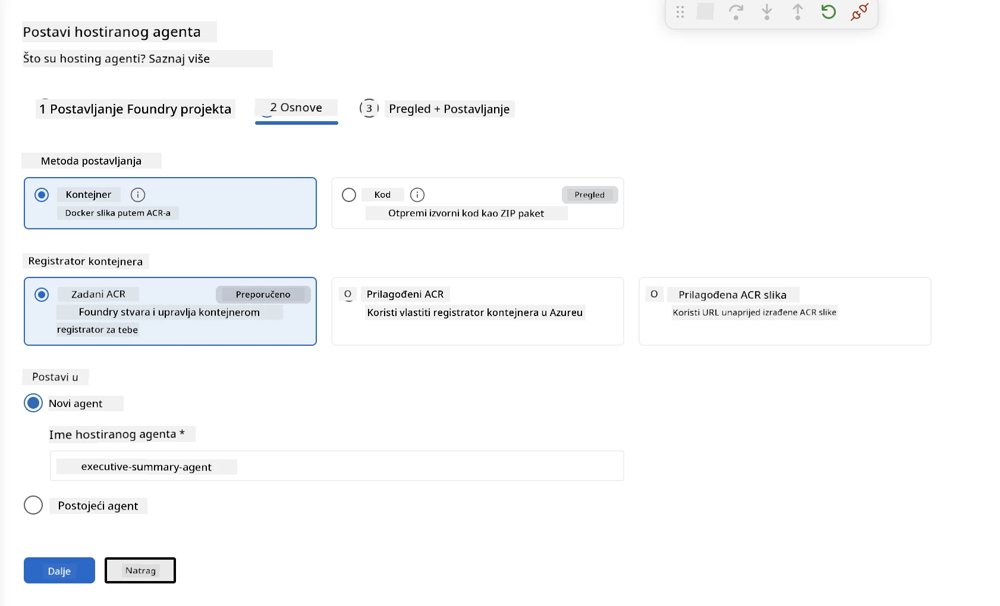
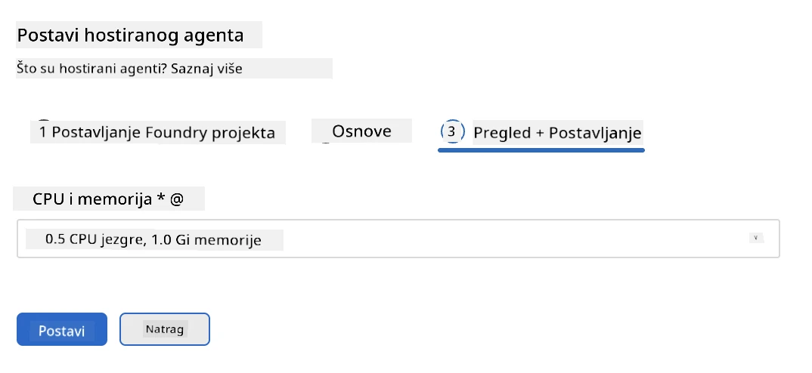
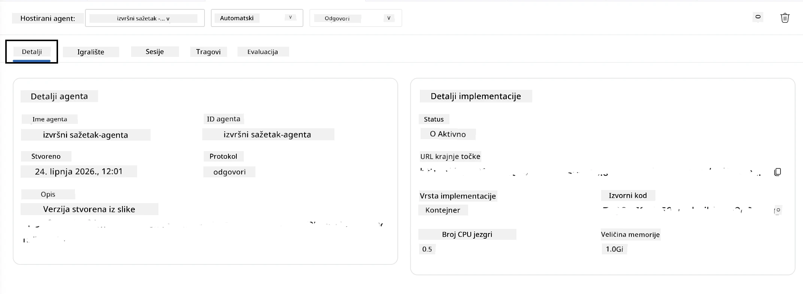

# Modul 5 - Implementacija u Foundry Agent Service

⏱️ ~10 min

> ⚠️ **Korisnici puta B:** Ovaj modul zahtijeva Foundry pretplatu. Ako koristite Foundry Local, preskočite na [Modul 07 - Sažetak](07-summary.md). Uspješno ste završili lokalni razvojni tijek rada!

U ovom modulu implementirate vaš lokalno testirani agent u Microsoft Foundry kao **Hostirani agent**. Implementacija gradi kontejner sliku, gura je u Azure Container Registry i pokreće agenta u Foundry-ovoj upravljanoj infrastrukturi.

### Pipeline implementacije

---

## Provjera preduvjeta

Prije implementacije provjerite:

- [ ] Agent prolazi sve 3 lokalna scenarija iz [Modul 04](04-test-locally.md)
- [ ] Imate ulogu **Azure AI User** na razini projekta ([Modul 01, Dodjela RBAC](01-setup.md#deploy-a-model--assign-rbac))
- [ ] Prijavljeni ste u Azure u VS Code (ikona računa prikazuje vaše ime)

---

## Korak 1: Započnite implementaciju

### Opcija A: Implementirajte iz Agent Inspectora (preporučeno)

Ako je Agent Inspector otvoren (iz testiranja):
1. Kliknite na gumb **Deploy** u gornjem desnom kutu (ikona oblaka ↑).

### Opcija B: Implementirajte iz Command Palette

1. Pritisnite `Ctrl+Shift+P` → **Foundry Toolkit: Deploy Hosted Agent**.

---

## Korak 2: Konfigurirajte implementaciju

Čarobnjak će vas pitati za:

| Pitanje | Odabir |
|--------|-----------|
| **Pretplata** | Vaša Azure pretplata |
| **Ciljani projekt** | Vaš Foundry projekt (npr. `workshop-agents`) |

Kliknite **dalje** za konfiguraciju agenta.

| Pitanje | Odabir |
|--------|-----------|
| **Metoda implementacije** | Kontejner |
| **Registry kontejnera** | **Zadani ACR** (Microsoft Foundry kreira i upravlja jednim za vas) |
| **Implementiraj u** | Novi agent (ime, `executive-summary-agent`) |

Kliknite **dalje** za pregled i implementaciju agenta.

| Pitanje | Odabir |
|--------|-----------|
| **CPU i memorija** | **0.5 CPU jezgre, 1.0 Gi memorije** (zadano - dovoljno za radionicu) |

---

## Korak 3: Implementirajte i pratite

1. Kliknite **Deploy**.
2. Promatrajte **Output** panel (odaberite **Microsoft Foundry** iz padajućeg menija).
3. Implementacija prolazi kroz ove faze:
   - **Docker build** - gradi kontejner iz vašeg Dockerfile-a
   - **Docker push** - gura sliku u ACR (1–3 min pri prvoj implementaciji)
   - **Registracija agenta** - kreira hostiranog agenta u Foundry-ju
   - **Pokretanje kontejnera** - pokreće se s identitetom kojim upravlja sustav

4. Kada završi, pojavit će se obavijest:
   > **executive-summary-agent je uspješno implementiran.** `View logs` `Run agent`

5. Kliknite **Run agent** za otvaranje Agent Playgounda.

### Vrijednosti statusa implementacije

| Status | Značenje |
|--------|---------|
| **Running** | Kontejner spreman, agent odgovara |
| **Pending** | Kontejner se pokreće - pričekajte 30–60 sekundi |
| **Failed** | Provjerite dnevnike (pogledajte rješavanje problema dolje) |

---

## Uobičajene pogreške prilikom implementacije

| Pogreška | Uzrok | Rješenje |
|---------|-------|----------|
| `agents/write` permission denied | Nedostaje uloga **Azure AI User** na razini projekta | [Modul 01, Dodjela RBAC](01-setup.md#deploy-a-model--assign-rbac) |
| Docker nije pokrenut | Docker Desktop nije pokrenut | Pokrenite Docker Desktop → provjerite `docker info` |
| ACR autorizacija | Identitet kojim upravlja sustav ne može povući sliku | Pogledajte [Modul 08 - Rješavanje problema](08-troubleshooting.md) |

---

### ✅ Kontrolna točka

- [ ] Implementacija je završena bez pogrešaka
- [ ] Agent se prikazuje na kartici **Hosted Agent** kada kliknete **Agents** u vašem projektu u Foundry Toolkit bočnoj traci
- [ ] Status kontejnera pokazuje **Running**
- [ ] Otvorena je kartica Agent Playground koja prikazuje detalje agenta i URL krajnje točke

---

**Prethodni:** [04 - Testiraj lokalno](04-test-locally.md) · **Sljedeći:** [06 - Provjeri u Playgroundu →](06-verify-in-playground.md)

---

<!-- CO-OP TRANSLATOR DISCLAIMER START -->
**Napomena**:
Ovaj dokument je preveden korištenjem AI prevoditeljskog servisa [Co-op Translator](https://github.com/Azure/co-op-translator). Iako težimo točnosti, imajte na umu da automatski prijevodi mogu sadržavati greške ili netočnosti. Izvorni dokument na izvornom jeziku treba smatrati autoritativnim izvorom. Za važne informacije preporuča se profesionalni ljudski prijevod. Nismo odgovorni za bilo kakva nesporazumevanja ili pogrešne interpretacije koje proizlaze iz korištenja ovog prijevoda.
<!-- CO-OP TRANSLATOR DISCLAIMER END -->