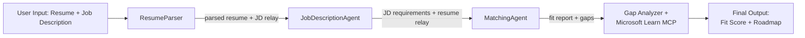

# PersonalCareerCopilot - Evaluator usklađenosti životopisa za posao

Višenamjenska aplikacija fokusirana na tijek rada koja procjenjuje koliko se životopis slaže s opisom posla, a zatim generira personaliziranu mapu učenja za zatvaranje praznina.

---

## Agenti

| Agent | Uloga | Alati |
|-------|------|-------|
| **ResumeParser** | Izvlači strukturirane vještine, iskustvo, certifikate iz teksta životopisa | - |
| **JobDescriptionAgent** | Izvlači potrebne/preferirane vještine, iskustvo, certifikate iz opisa posla | - |
| **MatchingAgent** | Uspoređuje profil s zahtjevima → ocjena usklađenosti (0-100) + usklađene/nedostajuće vještine | - |
| **GapAnalyzer** | Izrađuje personaliziranu mapu učenja koristeći Microsoft Learn resurse | `search_microsoft_learn_for_plan` (MCP) |

## Tijek rada



---

## Brzi početak

### 1. Postavljanje okruženja

Ova mapa je referentna implementacija za tijek rada Lab 02 okvira. Njezina `main.py` koristi postojeće blokove upita plus `WorkflowBuilder` za povezivanje četiri agenta.

```powershell
cd workshop\lab02-multi-agent\PersonalCareerCopilot
python -m venv .venv
.\.venv\Scripts\Activate.ps1          # Windows PowerShell
# source .venv/bin/activate            # macOS / Linux
pip install -r requirements.txt
```

### 2. Konfigurirajte vjerodajnice

Kreirajte datoteku `.env` u ovoj mapi:

```powershell
copy .env .env.bak 2>$null; echo $null > .env
```

Uredite `.env`:

```env
FOUNDRY_PROJECT_ENDPOINT=https://<your-account>.services.ai.azure.com/api/projects/<your-project>
AZURE_AI_MODEL_DEPLOYMENT_NAME=gpt-4.1-mini
```

| Vrijednost | Gdje je pronaći |
|-------|------------------|
| `FOUNDRY_PROJECT_ENDPOINT` | Foundry Toolkit bočna traka → desni klik na vaš projekt → **Copy Project Endpoint** |
| `AZURE_AI_MODEL_DEPLOYMENT_NAME` | Foundry bočna traka → proširite projekt → **Models + endpoints** → naziv implementacije |

### 3. Pokrenite lokalno

```powershell
python -m debugpy --listen 127.0.0.1:5679 main.py --port 8088
```

Ili koristite VS Code zadatak: `Ctrl+Shift+P` → **Tasks: Run Task** → **Run Agent HTTP Server**.

Za F5 debugiranje koristite **Debug Local Agent HTTP Server**.

### 4. Testirajte s Agent Inspectorom

Otvorite Agent Inspector: `Ctrl+Shift+P` → **Foundry Toolkit: Open Agent Inspector**.

Zalijepite ovaj testni upit:

```
Resume:
Jane Doe
Senior Software Engineer with 5 years of experience in Python, Django, and AWS.
Built microservices handling 10K+ requests/second. Led a team of 4 developers.
Certifications: AWS Solutions Architect Associate.
Education: B.S. Computer Science, State University.

Job Description:
Senior Cloud Engineer at Contoso Ltd.
Required: Python, Azure, Kubernetes, Terraform, CI/CD pipelines.
Preferred: Go, monitoring (Prometheus/Grafana), cost optimization.
Experience: 5+ years in cloud infrastructure.
Certifications: Azure Solutions Architect Expert preferred.
```

**Očekivano:** Ocjena usklađenosti (0-100), usklađene/nedostajuće vještine i personalizirana mapa učenja s URL-ovima Microsoft Learn.

### 5. Implementirajte u Foundry

`Ctrl+Shift+P` → **Foundry Toolkit: Deploy Hosted Agent** → odaberite svoj projekt → potvrdite.

---

## Struktura projekta

```
PersonalCareerCopilot/
├── .env                ← Your credentials (git-ignored)
├── agent.yaml          ← Hosted agent definition (name, resources, env vars)
├── Dockerfile          ← Container image for Foundry deployment
├── main.py             ← 4-agent workflow (instructions, MCP tool, WorkflowBuilder)
└── requirements.txt    ← Python dependencies
```

## Ključne datoteke

### `agent.yaml`

Definira hostiranog agenta za Foundry Agent Service:
- `kind: hosted` - radi kao upravljani kontejner
- `protocols` - `responses` protokol s `version: 2.0.0`, izlažući `/responses` HTTP endpoint
- `environment_variables` - `AZURE_AI_MODEL_DEPLOYMENT_NAME` se ovdje deklarira; `FOUNDRY_PROJECT_ENDPOINT` se automatski ubacuje pri implementaciji

### `main.py`

Sadrži:
- **Upute za agente** - četiri `*_INSTRUCTIONS` konstante, po jedna za svakog agenta
- **MCP alat** - `search_microsoft_learn_for_plan()` poziva `https://learn.microsoft.com/api/mcp` preko Streamable HTTP
- **Kreiranje agenata** - četiri `Agent()` + `AgentExecutor()` instance koje dijele jedan `FoundryChatClient`
- **Graf tijeka rada** - `WorkflowBuilder` povezuje agente kao sekvencijalni lanac: ResumeParser → JD Agent → MatchingAgent → GapAnalyzer
- **Pokretanje servera** - `ResponsesHostServer` radi na portu 8088

### `requirements.txt`

| Paket | Svrha |
|---------|----------|
| `agent-framework-foundry` | Jezgra runtime-a: `Agent`, `AgentExecutor`, `WorkflowBuilder`, `@tool`, `FoundryChatClient` |
| `agent-framework-foundry-hosting` | `ResponsesHostServer` + Foundry integracija hostinga |
| `mcp<2,>=1.24.0` | MCP klijent za GapAnalyzer (`streamable_http_client`) |
| `debugpy` | Python debugiranje (F5 u VS Code) |

---

## Rješavanje problema

| Problem | Rješenje |
|-------|-----|
| `KeyError: 'FOUNDRY_PROJECT_ENDPOINT'` ili `KeyError: 'AZURE_AI_MODEL_DEPLOYMENT_NAME'` | Kreirajte `.env` s obje postavke `FOUNDRY_PROJECT_ENDPOINT` i `AZURE_AI_MODEL_DEPLOYMENT_NAME` |
| `ModuleNotFoundError: No module named 'agent_framework'` | Aktivirajte venv i pokrenite `pip install -r requirements.txt` |
| Nema URL-ova Microsoft Learn u izlazu | Provjerite internetsku konekciju do `https://learn.microsoft.com/api/mcp` |
| Samo 1 kartica praznine (skraćeno) | Provjerite sadrži li `GAP_ANALYZER_INSTRUCTIONS` `CRITICAL:` blok |
| Port 8088 je zauzet | Zaustavite druge servere: `netstat -ano \| findstr :8088` |

Za detaljno rješavanje problema pogledajte [Modul 8 - Rješavanje problema](../docs/08-troubleshooting.md).

---

**Cjelovit vodič:** [Lab 02 Dokumentacija](../docs/README.md) · **Natrag na:** [Lab 02 README](../README.md) · [Početna radionice](../../../README.md)

---

<!-- CO-OP TRANSLATOR DISCLAIMER START -->
**Napomena**:
Ovaj dokument je preveden korištenjem AI prevoditeljskog servisa [Co-op Translator](https://github.com/Azure/co-op-translator). Iako težimo točnosti, imajte na umu da automatski prijevodi mogu sadržavati greške ili netočnosti. Izvorni dokument na izvornom jeziku treba smatrati autoritativnim izvorom. Za važne informacije preporuča se profesionalni ljudski prijevod. Nismo odgovorni za bilo kakva nesporazumevanja ili pogrešne interpretacije koje proizlaze iz korištenja ovog prijevoda.
<!-- CO-OP TRANSLATOR DISCLAIMER END -->