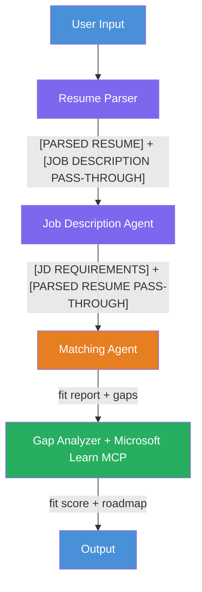

# Laboratorijska vježba 02 - Višeagentni tijek rada: Evaluator usklađenosti životopisa i posla

## Pregled

U ovoj praktičnoj laboratorijskoj vježbi izgradit ćete **višeagentnu aplikaciju usmjerenu na tijek rada** koristeći Foundry Toolkit u VS Codeu i implementirati je u Microsoft Foundry Agent Service.

**Što ćete izraditi:** Evaluator usklađenosti životopisa i posla koji parsira životopis i opis posla, ocjenjuje podudarnost i izrađuje personalizirani plan učenja koristeći Microsoft Learn resurse.

---

## Arhitektura

**Kako radi:**
1. Korisnik zalijepi životopis i opis posla.
2. **ResumeParser** parsira životopis i kopira opis posla doslovno u `[JOB DESCRIPTION PASS-THROUGH]` sekciju.
3. **JD Agent** izdvaja strukturirane zahtjeve iz proslijeđenih podataka, zatim prosljeđuje `[PARSED RESUME]` dalje kao `[PARSED RESUME PASS-THROUGH]`.
4. **MatchingAgent** uspoređuje `[PARSED RESUME PASS-THROUGH]` i `[JD REQUIREMENTS]` te generira ocjenu usklađenosti.
5. **GapAnalyzer** pretvara praznine u praktični plan puta i dohvaća stvarne poveznice Microsoft Learn putem MCP-a.

---

## Preduvjeti

Najprije dovršite laboratorij 01:

- [Laboratorij 01 - Jedan agent](../lab01-single-agent/README.md)

---

## Dio 1: Pročitajte module redom

Pogledajte cijeli put učenja u:

- [Dokumenti za laboratorij 2 - Preduvjeti](docs/00-prerequisites.md)
- [Dokumenti za laboratorij 2 - Cijeli put učenja](docs/README.md)
- [Vodič za pokretanje PersonalCareerCopilot](PersonalCareerCopilot/README.md)

---

## Dio 2: Izgradnja i testiranje tijeka rada

1. Koristite čarobnjak Foundry Toolkit za strukturiranje projekta temeljenog na tijeku rada.
2. Kopirajte blokove podražaja i graf tijeka rada iz `PersonalCareerCopilot/main.py` u svoj radni prostor.
3. Pokrenite lokalno s Agent Inspectorom i provjerite sva četiri agenta plus MCP alat.
4. Kada lokalno testiranje prođe, implementirajte hostiranog agenta u Foundry.

---

## Obrasci orkestracije

Laboratorijska vježba 02 koristi **sekvencijalni lanac**: izlaz svakog agenta napaja sljedećeg, a tijek rada vraća odgovor posljednjeg agenta. Dva obrasca omogućuju rad:

- **Sekvencijalni lanac** - `WorkflowBuilder` povezuje ResumeParser → JD Agent → MatchingAgent → GapAnalyzer s jednim pozivom `add_edge()` po koraku
- **Prosljeđivanje sadržaja** - jer svaki agent vidi samo izlaz svog izravnog prethodnika, ResumeParser i JD Agent kopiraju podatke koje sljedeći agenti trebaju u označene prosljeđene sekcije

Dokumentacija također objašnjava zašto laboratorij ne koristi fan-out/fan-in te kako proširiti graf s još jednim agentom.

Pogledajte [docs/04-orchestration-patterns.md](docs/04-orchestration-patterns.md).

---

**Prethodno:** [Laboratorij 01 - Jedan agent](../lab01-single-agent/README.md) · **Natrag na:** [Početna stranica radionice](../../README.md)

---

<!-- CO-OP TRANSLATOR DISCLAIMER START -->
**Napomena**:
Ovaj dokument je preveden korištenjem AI prevoditeljskog servisa [Co-op Translator](https://github.com/Azure/co-op-translator). Iako težimo točnosti, imajte na umu da automatski prijevodi mogu sadržavati greške ili netočnosti. Izvorni dokument na izvornom jeziku treba smatrati autoritativnim izvorom. Za važne informacije preporuča se profesionalni ljudski prijevod. Nismo odgovorni za bilo kakva nesporazumevanja ili pogrešne interpretacije koje proizlaze iz korištenja ovog prijevoda.
<!-- CO-OP TRANSLATOR DISCLAIMER END -->