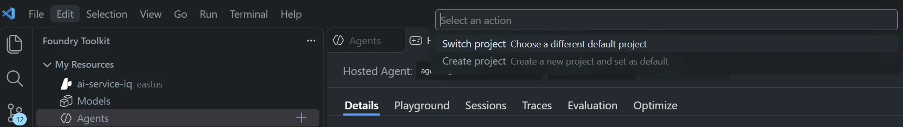

# Modul 0 - Uvod

⏱️ ~10 min

> [!WARNING]
> **Pregled & ograničenja:** [Hosted Agents](https://learn.microsoft.com/azure/foundry/agents/concepts/hosted-agents) su trenutno u **javnom pregledu** - nisu preporučeni za produkcijske zadatke. Neke značajke prikazane u ovom radionici mogu se promijeniti kako usluga bude napredovala prema GA.

## Što ćete izgraditi

U ovom laboratoriju proširujete sposobnosti jednog agenta iz Lab 01 za izgradnju **radnog procesa s više agenata** - Procjena životopisa prema pogodu za posao.

Zalijepite **životopis** i **opis posla**. Četiri specijalizirana agenta obrađuju unos sekvencijalno, zatim vraćaju:
- Ocjenu odgovarajućnosti (0–100 s prikazom bodovanja)
- Popis nedostataka vještina i certifikata
- Personalizirani učni plan s pravim vezama na Microsoft Learn za svaki nedostatak

**Radni proces koristi:**
- **Microsoft Agent Framework** - `WorkflowBuilder` za sekvencijalnu orkestraciju cjevovoda
- **Foundry Toolkit za VS Code** - osnova, lokalno testiranje, implementacija
- **AI model** (npr. `gpt-4.1-mini`) - koristi ga sva četiri agenta
- **Microsoft Learn MCP poslužitelj** - pruža stvarne veze za učenje za svaki nedostatak vještine

---

## Odaberite svoj put

> ⚠️ **Nastavite istim putem koji ste koristili u Lab 01.**

<details open>
<summary><strong>🅰️ Put A - Azure cloud (zahtijeva Azure pretplatu)</strong></summary>

| | Detalji |
|---|---|
| **Za koga je ovo?** | Završili ste Lab 01 koristeći Azure pretplatu |
| **Model** | Azure OpenAI preko Foundry (npr. `gpt-4.1-mini`) |
| **Pokriveni moduli** | Svi moduli (00–09) |
| **Implementirati u cloud?** | ✅ Da - potpuna end-to-end implementacija |

</details>

<details open>
<summary><strong>🅱️ Put B - Foundry Local (nije potrebna Azure pretplata)</strong></summary>

| | Detalji |
|---|---|
| **Za koga je ovo?** | Završili ste Lab 01 koristeći Foundry Local |
| **Model** | Foundry Local (besplatan, radi na vašem računalu) |
| **Pokriveni moduli** | Moduli 00–05 (preskočite 06–07 - implementacija i cloud verifikacija) |
| **Implementirati u cloud?** | ❌ Ne - samo lokalno testiranje preko Agent Inspectora |

</details>

---

## Provjera Lab 01

Lab 02 se gradi izravno na Lab 01. Prvo završite Lab 01 prije početka ovdje.

Još niste radili Lab 01? Počnite ovdje: [Lab 01 - Uvod](../../lab01-single-agent/docs/00-prerequisites.md)

<details open>
<summary><strong>🅰️ Put A - Azure cloud</strong></summary>

```powershell
az account show --query "{name:name, id:id}" --output table
```

Ako ovo ne uspije, pokrenite `az login`. Zatim provjerite u VS Code:

1. `Ctrl+Shift+P` → upišite **Foundry Toolkit** → potvrdite da se naredbe prikazuju.
2. Kliknite na ikonu **Foundry Toolkit** → vaš projekt i implementirani model prikazuju status **Succeeded**.



> **RBAC:** Dodijelili ste **Foundry User** u Lab 01. Ako trebate ponovno dodijeliti, pogledajte [Lab 01, Modul 1](../../lab01-single-agent/docs/01-setup.md#deploy-a-model--assign-rbac). Uloga je prethodno nazvana **Azure AI User** - iste dozvole.

</details>

<details open>
<summary><strong>🅱️ Put B - Foundry Local</strong></summary>

```powershell
Invoke-WebRequest -Uri "http://localhost:5273/v1/health" -UseBasicParsing | Select-Object StatusCode
```

Očekivano: `StatusCode: 200`. Ako nije, ponovno pokrenite Foundry Local iz Foundry Toolkit bočne trake.

> Sva inferencija se izvodi na vašem računalu. Jedini izlazni poziv je MCP alat za `https://learn.microsoft.com/api/mcp`.

</details>

---

## Što je novo u Lab 02

| | Lab 01 | Lab 02 |
|--|--------|--------|
| Agenti | 1 | 4 (povezani s WorkflowBuilder) |
| Predložak kostura | Osnovni - Agent Framework | Radni procesi - Agent Framework |
| Novi paket | - | `mcp` |
| Orkestracija | Jedan konverzacijski agent | Sekvencijalni cjevovod (WorkflowBuilder) |
| Novi alat | - | `search_microsoft_learn_for_plan` (MCP) |

---

**Dalje:** [01 - Razumjeti arhitekturu →](01-understand-multi-agent.md)

---

<!-- CO-OP TRANSLATOR DISCLAIMER START -->
**Napomena**:
Ovaj dokument je preveden korištenjem AI prevoditeljskog servisa [Co-op Translator](https://github.com/Azure/co-op-translator). Iako težimo točnosti, imajte na umu da automatski prijevodi mogu sadržavati greške ili netočnosti. Izvorni dokument na izvornom jeziku treba smatrati autoritativnim izvorom. Za važne informacije preporuča se profesionalni ljudski prijevod. Nismo odgovorni za bilo kakva nesporazumevanja ili pogrešne interpretacije koje proizlaze iz korištenja ovog prijevoda.
<!-- CO-OP TRANSLATOR DISCLAIMER END -->