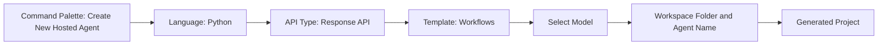
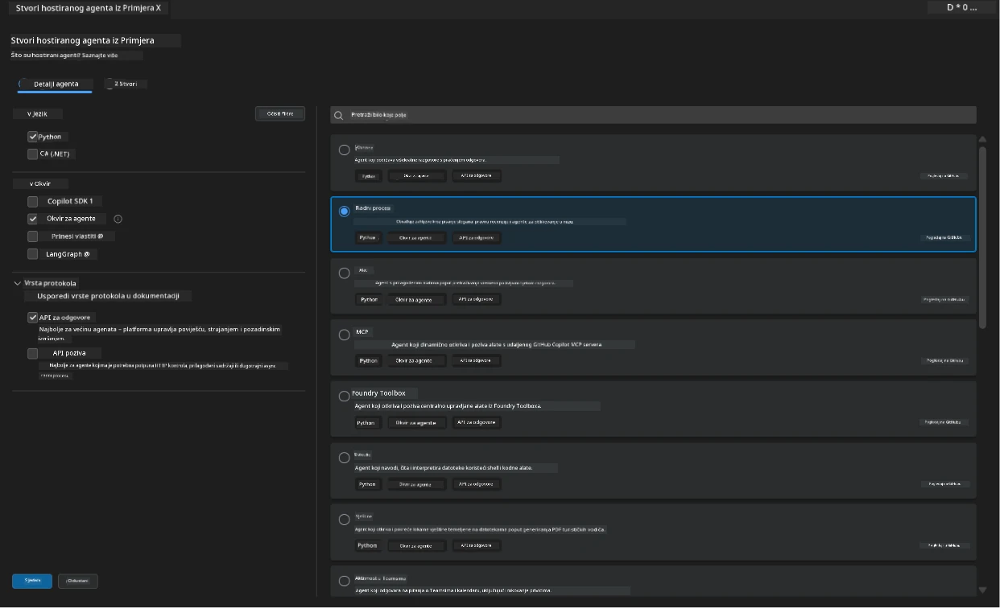
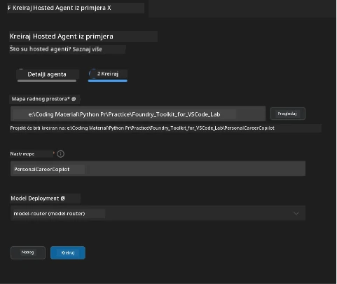

# Modul 2 - Postavljanje multi-agentnog projekta

⏱️ ~5 min

U ovom modulu koristite [Foundry Toolkit za VS Code](https://aka.ms/foundrytk) za **postavljanje multi-agentnog projekta**. Čarobnjak generira `agent.yaml`, `main.py`, `Dockerfile`, `requirements.txt`, `.env` i VS Code konfiguraciju za otklanjanje pogrešaka - kako biste se mogli usredotočiti na povezivanje radnog toka sa 4 agenta u Modulu 3.

> **Ključni koncept:** Scaffold je funkcionalna početna točka s jednim agentom. Zamijenite logiku rezervirane riječi grafom `WorkflowBuilder` u Modulu 3. Ne pišete osnovni kod od nule.

> **Referentna implementacija:** [`PersonalCareerCopilot/`](../../../../../workshop/lab02-multi-agent/PersonalCareerCopilot) je kompletan radni primjer. Koristite ga za usporedbu svog rada tijekom procesa.

### Tijek rada čarobnjaka za scaffold



---

## Korak 1: Otvorite čarobnjak za kreiranje Hosted Agenta

1. Pritisnite `Ctrl+Shift+P` za otvaranje **Command Palette**.
2. Upišite: **Foundry Toolkit: Create new Hosted Agent** i odaberite.
3. Čarobnjak se otvara na kartici **Agent Details**.

> **Alternativa:** Kliknite na ikonu **Foundry Toolkit** u Activity Bar → kliknite na ikonu **+** pored **Hosted Agents** → **Create New Hosted Agent**.

---

## Korak 2: Odaberite postavke



1. U lijevom dijelu za navigaciju/izbor odaberite sljedeće:

| Izbornik | Odabir | Napomene |
|--------|-----------|-------|
| **Jezik** | Python | Podržan je i C# (.NET) |
| **Framework** | Agent Framework | Pruža `Agent`, `AgentExecutor`, `WorkflowBuilder` |
| **Vrsta API-ja** | Response API | `POST /responses` - povijest upravljana platformom, podrška za streaming |
| **Predložak** | **Workflows** | Obrada zahtjeva kroz više agenata u nizu |

2. Kad odaberete, kliknite **Next**



3. U sljedećem prozoru odaberite sljedeće:

| Izbornik | Odabir | Napomene |
|--------|-----------|-------|
| **Mapa radnog prostora** | Pregledajte do ciljane mape | npr. `workshop/lab02-multi-agent/` u ovom repo-u |
| **Ime agenta** | `PersonalCareerCopilot` | Ovo postaje ime direktorija projekta |
| **Model Deployment** | Odaberite svoj implementirani model | npr. `gpt-4.1-mini` iz Lab 01 |

4. Kliknite **Create** za postavljanje projekta. VS Code generira datoteke i otvara mapu.

> **Savjet:** [`gpt-4.1-mini`](https://learn.microsoft.com/azure/foundry/foundry-models/concepts/models-sold-directly-by-azure#gpt-41-series) dobro balansira brzinu i kvalitetu za razvoj s više agenata.

---

## Korak 3: Pregledajte generirani projekt

Nakon što postavljanje završi, provjerite da vidite ove datoteke u Exploreru (`Ctrl+Shift+E`):

```
📂 <your-agent-name>/
├── .azdignore          ← Files excluded from Azure Developer CLI deployments
├── .dockerignore       ← Files excluded from Docker builds
├── .env                ← Environment variables (placeholders - fill in Module 3)
├── .vscode/
│   ├── launch.json     ← Debug config (F5 → run + Agent Inspector)
│   └── tasks.json      ← VS Code task definitions
├── agent.yaml          ← Agent definition (kind: hosted, protocol: responses)
├── Dockerfile          ← Container config for deployment
├── main.py             ← Stub agent entry point (replace with WorkflowBuilder in Module 3)
└── requirements.txt    ← Python dependencies
```

> **Važno:** Otvorite ovu mapu direktno u VS Code-u kako bi `.vscode/launch.json` i `tasks.json` ispravno radili za otklanjanje pogrešaka pritiskom na F5.

### Objašnjenje ključnih datoteka

| Datoteka | Svrha |
|------|---------|
| `agent.yaml` | Deklarira `kind: hosted`, mapira varijable okoline, definira `/responses` protokol |
| `main.py` | Stub: jedan `FoundryChatClient` → `Agent` → `ResponsesHostServer`. Zamijenit ćete ovo sa 4 agenta + `WorkflowBuilder` u Modulu 3 |
| `Dockerfile` | `python:3.12-slim`, instalira `requirements.txt`, otvara port 8088, pokreće `python main.py` |
| `requirements.txt` | `agent-framework-foundry`, `agent-framework-foundry-hosting`, `mcp<2,>=1.24.0`, `debugpy` |

> **Referenca:** Pogledajte [`PersonalCareerCopilot/agent.yaml`](../../../../../workshop/lab02-multi-agent/PersonalCareerCopilot/agent.yaml) i [`PersonalCareerCopilot/requirements.txt`](../../../../../workshop/lab02-multi-agent/PersonalCareerCopilot/requirements.txt) za kompletan generirani sadržaj.

---

### ✅ Kontrolna točka

- [ ] Završeno postavljanje čarobnjaka - nova mapa projekta vidljiva u Exploreru
- [ ] Sve očekivane datoteke su prisutne: `agent.yaml`, `main.py`, `Dockerfile`, `requirements.txt`, `.env`
- [ ] `agent.yaml` prikazuje `kind: hosted` i `protocol: responses`
- [ ] `main.py` uvozi `Agent`, `FoundryChatClient`, `ResponsesHostServer`
- [ ] Scaffold mapa je otvorena kao korijen VS Code radnog prostora
- [ ] Razumijete da je `main.py` početna točka - `WorkflowBuilder` se dodaje u Modulu 3

---

**Prethodno:** [01 - Razumijevanje multi-agentne arhitekture](01-understand-multi-agent.md) · **Sljedeće:** [03 - Konfiguriranje agenata i okoline →](03-configure-agents.md)

---

<!-- CO-OP TRANSLATOR DISCLAIMER START -->
**Napomena**:
Ovaj dokument je preveden korištenjem AI prevoditeljskog servisa [Co-op Translator](https://github.com/Azure/co-op-translator). Iako težimo točnosti, imajte na umu da automatski prijevodi mogu sadržavati greške ili netočnosti. Izvorni dokument na izvornom jeziku treba smatrati autoritativnim izvorom. Za važne informacije preporuča se profesionalni ljudski prijevod. Nismo odgovorni za bilo kakva nesporazumevanja ili pogrešne interpretacije koje proizlaze iz korištenja ovog prijevoda.
<!-- CO-OP TRANSLATOR DISCLAIMER END -->