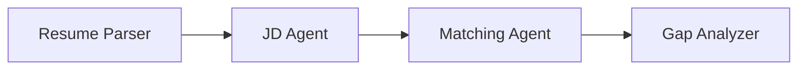
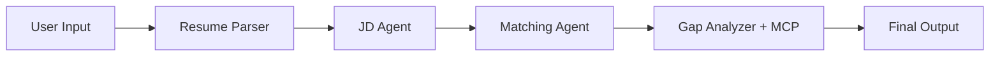

# Modul 4 - Obrasci orkestracije

⏱️ ~10 min

U ovom modulu istražujete obrasce orkestracije korištene u Resume Job Fit Evaluatoru i učite kako čitati, mijenjati i proširivati graf tijeka rada. Razumijevanje ovih obrazaca ključno je za otklanjanje pogrešaka u protoku podataka i izgradnju vlastitih [višeagentskih tijekova rada](https://learn.microsoft.com/agent-framework/workflows/).

---

## Obrazac 1: Sekvencijalni lanac

Temeljni obrazac u tijeku rada je **sekvencijalni lanac** - izlaz svakog agenta ide izravno u sljedećeg.



U kodu, svaki `add_edge()` poziv stvara jedan korak u lancu:

```python
.add_edge(resume_executor, jd_executor)       # ResumeParser output → JD Agent
.add_edge(jd_executor, matching_executor)     # JD Agent output → MatchingAgent
.add_edge(matching_executor, gap_executor)    # MatchingAgent output → GapAnalyzer
```

> **Zašto sekvencijalni, a ne fan-out/fan-in?** `WorkflowBuilder` koristi **OR-semantiku** za dolazne bridove: izvršitelj nizvodno pokreće se čim **bilo koji** prethodnik završi. Da je `matching_executor` imao dva dolazna brida (od `resume_executor` i `jd_executor`), pokrenuo bi se dva puta - jednom kad ResumeParser završi i ponovno kad JD Agent završi - zbog čega bi GapAnalyzer također pokrenuo se dva puta i izlaz bi se pojavio dvaput. Sekvencijalni lanac to u potpunosti izbjegava.

## Obrazac 2: Prosljeđivanje sadržaja

Budući da `context_mode="last_agent"` znači da svaki izvršitelj vidi samo **izlaz svog izravnog prethodnika**, agenti u sekvencijalnom lancu moraju eksplicitno prosljeđivati sve podatke koje nizvodni agenti trebaju.

U ovom tijeku rada:
- **ResumeParser** kopira JD doslovno u `[JOB DESCRIPTION PASS-THROUGH]` (kako bi ga JD Agent mogao pronaći).
- **JD Agent** kopira `[PARSED RESUME]` doslovno u `[PARSED RESUME PASS-THROUGH]` (kako bi MatchingAgent mogao usporediti oba profila).

```
ResumeParser output
└─ [PARSED RESUME]               ← extracted by JD Agent
└─ [JOB DESCRIPTION PASS-THROUGH] ← extracted by JD Agent

JD Agent output
└─ [JD REQUIREMENTS]             ← extracted by MatchingAgent
└─ [PARSED RESUME PASS-THROUGH]  ← extracted by MatchingAgent
```

Svaki dio prosljeđivanja mora se kopirati **doslovno** - sažimanje ili parafraziranje kvari nizvodnog agenta koji ovisi o njemu.

---

## Cjelokupni graf

Kombinacijom obrazaca sekvencijalnog lanca i prosljeđivanja sadržaja dobiva se puni tijek rada:



Agent Inspector prikazuje istu strukturu grafa kada agent radi lokalno. Pogledajte [Modul 5 - Test lokalno](05-test-locally.md) za snimke zaslona.

---

## Čitanje WorkflowBuilder koda

Graf tijeka rada se gradi u funkciji `main()` u [`PersonalCareerCopilot/main.py`](../../../../../workshop/lab02-multi-agent/PersonalCareerCopilot/main.py). Tri poziva `add_edge()` grade sekvencijalni lanac:

| # | Brid | Učinak |
|---|------|--------|
| 1 | `resume_executor → jd_executor` | JD Agent prima `[PARSED RESUME]` + `[JOB DESCRIPTION PASS-THROUGH]` |
| 2 | `jd_executor → matching_executor` | MatchingAgent prima `[JD REQUIREMENTS]` + `[PARSED RESUME PASS-THROUGH]` |
| 3 | `matching_executor → gap_executor` | GapAnalyzer prima izvještaj o uklapanju + popis praznina |

---

## Mijenjanje grafa

### Dodavanje novog agenta

Za dodavanje petog agenta (npr. **InterviewPrepAgent** nakon GapAnalyzer):

1. Definirajte konstantu `INTERVIEW_PREP_INSTRUCTIONS`.
2. Kreirajte objekte `Agent` + `AgentExecutor` (isti obrazac kao postojeća četiri).
3. Dodajte `.add_edge(gap_executor, interview_exec)` u `WorkflowBuilder`.
4. Ažurirajte `output_executors=[interview_exec]`.

> **Važno:** `start_executor` je jedini agent koji prima sirovi korisnički unos. Svi ostali agenti primaju izlaz sa svog uzvodnog brida.

---

## Česte pogreške u grafu

| Pogreška | Simptom | Rješenje |
|---------|---------|-----|
| Nedostaje brid prema `output_executors` | Agent radi, ali je izlaz prazan | Osigurajte put od `start_executor` do svakog agenta u `output_executors` |
| Ciklična ovisnost | Beskonačna petlja ili timeout | Provjerite da nijedan agent ne povratno hrani uzvodnog agenta |
| Agent u `output_executors` bez dolaznog brida | Prazan izlaz | Dodajte barem jedan `add_edge(source, that_agent)` |
| Više `output_executors` bez fan-in | Izlaz sadrži samo odgovor jednog agenta | Koristite jednog izlaznog agenta koji agregira, ili prihvatite višestruke izlaze |
| Nedostaje `start_executor` | `ValueError` prilikom izgradnje | Uvijek navedite `start_executor` u `WorkflowBuilder()` |

---

## Otklanjanje pogrešaka u grafu

### Korištenje Agent Inspectora

1. Pokrenite agenta lokalno s F5.
2. Otvorite Agent Inspector (`Ctrl+Shift+P` → **Foundry Toolkit: Open Agent Inspector**).
3. Pošaljite testnu poruku.
4. U panelu za odgovor Inspectora potražite **streaming output** - prikazuje doprinos svakog agenta redom.


### Korištenje zapisivanja (logging)

Dodajte zapisivanje u `main.py` za praćenje protoka podataka:

```python
import logging
logger = logging.getLogger("resume-job-fit")

# In main(), after building the workflow:
logger.info("Workflow graph built with edges: RP→JD, JD→MA, MA→GA")
```

Dnevnici poslužitelja prikazuju redoslijed izvođenja agenta i pozive MCP alata:

```
INFO:agent_framework:Executing agent: ResumeParser
INFO:agent_framework:Executing agent: JobDescriptionAgent
INFO:agent_framework:Executing agent: MatchingAgent
INFO:agent_framework:Executing agent: GapAnalyzer
INFO:agent_framework:Tool call: search_microsoft_learn_for_plan(skill="Kubernetes")
POST https://learn.microsoft.com/api/mcp → 200
INFO:agent_framework:Tool call: search_microsoft_learn_for_plan(skill="Terraform")
POST https://learn.microsoft.com/api/mcp → 200
```

---

### Checkpoint

- [ ] Možete identificirati dva obrasca orkestracije u tijeku rada: sekvencijalni lanac i prosljeđivanje sadržaja
- [ ] Razumijete zašto `context_mode="last_agent"` zahtijeva eksplicitno prosljeđivanje podataka između agenata
- [ ] Možete čitati kod `WorkflowBuilder` i mapirati svaki `add_edge()` poziv na vizualni graf
- [ ] Znate kako dodati novog agenta na kraj lanca
- [ ] Možete identificirati česte pogreške u grafu i njihove simptome

---

**Prethodni:** [03 - Konfiguracija agenata i okoline](03-configure-agents.md) · **Sljedeći:** [05 - Test lokalno →](05-test-locally.md)

---

<!-- CO-OP TRANSLATOR DISCLAIMER START -->
**Napomena**:
Ovaj dokument je preveden korištenjem AI prevoditeljskog servisa [Co-op Translator](https://github.com/Azure/co-op-translator). Iako težimo točnosti, imajte na umu da automatski prijevodi mogu sadržavati greške ili netočnosti. Izvorni dokument na izvornom jeziku treba smatrati autoritativnim izvorom. Za važne informacije preporuča se profesionalni ljudski prijevod. Nismo odgovorni za bilo kakva nesporazumevanja ili pogrešne interpretacije koje proizlaze iz korištenja ovog prijevoda.
<!-- CO-OP TRANSLATOR DISCLAIMER END -->