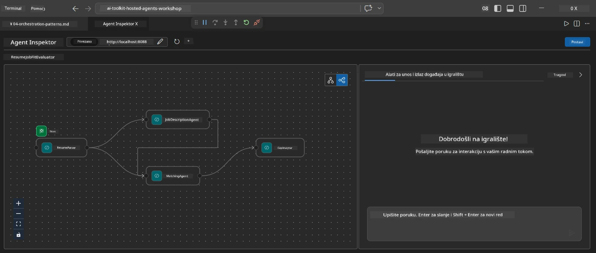
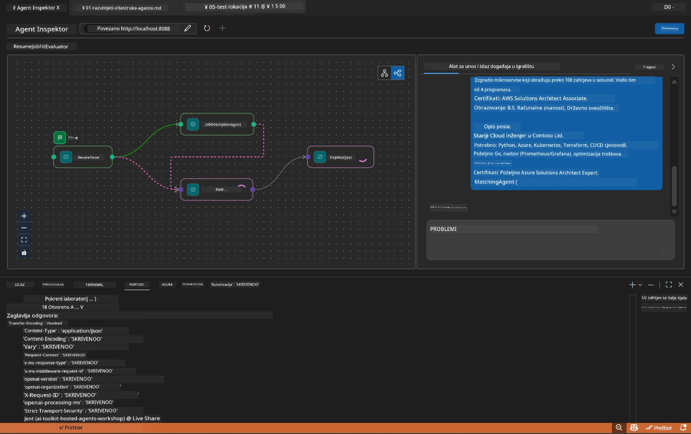
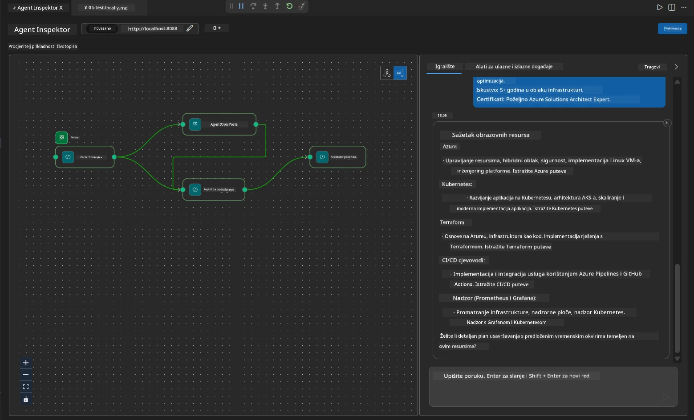

# Modul 5 - Lokalno testiranje

⏱️ ~15 min

U ovom modulu pokrenut ćete višestruki agentni tijek rada lokalno, testirati ga pomoću Agent Inspectora i provjeriti da sva četiri agenta i MCP alat ispravno rade prije implementacije.

---

## Korak 1: Pokreni serverski agent

### Opcija A: Korištenje VS Code zadatka (preporučeno)

1. Otvorite `workshop/lab02-multi-agent/PersonalCareerCopilot/` kao svoju VS Code mapu.
2. Pritisnite `Ctrl+Shift+P` → upišite **Tasks: Run Task** → odaberite **Run Agent HTTP Server**.
3. Zadatak pokreće server s debugpy priključenim na portu `5679` i agentom na portu `8088`.
4. Pričekajte da se u izlazu pojavi poruka o pokretanju, a zatim i vlastita poruka spremnosti servera (između se pojavljuju i druge linije dnevnika):

```
INFO:resume-job-fit:Starting Resume -> Job Fit Evaluator HTTP server...
...
INFO:hypercorn.error:Running on http://0.0.0.0:8088 (CTRL + C to quit)
```

### Opcija B: Korištenje F5 (debug način)

1. Pritisnite `F5` → odaberite **Debug Local Agent HTTP Server**.
2. Server se pokreće sa punom podrškom za točke prekida - korisno za pregled odgovora MCP-a ili izlaza agenta.

---

## Korak 2: Otvorite Agent Inspector

1. Pritisnite `Ctrl+Shift+P` → upišite **Foundry Toolkit: Open Agent Inspector**.
2. Agent Inspector se otvara kao VS Code panel povezan s `http://localhost:8088`.
3. Trebali biste vidjeti interfaces agenta spreman za primanje poruka.



> **Ako Agent Inspector ne otvara:** Provjerite je li poslužitelj u potpunosti pokrenut (vidite `Running on http://0.0.0.0:8088` zapisnik). Ako je port 5679 zauzet, pogledajte [Modul 8 - Rješavanje problema](08-troubleshooting.md).

---

## Korak 2b: (Neobavezno) Otvorite vizualizator tijeka rada

Foundry Toolkit uključuje real-time **vizualizator tijeka rada** koji prikazuje kako agenti međusobno djeluju dok se graf izvodi. Ovo je osobito korisno za višestruko otklanjanje pogrešaka agenata.

1. Pritisnite `Ctrl+Shift+P` → upišite **Foundry Toolkit: Open Visualizer for Hosted Agents**.
2. Otvara se novi VS Code tab koji prikazuje graf žive izvedbe.
3. Dok šaljete poruke u Agent Inspectoru, vizualizator se automatski ažurira - zeleni čvorovi označavaju završene agente, a animirane poveznice prikazuju protok podataka među njima.

> **Sukob porta:** Ako je port vizualizatora već zauzet, promijenite ga u VS Code Settings → **Extensions** → **Microsoft Foundry Configuration** → **Hosted Agents: Visualizer Port**.

---

## Korak 3: Pokrenite osnovne testove

Pokrenite ova dva testa redom. Svaki test provjerava sveobuhvatnije dijelove tijeka rada.

### Test 1: Osnovni životopis + opis posla

Zalijepite sljedeće u Agent Inspector:

```
Resume:
Jane Doe
Senior Software Engineer with 5 years of experience in Python, Django, and AWS.
Built microservices handling 10K+ requests/second. Led a team of 4 developers.
Certifications: AWS Solutions Architect Associate.
Education: B.S. Computer Science, State University.

Job Description:
Senior Cloud Engineer at Contoso Ltd.
Required: Python, Azure, Kubernetes, Terraform, CI/CD pipelines.
Preferred: Go, monitoring (Prometheus/Grafana), cost optimization.
Experience: 5+ years in cloud infrastructure.
Certifications: Azure Solutions Architect Expert preferred.
```

**Očekivana struktura izlaza:**

Odgovor treba sadržavati izlaz od svih četiriju agenata redom:

1. **Izlaz Parsera životopisa** - Dva označena odjeljka: `[PARSED RESUME]` (profil kandidata s grupiranim vještinama) i `[JOB DESCRIPTION PASS-THROUGH]` (doslovni tekst opisa posla koji hrani JD agenta)
2. **Izlaz JD agenta** - Strukturirani zahtjevi s odvojenim obaveznim i poželjnim vještinama
3. **Izlaz Matching agenta** - Ocjena podudarnosti (0-100) s razradom, podudarajuće vještine, nedostajuće vještine, praznine
4. **Izlaz Gap Analyzer-a** - Pojedinačne kartice praznina za svaku nedostajuću vještinu, svaka s Microsoft Learn URL-ovima





### Što provjeriti u Testu 1

| Provjera | Očekivano | Prolaz? |
|---------|-----------|----------|
| Odgovor sadrži ocjenu podudarnosti | Broj između 0-100 s razradom | |
| Popisane su podudarajuće vještine | Python, CI/CD (djelomično), itd. | |
| Popisane su nedostajuće vještine | Azure, Kubernetes, Terraform, itd. | |
| Kartice praznina postoje za svaku nedostajuću vještinu | Po jedna kartica po vještini | |
| Microsoft Learn URL-ovi su prisutni | Pravi `learn.microsoft.com` linkovi | |
| Nema poruka o pogreškama u odgovoru | Čisti strukturirani izlaz | |

### Test 2: Edge slučaj - kandidat visokog podudaranja

Zalijepite životopis koji je blizu zahtjevima JD-a kako biste provjerili kako GapAnalyzer rukuje situacijama visokog podudaranja:

```
Resume:
Alex Chen
Senior Cloud Engineer with 7 years of experience.
Skills: Python, Azure (AKS, Functions, DevOps), Kubernetes, Terraform, CI/CD (GitHub Actions, Azure Pipelines), Go, Prometheus, Grafana, cost optimization.
Certifications: Azure Solutions Architect Expert, Azure DevOps Engineer Expert.
Led infrastructure migration to Azure for 3 enterprise clients.
Education: M.S. Computer Science, Tech University.

Job Description:
Senior Cloud Engineer at Contoso Ltd.
Required: Python, Azure, Kubernetes, Terraform, CI/CD pipelines.
Preferred: Go, monitoring (Prometheus/Grafana), cost optimization.
Experience: 5+ years in cloud infrastructure.
Certifications: Azure Solutions Architect Expert preferred.
```

**Očekivano ponašanje:**
- Ocjena podudarnosti trebala bi biti **80+** (većina vještina se podudara)
- Kartice praznina trebale bi se fokusirati na doradu/pripremu za intervju, a ne na osnovno učenje
- Uputstva GapAnalyzer-a kažu: "Ako je podudaranje >= 80, fokusirajte se na doradu/pripremu za intervju"

---

## Korak 4: Testirajte sa svojim podacima (neobavezno)

Pokušajte zalijepiti svoj životopis i stvarni opis posla. Ovo pomaže potvrditi:

- Agenti obrađuju različite formate životopisa (kronološki, funkcionalni, hibridni)
- JD agent obrađuje različite stilove opisa posla (točke, odlomci, strukturirani)
- MCP alat vraća relevantne izvore za stvarne vještine
- Kartice praznina su personalizirane za vašu specifičnu pozadinu

> **Privatnost - Put A (Foundry cloud):** Tekst životopisa i opisa posla šalje se vašoj Azure OpenAI implementaciji na interpretaciju. Ne bilježi se niti čuva na infrastrukturi radionice. Koristite lažna imena (npr. "Jane Doe") ako želite.
>
> **Privatnost - Put B (Foundry Local):** Sve četiri radnje agenata izvode se u potpunosti na vašem uređaju. Tekst vašeg životopisa i opisa posla **nikada ne izlazi s vašeg računala**. Jedini odlazni poziv je MCP alatu za dohvat izvora iz `https://learn.microsoft.com/api/mcp`; taj upit sadrži samo ime vještine, ne vaše osobne podatke.

---

### Kontrolna točka

- [ ] Poslužitelj je uspješno pokrenut na portu `8088` (zapisnik pokazuje `Running on http://0.0.0.0:8088`)
- [ ] Agent Inspector je otvoren i povezan s agentom
- [ ] Test 1: Kompletan odgovor s ocjenom podudarnosti, podudarnim/nedostajućim vještinama, karticama praznina i Microsoft Learn URL-ovima
- [ ] Test 2: Kandidat visokog podudaranja dobiva ocjenu 80+ s preporukama za doradu
- [ ] Sve kartice praznina su prisutne (po jedna po nedostajućoj vještini, bez skraćenja)
- [ ] Nema pogrešaka ni tragova u terminalu poslužitelja

---

**Prethodno:** [04 - Obrasci orkestracije](04-orchestration-patterns.md) · **Sljedeće:** [06 - Deploy to Foundry →](06-deploy-to-foundry.md)

---

<!-- CO-OP TRANSLATOR DISCLAIMER START -->
**Napomena**:
Ovaj dokument je preveden korištenjem AI prevoditeljskog servisa [Co-op Translator](https://github.com/Azure/co-op-translator). Iako težimo točnosti, imajte na umu da automatski prijevodi mogu sadržavati greške ili netočnosti. Izvorni dokument na izvornom jeziku treba smatrati autoritativnim izvorom. Za važne informacije preporuča se profesionalni ljudski prijevod. Nismo odgovorni za bilo kakva nesporazumevanja ili pogrešne interpretacije koje proizlaze iz korištenja ovog prijevoda.
<!-- CO-OP TRANSLATOR DISCLAIMER END -->