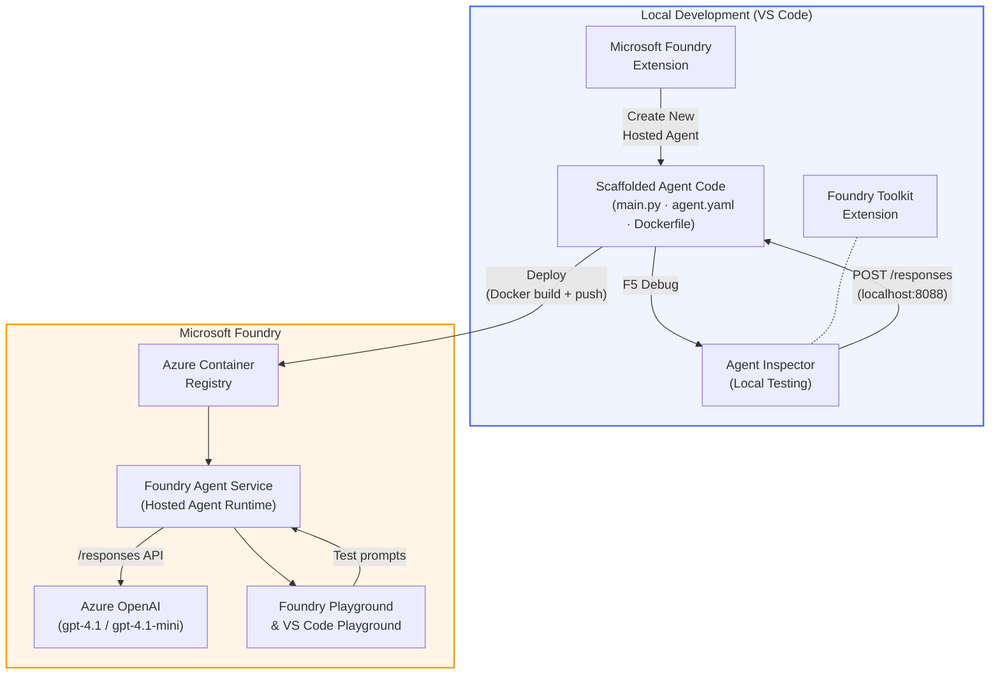

# Foundry Toolkit + Foundry Hosted Agents műhely

[](https://www.python.org/)
[](https://github.com/microsoft/agents)
[](https://learn.microsoft.com/azure/foundry/agents/concepts/hosted-agents)
[](https://ai.azure.com/)
[](https://learn.microsoft.com/azure/ai-services/openai/)
[](https://learn.microsoft.com/cli/azure/install-azure-cli)
[](https://learn.microsoft.com/azure/developer/azure-developer-cli/install-azd)
[](https://www.docker.com/)
[](https://marketplace.visualstudio.com/items?itemName=ms-windows-ai-studio.windows-ai-studio)
[](../../LICENSE)

Építsen, teszteljen és telepítsen MI-ügynököket a **Microsoft Foundry Agent Service**-re **Hosted Agents** formájában - teljes egészében a VS Code-ból a **Microsoft Foundry bővítmény** és a **Foundry Toolkit** használatával.

> **A Hosted Agents jelenleg előzetes verzióban van.** A támogatott régiók korlátozottak - lásd a [régiók elérhetősége](https://learn.microsoft.com/azure/foundry/agents/concepts/hosted-agents#region-availability).

> A `agent/` mappa minden laboron belül a Foundry bővítmény által **automatikusan előállított** - ezt követően testreszabod a kódot, helyben teszteled, és telepíted.

### 🌐 Többnyelvű támogatás

#### GitHub Action által támogatott (automatikus és mindig naprakész)

<!-- CO-OP TRANSLATOR LANGUAGES TABLE START -->
[Arab](../ar/README.md) | [Bengáli](../bn/README.md) | [Bolgár](../bg/README.md) | [Burmai (Mianmar)](../my/README.md) | [Kínai (egyszerűsített)](../zh-CN/README.md) | [Kínai (hagyományos, Hongkong)](../zh-HK/README.md) | [Kínai (hagyományos, Makaó)](../zh-MO/README.md) | [Kínai (hagyományos, Tajvan)](../zh-TW/README.md) | [Horvát](../hr/README.md) | [Cseh](../cs/README.md) | [Dán](../da/README.md) | [Holland](../nl/README.md) | [Észt](../et/README.md) | [Finn](../fi/README.md) | [Francia](../fr/README.md) | [Német](../de/README.md) | [Görög](../el/README.md) | [Héber](../he/README.md) | [Hindi](../hi/README.md) | [Magyar](./README.md) | [Indonéz](../id/README.md) | [Olasz](../it/README.md) | [Japán](../ja/README.md) | [Kannada](../kn/README.md) | [Khmer](../km/README.md) | [Koreai](../ko/README.md) | [Litván](../lt/README.md) | [Maláj](../ms/README.md) | [Malayálam](../ml/README.md) | [Maráthi](../mr/README.md) | [Nepáli](../ne/README.md) | [Nigériai pidgin](../pcm/README.md) | [Norvég](../no/README.md) | [Perzsa (fárszi)](../fa/README.md) | [Lengyel](../pl/README.md) | [Portugál (Brazília)](../pt-BR/README.md) | [Portugál (Portugália)](../pt-PT/README.md) | [Pandzsábi (Gurmukhi)](../pa/README.md) | [Román](../ro/README.md) | [Orosz](../ru/README.md) | [Szerb (cirill)](../sr/README.md) | [Szlovák](../sk/README.md) | [Szlovén](../sl/README.md) | [Spanyol](../es/README.md) | [Szuahéli](../sw/README.md) | [Svéd](../sv/README.md) | [Tagalog (filippínó)](../tl/README.md) | [Tamil](../ta/README.md) | [Telugu](../te/README.md) | [Thai](../th/README.md) | [Török](../tr/README.md) | [Ukrán](../uk/README.md) | [Urdu](../ur/README.md) | [Vietnami](../vi/README.md)

> **Inkább helyben klónoznád?**
>
> Ez a tároló 50+ nyelvi fordítást tartalmaz, ami jelentősen megnöveli a letöltési méretet. Ha fordítások nélkül szeretnéd klónozni, használd a sparse checkout-ot:
>
> **Bash / macOS / Linux:**
> ```bash
> git clone --filter=blob:none --sparse https://github.com/microsoft-foundry/Foundry_Toolkit_for_VSCode_Lab.git
> cd Foundry_Toolkit_for_VSCode_Lab
> git sparse-checkout set --no-cone '/*' '!translations' '!translated_images'
> ```
>
> **CMD (Windows):**
> ```cmd
> git clone --filter=blob:none --sparse https://github.com/microsoft-foundry/Foundry_Toolkit_for_VSCode_Lab.git
> cd Foundry_Toolkit_for_VSCode_Lab
> git sparse-checkout set --no-cone "/*" "!translations" "!translated_images"
> ```
>
> Ez mindent megad, amire szükséged van a kurzus befejezéséhez, jelentősen gyorsabb letöltéssel.
<!-- CO-OP TRANSLATOR LANGUAGES TABLE END -->

---

## Architektúra



**Folyamat:** A Foundry-bővítmény létrehozza az ügynök alapvázát → te testre szabod a kódot és az utasításokat → helyben teszteled az Agent Inspectorral → telepíted a Foundry-ba (Docker-kép feltöltése az ACR-be) → ellenőrzés a Playgroundban.

---

## Mit fogsz építeni

| Labor | Leírás | Állapot |
|-----|-------------|--------|
| **Lab 01 - Single Agent** | Építsd meg a **"Explain Like I'm an Executive" Agent**-et, teszteld helyben, és telepítsd a Foundry-ba | ✅ Elérhető |
| **Lab 02 - Multi-Agent Workflow** | Építsd meg a **"Resume → Job Fit Evaluator"** - 4 ügynök együttműködik az önéletrajz illeszkedésének értékelésében és egy tanulási ütemtervet hoz létre | ✅ Elérhető |

---

## Ismerd meg az Executive ügynököt

Ebben a workshopban megépíted a **"Explain Like I'm an Executive" Agent**-et — egy olyan MI-ügynököt, amely a bonyolult technikai zsargont nyugodt, igazgatósági tárgyalásokra alkalmas összefoglalókká fordítja. Legyünk őszinték, a felsővezetésben senki sem akar arról hallani, hogy "thread pool exhaustion caused by synchronous calls introduced in v3.2."

Ezt az ügynököt több olyan incidens után építettem, amikor a tökéletesre megfogalmazott post-mortememre ez volt a reakció: *"Szóval... le van-e az oldal, vagy nincs?"*

### Hogyan működik

Adsz neki egy technikai frissítést. Visszaad egy vezetői összefoglalót — három pontban, zsargon nélkül, stack trace-ek nélkül, semmi pánik. Csak **mi történt**, **üzleti hatás**, és **következő lépés**.

### Nézd meg működés közben

**Te mondod:**
> "Az API késleltetése nőtt a thread pool kimerülése miatt, amit a v3.2-ben bevezetett szinkron hívások okoztak."

**Az ügynök válasza:**

> **Vezetői összefoglaló:**
> - **Mi történt:** A legutóbbi kiadás után a rendszer lelassult.
> - **Üzleti hatás:** Néhány felhasználó késéseket tapasztalt a szolgáltatás használata közben.
> - **Következő lépés:** A változtatást visszavonták, és javítást készítenek elő az újratelepítés előtt.

### Miért ez az ügynök?

Ez egy halálosan egyszerű, egycélú ügynök – tökéletes arra, hogy az egész hostolt ügynök munkafolyamatot végig tudd tanulni anélkül, hogy bonyolult eszközkészletekbe fulladnál. És őszintén? Minden mérnöki csapatnak jól jönne egy ilyen.

---

## Workshop felépítése

```
📂 Foundry_Toolkit_for_VSCode_Lab/
├── 📄 README.md                      ← You are here
└── 📂 workshop/
    ├── 📂 lab01-single-agent/        ← Full lab: docs + agent code
    │   ├── README.md                 ← Hands-on lab instructions
    │   ├── 📂 docs/                  ← Step-by-step tutorial modules
    │   │   ├── 00-prerequisites.md
    │   │   ├── 01-setup.md
    │   │   ├── 02-create-hosted-agent.md
    │   │   ├── 03-configure-and-code.md
    │   │   ├── 04-test-locally.md
    │   │   ├── 05-deploy-to-foundry.md
    │   │   ├── 06-verify-in-playground.md
    │   │   ├── 07-summary.md
    │   │   └── 08-troubleshooting.md
    │   └── 📂 agent/                 ← Reference solution (auto-scaffolded by Foundry extension)
    │       ├── agent.yaml
    │       ├── Dockerfile
    │       ├── main.py
    │       └── requirements.txt
    └── 📂 lab02-multi-agent/         ← Resume → Job Fit Evaluator
        ├── README.md                 ← Hands-on lab instructions (end-to-end)
        ├── 📂 docs/                  ← Step-by-step tutorial modules
        │   ├── 00-prerequisites.md
        │   ├── 01-understand-multi-agent.md
        │   ├── 02-scaffold-multi-agent.md
        │   ├── 03-configure-agents.md
        │   ├── 04-orchestration-patterns.md
        │   ├── 05-test-locally.md
        │   ├── 06-deploy-to-foundry.md
        │   ├── 07-verify-in-playground.md
        │   └── 08-troubleshooting.md
        └── 📂 PersonalCareerCopilot/ ← Reference solution (multi-agent workflow)
            ├── agent.yaml
            ├── Dockerfile
            ├── main.py
            └── requirements.txt
```

> **Megjegyzés:** Az `agent/` mappa minden laboron belül azt generálja, amit a **Microsoft Foundry extension** hoz létre, amikor futtatod az `Microsoft Foundry: Create a New Hosted Agent` parancsot a Command Palette-ből. A fájlokat ezután testre szabják az ügynök utasításaival, eszközeivel és konfigurációjával. A Lab 01 végigvezet azon, hogyan hozd ezt létre nulláról.

---

## Első lépések

### 1. Klónozd a tárolót

```bash
git clone https://github.com/microsoft-foundry/Foundry_Toolkit_for_VSCode_Lab.git
cd Foundry_Toolkit_for_VSCode_Lab
```

### 2. Hozz létre egy Python virtuális környezetet

```bash
python -m venv venv
```

Aktiváld:

- **Windows (PowerShell):**
  ```powershell
  .\venv\Scripts\Activate.ps1
  ```
- **macOS / Linux:**
  ```bash
  source venv/bin/activate
  ```

### 3. Telepítsd a függőségeket

```bash
pip install -r workshop/lab01-single-agent/agent/requirements.txt
```

### 4. Állítsd be a környezeti változókat

Másold be az agent mappába a példa `.env` fájlt, és töltsd ki a saját adataiddal:

```bash
cp workshop/lab01-single-agent/agent/.env.example workshop/lab01-single-agent/agent/.env
```

Szerkeszd az `workshop/lab01-single-agent/agent/.env`-t:

```env
AZURE_AI_PROJECT_ENDPOINT=https://<your-account>.services.ai.azure.com/api/projects/<your-project>
AZURE_AI_MODEL_DEPLOYMENT_NAME=<your-model-deployment-name>
```

### 5. Kövesd a workshop gyakorlatokat

Minden labor önálló, saját modulokkal. Kezdd a **Lab 01**-gyel az alapok elsajátításához, majd lépj tovább a **Lab 02**-re a többügynökös munkafolyamatokhoz.

#### Lab 01 - Single Agent ([részletes utasítások](workshop/lab01-single-agent/README.md))

| # | Modul | Link |
|---|--------|------|
| 1 | Olvasd el az előfeltételeket | [00-prerequisites.md](workshop/lab01-single-agent/docs/00-prerequisites.md) |
| 2 | Telepítsd a Foundry Toolkitet és a Foundry bővítményt | [01-setup.md](workshop/lab01-single-agent/docs/01-setup.md) |
| 3 | Hozz létre egy Foundry projektet | [01-setup.md](workshop/lab01-single-agent/docs/01-setup.md) |
| 4 | Hozz létre egy hostolt ügynököt | [02-create-hosted-agent.md](workshop/lab01-single-agent/docs/02-create-hosted-agent.md) |
| 5 | Állítsd be az utasításokat és a környezetet | [03-configure-and-code.md](workshop/lab01-single-agent/docs/03-configure-and-code.md) |
| 6 | Teszteld helyben | [04-test-locally.md](workshop/lab01-single-agent/docs/04-test-locally.md) |
| 7 | Telepítsd a Foundry-ba | [05-deploy-to-foundry.md](workshop/lab01-single-agent/docs/05-deploy-to-foundry.md) |
| 8 | Ellenőrizd a Playgroundban | [06-verify-in-playground.md](workshop/lab01-single-agent/docs/06-verify-in-playground.md) |
| 9 | Hibaelhárítás | [08-troubleshooting.md](workshop/lab01-single-agent/docs/08-troubleshooting.md) |

#### Lab 02 - Multi-Agent Workflow ([részletes utasítások](workshop/lab02-multi-agent/README.md))

| # | Modul | Link |
|---|--------|------|
| 1 | Előfeltételek (Lab 02) | [00-prerequisites.md](workshop/lab02-multi-agent/docs/00-prerequisites.md) |
| 2 | Ismerd meg a többügynökös architektúrát | [01-understand-multi-agent.md](workshop/lab02-multi-agent/docs/01-understand-multi-agent.md) |
| 3 | Hozd létre a többügynökös projekt vázát | [02-scaffold-multi-agent.md](workshop/lab02-multi-agent/docs/02-scaffold-multi-agent.md) |
| 4 | Állítsd be az ügynököket és a környezetet | [03-configure-agents.md](workshop/lab02-multi-agent/docs/03-configure-agents.md) |
| 5 | Orkesztrációs minták | [04-orchestration-patterns.md](workshop/lab02-multi-agent/docs/04-orchestration-patterns.md) |
| 6 | Teszteld helyben (többügynökös) | [05-test-locally.md](workshop/lab02-multi-agent/docs/05-test-locally.md) |
| 7 | Telepítsd a Foundry-ba | [06-deploy-to-foundry.md](workshop/lab02-multi-agent/docs/06-deploy-to-foundry.md) |
| 8 | Ellenőrizd a Playgroundban | [07-verify-in-playground.md](workshop/lab02-multi-agent/docs/07-verify-in-playground.md) |
| 9 | Hibaelhárítás (többügynökös) | [08-troubleshooting.md](workshop/lab02-multi-agent/docs/08-troubleshooting.md) |

---

## Fenntartó

<table>
<tr>
    <td align="center"><a href="https://github.com/ShivamGoyal03">
        <br />
        <sub><b>Shivam Goyal</b></sub>
    </a><br />
    </td>
</tr>
</table>

---

## Szükséges jogosultságok (gyors áttekintés)

| Forgatókönyv | Szükséges szerepkörök |
|----------|---------------|
| Új Foundry projekt létrehozása | **Azure AI Owner** a Foundry erőforráson |
| Telepítés meglévő projektre (új erőforrások) | **Azure AI Owner** + **Contributor** az előfizetésen |
| Telepítés teljesen konfigurált projektre | **Reader** a fiókon + **Azure AI User** a projekten |

> **Fontos:** Az Azure `Owner` és `Contributor` szerepkörök csak *kezelési* jogosultságokat tartalmaznak, nem *fejlesztési* (adatműveleti) jogosultságokat. Ügynökök építéséhez és telepítéséhez **Azure AI User** vagy **Azure AI Owner** szükséges.

---

## Hivatkozások

- [Gyors kezdés: Az első hostolt ügynök telepítése (VS Code)](https://learn.microsoft.com/azure/foundry/agents/quickstarts/quickstart-hosted-agent)
- [Mik azok a hostolt ügynökök?](https://learn.microsoft.com/azure/foundry/agents/concepts/hosted-agents)
- [Hostolt ügynök munkafolyamatok létrehozása a VS Code-ban](https://learn.microsoft.com/azure/foundry/agents/how-to/vs-code-agents-workflow-pro-code)
- [Hostolt ügynök telepítése](https://learn.microsoft.com/azure/foundry/agents/how-to/deploy-hosted-agent)
- [RBAC a Microsoft Foundry számára](https://learn.microsoft.com/azure/foundry/concepts/rbac-foundry)
- [Architektúra-áttekintő ügynök minta](https://github.com/Azure-Samples/agent-architecture-review-sample) - Valós környezetben használt hostolt ügynök MCP-eszközökkel, Excalidraw-diagramokkal és kettős telepítéssel

---


## Licenc

[MIT](../../LICENSE)

---

<!-- CO-OP TRANSLATOR DISCLAIMER START -->
**Jogi nyilatkozat**:
Ez a dokumentum az AI fordítási szolgáltatás, a [Co-op Translator](https://github.com/Azure/co-op-translator) segítségével készült. Bár az pontosságra törekszünk, kérjük, vegye figyelembe, hogy az automatikus fordítások hibákat vagy pontatlanságokat tartalmazhatnak. Az eredeti dokumentum az anyanyelvén tekintendő hiteles forrásnak. Fontos információk esetén professzionális emberi fordítást javasolunk. Nem vállalunk felelősséget semmilyen félreértésért vagy téves értelmezésért, amely ebből a fordításból ered.
<!-- CO-OP TRANSLATOR DISCLAIMER END -->
