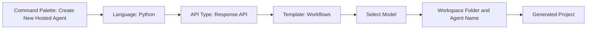

# Modul 2 - Többügynökös projekt előkészítése

⏱️ ~5 perc

Ebben a modulban a [Foundry Toolkit for VS Code](https://aka.ms/foundrytk) segítségével **egy többügynökös projekt gerincét állítod elő**. A varázsló legenerálja `agent.yaml`, `main.py`, `Dockerfile`, `requirements.txt`, `.env`, és a VS Code hibakeresési konfigurációt - így a 3. modulban a 4-ügynökös munkafolyamat összekapcsolására koncentrálhatsz.

> **Kulcsfogalom:** A scaffold egy működő váz egy ügynökkel. A helykitöltő logikát a 3. modulban a `WorkflowBuilder` gráffal cseréled le. Nem kell a sablonkódot a semmiből írnod.

> **Referenciaimplementáció:** [`PersonalCareerCopilot/`](../../../../../workshop/lab02-multi-agent/PersonalCareerCopilot) egy teljes, működő példa. Használd összehasonlításként munka közben.

### Scaffold varázsló folyamata



---

## 1. lépés: Nyisd meg a Create Hosted Agent varázslót

1. Nyomd meg `Ctrl+Shift+P` a **Parancspaletta** megnyitásához.
2. Írd be: **Foundry Toolkit: Create a New Hosted Agent** és válaszd ki.
3. A varázsló az **Agent Details** fülön nyílik meg.

> **Alternatíva:** Kattints a **Foundry Toolkit** ikonra az Activity Barban → kattints a **+** ikonra a **Hosted Agents** mellett → **Create New Hosted Agent**.

---

## 2. lépés: Válaszd ki a beállításokat


1. A bal oldali navigációs/opciós részen válaszd ki a következőket:

| Menü | Kiválasztás | Megjegyzések |
|--------|-----------|-------|
| **Nyelv** | Python | C# (.NET) szintén támogatott |
| **Keretrendszer** | Agent Framework | Biztosítja `Agent`, `AgentExecutor`, `WorkflowBuilder` |
| **API típusa** | Response API | `POST /responses` - platform által kezelt előzmények, streaming támogatás |
| **Sablon** | **Workflows** | A kéréseket sorban, több ügynökön keresztül dolgozza fel |

2. Miután kiválasztottad, kattints a **Next**.


3. A következő ablakban válaszd ki a következőket:

| Menü | Kiválasztás | Megjegyzések |
|--------|-----------|-------|
| **Workspace mappa** | Tallózd a célmappát | pl. `workshop/lab02-multi-agent/` ebben a repo-ban |
| **Agent név** | `PersonalCareerCopilot` | Ez lesz a projekt könyvtárának neve |
| **Model telepítés** | Válaszd ki a telepített modelledet | pl. `gpt-4.1-mini` a Lab 01-ből |

4. Kattints a **Create**-re, hogy felépüljön a projekt. A VS Code legenerálja a fájlokat és megnyitja a mappát.

> **Tipp:** [`gpt-4.1-mini`](https://learn.microsoft.com/azure/foundry/foundry-models/concepts/models-sold-directly-by-azure#gpt-41-series) jó egyensúlyt kínál a sebesség és a minőség között többügynökös fejlesztéshez.

---

## 3. lépés: Vizsgáld meg a generált projektet

Miután a sablon létrehozása befejeződött, ellenőrizd, hogy ezeket a fájlokat látod-e az Explorerben (`Ctrl+Shift+E`):

```
📂 <your-agent-name>/
├── .azdignore          ← Files excluded from Azure Developer CLI deployments
├── .dockerignore       ← Files excluded from Docker builds
├── .env                ← Environment variables (placeholders - fill in Module 3)
├── .vscode/
│   ├── launch.json     ← Debug config (F5 → run + Agent Inspector)
│   └── tasks.json      ← VS Code task definitions
├── agent.yaml          ← Agent definition (kind: hosted, protocol: responses)
├── Dockerfile          ← Container config for deployment
├── main.py             ← Stub agent entry point (replace with WorkflowBuilder in Module 3)
└── requirements.txt    ← Python dependencies
```

> **Fontos:** Nyisd meg ezt a sablonmappát közvetlenül a VS Code-ban, hogy `.vscode/launch.json` és `tasks.json` helyesen érvényesüljenek az F5-ös hibakereséshez.

### Fontos fájlok magyarázata

| Fájl | Cél |
|------|---------|
| `agent.yaml` | Deklarálja `kind: hosted`-t, leképezi a környezeti változókat, meghatározza a `/responses` protokollt |
| `main.py` | Váz: egy `FoundryChatClient` → `Agent` → `ResponsesHostServer`. Ezt a 3. modulban 4 ügynökre és `WorkflowBuilder`-ra cseréled |
| `Dockerfile` | `python:3.12-slim`, telepíti `requirements.txt`, megnyitja a 8088-as portot, futtatja `python main.py` |
| `requirements.txt` | `agent-framework-foundry`, `agent-framework-foundry-hosting`, `mcp<2,>=1.24.0`, `debugpy` |

> **Referencia:** Lásd [`PersonalCareerCopilot/agent.yaml`](../../../../../workshop/lab02-multi-agent/PersonalCareerCopilot/agent.yaml) és [`PersonalCareerCopilot/requirements.txt`](../../../../../workshop/lab02-multi-agent/PersonalCareerCopilot/requirements.txt) a teljes generált tartalomért.

---

### ✅ Ellenőrzőpont

- [ ] A sablonvarázsló befejezve - az új projektmappa látható az Explorerben
- [ ] Minden várt fájl jelen van: `agent.yaml`, `main.py`, `Dockerfile`, `requirements.txt`, `.env`
- [ ] `agent.yaml` mutatja `kind: hosted` és `protocol: responses`
- [ ] `main.py` importálja `Agent`, `FoundryChatClient`, `ResponsesHostServer`
- [ ] A generált mappa meg van nyitva mint a VS Code munkaterület gyökérkönyvtára
- [ ] Érted, hogy `main.py` egy váz - `WorkflowBuilder` hozzáadásra kerül a 3. modulban

---

**Előző:** [01 - Understand Multi-Agent Architecture](01-understand-multi-agent.md) · **Következő:** [03 - Configure Agents & Environment →](03-configure-agents.md)

---

<!-- CO-OP TRANSLATOR DISCLAIMER START -->
**Jogi nyilatkozat**:
Ez a dokumentum az AI fordítási szolgáltatás, a [Co-op Translator](https://github.com/Azure/co-op-translator) segítségével készült. Bár az pontosságra törekszünk, kérjük, vegye figyelembe, hogy az automatikus fordítások hibákat vagy pontatlanságokat tartalmazhatnak. Az eredeti dokumentum az anyanyelvén tekintendő hiteles forrásnak. Fontos információk esetén professzionális emberi fordítást javasolunk. Nem vállalunk felelősséget semmilyen félreértésért vagy téves értelmezésért, amely ebből a fordításból ered.
<!-- CO-OP TRANSLATOR DISCLAIMER END -->