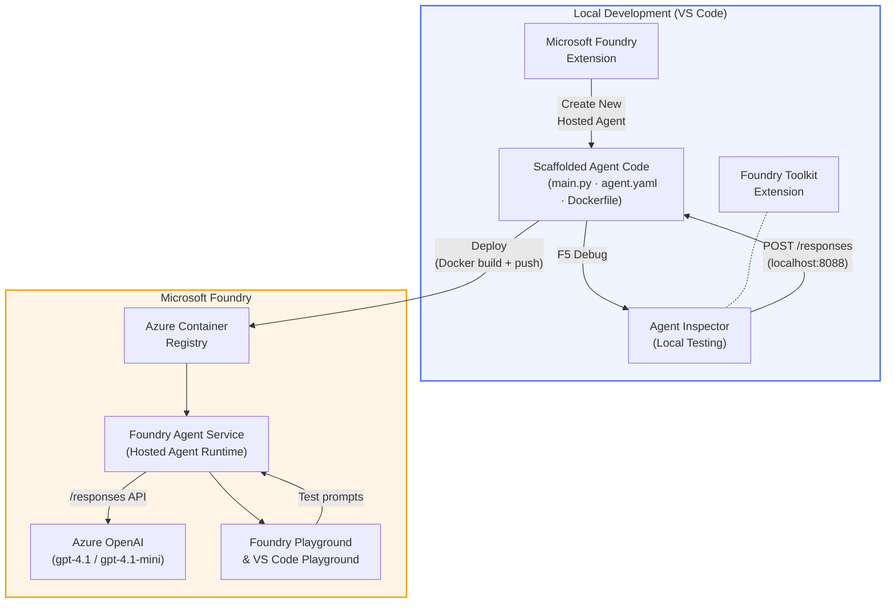

# Foundry Toolkit + Lokakarya Agen Hosted Foundry

[](https://www.python.org/)
[](https://github.com/microsoft/agents)
[](https://learn.microsoft.com/azure/foundry/agents/concepts/hosted-agents)
[](https://ai.azure.com/)
[](https://learn.microsoft.com/azure/ai-services/openai/)
[](https://learn.microsoft.com/cli/azure/install-azure-cli)
[](https://learn.microsoft.com/azure/developer/azure-developer-cli/install-azd)
[](https://www.docker.com/)
[](https://marketplace.visualstudio.com/items?itemName=ms-windows-ai-studio.windows-ai-studio)
[](LICENSE)

Bangun, uji, dan deploy agen AI ke **Microsoft Foundry Agent Service** sebagai **Hosted Agents** - sepenuhnya dari VS Code menggunakan **ekstensi Microsoft Foundry** dan **Foundry Toolkit**.

> **Hosted Agents saat ini masih dalam preview.** Wilayah yang didukung terbatas - lihat [ketersediaan wilayah](https://learn.microsoft.com/azure/foundry/agents/concepts/hosted-agents#region-availability).

> Folder `agent/` di dalam setiap lab **otomatis dibuat** oleh ekstensi Foundry - kemudian Anda menyesuaikan kode, menguji secara lokal, dan melakukan deploy.

### 🌐 Dukungan Multi-Bahasa

#### Didukung melalui GitHub Action (Otomatis & Selalu Terbaru)

<!-- CO-OP TRANSLATOR LANGUAGES TABLE START -->
[Arab](../ar/README.md) | [Bengali](../bn/README.md) | [Bulgaria](../bg/README.md) | [Burmese (Myanmar)](../my/README.md) | [Cina (Sederhana)](../zh-CN/README.md) | [Cina (Tradisional, Hong Kong)](../zh-HK/README.md) | [Cina (Tradisional, Macau)](../zh-MO/README.md) | [Cina (Tradisional, Taiwan)](../zh-TW/README.md) | [Kroasia](../hr/README.md) | [Ceska](../cs/README.md) | [Denmark](../da/README.md) | [Belanda](../nl/README.md) | [Estonia](../et/README.md) | [Finlandia](../fi/README.md) | [Prancis](../fr/README.md) | [Jerman](../de/README.md) | [Yunani](../el/README.md) | [Ibrani](../he/README.md) | [Hindi](../hi/README.md) | [Hungaria](../hu/README.md) | [Indonesia](./README.md) | [Italia](../it/README.md) | [Jepang](../ja/README.md) | [Kannada](../kn/README.md) | [Khmer](../km/README.md) | [Korea](../ko/README.md) | [Lithuania](../lt/README.md) | [Melayu](../ms/README.md) | [Malayalam](../ml/README.md) | [Manipuri (Meitei Mayek)](../mni/README.md) | [Marathi](../mr/README.md) | [Nepali](../ne/README.md) | [Pidgin Nigeria](../pcm/README.md) | [Norwegia](../no/README.md) | [Persia (Farsi)](../fa/README.md) | [Polandia](../pl/README.md) | [Portugis (Brasil)](../pt-BR/README.md) | [Portugis (Portugal)](../pt-PT/README.md) | [Punjabi (Gurmukhi)](../pa/README.md) | [Rumania](../ro/README.md) | [Rusia](../ru/README.md) | [Serbia (Sirilik)](../sr/README.md) | [Slowakia](../sk/README.md) | [Slovenia](../sl/README.md) | [Spanyol](../es/README.md) | [Swahili](../sw/README.md) | [Swedia](../sv/README.md) | [Tagalog (Filipina)](../tl/README.md) | [Tamil](../ta/README.md) | [Telugu](../te/README.md) | [Thai](../th/README.md) | [Turki](../tr/README.md) | [Ukraina](../uk/README.md) | [Urdu](../ur/README.md) | [Vietnam](../vi/README.md)

> **Lebih suka Clone Secara Lokal?**
>
> Repositori ini termasuk lebih dari 50 terjemahan bahasa yang secara signifikan meningkatkan ukuran unduhan. Untuk meng-clone tanpa terjemahan, gunakan sparse checkout:
>
> **Bash / macOS / Linux:**
> ```bash
> git clone --filter=blob:none --sparse https://github.com/microsoft-foundry/Foundry_Toolkit_for_VSCode_Lab.git
> cd Foundry_Toolkit_for_VSCode_Lab
> git sparse-checkout set --no-cone '/*' '!translations' '!translated_images'
> ```
>
> **CMD (Windows):**
> ```cmd
> git clone --filter=blob:none --sparse https://github.com/microsoft-foundry/Foundry_Toolkit_for_VSCode_Lab.git
> cd Foundry_Toolkit_for_VSCode_Lab
> git sparse-checkout set --no-cone "/*" "!translations" "!translated_images"
> ```
>
> Ini memberi Anda semua yang Anda butuhkan untuk menyelesaikan kursus dengan unduhan yang jauh lebih cepat.
<!-- CO-OP TRANSLATOR LANGUAGES TABLE END -->

---

## Arsitektur



**Alur:** ekstensi Foundry membuat kerangka agen → Anda menyesuaikan kode & instruksi → uji di lokal dengan Agent Inspector → deploy ke Foundry (gambar Docker didorong ke ACR) → verifikasi di Playground.

---

## Apa yang akan Anda buat

| Lab | Deskripsi | Status |
|-----|-------------|--------|
| **Lab 01 - Agen Tunggal** | Bangun **Agen "Jelaskan Seperti Saya Eksekutif"**, uji secara lokal, dan deploy ke Foundry | ✅ Tersedia |
| **Lab 02 - Alur Kerja Multi-agen** | Bangun **"Resume → Evaluator Kecocokan Pekerjaan"** - 4 agen bekerja sama menilai kecocokan resume dan membuat roadmap belajar | ✅ Tersedia |

---

## Kenali Agen Eksekutif

Dalam lokakarya ini Anda akan membangun **Agen "Jelaskan Seperti Saya Eksekutif"** - agen AI yang mengambil istilah teknis yang rumit dan menerjemahkannya menjadi ringkasan tenang siap ruang rapat. Karena jujur saja, tidak ada yang di C-suite ingin mendengar tentang "kelelahan thread pool yang disebabkan oleh panggilan sinkron yang diperkenalkan di v3.2."

Saya membuat agen ini setelah kejadian terlalu sering di mana laporan post-mortem saya yang sempurna mendapatkan respons: *"Jadi... websitenya down atau tidak?"*

### Cara kerjanya

Anda memberinya pembaruan teknis. Agen mengeluarkan ringkasan eksekutif - tiga poin penting, tanpa jargon, tanpa jejak stack, tanpa ketakutan eksistensial. Hanya **apa yang terjadi**, **dampak bisnis**, dan **langkah selanjutnya**.

### Lihat dalam aksi

**Anda mengatakan:**
> "Latensi API meningkat karena kelelahan thread pool yang disebabkan oleh panggilan sinkron yang diperkenalkan di v3.2."

**Agen menjawab:**

> **Ringkasan Eksekutif:**
> - **Apa yang terjadi:** Setelah rilis terbaru, sistem melambat.
> - **Dampak bisnis:** Beberapa pengguna mengalami keterlambatan saat menggunakan layanan.
> - **Langkah berikutnya:** Perubahan telah dibatalkan dan perbaikan sedang disiapkan sebelum dideploy ulang.

### Kenapa agen ini?

Ini agen sederhana yang dibuat untuk satu tujuan - sempurna untuk belajar alur kerja agen hosted dari awal hingga akhir tanpa ribet dengan rantai alat yang kompleks. Dan jujur? Setiap tim engineering bisa menggunakan salah satu ini.

---

## Struktur lokakarya

```
📂 Foundry_Toolkit_for_VSCode_Lab/
├── 📄 README.md                      ← You are here
└── 📂 workshop/
    ├── 📂 lab01-single-agent/        ← Full lab: docs + agent code
    │   ├── README.md                 ← Hands-on lab instructions
    │   ├── 📂 docs/                  ← Step-by-step tutorial modules
    │   │   ├── 00-prerequisites.md
    │   │   ├── 01-setup.md
    │   │   ├── 02-create-hosted-agent.md
    │   │   ├── 03-configure-and-code.md
    │   │   ├── 04-test-locally.md
    │   │   ├── 05-deploy-to-foundry.md
    │   │   ├── 06-verify-in-playground.md
    │   │   ├── 07-summary.md
    │   │   └── 08-troubleshooting.md
    │   └── 📂 agent/                 ← Reference solution (auto-scaffolded by Foundry extension)
    │       ├── agent.yaml
    │       ├── Dockerfile
    │       ├── main.py
    │       └── requirements.txt
    └── 📂 lab02-multi-agent/         ← Resume → Job Fit Evaluator
        ├── README.md                 ← Hands-on lab instructions (end-to-end)
        ├── 📂 docs/                  ← Step-by-step tutorial modules
        │   ├── 00-prerequisites.md
        │   ├── 01-understand-multi-agent.md
        │   ├── 02-scaffold-multi-agent.md
        │   ├── 03-configure-agents.md
        │   ├── 04-orchestration-patterns.md
        │   ├── 05-test-locally.md
        │   ├── 06-deploy-to-foundry.md
        │   ├── 07-verify-in-playground.md
        │   └── 08-troubleshooting.md
        └── 📂 PersonalCareerCopilot/ ← Reference solution (multi-agent workflow)
            ├── agent.yaml
            ├── Dockerfile
            ├── main.py
            └── requirements.txt
```

> **Catatan:** Folder `agent/` di dalam setiap lab adalah yang dibuat oleh **ekstensi Microsoft Foundry** ketika Anda menjalankan `Microsoft Foundry: Create a New Hosted Agent` dari Command Palette. File kemudian disesuaikan dengan instruksi, alat, dan konfigurasi agen Anda. Lab 01 memandu Anda membuat ini dari awal.

---

## Memulai

### 1. Clone repositori

```bash
git clone https://github.com/microsoft-foundry/Foundry_Toolkit_for_VSCode_Lab.git
cd Foundry_Toolkit_for_VSCode_Lab
```

### 2. Siapkan lingkungan virtual Python

```bash
python -m venv venv
```

Aktifkan:

- **Windows (PowerShell):**
  ```powershell
  .\venv\Scripts\Activate.ps1
  ```
- **macOS / Linux:**
  ```bash
  source venv/bin/activate
  ```

### 3. Instal dependensi

```bash
pip install -r workshop/lab01-single-agent/agent/requirements.txt
```

### 4. Konfigurasi variabel lingkungan

Salin file contoh `.env` di dalam folder agen dan isi dengan nilai Anda:

```bash
cp workshop/lab01-single-agent/agent/.env.example workshop/lab01-single-agent/agent/.env
```

Edit `workshop/lab01-single-agent/agent/.env`:

```env
AZURE_AI_PROJECT_ENDPOINT=https://<your-account>.services.ai.azure.com/api/projects/<your-project>
AZURE_AI_MODEL_DEPLOYMENT_NAME=<your-model-deployment-name>
```

### 5. Ikuti lab lokakarya

Setiap lab mandiri dengan modulnya sendiri. Mulai dengan **Lab 01** untuk belajar dasar-dasar, lalu lanjut ke **Lab 02** untuk alur kerja multi-agen.

#### Lab 01 - Agen Tunggal ([instruksi lengkap](workshop/lab01-single-agent/README.md))

| # | Modul | Tautan |
|---|--------|------|
| 1 | Baca prasyarat | [00-prerequisites.md](workshop/lab01-single-agent/docs/00-prerequisites.md) |
| 2 | Instal Foundry Toolkit & ekstensi Foundry | [01-setup.md](workshop/lab01-single-agent/docs/01-setup.md) |
| 3 | Buat proyek Foundry | [01-setup.md](workshop/lab01-single-agent/docs/01-setup.md) |
| 4 | Buat agen hosted | [02-create-hosted-agent.md](workshop/lab01-single-agent/docs/02-create-hosted-agent.md) |
| 5 | Konfigurasi instruksi & lingkungan | [03-configure-and-code.md](workshop/lab01-single-agent/docs/03-configure-and-code.md) |
| 6 | Uji secara lokal | [04-test-locally.md](workshop/lab01-single-agent/docs/04-test-locally.md) |
| 7 | Deploy ke Foundry | [05-deploy-to-foundry.md](workshop/lab01-single-agent/docs/05-deploy-to-foundry.md) |
| 8 | Verifikasi di playground | [06-verify-in-playground.md](workshop/lab01-single-agent/docs/06-verify-in-playground.md) |
| 9 | Pemecahan masalah | [08-troubleshooting.md](workshop/lab01-single-agent/docs/08-troubleshooting.md) |

#### Lab 02 - Alur Kerja Multi-Agen ([instruksi lengkap](workshop/lab02-multi-agent/README.md))

| # | Modul | Tautan |
|---|--------|------|
| 1 | Prasyarat (Lab 02) | [00-prerequisites.md](workshop/lab02-multi-agent/docs/00-prerequisites.md) |
| 2 | Pahami arsitektur multi-agen | [01-understand-multi-agent.md](workshop/lab02-multi-agent/docs/01-understand-multi-agent.md) |
| 3 | Buat kerangka proyek multi-agen | [02-scaffold-multi-agent.md](workshop/lab02-multi-agent/docs/02-scaffold-multi-agent.md) |
| 4 | Konfigurasi agen & lingkungan | [03-configure-agents.md](workshop/lab02-multi-agent/docs/03-configure-agents.md) |
| 5 | Pola orkestrasi | [04-orchestration-patterns.md](workshop/lab02-multi-agent/docs/04-orchestration-patterns.md) |
| 6 | Uji secara lokal (multi-agen) | [05-test-locally.md](workshop/lab02-multi-agent/docs/05-test-locally.md) |
| 7 | Deploy ke Foundry | [06-deploy-to-foundry.md](workshop/lab02-multi-agent/docs/06-deploy-to-foundry.md) |
| 8 | Verifikasi di playground | [07-verify-in-playground.md](workshop/lab02-multi-agent/docs/07-verify-in-playground.md) |
| 9 | Pemecahan masalah (multi-agen) | [08-troubleshooting.md](workshop/lab02-multi-agent/docs/08-troubleshooting.md) |

---

## Pemelihara

<table>
<tr>
    <td align="center"><a href="https://github.com/ShivamGoyal03">
        <br />
        <sub><b>Shivam Goyal</b></sub>
    </a><br />
    </td>
</tr>
</table>

---

## Izin yang diperlukan (referensi cepat)

| Skenario | Peran yang dibutuhkan |
|----------|---------------|
| Buat proyek Foundry baru | **Azure AI Owner** pada sumber daya Foundry |
| Deploy ke proyek yang ada (sumber daya baru) | **Azure AI Owner** + **Contributor** pada langganan |
| Deploy ke proyek yang sudah dikonfigurasi penuh | **Reader** pada akun + **Azure AI User** pada proyek |

> **Penting:** Peran Azure `Owner` dan `Contributor` hanya mencakup izin *manajemen*, bukan izin *pengembangan* (aksi data). Anda membutuhkan **Azure AI User** atau **Azure AI Owner** untuk membangun dan mendepoy agen.

---

## Referensi

- [Mulai Cepat: Deploy agen hosted pertama Anda (VS Code)](https://learn.microsoft.com/azure/foundry/agents/quickstarts/quickstart-hosted-agent)
- [Apa itu agen hosted?](https://learn.microsoft.com/azure/foundry/agents/concepts/hosted-agents)
- [Buat alur kerja agen hosted di VS Code](https://learn.microsoft.com/azure/foundry/agents/how-to/vs-code-agents-workflow-pro-code)
- [Deploy agen hosted](https://learn.microsoft.com/azure/foundry/agents/how-to/deploy-hosted-agent)
- [RBAC untuk Microsoft Foundry](https://learn.microsoft.com/azure/foundry/concepts/rbac-foundry)
- [Contoh Agen Tinjauan Arsitektur](https://github.com/Azure-Samples/agent-architecture-review-sample) - Agen hosted dunia nyata dengan alat MCP, diagram Excalidraw, dan deployment ganda

---


## Lisensi

[MIT](../../LICENSE)

---

<!-- CO-OP TRANSLATOR DISCLAIMER START -->
**Penafian**:
Dokumen ini telah diterjemahkan menggunakan layanan terjemahan AI [Co-op Translator](https://github.com/Azure/co-op-translator). Meskipun kami berupaya untuk mencapai akurasi, harap diketahui bahwa terjemahan otomatis mungkin mengandung kesalahan atau ketidakakuratan. Dokumen asli dalam bahasa aslinya harus dianggap sebagai sumber yang sah. Untuk informasi penting, disarankan menggunakan terjemahan profesional oleh manusia. Kami tidak bertanggung jawab atas kesalahpahaman atau penafsiran yang keliru yang timbul dari penggunaan terjemahan ini.
<!-- CO-OP TRANSLATOR DISCLAIMER END -->