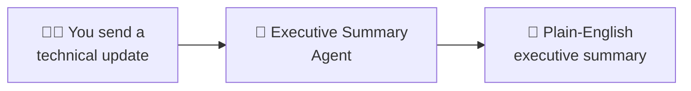

# Modul 0 - Pendahuluan

⏱️ ~10 menit

> [!WARNING]
> **Pratinjau & Batasan:** [Hosted Agents](https://learn.microsoft.com/azure/foundry/agents/concepts/hosted-agents) saat ini dalam **pratinjau publik** - tidak disarankan untuk beban kerja produksi. Harap perhatikan hal berikut:
> - **Wilayah yang didukung terbatas** - periksa [ketersediaan wilayah](https://learn.microsoft.com/azure/foundry/agents/concepts/hosted-agents#region-availability) sebelum membuat sumber daya. Jika Anda memilih wilayah yang tidak didukung, penyebaran akan gagal.
> - Paket `agent-framework-foundry-hosting` masih dalam versi pra-rilis - API dapat berubah antar versi.
> - Batas skala: hosted agents mendukung 0–5 replika (termasuk skala ke nol).
> - Beberapa fitur yang ditunjukkan dalam workshop ini mungkin berubah saat layanan mendekati GA.

## Apa yang akan Anda bangun

Dalam workshop ini, Anda akan membuat agen **"Jelaskan Seperti Saya Seorang Eksekutif"** - agen AI hosted yang mengambil pembaruan teknis kompleks dan menulis ulang menjadi ringkasan eksekutif berbahasa Inggris sederhana.

**Agen menggunakan:**
- **Microsoft Agent Framework** - untuk logika dan struktur agen
- **Foundry Toolkit untuk VS Code** - untuk scaffolding, pengujian lokal, dan penyebaran
- **Model AI** (misalnya, `gpt-4.1-mini/gpt-5-mini`) - untuk menghasilkan ringkasan

Pada akhir lab ini, Anda akan memiliki agen yang berfungsi yang dapat Anda uji secara lokal melalui Agent Inspector, dan opsional menyebarkannya ke cloud.

---

## Apa itu hosted agents?

**Hosted agent** adalah agen AI yang berjalan sebagai layanan terkelola di Microsoft Foundry. Alih-alih mengelola infrastruktur sendiri, Anda membungkus kode agen Anda dalam sebuah container dan Foundry menangani scaling, hosting, dan mengeksposnya melalui endpoint HTTP standar.

| Konsep | Artinya |
|---------|--------------|
| **Agent** | Kode Python Anda yang menerima pesan pengguna, memanggil model AI, dan mengembalikan respons terstruktur |
| **Hosted** | Foundry menjalankan container Anda - tanpa VM, tanpa Kubernetes, tanpa infrastruktur untuk dikelola |
| **Protokol respons** | API HTTP standar (`POST /responses`) yang dapat dipanggil klien mana pun untuk berinteraksi dengan agen Anda |
| **Agent Inspector** | Antarmuka pengujian lokal (terintegrasi dalam Foundry Toolkit) yang memungkinkan Anda mengobrol dengan agen Anda sebelum melakukan penyebaran |

Dalam workshop ini, Anda akan mulai dari nol sampai memiliki agen hosted sepenuhnya - atau berhenti di pengujian lokal jika Anda lebih suka.

---

## Pilih jalur Anda

> ⚠️ **Pilih satu jalur sebelum melanjutkan.** Pilihan Anda menentukan alat yang diinstal dan modul yang berlaku. Anda dapat beralih dari Jalur B → Jalur A nanti jika Anda mendapatkan langganan.

<strong>🅰️ Jalur A - Cloud Azure (memerlukan langganan Azure)</strong>

| | Detail |
|---|---|
| **Untuk siapa?** | Anda memiliki langganan Azure aktif dan dapat membuat sumber daya Foundry |
| **Model** | Azure OpenAI melalui Foundry (misalnya `gpt-4.1-mini/gpt-5-mini`) |
| **Modul yang dibahas** | Semua modul (00–07) |
| **Menyebarkan ke cloud?** | ✅ Ya - penyebaran penuh ujung ke ujung |

<strong>🅱️ Jalur B - Lokal / tingkat gratis (tidak perlu langganan Azure)</strong>

| | Detail |
|---|---|
| **Untuk siapa?** | MVP, pelajar, atau siapa saja yang tidak memiliki akses Azure |
| **Model** | **Foundry Lokal** (gratis, berjalan di mesin Anda) |
| **Modul yang dibahas** | Modul 00–04 (lewati deploy & verifikasi cloud) |
| **Menyebarkan ke cloud?** | ❌ Tidak - hanya pengujian lokal melalui Agent Inspector |

---

## Semua jalur: Alat yang diperlukan

Pasang setiap alat berikut. Setelah dipasang, pastikan alat berfungsi dengan menjalankan perintah cek.

| # | Alat | Versi | Instalasi | Verifikasi (Output yang Diharapkan) |
|---|------|---------|---------|---------------------------|
| 1 | **Visual Studio Code** | Terbaru | [code.visualstudio.com](https://code.visualstudio.com/) | Membuka tanpa error |
| 2 | **Python** | 3.12 atau lebih tinggi| [python.org/downloads](https://www.python.org/downloads/) | `python --version` $\rightarrow$ `Python 3.12.x` |
| 3 | **Foundry Toolkit untuk VS Code** | Terbaru | Extension ID: `ms-windows-ai-studio.windows-ai-studio` | Ikon Foundry di Activity Bar |
| 4 | **Ekstensi Python untuk VS Code** | Terbaru | Extension ID: `ms-python.python` | Terpasang di panel Extensions |

> [!TIP]
> **Tips pro untuk instalasi:**
> - **Python PATH (Windows):** Selalu centang **"Add Python to PATH"** pada layar pertama installer Python. Tanpa ini, `python` tidak akan dikenali di terminal Anda.
> - **Beberapa versi Python:** Jika Anda menginstal Python 3.10 dan 3.12 sekaligus, gunakan `python3.12 -m venv .venv` untuk memastikan versi yang benar digunakan untuk lingkungan virtual Anda.
> - **Docker WSL 2 (Windows):** Saat instalasi Docker Desktop, pastikan backend **WSL 2** dipilih. Docker dengan Hyper-V lebih lambat dan dapat menyebabkan masalah saat membangun container Foundry.
> - **Docker tidak mulai?** Tunggu 30–60 detik setelah membuka Docker Desktop. Jalankan `docker info` - jika Anda melihat "Cannot connect to the Docker daemon," Docker masih dalam proses inisialisasi.
> - **Ekstensi VS Code tidak dimuat?** Setelah memasang ekstensi, muat ulang jendela: `Ctrl+Shift+P` → `Developer: Reload Window`.

> **Pengguna Windows:** Periksa **"Add Python to PATH"** saat instalasi Python.

**Selanjutnya:** [01 - Setup →](01-setup.md)

---

<!-- CO-OP TRANSLATOR DISCLAIMER START -->
**Penafian**:
Dokumen ini telah diterjemahkan menggunakan layanan terjemahan AI [Co-op Translator](https://github.com/Azure/co-op-translator). Meskipun kami berupaya untuk mencapai akurasi, harap diketahui bahwa terjemahan otomatis mungkin mengandung kesalahan atau ketidakakuratan. Dokumen asli dalam bahasa aslinya harus dianggap sebagai sumber yang sah. Untuk informasi penting, disarankan menggunakan terjemahan profesional oleh manusia. Kami tidak bertanggung jawab atas kesalahpahaman atau penafsiran yang keliru yang timbul dari penggunaan terjemahan ini.
<!-- CO-OP TRANSLATOR DISCLAIMER END -->