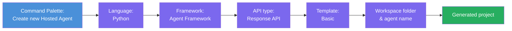
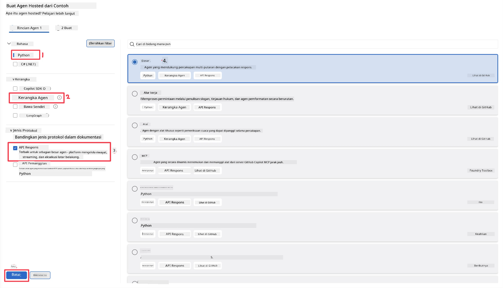
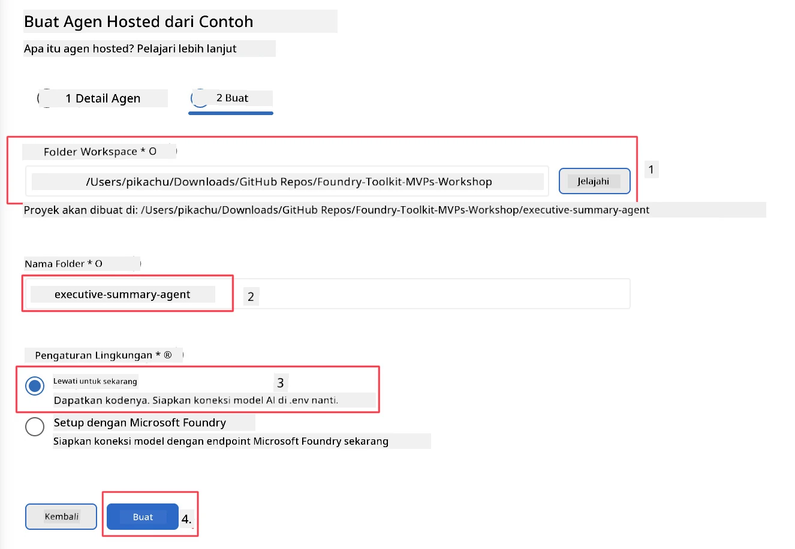

# Modul 2 - Membuat Hosted Agent Baru

⏱️ ~5 menit

Dalam modul ini, Anda menggunakan Foundry Toolkit untuk **membuat kerangka proyek hosted agent**. Kerangka ini menghasilkan struktur proyek penuh - `agent.yaml`, `main.py`, `Dockerfile`, `requirements.txt`, dan konfigurasi debug VS Code - sehingga Anda dapat fokus menyesuaikan perilaku agent.

> **Konsep kunci:** Folder `agent/` dalam lab ini adalah contoh dari apa yang dihasilkan oleh Foundry Toolkit. Anda tidak menulis file-file ini dari awal.

### Alur wizard pembuatan kerangka



---

## Langkah 1: Buka wizard Create Hosted Agent

1. Tekan `Ctrl+Shift+P` untuk membuka **Command Palette**.
2. Ketik: **Foundry Toolkit: Create new Hosted Agent** dan pilih.

> **Alternatif: Membuat lewat Foundry Portal**
> Jika Anda lebih suka browser, Anda dapat membuat proyek Anda di [https://ai.azure.com](https://ai.azure.com). Setelah proyek diprovisikan, kembali ke VS Code dan gunakan sidebar **Foundry Toolkit** untuk menghubungkannya.

> **Alternatif:** Di sidebar Foundry Toolkit, arahkan kursor ke **Agents** di bawah proyek Anda, klik ikon **+**, lalu pilih **Create in Code With Template**.

## Langkah 2: Pilih pengaturan



1. Pada bagian navigasi/pilihan di kiri pilih item berikut:

| Menu | Pilihan | Catatan |
|--------|-----------|-------|
| **Language** | Python | C# juga didukung |
| **Framework** | Agent Framework | Titik awal sederhana menggunakan Agent Framework SDK |
| **API type** | Response API | `POST /responses` - percakapan, dengan riwayat yang dikelola platform |
| **Template** | Basic | Titik awal sederhana menggunakan Agent Framework SDK |

2. Setelah dipilih, klik **Next**



3. Di jendela berikutnya, pilih item berikut:

| Menu | Pilihan | Catatan |
|--------|-----------|-------|
| **Workspace folder** | Pilih folder target | misal, `/workspace/Foundry_Toolkit_for_VSCode_Lab/` atau subfolder di repo ini |
| **Agent name** | Masukkan nama | misal, `executive-summary-agent` |
| **Environment Setup** | lewati pengaturan dulu |  |

Klik **create** untuk membuat agent kita. Folder baru akan dibuat dengan nama hosted agent.

## Langkah 3: Periksa proyek yang dihasilkan

Setelah proses scaffolding selesai, periksa apakah Anda melihat file-file ini di Explorer (`Ctrl+Shift+E`):

```
📂 executive-summary-agent/
├── .env                ← Environment variables (placeholders)
├── .vscode/
│   ├── launch.json     ← Debug config (F5 → run + Agent Inspector)
│   └── tasks.json      ← VS Code task definitions
├── agent.yaml          ← Agent definition (kind: hosted)
├── Dockerfile          ← Container config for deployment
├── main.py             ← Agent entry point (your main code)
└── requirements.txt    ← Python dependencies
```

### Penjelasan file utama

| File | Tujuan |
|------|---------|
| `agent.yaml` | Mendeklarasikan agent sebagai `kind: hosted`, memetakan variabel lingkungan, mendefinisikan protokol `/responses` |
| `main.py` | Membuat `FoundryChatClient` → membungkusnya dalam `Agent` dengan instruksi → menyajikan melalui `ResponsesHostServer` pada port 8088 |
| `Dockerfile` | Menggunakan `python:3.12-slim`, menginstal dependensi, mengekspos port 8088, menjalankan `main.py` |
| `requirements.txt` | `agent-framework-foundry`, `agent-framework-foundry-hosting`, `mcp`, `debugpy` |

> **Penting:** Buka folder agent yang sudah dibuat secara langsung di VS Code (folder `agent/` itu sendiri) agar `.vscode/launch.json` dan `tasks.json` berfungsi dengan benar untuk debugging F5.

---

### ✅ Titik pemeriksaan

- [ ] Proyek yang dibangun dengan kerangka telah dibuat dengan semua file yang diharapkan
- [ ] `agent.yaml` menunjukkan `kind: hosted` dan `protocol: responses`
- [ ] `main.py` mengimpor `Agent`, `FoundryChatClient`, `ResponsesHostServer`
- [ ] Folder agent terbuka di VS Code sebagai root workspace

---

**Sebelumnya:** [01 - Setup](01-setup.md) · **Berikutnya:** [03 - Konfigurasi & Kode →](03-configure-and-code.md)

---

<!-- CO-OP TRANSLATOR DISCLAIMER START -->
**Penafian**:
Dokumen ini telah diterjemahkan menggunakan layanan terjemahan AI [Co-op Translator](https://github.com/Azure/co-op-translator). Meskipun kami berupaya untuk mencapai akurasi, harap diketahui bahwa terjemahan otomatis mungkin mengandung kesalahan atau ketidakakuratan. Dokumen asli dalam bahasa aslinya harus dianggap sebagai sumber yang sah. Untuk informasi penting, disarankan menggunakan terjemahan profesional oleh manusia. Kami tidak bertanggung jawab atas kesalahpahaman atau penafsiran yang keliru yang timbul dari penggunaan terjemahan ini.
<!-- CO-OP TRANSLATOR DISCLAIMER END -->