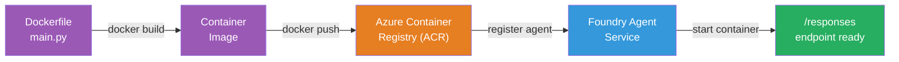
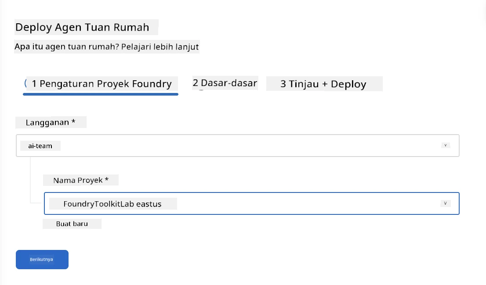
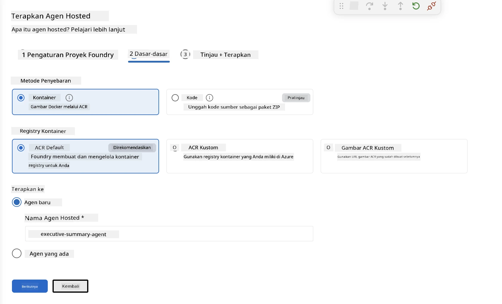
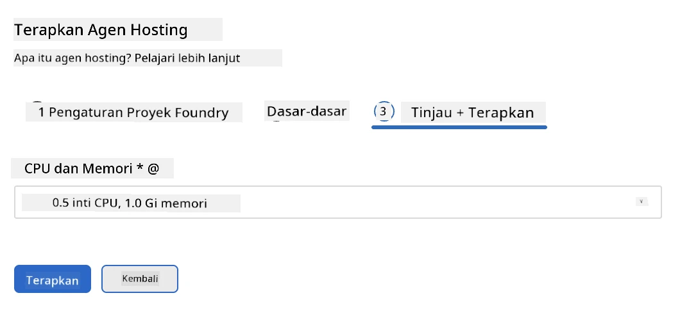
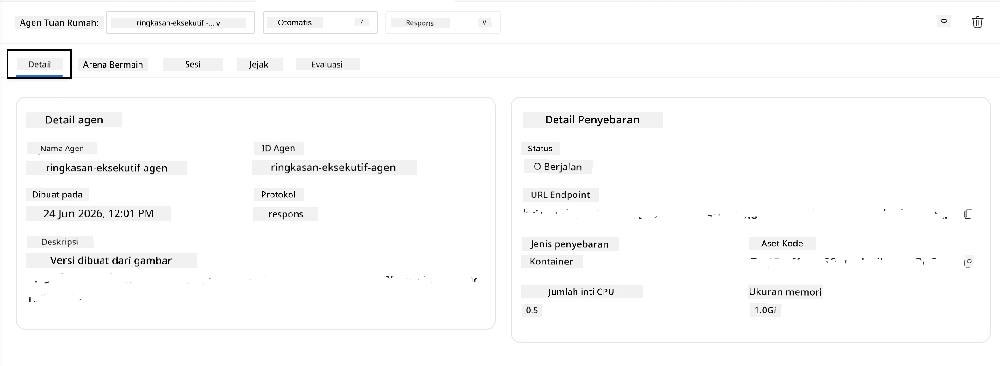

# Modul 5 - Deploy ke Foundry Agent Service

⏱️ ~10 menit

> ⚠️ **Pengguna Jalur B:** Modul ini memerlukan langganan Foundry. Jika Anda menggunakan Foundry Local, lanjutkan ke [Modul 07 - Ringkasan](07-summary.md). Anda telah berhasil menyelesaikan alur kerja pengembangan lokal!

Dalam modul ini, Anda akan menerapkan agent yang telah diuji secara lokal ke Microsoft Foundry sebagai **Hosted Agent**. Penyebaran membangun image container, mendorongnya ke Azure Container Registry, dan memulai agent di infrastruktur terkelola Foundry.

### Pipeline penyebaran

---

## Pemeriksaan prasyarat

Sebelum melakukan penyebaran, pastikan:

- [ ] Agent lulus semua 3 skenario lokal dari [Modul 04](04-test-locally.md)
- [ ] Anda memiliki peran **Azure AI User** pada tingkat proyek ([Modul 01, Tetapkan RBAC](01-setup.md#deploy-a-model--assign-rbac))
- [ ] Anda sudah masuk ke Azure di VS Code (ikon Akun menampilkan nama Anda)

---

## Langkah 1: Mulai penyebaran

### Opsi A: Deploy dari Agent Inspector (direkomendasikan)

Jika Agent Inspector terbuka (dari pengujian):
1. Klik tombol **Deploy** di pojok kanan atas (ikon awan ↑).

### Opsi B: Deploy dari Command Palette

1. Tekan `Ctrl+Shift+P` → **Foundry Toolkit: Deploy Hosted Agent**.

---

## Langkah 2: Konfigurasikan penyebaran

Wizard akan menanyakan kepada Anda:

| Prompt | Pilihan |
|--------|-----------|
| **Subscription** | Langganan Azure Anda |
| **Target project** | Proyek Foundry Anda (misalnya `workshop-agents`) |

Klik **next** untuk mengkonfigurasi agent Anda.

| Prompt | Pilihan |
|--------|-----------|
| **Metode Penyebaran** | Kontainer |
| **Container registry** | **Default ACR** (Microsoft Foundry membuat dan mengelolanya untuk Anda) |
| **Deploy ke** | Agent Baru (nama, `executive-summary-agent`) |

Klik **next** untuk meninjau dan menerapkan agen Anda.

| Prompt | Pilihan |
|--------|-----------|
| **CPU dan memori** | **0.5 CPU cores, 1.0 Gi memori** (default - cukup untuk workshop) |

---

## Langkah 3: Deploy dan pantau

1. Klik **Deploy**.
2. Pantau panel **Output** (pilih **Microsoft Foundry** dari dropdown).
3. Penyebaran berjalan melalui tahap-tahap berikut:
   - **Docker build** - membangun container dari Dockerfile Anda
   - **Docker push** - mendorong image ke ACR (1–3 menit pada penyebaran pertama)
   - **Pendaftaran agent** - membuat hosted agent di Foundry
   - **Container start** - memulai dengan identitas yang dikelola sistem

4. Setelah selesai, akan muncul notifikasi:
   > **executive-summary-agent berhasil disebarkan.** `View logs` `Run agent`

5. Klik **Run agent** untuk membuka Agent Playground.

### Nilai status penyebaran

| Status | Arti |
|--------|---------|
| **Running** | Kontainer siap, agent merespon |
| **Pending** | Kontainer sedang mulai - tunggu 30–60 detik |
| **Failed** | Periksa log (lihat troubleshooting di bawah) |

---

## Kesalahan umum saat penyebaran

| Kesalahan | Penyebab utama | Solusi |
|-------|-----------|-----|
| `agents/write` izin ditolak | Peran **Azure AI User** hilang di tingkat proyek | [Modul 01, Tetapkan RBAC](01-setup.md#deploy-a-model--assign-rbac) |
| Docker tidak berjalan | Docker Desktop belum dimulai | Mulai Docker Desktop → verifikasi `docker info` |
| Otorisasi ACR | Identitas terkelola tidak dapat menarik gambar | Lihat [Modul 08 - Pemecahan Masalah](08-troubleshooting.md) |

---

### ✅ Titik Pemeriksaan

- [ ] Penyebaran selesai tanpa kesalahan
- [ ] Agen muncul di tab **Hosted Agent** saat Anda mengklik **Agents** di bawah proyek Anda di sidebar Foundry Toolkit
- [ ] Status kontainer menunjukkan **Running**
- [ ] Tab Agent Playground terbuka menampilkan detail agen dan URL endpoint

---

**Sebelumnya:** [04 - Uji Secara Lokal](04-test-locally.md) · **Selanjutnya:** [06 - Verifikasi di Playground →](06-verify-in-playground.md)

---

<!-- CO-OP TRANSLATOR DISCLAIMER START -->
**Penafian**:
Dokumen ini telah diterjemahkan menggunakan layanan terjemahan AI [Co-op Translator](https://github.com/Azure/co-op-translator). Meskipun kami berupaya untuk mencapai akurasi, harap diketahui bahwa terjemahan otomatis mungkin mengandung kesalahan atau ketidakakuratan. Dokumen asli dalam bahasa aslinya harus dianggap sebagai sumber yang sah. Untuk informasi penting, disarankan menggunakan terjemahan profesional oleh manusia. Kami tidak bertanggung jawab atas kesalahpahaman atau penafsiran yang keliru yang timbul dari penggunaan terjemahan ini.
<!-- CO-OP TRANSLATOR DISCLAIMER END -->