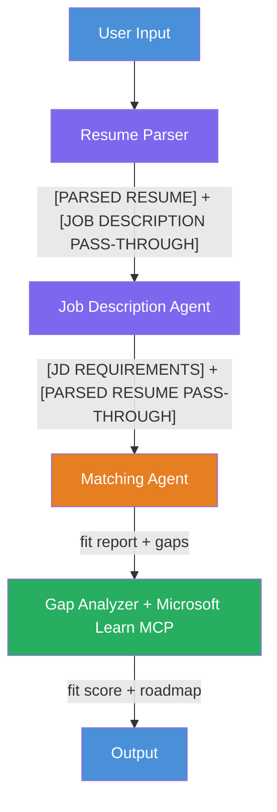

# Lab 02 - Alur Kerja Multi-Agen: Resume → Evaluator Kecocokan Pekerjaan

## Ikhtisar

Dalam lab praktek ini, Anda akan membuat **aplikasi multi-agen berbasis alur kerja** menggunakan Foundry Toolkit di VS Code dan menerapkannya ke Microsoft Foundry Agent Service.

**Apa yang akan Anda buat:** sebuah Evaluator Resume → Kecocokan Pekerjaan yang memparsing resume dan deskripsi pekerjaan, memberi skor kecocokan, dan menghasilkan roadmap pembelajaran yang dipersonalisasi menggunakan sumber daya Microsoft Learn.

---

## Arsitektur

**Cara kerjanya:**
1. Pengguna menempelkan resume dan deskripsi pekerjaan.
2. **ResumeParser** memparsing resume dan menyalin deskripsi pekerjaan apa adanya ke dalam bagian `[JOB DESCRIPTION PASS-THROUGH]`.
3. **JD Agent** mengekstrak persyaratan terstruktur dari bagian tersebut, lalu meneruskan `[PARSED RESUME]` sebagai `[PARSED RESUME PASS-THROUGH]`.
4. **MatchingAgent** membandingkan `[PARSED RESUME PASS-THROUGH]` dengan `[JD REQUIREMENTS]` dan menghasilkan skor kecocokan.
5. **GapAnalyzer** mengubah kekurangan menjadi roadmap praktis dan mengambil tautan Microsoft Learn asli melalui MCP.

---

## Prasyarat

Selesaikan Lab 01 terlebih dahulu:

- [Lab 01 - Single Agent](../lab01-single-agent/README.md)

---

## Bagian 1: Baca modul secara berurutan

Lihat jalur pembelajaran lengkap di:

- [Dokumentasi Lab 2 - Prasyarat](docs/00-prerequisites.md)
- [Dokumentasi Lab 2 - Jalur Pembelajaran Lengkap](docs/README.md)
- [Panduan menjalankan PersonalCareerCopilot](PersonalCareerCopilot/README.md)

---

## Bagian 2: Bangun dan uji alur kerja

1. Gunakan wizard Foundry Toolkit untuk membuat proyek berbasis alur kerja.
2. Salin blok prompt dan grafik alur kerja dari `PersonalCareerCopilot/main.py` ke ruang kerja Anda.
3. Jalankan secara lokal dengan Agent Inspector dan verifikasi semua empat agen serta alat MCP.
4. Terapkan agen yang dihosting ke Foundry setelah pengujian lokal berhasil.

---

## Pola orkestrasi

Lab 02 menggunakan **pipeline berurutan**: output setiap agen menjadi input agen berikutnya, dan alur kerja mengembalikan respons akhir agen terakhir. Ada dua pola yang membuat ini bekerja:

- **Rangkaian berurutan** - `WorkflowBuilder` menghubungkan ResumeParser → JD Agent → MatchingAgent → GapAnalyzer dengan satu panggilan `add_edge()` per langkah
- **Relay konten** - karena setiap agen hanya melihat output agen pendahulunya langsung, ResumeParser dan JD Agent menyalin data yang dibutuhkan agen berikutnya ke bagian pass-through yang diberi label

Dokumentasi juga menjelaskan mengapa lab ini tidak menggunakan fan-out/fan-in, dan cara memperluas grafik dengan agen lain.

Lihat [docs/04-orchestration-patterns.md](docs/04-orchestration-patterns.md).

---

**Sebelumnya:** [Lab 01 - Single Agent](../lab01-single-agent/README.md) · **Kembali ke:** [Beranda Workshop](../../README.md)

---

<!-- CO-OP TRANSLATOR DISCLAIMER START -->
**Penafian**:
Dokumen ini telah diterjemahkan menggunakan layanan terjemahan AI [Co-op Translator](https://github.com/Azure/co-op-translator). Meskipun kami berupaya untuk mencapai akurasi, harap diketahui bahwa terjemahan otomatis mungkin mengandung kesalahan atau ketidakakuratan. Dokumen asli dalam bahasa aslinya harus dianggap sebagai sumber yang sah. Untuk informasi penting, disarankan menggunakan terjemahan profesional oleh manusia. Kami tidak bertanggung jawab atas kesalahpahaman atau penafsiran yang keliru yang timbul dari penggunaan terjemahan ini.
<!-- CO-OP TRANSLATOR DISCLAIMER END -->