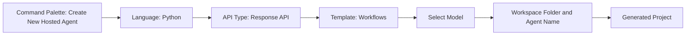
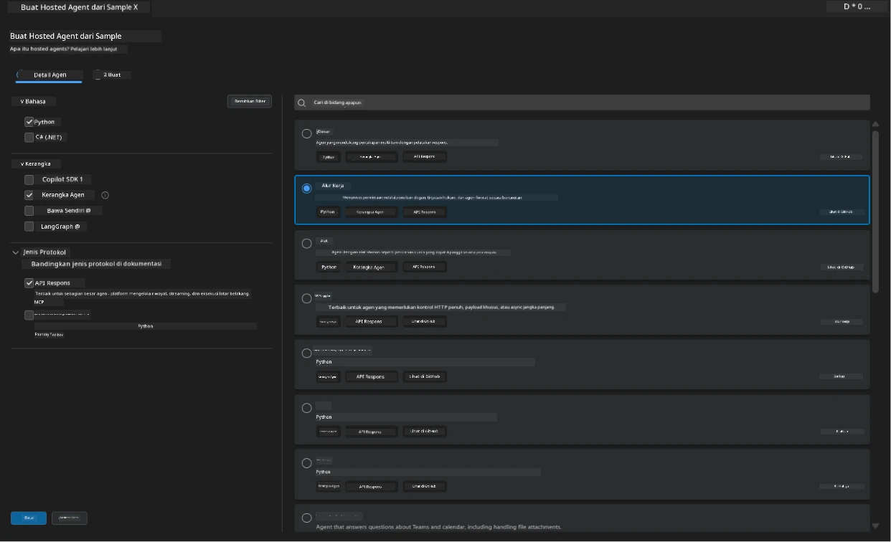
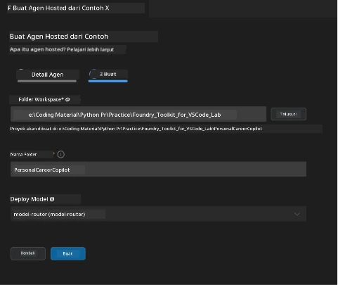

# Modul 2 - Membuat Kerangka Proyek Multi-Agen

⏱️ ~5 menit

Dalam modul ini, Anda menggunakan [Foundry Toolkit for VS Code](https://aka.ms/foundrytk) untuk **membuat kerangka proyek multi-agen**. Wizard menghasilkan `agent.yaml`, `main.py`, `Dockerfile`, `requirements.txt`, `.env`, dan konfigurasi debug VS Code - sehingga Anda dapat fokus pada pengkabelan alur kerja 4-agen di Modul 3.

> **Konsep utama:** Kerangka adalah stub yang berfungsi dengan satu agen. Anda mengganti logika placeholder dengan grafik `WorkflowBuilder` di Modul 3. Anda tidak menulis kode dasar dari awal.

> **Implementasi referensi:** [`PersonalCareerCopilot/`](../../../../../workshop/lab02-multi-agent/PersonalCareerCopilot) adalah contoh lengkap yang berfungsi. Gunakan untuk membandingkan pekerjaan Anda seiring berjalan.

### Alur wizard pembuatan kerangka



---

## Langkah 1: Buka wizard Create Hosted Agent

1. Tekan `Ctrl+Shift+P` untuk membuka **Command Palette**.
2. Ketik: **Foundry Toolkit: Create new Hosted Agent** dan pilih.
3. Wizard terbuka pada tab **Agent Details**.

> **Alternatif:** Klik ikon **Foundry Toolkit** di Activity Bar → klik ikon **+** di sebelah **Hosted Agents** → **Create New Hosted Agent**.

---

## Langkah 2: Pilih pengaturan



1. Di bagian navigasi/pilihan kiri pilih yang berikut:

| Menu | Pilihan | Catatan |
|--------|-----------|-------|
| **Language** | Python | C# (.NET) juga didukung |
| **Framework** | Agent Framework | Menyediakan `Agent`, `AgentExecutor`, `WorkflowBuilder` |
| **API type** | Response API | `POST /responses` - riwayat dikelola platform, dukungan streaming |
| **Template** | **Workflows** | Memproses permintaan melalui beberapa agen secara berurutan |

2. Setelah memilih, klik **Next**



3. Pada jendela berikutnya, pilih yang berikut:

| Menu | Pilihan | Catatan |
|--------|-----------|-------|
| **Workspace folder** | Telusuri ke folder target | misal, `workshop/lab02-multi-agent/` di repo ini |
| **Agent name** | `PersonalCareerCopilot` | Ini akan menjadi nama direktori proyek |
| **Model Deployment** | Pilih model yang sudah Anda deploy | misal, `gpt-4.1-mini` dari Lab 01 |

4. Klik **Create** untuk membuat kerangka proyek. VS Code menghasilkan file dan membuka folder tersebut.

> **Tips:** [`gpt-4.1-mini`](https://learn.microsoft.com/azure/foundry/foundry-models/concepts/models-sold-directly-by-azure#gpt-41-series) menyeimbangkan kecepatan dan kualitas dengan baik untuk pengembangan multi-agen.

---

## Langkah 3: Periksa proyek yang dihasilkan

Setelah selesai membuat kerangka, pastikan Anda melihat file-file ini di Explorer (`Ctrl+Shift+E`):

```
📂 <your-agent-name>/
├── .azdignore          ← Files excluded from Azure Developer CLI deployments
├── .dockerignore       ← Files excluded from Docker builds
├── .env                ← Environment variables (placeholders - fill in Module 3)
├── .vscode/
│   ├── launch.json     ← Debug config (F5 → run + Agent Inspector)
│   └── tasks.json      ← VS Code task definitions
├── agent.yaml          ← Agent definition (kind: hosted, protocol: responses)
├── Dockerfile          ← Container config for deployment
├── main.py             ← Stub agent entry point (replace with WorkflowBuilder in Module 3)
└── requirements.txt    ← Python dependencies
```

> **Penting:** Buka folder kerangka ini langsung di VS Code agar `.vscode/launch.json` dan `tasks.json` berlaku dengan benar saat debugging F5.

### Penjelasan file kunci

| File | Tujuan |
|------|---------|
| `agent.yaml` | Mendeklarasikan `kind: hosted`, memetakan variabel env, mendefinisikan protokol `/responses` |
| `main.py` | Stub: satu `FoundryChatClient` → `Agent` → `ResponsesHostServer`. Anda mengganti ini dengan 4 agen + `WorkflowBuilder` di Modul 3 |
| `Dockerfile` | `python:3.12-slim`, menginstal `requirements.txt`, membuka port 8088, menjalankan `python main.py` |
| `requirements.txt` | `agent-framework-foundry`, `agent-framework-foundry-hosting`, `mcp<2,>=1.24.0`, `debugpy` |

> **Referensi:** Lihat [`PersonalCareerCopilot/agent.yaml`](../../../../../workshop/lab02-multi-agent/PersonalCareerCopilot/agent.yaml) dan [`PersonalCareerCopilot/requirements.txt`](../../../../../workshop/lab02-multi-agent/PersonalCareerCopilot/requirements.txt) untuk isi lengkap yang dihasilkan.

---

### ✅ Titik pemeriksaan

- [ ] Wizard pembuatan kerangka selesai - folder proyek baru terlihat di Explorer
- [ ] Semua file yang diharapkan ada: `agent.yaml`, `main.py`, `Dockerfile`, `requirements.txt`, `.env`
- [ ] `agent.yaml` menampilkan `kind: hosted` dan `protocol: responses`
- [ ] `main.py` mengimpor `Agent`, `FoundryChatClient`, `ResponsesHostServer`
- [ ] Folder yang sudah dibuat dibuka sebagai root workspace di VS Code
- [ ] Anda memahami `main.py` adalah stub - `WorkflowBuilder` akan ditambahkan di Modul 3

---

**Sebelumnya:** [01 - Memahami Arsitektur Multi-Agen](01-understand-multi-agent.md) · **Berikutnya:** [03 - Konfigurasikan Agen & Lingkungan →](03-configure-agents.md)

---

<!-- CO-OP TRANSLATOR DISCLAIMER START -->
**Penafian**:
Dokumen ini telah diterjemahkan menggunakan layanan terjemahan AI [Co-op Translator](https://github.com/Azure/co-op-translator). Meskipun kami berupaya untuk mencapai akurasi, harap diketahui bahwa terjemahan otomatis mungkin mengandung kesalahan atau ketidakakuratan. Dokumen asli dalam bahasa aslinya harus dianggap sebagai sumber yang sah. Untuk informasi penting, disarankan menggunakan terjemahan profesional oleh manusia. Kami tidak bertanggung jawab atas kesalahpahaman atau penafsiran yang keliru yang timbul dari penggunaan terjemahan ini.
<!-- CO-OP TRANSLATOR DISCLAIMER END -->