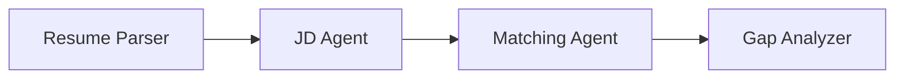
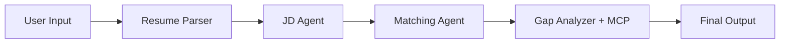

# Modul 4 - Pola Orkestrasi

⏱️ ~10 menit

Dalam modul ini, Anda mengeksplorasi pola orkestrasi yang digunakan dalam Resume Job Fit Evaluator dan belajar bagaimana membaca, memodifikasi, dan memperluas grafik alur kerja. Memahami pola-pola ini sangat penting untuk debugging masalah aliran data dan membangun [alur kerja multi-agen](https://learn.microsoft.com/agent-framework/workflows/) Anda sendiri.

---

## Pola 1: Rangkaian berurutan

Pola dasar dalam alur kerja adalah **rangkaian berurutan** - output setiap agen langsung mengalir ke agen berikutnya.



Dalam kode, setiap panggilan `add_edge()` membuat satu langkah dalam rangkaian:

```python
.add_edge(resume_executor, jd_executor)       # ResumeParser output → JD Agent
.add_edge(jd_executor, matching_executor)     # JD Agent output → MatchingAgent
.add_edge(matching_executor, gap_executor)    # MatchingAgent output → GapAnalyzer
```

> **Kenapa berurutan, bukan fan-out/fan-in?** `WorkflowBuilder` menggunakan **semantik OR** untuk tepi masuk: eksekutor hilir berjalan segera setelah **salah satu** pendahulunya selesai. Jika `matching_executor` memiliki dua tepi masuk (dari `resume_executor` dan `jd_executor`), ia akan terpicu dua kali - sekali saat ResumeParser selesai dan sekali lagi saat JD Agent selesai - menyebabkan GapAnalyzer juga berjalan dua kali dan output muncul dua kali. Jalur berurutan menghindari ini sepenuhnya.

## Pola 2: Pengiriman Konten

Karena `context_mode="last_agent"` berarti setiap eksekutor hanya melihat output **pendahulu langsungnya**, agen dalam rangkaian berurutan harus secara eksplisit meneruskan data apa pun yang dibutuhkan agen hilir.

Dalam alur kerja ini:
- **ResumeParser** menyalin JD secara verbatim ke `[JOB DESCRIPTION PASS-THROUGH]` (agar JD Agent bisa menemukannya).
- **JD Agent** menyalin `[PARSED RESUME]` secara verbatim ke `[PARSED RESUME PASS-THROUGH]` (agar MatchingAgent dapat membandingkan kedua profil).

```
ResumeParser output
└─ [PARSED RESUME]               ← extracted by JD Agent
└─ [JOB DESCRIPTION PASS-THROUGH] ← extracted by JD Agent

JD Agent output
└─ [JD REQUIREMENTS]             ← extracted by MatchingAgent
└─ [PARSED RESUME PASS-THROUGH]  ← extracted by MatchingAgent
```

Setiap bagian relay harus disalin **secara verbatim** - meringkas atau memparafrasekannya akan merusak agen hilir yang bergantung padanya.

---

## Grafik lengkap

Menggabungkan pola rangkaian berurutan dan pengiriman konten menghasilkan alur kerja lengkap:



Agent Inspector menunjukkan struktur grafik yang sama ini saat agen berjalan secara lokal. Lihat [Modul 5 - Uji Secara Lokal](05-test-locally.md) untuk tangkapan layar.

---

## Membaca kode WorkflowBuilder

Grafik alur kerja dibangun dalam fungsi `main()` di [`PersonalCareerCopilot/main.py`](../../../../../workshop/lab02-multi-agent/PersonalCareerCopilot/main.py). Tiga panggilan `add_edge()` membangun pipeline berurutan:

| # | Tepi | Efek |
|---|------|--------|
| 1 | `resume_executor → jd_executor` | JD Agent menerima `[PARSED RESUME]` + `[JOB DESCRIPTION PASS-THROUGH]` |
| 2 | `jd_executor → matching_executor` | MatchingAgent menerima `[JD REQUIREMENTS]` + `[PARSED RESUME PASS-THROUGH]` |
| 3 | `matching_executor → gap_executor` | GapAnalyzer menerima laporan kecocokan + daftar celah |

---

## Memodifikasi grafik

### Menambahkan agen baru

Untuk menambahkan agen kelima (misalnya, **InterviewPrepAgent** setelah GapAnalyzer):

1. Definisikan konstanta `INTERVIEW_PREP_INSTRUCTIONS`.
2. Buat objek `Agent` + `AgentExecutor` (pola yang sama dengan yang ada empat agen).
3. Tambahkan `.add_edge(gap_executor, interview_exec)` di `WorkflowBuilder`.
4. Perbarui `output_executors=[interview_exec]`.

> **Penting:** `start_executor` adalah satu-satunya agen yang menerima input pengguna mentah. Semua agen lain menerima output dari tepi hulu mereka.

---

## Kesalahan umum dalam grafik

| Kesalahan | Gejala | Perbaikan |
|---------|---------|-----|
| Tepi yang hilang ke `output_executors` | Agen berjalan tetapi output kosong | Pastikan ada jalur dari `start_executor` ke setiap agen di `output_executors` |
| Ketergantungan siklis | Loop tak berujung atau timeout | Periksa bahwa tidak ada agen yang memberi umpan balik ke agen hulu |
| Agen di `output_executors` tanpa tepi masuk | Output kosong | Tambahkan setidaknya satu `add_edge(source, that_agent)` |
| Beberapa `output_executors` tanpa fan-in | Output hanya berisi respons satu agen | Gunakan satu agen output yang menggabungkan, atau terima banyak output |
| `start_executor` tidak ada | `ValueError` saat build | Selalu tentukan `start_executor` di `WorkflowBuilder()` |

---

## Debugging grafik

### Menggunakan Agent Inspector

1. Mulai agen secara lokal dengan F5.
2. Buka Agent Inspector (`Ctrl+Shift+P` → **Foundry Toolkit: Open Agent Inspector**).
3. Kirim pesan uji.
4. Di panel respons Inspector, cari **output streaming** - ini menampilkan kontribusi setiap agen secara berurutan.


### Menggunakan logging

Tambahkan logging ke `main.py` untuk melacak aliran data:

```python
import logging
logger = logging.getLogger("resume-job-fit")

# In main(), after building the workflow:
logger.info("Workflow graph built with edges: RP→JD, JD→MA, MA→GA")
```

Log server menunjukkan urutan eksekusi agen dan panggilan alat MCP:

```
INFO:agent_framework:Executing agent: ResumeParser
INFO:agent_framework:Executing agent: JobDescriptionAgent
INFO:agent_framework:Executing agent: MatchingAgent
INFO:agent_framework:Executing agent: GapAnalyzer
INFO:agent_framework:Tool call: search_microsoft_learn_for_plan(skill="Kubernetes")
POST https://learn.microsoft.com/api/mcp → 200
INFO:agent_framework:Tool call: search_microsoft_learn_for_plan(skill="Terraform")
POST https://learn.microsoft.com/api/mcp → 200
```

---

### Titik pemeriksaan

- [ ] Anda dapat mengidentifikasi dua pola orkestrasi dalam alur kerja: rangkaian berurutan dan pengiriman konten
- [ ] Anda memahami mengapa `context_mode="last_agent"` memerlukan pengiriman data eksplisit antar agen
- [ ] Anda dapat membaca kode `WorkflowBuilder` dan memetakan setiap panggilan `add_edge()` ke grafik visual
- [ ] Anda tahu cara menambahkan agen baru di akhir pipeline
- [ ] Anda dapat mengidentifikasi kesalahan grafik umum dan gejalanya

---

**Sebelumnya:** [03 - Konfigurasi Agen & Lingkungan](03-configure-agents.md) · **Berikutnya:** [05 - Uji Secara Lokal →](05-test-locally.md)

---

<!-- CO-OP TRANSLATOR DISCLAIMER START -->
**Penafian**:
Dokumen ini telah diterjemahkan menggunakan layanan terjemahan AI [Co-op Translator](https://github.com/Azure/co-op-translator). Meskipun kami berupaya untuk mencapai akurasi, harap diketahui bahwa terjemahan otomatis mungkin mengandung kesalahan atau ketidakakuratan. Dokumen asli dalam bahasa aslinya harus dianggap sebagai sumber yang sah. Untuk informasi penting, disarankan menggunakan terjemahan profesional oleh manusia. Kami tidak bertanggung jawab atas kesalahpahaman atau penafsiran yang keliru yang timbul dari penggunaan terjemahan ini.
<!-- CO-OP TRANSLATOR DISCLAIMER END -->