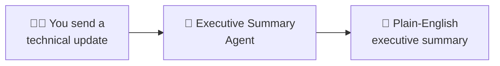

# Modulo 0 - Introduzione

⏱️ ~10 min

> [!WARNING]
> **Anteprima e limitazioni:** [Gli Agenti ospitati](https://learn.microsoft.com/azure/foundry/agents/concepts/hosted-agents) sono attualmente in **anteprima pubblica** - non consigliati per carichi di lavoro in produzione. Tieni presente quanto segue:
> - **Le regioni supportate sono limitate** - controlla la [disponibilità delle regioni](https://learn.microsoft.com/azure/foundry/agents/concepts/hosted-agents#region-availability) prima di creare risorse. Se scegli una regione non supportata, il deployment fallirà.
> - Il pacchetto `agent-framework-foundry-hosting` è in pre-release - le API possono cambiare tra le versioni.
> - Limiti di scala: gli agenti ospitati supportano da 0 a 5 repliche (incluso lo scale-to-zero).
> - Alcune funzionalità mostrate in questo workshop potrebbero cambiare man mano che il servizio si avvicina alla GA.

## Cosa costruirai

In questo workshop, costruirai un agente **"Spiega come se fossi un dirigente"** - un agente AI ospitato che prende aggiornamenti tecnici complessi e li riscrive in riassunti esecutivi in inglese semplice.

**L'agente usa:**
- **Microsoft Agent Framework** - per la logica e la struttura dell'agente
- **Foundry Toolkit for VS Code** - per scaffolding, test locali e deployment
- **Un modello AI** (es. `gpt-4.1-mini/gpt-5-mini`) - per generare i riassunti

Alla fine di questo laboratorio, avrai un agente funzionante che potrai testare localmente tramite l'Agent Inspector e opzionalmente distribuire sul cloud.

---

## Cosa sono gli agenti ospitati?

Un **agente ospitato** è un agente AI che viene eseguito come servizio gestito in Microsoft Foundry. Invece di gestire la tua infrastruttura, impacchetti il codice del tuo agente in un container e Foundry si occupa di scalare, ospitare e esporlo tramite un endpoint HTTP standard.

| Concetto | Cosa significa |
|---------|--------------|
| **Agente** | Il tuo codice Python che riceve un messaggio dall'utente, chiama un modello AI e restituisce una risposta strutturata |
| **Ospitato** | Foundry esegue il tuo container per te - niente VM, niente Kubernetes, nessuna infrastruttura da gestire |
| **Protocollo risposte** | Una API HTTP standard (`POST /responses`) che qualsiasi client può chiamare per interagire con il tuo agente |
| **Agent Inspector** | Un'interfaccia utente di test locale (integrata in Foundry Toolkit) che ti permette di chattare con il tuo agente prima del deployment |

In questo workshop, passerai da zero a un agente completamente ospitato - oppure ti fermerai al test locale, se preferisci.

---

## Scegli il tuo percorso

> ⚠️ **Scegli un percorso prima di continuare.** La tua scelta determina quali strumenti installare e quali moduli seguire. Puoi passare dal Percorso B → Percorso A in seguito se ottieni un abbonamento.

<strong>🅰️ Percorso A - Cloud Azure (richiede abbonamento Azure)</strong>

| | Dettagli |
|---|---|
| **Per chi è?** | Hai un abbonamento Azure attivo e puoi creare risorse Foundry |
| **Modello** | Azure OpenAI via Foundry (es. `gpt-4.1-mini/gpt-5-mini`) |
| **Moduli coperti** | Tutti i moduli (00–07) |
| **Deployment sul cloud?** | ✅ Sì - deployment completo end-to-end |

<strong>🅱️ Percorso B - Locale / tier gratuito (non serve abbonamento Azure)</strong>

| | Dettagli |
|---|---|
| **Per chi è?** | MVP, studenti o chiunque non abbia accesso ad Azure |
| **Modello** | **Foundry Local** (gratuito, gira sulla tua macchina) |
| **Moduli coperti** | Moduli 00–04 (salta deploy e verifica cloud) |
| **Deployment sul cloud?** | ❌ No - solo test locali via Agent Inspector |

---

## Tutti i percorsi: strumenti richiesti

Installa ogni strumento qui sotto. Dopo l’installazione, verifica che funzioni eseguendo il comando di controllo.

| # | Strumento | Versione | Installazione | Verifica (Output previsto) |
|---|------|---------|---------|---------------------------|
| 1 | **Visual Studio Code** | Ultima | [code.visualstudio.com](https://code.visualstudio.com/) | Si apre senza errori |
| 2 | **Python** | 3.12 o superiore | [python.org/downloads](https://www.python.org/downloads/) | `python --version` $\rightarrow$ `Python 3.12.x` |
| 3 | **Foundry Toolkit per VS Code** | Ultima | ID estensione: `ms-windows-ai-studio.windows-ai-studio` | Icona Foundry nella barra attività |
| 4 | **Estensione Python per VS Code** | Ultima | ID estensione: `ms-python.python` | Installata nel pannello Estensioni |

> [!TIP]
> **Consigli per l’installazione:**
> - **Percorso Python (Windows):** Controlla sempre **"Aggiungi Python al PATH"** nella prima schermata dell’installatore Python. Senza questo, `python` non sarà riconosciuto nel terminale.
> - **Più versioni di Python:** Se hai Python 3.10 e 3.12 installati, usa `python3.12 -m venv .venv` per assicurarti di usare la versione corretta per il tuo ambiente virtuale.
> - **Docker WSL 2 (Windows):** Durante l'installazione di Docker Desktop, assicurati che sia selezionato il **backend WSL 2**. Docker con Hyper-V è più lento e potrebbe causare problemi con le build dei container Foundry.
> - **Docker non si avvia?** Aspetta 30–60 secondi dopo aver avviato Docker Desktop. Esegui `docker info` - se vedi "Cannot connect to the Docker daemon", Docker sta ancora iniziando.
> - **Estensioni VS Code non si caricano?** Dopo aver installato le estensioni, ricarica la finestra: `Ctrl+Shift+P` → `Developer: Reload Window`.

> **Utenti Windows:** Controlla **"Aggiungi Python al PATH"** durante l’installazione di Python.

**Successivo:** [01 - Configurazione →](01-setup.md)

---

<!-- CO-OP TRANSLATOR DISCLAIMER START -->
**Disclaimer**:
Questo documento è stato tradotto utilizzando il servizio di traduzione AI [Co-op Translator](https://github.com/Azure/co-op-translator). Sebbene ci impegniamo per garantire la precisione, si prega di notare che le traduzioni automatizzate possono contenere errori o imprecisioni. Il documento originale nella sua lingua nativa deve essere considerato la fonte autorevole. Per informazioni critiche, si raccomanda una traduzione professionale effettuata da un essere umano. Non siamo responsabili per eventuali malintesi o interpretazioni errate derivanti dall’uso di questa traduzione.
<!-- CO-OP TRANSLATOR DISCLAIMER END -->