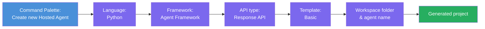
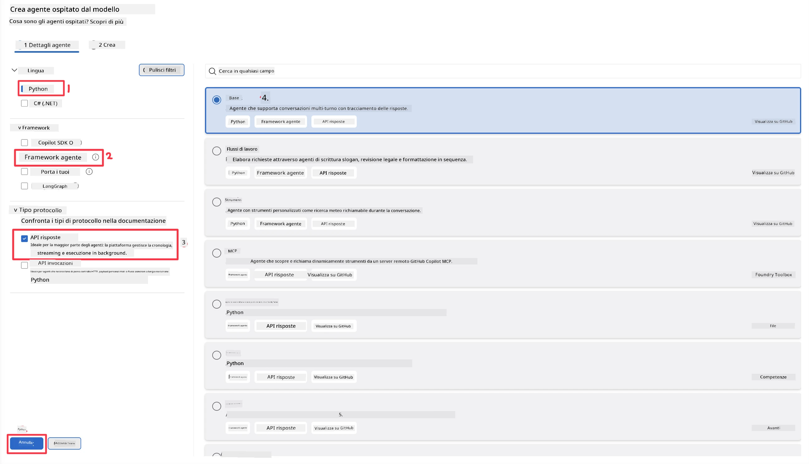
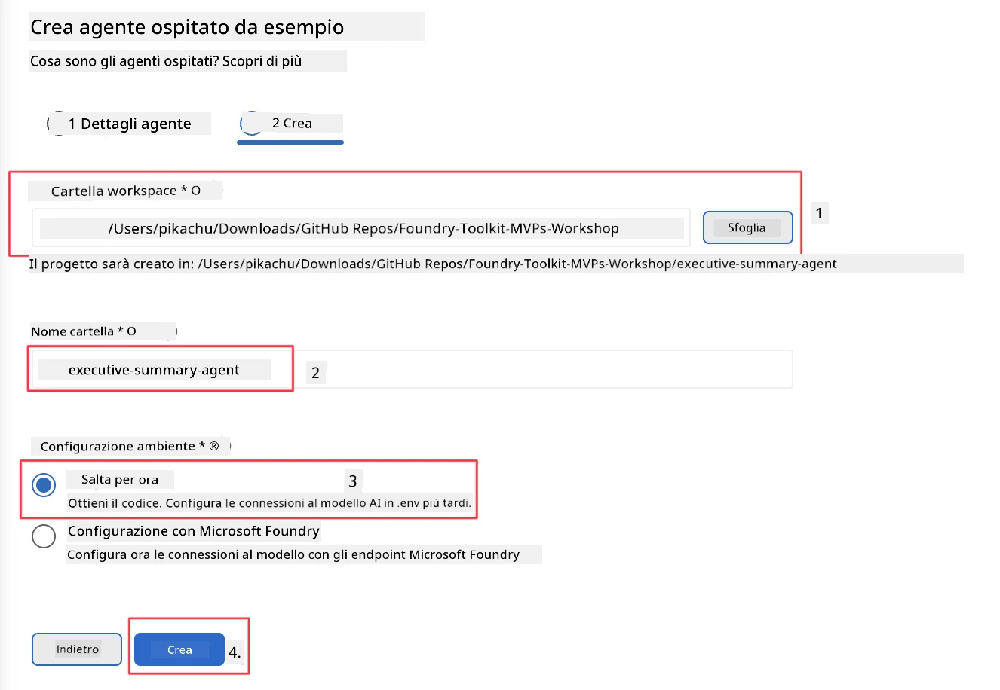

# Modulo 2 - Creare un nuovo Hosted Agent

⏱️ ~5 min

In questo modulo, usi Foundry Toolkit per **creare lo scheletro di un progetto hosted agent**. Lo scheletro genera la struttura completa del progetto - `agent.yaml`, `main.py`, `Dockerfile`, `requirements.txt` e la configurazione di debug di VS Code - così puoi concentrarti sulla personalizzazione del comportamento dell'agente.

> **Concetto chiave:** La cartella `agent/` in questo laboratorio è un esempio di quello che genera Foundry Toolkit. Non scrivi questi file da zero.

### Flusso della procedura guidata scaffold



---

## Passo 1: Apri la procedura guidata Create Hosted Agent

1. Premi `Ctrl+Shift+P` per aprire la **Palette comandi**.
2. Digita: **Foundry Toolkit: Create new Hosted Agent** e selezionalo.

> **Alternativa: Crea tramite Foundry Portal**
> Se preferisci il browser, puoi creare il tuo progetto su [https://ai.azure.com](https://ai.azure.com). Una volta che il progetto è stato allestito, torna a VS Code e usa la sidebar di **Foundry Toolkit** per connetterti ad esso.

> **Alternativa:** Nella sidebar di Foundry Toolkit, posiziona il cursore su **Agents** sotto il tuo progetto, clicca l'icona **+**, poi seleziona **Create in Code With Template**.

## Passo 2: Scegli impostazioni



1. Nella sezione di navigazione/opzioni a sinistra seleziona quanto segue:

| Menu | Selezione | Note |
|--------|-----------|-------|
| **Lingua** | Python | Anche C# è supportato |
| **Framework** | Agent Framework | Punto di partenza semplice usando Agent Framework SDK |
| **Tipo di API** | Response API | `POST /responses` - conversazionale, con cronologia gestita dalla piattaforma |
| **Template** | Basic | Punto di partenza semplice usando Agent Framework SDK |

2. Una volta selezionato, clicca **Next**



3. Nella finestra successiva seleziona quanto segue:

| Menu | Selezione | Note |
|--------|-----------|-------|
| **Cartella workspace** | Scegli una cartella di destinazione | es. `/workspace/Foundry_Toolkit_for_VSCode_Lab/` o una sottocartella in questo repo |
| **Nome agente** | Inserisci un nome | es. `executive-summary-agent` |
| **Configurazione ambiente** | salta la configurazione per ora |  |

Clicca **create** per creare il tuo agente. Verrà creata una nuova cartella con il nome dell'agente hosted.

## Passo 3: Ispeziona il progetto generato

Dopo il completamento dello scaffolding, verifica che tu veda questi file nell'Explorer (`Ctrl+Shift+E`):

```
📂 executive-summary-agent/
├── .env                ← Environment variables (placeholders)
├── .vscode/
│   ├── launch.json     ← Debug config (F5 → run + Agent Inspector)
│   └── tasks.json      ← VS Code task definitions
├── agent.yaml          ← Agent definition (kind: hosted)
├── Dockerfile          ← Container config for deployment
├── main.py             ← Agent entry point (your main code)
└── requirements.txt    ← Python dependencies
```

### Spiegazione dei file chiave

| File | Scopo |
|------|---------|
| `agent.yaml` | Dichiara l'agente come `kind: hosted`, mappa le variabili d'ambiente, definisce il protocollo `/responses` |
| `main.py` | Crea un `FoundryChatClient` → lo avvolge in un `Agent` con istruzioni → serve tramite `ResponsesHostServer` sulla porta 8088 |
| `Dockerfile` | Usa `python:3.12-slim`, installa dipendenze, espone la porta 8088, esegue `main.py` |
| `requirements.txt` | `agent-framework-foundry`, `agent-framework-foundry-hosting`, `mcp`, `debugpy` |

> **Importante:** Apri la cartella dell'agente scaffolding direttamente in VS Code (la cartella `agent/` stessa) così che `.vscode/launch.json` e `tasks.json` funzionino correttamente per il debug con F5.

---

### ✅ Punto di controllo

- [ ] Progetto scaffolding creato con tutti i file attesi
- [ ] `agent.yaml` mostra `kind: hosted` e `protocol: responses`
- [ ] `main.py` importa `Agent`, `FoundryChatClient`, `ResponsesHostServer`
- [ ] La cartella agente è aperta in VS Code come root del workspace

---

**Precedente:** [01 - Setup](01-setup.md) · **Successivo:** [03 - Configure & Code →](03-configure-and-code.md)

---

<!-- CO-OP TRANSLATOR DISCLAIMER START -->
**Disclaimer**:
Questo documento è stato tradotto utilizzando il servizio di traduzione AI [Co-op Translator](https://github.com/Azure/co-op-translator). Sebbene ci impegniamo per garantire la precisione, si prega di notare che le traduzioni automatizzate possono contenere errori o imprecisioni. Il documento originale nella sua lingua nativa deve essere considerato la fonte autorevole. Per informazioni critiche, si raccomanda una traduzione professionale effettuata da un essere umano. Non siamo responsabili per eventuali malintesi o interpretazioni errate derivanti dall’uso di questa traduzione.
<!-- CO-OP TRANSLATOR DISCLAIMER END -->