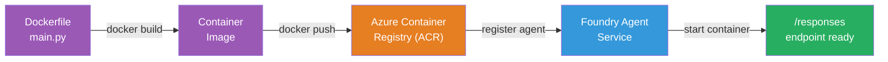
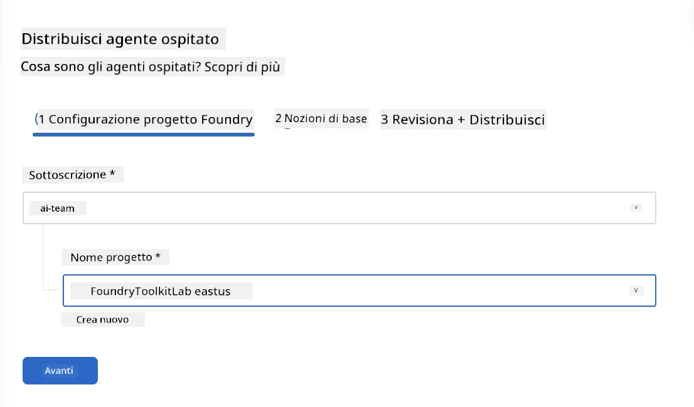
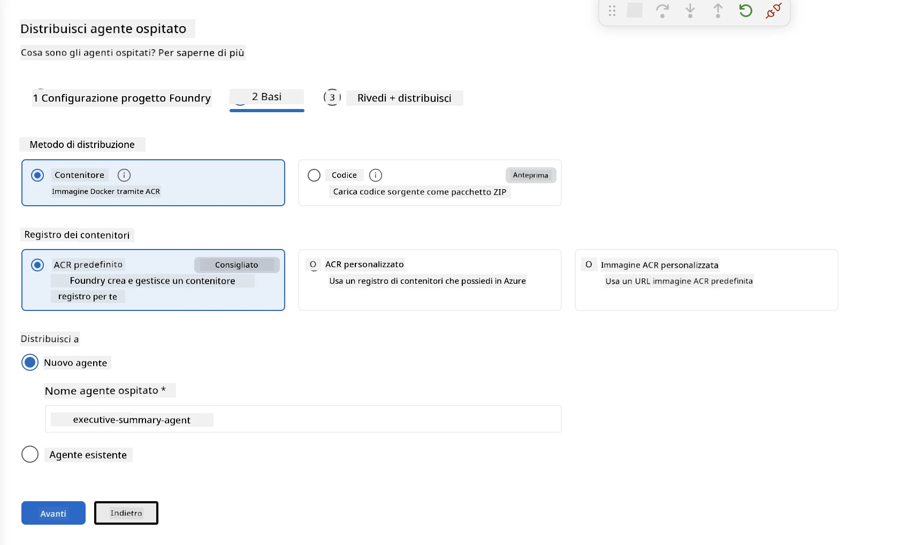
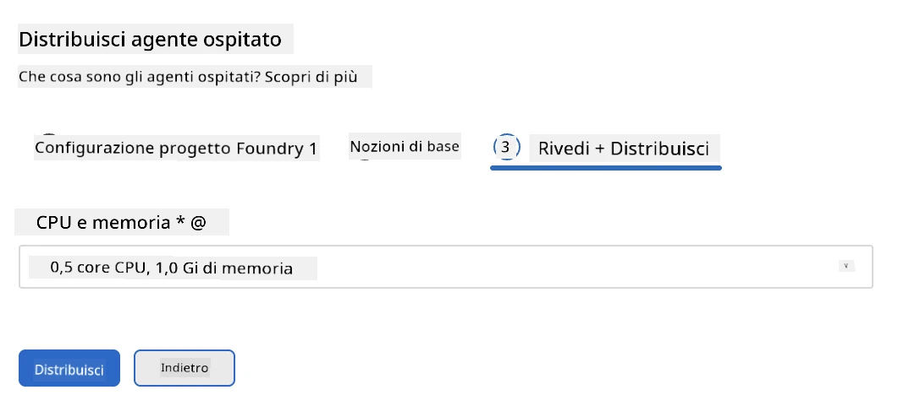
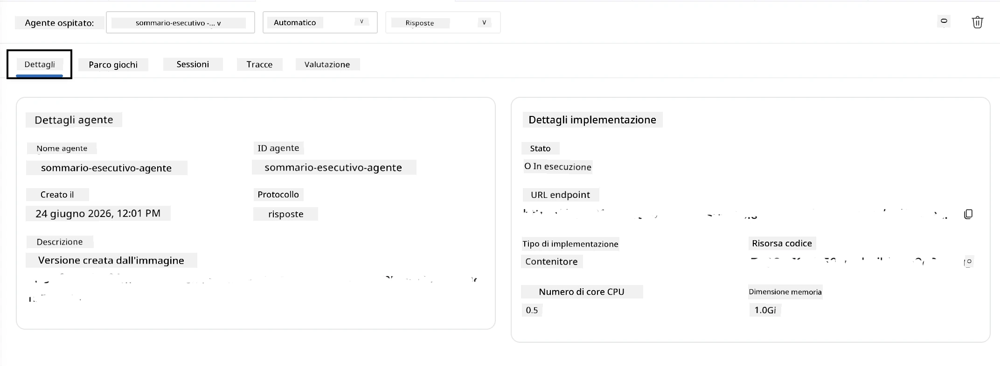

# Modulo 5 - Distribuzione al servizio Foundry Agent

⏱️ ~10 min

> ⚠️ **Utenti Percorso B:** Questo modulo richiede un abbonamento Foundry. Se stai usando Foundry Local, passa a [Modulo 07 - Sommario](07-summary.md). Hai completato con successo il flusso di lavoro di sviluppo locale!

In questo modulo, distribuisci l'agente testato localmente su Microsoft Foundry come **Hosted Agent**. La distribuzione crea un'immagine del contenitore, la invia ad Azure Container Registry e avvia l'agente nell'infrastruttura gestita di Foundry.

### Pipeline di distribuzione

---

## Verifica prerequisiti

Prima della distribuzione, verifica:

- [ ] L'agente supera tutti e 3 gli scenari locali da [Modulo 04](04-test-locally.md)
- [ ] Hai il ruolo **Azure AI User** a livello di progetto ([Modulo 01, Assegna RBAC](01-setup.md#deploy-a-model--assign-rbac))
- [ ] Sei connesso ad Azure in VS Code (l'icona Account mostra il tuo nome)

---

## Passo 1: Avvia la distribuzione

### Opzione A: Distribuisci dall'Agent Inspector (consigliato)

Se l'Agent Inspector è aperto (dai test):
1. Clicca il pulsante **Deploy** in alto a destra (icona cloud ↑).

### Opzione B: Distribuisci dal Command Palette

1. Premi `Ctrl+Shift+P` → **Foundry Toolkit: Deploy Hosted Agent**.

---

## Passo 2: Configura la distribuzione

Il wizard ti richiede:

| Prompt | Selezione |
|--------|------------|
| **Sottoscrizione** | La tua sottoscrizione Azure |
| **Progetto di destinazione** | Il tuo progetto Foundry (ad es., `workshop-agents`) |

Clicca **avanti** per configurare il tuo agente.

| Prompt | Selezione |
|--------|------------|
| **Metodo di distribuzione** | Contenitore |
| **Container registry** | **ACR predefinito** (Microsoft Foundry ne crea e gestisce uno per te) |
| **Distribuisci a** | Nuovo agente (nome, `executive-summary-agent`) |

Clicca **avanti** per rivedere e distribuire il tuo agente.

| Prompt | Selezione |
|--------|------------|
| **CPU e memoria** | **0.5 CPU cores, 1.0 Gi memoria** (predefinito - sufficiente per il workshop) |

---

## Passo 3: Distribuisci e monitora

1. Clicca **Deploy**.
2. Osserva il pannello **Output** (seleziona **Microsoft Foundry** dal menù a tendina).
3. La distribuzione passa attraverso queste fasi:
   - **Docker build** - costruisce il contenitore dal tuo Dockerfile
   - **Docker push** - invia l'immagine ad ACR (1–3 minuti alla prima distribuzione)
   - **Registrazione agente** - crea l'agente ospitato in Foundry
   - **Avvio contenitore** - avvia con identità gestita dal sistema

4. Al completamento, appare una notifica:
   > **executive-summary-agent è stato distribuito con successo.** `View logs` `Run agent`

5. Clicca **Run agent** per aprire l'Agent Playground.

### Valori dello stato di distribuzione

| Stato | Significato |
|--------|------------|
| **Running** | Contenitore pronto, agente risponde |
| **Pending** | Contenitore in avvio - attendere 30–60 secondi |
| **Failed** | Controlla i log (vedi risoluzione dei problemi sotto) |

---

## Errori comuni di distribuzione

| Errore | Causa principale | Soluzione |
|-------|-----------------|----------|
| `agents/write` permesso negato | Ruolo **Azure AI User** mancante a livello di progetto | [Modulo 01, Assegna RBAC](01-setup.md#deploy-a-model--assign-rbac) |
| Docker non in esecuzione | Docker Desktop non avviato | Avvia Docker Desktop → verifica `docker info` |
| Autorizzazione ACR | L'identità gestita non può estrarre l'immagine | Vedi [Modulo 08 - Risoluzione dei problemi](08-troubleshooting.md) |

---

### ✅ Punto di controllo

- [ ] Distribuzione completata senza errori
- [ ] L'agente appare nella scheda **Hosted Agent** quando clicchi su **Agents** sotto il tuo progetto nella barra laterale del Foundry Toolkit
- [ ] Lo stato del container mostra **Running**
- [ ] Scheda Agent Playground aperta che mostra i dettagli dell'agente e l'URL dell'endpoint

---

**Precedente:** [04 - Testa localmente](04-test-locally.md) · **Successivo:** [06 - Verifica nel Playground →](06-verify-in-playground.md)

---

<!-- CO-OP TRANSLATOR DISCLAIMER START -->
**Disclaimer**:
Questo documento è stato tradotto utilizzando il servizio di traduzione AI [Co-op Translator](https://github.com/Azure/co-op-translator). Sebbene ci impegniamo per garantire la precisione, si prega di notare che le traduzioni automatizzate possono contenere errori o imprecisioni. Il documento originale nella sua lingua nativa deve essere considerato la fonte autorevole. Per informazioni critiche, si raccomanda una traduzione professionale effettuata da un essere umano. Non siamo responsabili per eventuali malintesi o interpretazioni errate derivanti dall’uso di questa traduzione.
<!-- CO-OP TRANSLATOR DISCLAIMER END -->