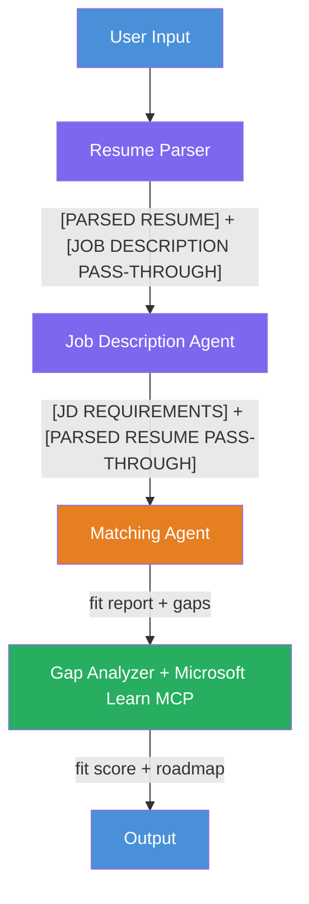

# Lab 02 - Flusso di Lavoro Multi-Agent: Valutatore di Corrispondenza Curriculum → Lavoro

## Panoramica

In questo laboratorio pratico, costruirai una **app multi-agente incentrata sul flusso di lavoro** utilizzando Foundry Toolkit in VS Code e la distribuirai su Microsoft Foundry Agent Service.

**Cosa realizzerai:** un Valutatore di Corrispondenza Curriculum → Lavoro che analizza un curriculum e una descrizione del lavoro, valuta la corrispondenza e produce una roadmap di apprendimento personalizzata utilizzando risorse Microsoft Learn.

---

## Architettura

**Come funziona:**
1. L'utente incolla un curriculum e una descrizione del lavoro.
2. **ResumeParser** analizza il curriculum e copia integralmente la descrizione del lavoro in una sezione `[JOB DESCRIPTION PASS-THROUGH]`.
3. **JD Agent** estrae i requisiti strutturati dalla sezione pass-through, poi inoltra il `[PARSED RESUME]` come `[PARSED RESUME PASS-THROUGH]`.
4. **MatchingAgent** confronta `[PARSED RESUME PASS-THROUGH]` con `[JD REQUIREMENTS]` e produce un punteggio di corrispondenza.
5. **GapAnalyzer** trasforma le lacune in una roadmap pratica e recupera veri link Microsoft Learn tramite MCP.

---

## Prerequisiti

Per prima cosa completa il Lab 01:

- [Lab 01 - Agente Singolo](../lab01-single-agent/README.md)

---

## Parte 1: Leggi i moduli in ordine

Consulta l'intero percorso di apprendimento in:

- [Documentazione Lab 2 - Prerequisiti](docs/00-prerequisites.md)
- [Documentazione Lab 2 - Percorso Completo di Apprendimento](docs/README.md)
- [Guida all'esecuzione di PersonalCareerCopilot](PersonalCareerCopilot/README.md)

---

## Parte 2: Costruisci e testa il flusso di lavoro

1. Usa la procedura guidata Foundry Toolkit per impostare il progetto basato sul flusso di lavoro.
2. Copia i blocchi di prompt e il grafo del flusso di lavoro da `PersonalCareerCopilot/main.py` nel tuo workspace.
3. Esegui localmente con Agent Inspector e verifica tutti e quattro gli agenti più lo strumento MCP.
4. Distribuisci l'agente ospitato su Foundry dopo il superamento dei test locali.

---

## Modelli di orchestrazione

Il Lab 02 utilizza una **pipeline sequenziale**: l'output di ogni agente alimenta il successivo, e il flusso di lavoro restituisce la risposta dell'ultimo agente. Due modelli fanno funzionare questo:

- **Catena sequenziale** - `WorkflowBuilder` collega ResumeParser → JD Agent → MatchingAgent → GapAnalyzer con una chiamata `add_edge()` per passo
- **Trasmissione contenuti** - poiché ogni agente vede solo l'output del diretto predecessore, ResumeParser e JD Agent copiano i dati necessari agli agent downstream in sezioni pass-through etichettate

La documentazione spiega anche perché il laboratorio non utilizza fan-out/fan-in, e come estendere il grafo con un altro agente.

Consulta [docs/04-orchestration-patterns.md](docs/04-orchestration-patterns.md).

---

**Precedente:** [Lab 01 - Agente Singolo](../lab01-single-agent/README.md) · **Torna a:** [Home del Workshop](../../README.md)

---

<!-- CO-OP TRANSLATOR DISCLAIMER START -->
**Disclaimer**:
Questo documento è stato tradotto utilizzando il servizio di traduzione AI [Co-op Translator](https://github.com/Azure/co-op-translator). Sebbene ci impegniamo per garantire la precisione, si prega di notare che le traduzioni automatizzate possono contenere errori o imprecisioni. Il documento originale nella sua lingua nativa deve essere considerato la fonte autorevole. Per informazioni critiche, si raccomanda una traduzione professionale effettuata da un essere umano. Non siamo responsabili per eventuali malintesi o interpretazioni errate derivanti dall’uso di questa traduzione.
<!-- CO-OP TRANSLATOR DISCLAIMER END -->