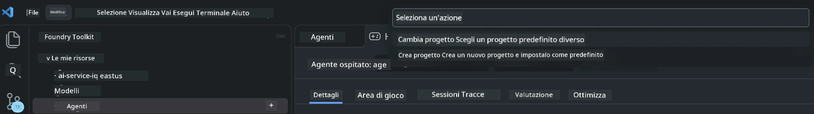

# Modulo 0 - Introduzione

⏱️ ~10 min

> [!WARNING]
> **Anteprima e limitazioni:** [Agenti ospitati](https://learn.microsoft.com/azure/foundry/agents/concepts/hosted-agents) sono attualmente in **anteprima pubblica** - non consigliati per carichi di lavoro in produzione. Alcune funzionalità mostrate in questo laboratorio potrebbero cambiare man mano che il servizio si avvicina alla disponibilità generale.

## Cosa costruirai

In questo laboratorio, estendi le capacità del singolo agente del Lab 01 per costruire un **flusso di lavoro multi-agente** - il Valutatore di Curriculum → Compatibilità con il lavoro.

Incolli un **curriculum** e una **descrizione del lavoro**. Quattro agenti specializzati elaborano l’input in sequenza, quindi restituiscono:
- Un punteggio di compatibilità (0–100 con una suddivisione del punteggio)
- Una lista di lacune di competenze e certificazioni
- Un percorso di apprendimento personalizzato con link reali di Microsoft Learn per ogni lacuna

**Il flusso di lavoro utilizza:**
- **Microsoft Agent Framework** - `WorkflowBuilder` per l’orchestrazione sequenziale della pipeline
- **Foundry Toolkit for VS Code** - scaffolding, test locale, distribuzione
- **Un modello di AI** (ad esempio, `gpt-4.1-mini`) - usato da tutti e quattro gli agenti
- **Microsoft Learn MCP server** - fornisce link reali alle risorse di apprendimento per ogni lacuna di competenza

---

## Scegli il tuo percorso

> ⚠️ **Continua con lo stesso percorso usato nel Lab 01.**

<details open>
<summary><strong>🅰️ Percorso A - cloud Azure (richiede sottoscrizione Azure)</strong></summary>

| | Dettagli |
|---|---|
| **A chi è rivolto?** | Hai completato il Lab 01 usando una sottoscrizione Azure |
| **Modello** | Azure OpenAI tramite Foundry (ad esempio, `gpt-4.1-mini`) |
| **Moduli trattati** | Tutti i moduli (00–09) |
| **Distribuzione su cloud?** | ✅ Sì - distribuzione completa end-to-end |

</details>

<details open>
<summary><strong>🅱️ Percorso B - Foundry Locale (nessuna sottoscrizione Azure necessaria)</strong></summary>

| | Dettagli |
|---|---|
| **A chi è rivolto?** | Hai completato il Lab 01 usando Foundry Locale |
| **Modello** | Foundry Locale (gratuito, eseguito sulla tua macchina) |
| **Moduli trattati** | Moduli 00–05 (salta 06–07 - distribuzione e verifica cloud) |
| **Distribuzione su cloud?** | ❌ No - solo test locale tramite Agent Inspector |

</details>

---

## Verifica Lab 01

Il Lab 02 si basa direttamente sul Lab 01. Completa prima il Lab 01 prima di iniziare qui.

Non hai ancora fatto il Lab 01? Inizia qui: [Lab 01 - Introduzione](../../lab01-single-agent/docs/00-prerequisites.md)

<details open>
<summary><strong>🅰️ Percorso A - cloud Azure</strong></summary>

```powershell
az account show --query "{name:name, id:id}" --output table
```

Se fallisce, esegui `az login`. Poi verifica in VS Code:

1. `Ctrl+Shift+P` → digita **Foundry Toolkit** → conferma che i comandi appaiono.
2. Clicca l’icona **Foundry Toolkit** → il tuo progetto e il modello distribuito mostrano **Completato con successo**.



> **RBAC:** Hai assegnato **Utente Foundry** nel Lab 01. Se devi riassegnarlo, vedi [Lab 01, Modulo 1](../../lab01-single-agent/docs/01-setup.md#deploy-a-model--assign-rbac). Il ruolo si chiamava precedentemente **Azure AI User** - stessi permessi.

</details>

<details open>
<summary><strong>🅱️ Percorso B - Foundry Locale</strong></summary>

```powershell
Invoke-WebRequest -Uri "http://localhost:5273/v1/health" -UseBasicParsing | Select-Object StatusCode
```

Previsto: `StatusCode: 200`. In caso contrario, riavvia Foundry Locale dalla barra laterale di Foundry Toolkit.

> Tutte le inferenze sono eseguite sulla tua macchina. La sola chiamata in uscita è lo strumento MCP verso `https://learn.microsoft.com/api/mcp`.

</details>

---

## Novità nel Lab 02

| | Lab 01 | Lab 02 |
|--|--------|--------|
| Agenti | 1 | 4 (collegati con WorkflowBuilder) |
| Modello di scaffolding | Base - Agent Framework | Flussi di lavoro - Agent Framework |
| Nuovo pacchetto | - | `mcp` |
| Orchestrazione | Agente conversazionale singolo | Pipeline sequenziale (WorkflowBuilder) |
| Nuovo strumento | - | `search_microsoft_learn_for_plan` (MCP) |

---

**Prossimo:** [01 - Comprendere l’architettura →](01-understand-multi-agent.md)

---

<!-- CO-OP TRANSLATOR DISCLAIMER START -->
**Disclaimer**:
Questo documento è stato tradotto utilizzando il servizio di traduzione AI [Co-op Translator](https://github.com/Azure/co-op-translator). Sebbene ci impegniamo per garantire la precisione, si prega di notare che le traduzioni automatizzate possono contenere errori o imprecisioni. Il documento originale nella sua lingua nativa deve essere considerato la fonte autorevole. Per informazioni critiche, si raccomanda una traduzione professionale effettuata da un essere umano. Non siamo responsabili per eventuali malintesi o interpretazioni errate derivanti dall’uso di questa traduzione.
<!-- CO-OP TRANSLATOR DISCLAIMER END -->