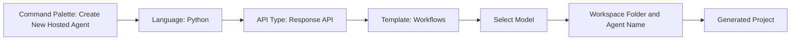

# Modulo 2 - Creare lo scheletro del progetto multi-agente

⏱️ ~5 min

In questo modulo, utilizzi [Foundry Toolkit for VS Code](https://aka.ms/foundrytk) per **creare lo scheletro di un progetto multi-agente**. La procedura guidata genera `agent.yaml`, `main.py`, `Dockerfile`, `requirements.txt`, `.env`, e la configurazione di debug di VS Code - così puoi concentrarti sul collegamento del flusso di lavoro a 4 agenti nel Modulo 3.

> **Concetto chiave:** Lo scaffold è uno stub funzionante con un agente. Sostituisci la logica segnaposto con il grafo `WorkflowBuilder` nel Modulo 3. Non devi scrivere il boilerplate da zero.

> **Implementazione di riferimento:** [`PersonalCareerCopilot/`](../../../../../workshop/lab02-multi-agent/PersonalCareerCopilot) è un esempio completo e funzionante. Usalo per confrontare il tuo lavoro man mano che procedi.

### Flusso della procedura guidata



---

## Passo 1: Apri la procedura guidata Create Hosted Agent

1. Premi `Ctrl+Shift+P` per aprire la **Palette comandi**.
2. Digita: **Foundry Toolkit: Create a New Hosted Agent** e selezionalo.
3. La procedura guidata si apre nella scheda **Agent Details**.

> **Alternativa:** Clicca l'icona **Foundry Toolkit** nella barra attività → clicca l'icona **+** accanto a **Hosted Agents** → **Create New Hosted Agent**.

---

## Passo 2: Scegli le impostazioni


1. Nella sezione di navigazione/opzioni a sinistra seleziona quanto segue:

| Menu | Selezione | Note |
|--------|-----------|-------|
| **Linguaggio** | Python | Supportato anche C# (.NET) |
| **Framework** | Agent Framework | Fornisce `Agent`, `AgentExecutor`, `WorkflowBuilder` |
| **Tipo API** | Response API | `POST /responses` - cronologia gestita dalla piattaforma, supporto streaming |
| **Modello** | **Workflows** | Elabora le richieste attraverso più agenti in sequenza |

2. Una volta selezionato, clicca **Next**


3. Nella finestra successiva, seleziona quanto segue:

| Menu | Selezione | Note |
|--------|-----------|-------|
| **Workspace folder** | Sfoglia la cartella di destinazione | es., `workshop/lab02-multi-agent/` in questo repo |
| **Agent name** | `PersonalCareerCopilot` | Questo diventa il nome della directory del progetto |
| **Model Deployment** | Seleziona il tuo modello distribuito | es., `gpt-4.1-mini` dal Lab 01 |

4. Clicca **Create** per creare lo scheletro del progetto. VS Code genera i file e apre la cartella.

> **Suggerimento:** [`gpt-4.1-mini`](https://learn.microsoft.com/azure/foundry/foundry-models/concepts/models-sold-directly-by-azure#gpt-41-series) bilancia bene velocità e qualità per lo sviluppo multi-agente.

---

## Passo 3: Ispeziona il progetto generato

Dopo che lo scaffold è completato, verifica di vedere questi file nell'Esplora risorse (`Ctrl+Shift+E`):

```
📂 <your-agent-name>/
├── .azdignore          ← Files excluded from Azure Developer CLI deployments
├── .dockerignore       ← Files excluded from Docker builds
├── .env                ← Environment variables (placeholders - fill in Module 3)
├── .vscode/
│   ├── launch.json     ← Debug config (F5 → run + Agent Inspector)
│   └── tasks.json      ← VS Code task definitions
├── agent.yaml          ← Agent definition (kind: hosted, protocol: responses)
├── Dockerfile          ← Container config for deployment
├── main.py             ← Stub agent entry point (replace with WorkflowBuilder in Module 3)
└── requirements.txt    ← Python dependencies
```

> **Importante:** Apri questa cartella scaffoldata direttamente in VS Code in modo che `.vscode/launch.json` e `tasks.json` si applichino correttamente per il debug con F5.

### Spiegazione dei file principali

| File | Scopo |
|------|---------|
| `agent.yaml` | Dichiara `kind: hosted`, mappa le variabili d'ambiente, definisce il protocollo `/responses` |
| `main.py` | Stub: un `FoundryChatClient` → `Agent` → `ResponsesHostServer`. Lo sostituirai con 4 agenti + `WorkflowBuilder` nel Modulo 3 |
| `Dockerfile` | `python:3.12-slim`, installa `requirements.txt`, espone la porta 8088, esegue `python main.py` |
| `requirements.txt` | `agent-framework-foundry`, `agent-framework-foundry-hosting`, `mcp<2,>=1.24.0`, `debugpy` |

> **Riferimento:** Vedi [`PersonalCareerCopilot/agent.yaml`](../../../../../workshop/lab02-multi-agent/PersonalCareerCopilot/agent.yaml) e [`PersonalCareerCopilot/requirements.txt`](../../../../../workshop/lab02-multi-agent/PersonalCareerCopilot/requirements.txt) per il contenuto completo generato.

---

### ✅ Punto di controllo

- [ ] Procedura guidata di scaffold completata - la nuova cartella del progetto è visibile in Esplora risorse
- [ ] Tutti i file previsti presenti: `agent.yaml`, `main.py`, `Dockerfile`, `requirements.txt`, `.env`
- [ ] `agent.yaml` mostra `kind: hosted` e `protocol: responses`
- [ ] `main.py` importa `Agent`, `FoundryChatClient`, `ResponsesHostServer`
- [ ] La cartella scaffoldata è aperta come la radice dello spazio di lavoro di VS Code
- [ ] Hai compreso che `main.py` è uno stub - `WorkflowBuilder` viene aggiunto nel Modulo 3

---

**Precedente:** [01 - Comprendere l'architettura multi-agente](01-understand-multi-agent.md) · **Successivo:** [03 - Configurare agenti e ambiente →](03-configure-agents.md)

---

<!-- CO-OP TRANSLATOR DISCLAIMER START -->
**Disclaimer**:
Questo documento è stato tradotto utilizzando il servizio di traduzione AI [Co-op Translator](https://github.com/Azure/co-op-translator). Sebbene ci impegniamo per garantire la precisione, si prega di notare che le traduzioni automatizzate possono contenere errori o imprecisioni. Il documento originale nella sua lingua nativa deve essere considerato la fonte autorevole. Per informazioni critiche, si raccomanda una traduzione professionale effettuata da un essere umano. Non siamo responsabili per eventuali malintesi o interpretazioni errate derivanti dall’uso di questa traduzione.
<!-- CO-OP TRANSLATOR DISCLAIMER END -->