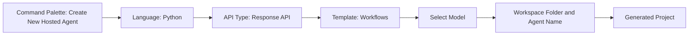
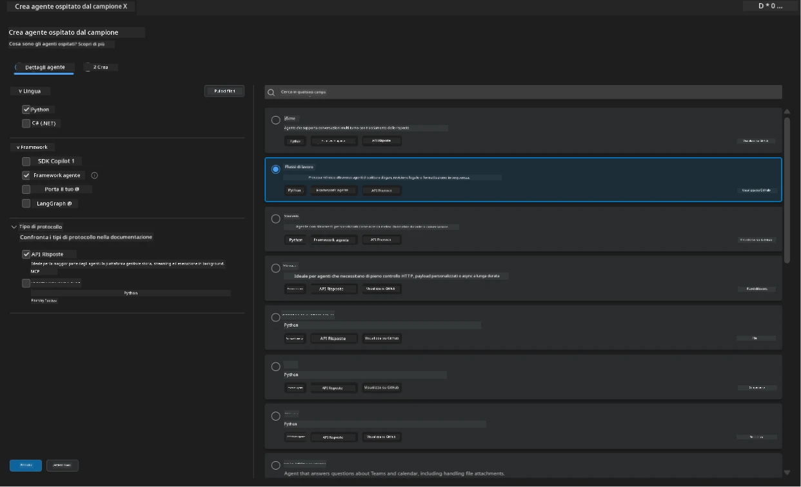
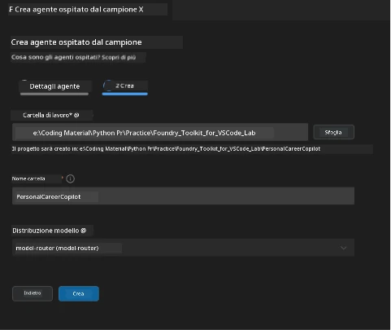

# Modulo 2 - Creare lo scheletro del progetto Multi-Agent

⏱️ ~5 min

In questo modulo, utilizzi [Foundry Toolkit per VS Code](https://aka.ms/foundrytk) per **creare lo scheletro di un progetto multi-agente**. Il wizard genera `agent.yaml`, `main.py`, `Dockerfile`, `requirements.txt`, `.env`, e la configurazione di debug di VS Code - così puoi concentrarti sul collegamento del workflow a 4 agenti nel Modulo 3.

> **Concetto chiave:** Lo scheletro è un prototipo funzionante con un agente. Sostituisci la logica segnaposto con il grafo `WorkflowBuilder` nel Modulo 3. Non scrivi il boilerplate da zero.

> **Implementazione di riferimento:** [`PersonalCareerCopilot/`](../../../../../workshop/lab02-multi-agent/PersonalCareerCopilot) è un esempio completo e funzionante. Usalo per confrontare il tuo lavoro durante lo sviluppo.

### Flusso del wizard per lo scheletro



---

## Passo 1: Apri il wizard Create Hosted Agent

1. Premi `Ctrl+Shift+P` per aprire la **Command Palette**.
2. Digita: **Foundry Toolkit: Create new Hosted Agent** e selezionalo.
3. Il wizard si apre sulla scheda **Agent Details**.

> **Alternativa:** Clicca sull'icona **Foundry Toolkit** nella Activity Bar → clicca sull'icona **+** accanto a **Hosted Agents** → **Create New Hosted Agent**.

---

## Passo 2: Scegli le impostazioni



1. Nella sezione di navigazione/opzioni a sinistra seleziona quanto segue:

| Menu | Selezione | Note |
|--------|-----------|-------|
| **Language** | Python | Supportato anche C# (.NET) |
| **Framework** | Agent Framework | Fornisce `Agent`, `AgentExecutor`, `WorkflowBuilder` |
| **API type** | Response API | `POST /responses` - cronologia gestita dalla piattaforma, supporto streaming |
| **Template** | **Workflows** | Gestisce le richieste attraverso più agenti in sequenza |

2. Una volta selezionato, clicca su **Next**



3. Nella finestra successiva seleziona quanto segue:

| Menu | Selezione | Note |
|--------|-----------|-------|
| **Workspace folder** | Naviga alla cartella di destinazione | es. `workshop/lab02-multi-agent/` in questo repo |
| **Agent name** | `PersonalCareerCopilot` | Diventa il nome della directory del progetto |
| **Model Deployment** | Seleziona il tuo modello distribuito | es. `gpt-4.1-mini` dal Lab 01 |

4. Clicca su **Create** per creare lo scheletro del progetto. VS Code genera i file e apre la cartella.

> **Suggerimento:** [`gpt-4.1-mini`](https://learn.microsoft.com/azure/foundry/foundry-models/concepts/models-sold-directly-by-azure#gpt-41-series) bilancia bene velocità e qualità per lo sviluppo multi-agente.

---

## Passo 3: Ispeziona il progetto generato

Dopo il completamento dello scheletro, verifica che alla vista Explorer siano presenti questi file (`Ctrl+Shift+E`):

```
📂 <your-agent-name>/
├── .azdignore          ← Files excluded from Azure Developer CLI deployments
├── .dockerignore       ← Files excluded from Docker builds
├── .env                ← Environment variables (placeholders - fill in Module 3)
├── .vscode/
│   ├── launch.json     ← Debug config (F5 → run + Agent Inspector)
│   └── tasks.json      ← VS Code task definitions
├── agent.yaml          ← Agent definition (kind: hosted, protocol: responses)
├── Dockerfile          ← Container config for deployment
├── main.py             ← Stub agent entry point (replace with WorkflowBuilder in Module 3)
└── requirements.txt    ← Python dependencies
```

> **Importante:** Apri questa cartella generata direttamente in VS Code in modo che `.vscode/launch.json` e `tasks.json` funzionino correttamente per il debug con F5.

### Spiegazione dei file chiave

| File | Scopo |
|------|---------|
| `agent.yaml` | Dichiara `kind: hosted`, mappa le variabili d’ambiente, definisce il protocollo `/responses` |
| `main.py` | Stub: un `FoundryChatClient` → `Agent` → `ResponsesHostServer`. Lo sostituisci con 4 agenti + `WorkflowBuilder` nel Modulo 3 |
| `Dockerfile` | `python:3.12-slim`, installa `requirements.txt`, espone la porta 8088, esegue `python main.py` |
| `requirements.txt` | `agent-framework-foundry`, `agent-framework-foundry-hosting`, `mcp<2,>=1.24.0`, `debugpy` |

> **Riferimento:** Consulta [`PersonalCareerCopilot/agent.yaml`](../../../../../workshop/lab02-multi-agent/PersonalCareerCopilot/agent.yaml) e [`PersonalCareerCopilot/requirements.txt`](../../../../../workshop/lab02-multi-agent/PersonalCareerCopilot/requirements.txt) per il contenuto completo generato.

---

### ✅ Punto di controllo

- [ ] Wizard per lo scheletro completato - nuova cartella di progetto visibile in Explorer
- [ ] Tutti i file attesi presenti: `agent.yaml`, `main.py`, `Dockerfile`, `requirements.txt`, `.env`
- [ ] `agent.yaml` mostra `kind: hosted` e `protocol: responses`
- [ ] `main.py` importa `Agent`, `FoundryChatClient`, `ResponsesHostServer`
- [ ] La cartella generata è aperta come radice dello workspace VS Code
- [ ] Comprendi che `main.py` è uno stub - `WorkflowBuilder` viene aggiunto nel Modulo 3

---

**Precedente:** [01 - Comprendere l'architettura Multi-Agent](01-understand-multi-agent.md) · **Successivo:** [03 - Configura Agenti & Ambiente →](03-configure-agents.md)

---

<!-- CO-OP TRANSLATOR DISCLAIMER START -->
**Disclaimer**:
Questo documento è stato tradotto utilizzando il servizio di traduzione AI [Co-op Translator](https://github.com/Azure/co-op-translator). Sebbene ci impegniamo per garantire la precisione, si prega di notare che le traduzioni automatizzate possono contenere errori o imprecisioni. Il documento originale nella sua lingua nativa deve essere considerato la fonte autorevole. Per informazioni critiche, si raccomanda una traduzione professionale effettuata da un essere umano. Non siamo responsabili per eventuali malintesi o interpretazioni errate derivanti dall’uso di questa traduzione.
<!-- CO-OP TRANSLATOR DISCLAIMER END -->