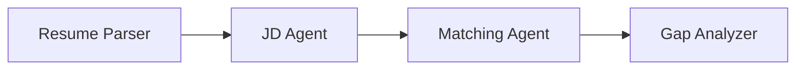
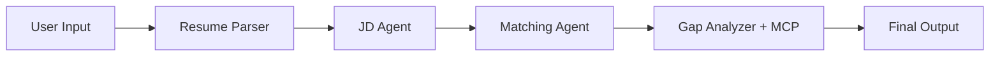

# Modulo 4 - Schemi di orchestrazione

⏱️ ~10 min

In questo modulo, esplorerai gli schemi di orchestrazione usati nel Resume Job Fit Evaluator e imparerai a leggere, modificare ed estendere il grafo del workflow. Comprendere questi schemi è essenziale per il debug di problemi nel flusso dei dati e per costruire i tuoi [workflow multi-agente](https://learn.microsoft.com/agent-framework/workflows/).

---

## Schema 1: Catena sequenziale

Lo schema fondamentale nel workflow è una **catena sequenziale** - l’output di ogni agente alimenta direttamente il successivo.



Nel codice, ogni chiamata `add_edge()` crea un passaggio della catena:

```python
.add_edge(resume_executor, jd_executor)       # ResumeParser output → JD Agent
.add_edge(jd_executor, matching_executor)     # JD Agent output → MatchingAgent
.add_edge(matching_executor, gap_executor)    # MatchingAgent output → GapAnalyzer
```

> **Perché sequenziale e non fan-out/fan-in?** `WorkflowBuilder` usa la **semantica OR** per gli archi in ingresso: un esecutore a valle scatta non appena **qualsiasi** predecessore completa. Se `matching_executor` avesse due archi in ingresso (da `resume_executor` e `jd_executor`), si attiverebbe due volte - una volta quando ResumeParser termina e di nuovo quando JD Agent termina - causando anche GapAnalyzer a eseguirsi due volte e l’output a comparire due volte. La pipeline sequenziale evita ciò completamente.

## Schema 2: Trasmissione del contenuto

Poiché `context_mode="last_agent"` significa che ogni esecutore vede solo l’**output del suo diretto predecessore**, gli agenti in una catena sequenziale devono esplicitamente passare avanti i dati che gli agenti a valle necessitano.

In questo workflow:
- **ResumeParser** copia il JD letteralmente in `[JOB DESCRIPTION PASS-THROUGH]` (così JD Agent può trovarlo).
- **JD Agent** copia `[PARSED RESUME]` letteralmente in `[PARSED RESUME PASS-THROUGH]` (così MatchingAgent può confrontare entrambi i profili).

```
ResumeParser output
└─ [PARSED RESUME]               ← extracted by JD Agent
└─ [JOB DESCRIPTION PASS-THROUGH] ← extracted by JD Agent

JD Agent output
└─ [JD REQUIREMENTS]             ← extracted by MatchingAgent
└─ [PARSED RESUME PASS-THROUGH]  ← extracted by MatchingAgent
```

Ogni sezione di trasmissione deve essere copiata **letteralmente** - riassumerla o parafrasarla rompe l’agente a valle che ne dipende.

---

## Il grafo completo

Combinando gli schemi di catena sequenziale e trasmissione del contenuto si ottiene il workflow completo:



L’Agent Inspector mostra questa stessa struttura del grafo quando l’agente è in esecuzione locale. Consulta [Modulo 5 - Test Localmente](05-test-locally.md) per gli screenshot.

---

## Lettura del codice WorkflowBuilder

Il grafo del workflow è costruito nella funzione `main()` in [`PersonalCareerCopilot/main.py`](../../../../../workshop/lab02-multi-agent/PersonalCareerCopilot/main.py). Le tre chiamate `add_edge()` costruiscono la pipeline sequenziale:

| # | Arco | Effetto |
|---|------|--------|
| 1 | `resume_executor → jd_executor` | JD Agent riceve `[PARSED RESUME]` + `[JOB DESCRIPTION PASS-THROUGH]` |
| 2 | `jd_executor → matching_executor` | MatchingAgent riceve `[JD REQUIREMENTS]` + `[PARSED RESUME PASS-THROUGH]` |
| 3 | `matching_executor → gap_executor` | GapAnalyzer riceve report di fit + lista dei gap |

---

## Modifica del grafo

### Aggiungere un nuovo agente

Per aggiungere un quinto agente (es. un **InterviewPrepAgent** dopo GapAnalyzer):

1. Definisci una costante `INTERVIEW_PREP_INSTRUCTIONS`.
2. Crea oggetti `Agent` + `AgentExecutor` (stesso schema degli attuali quattro).
3. Aggiungi `.add_edge(gap_executor, interview_exec)` in `WorkflowBuilder`.
4. Aggiorna `output_executors=[interview_exec]`.

> **Importante:** `start_executor` è l’unico agente che riceve input utente grezzo. Tutti gli altri agenti ricevono l’output dal loro arco a monte.

---

## Errori comuni nel grafo

| Errore | Sintomo | Soluzione |
|---------|---------|-----|
| Arco mancante verso `output_executors` | L’agente gira ma l’output è vuoto | Assicurarsi che ci sia un percorso da `start_executor` a ogni agente in `output_executors` |
| Dipendenza circolare | Loop infinito o timeout | Verificare che nessun agente alimenti un agente a monte |
| Agente in `output_executors` senza arco in ingresso | Output vuoto | Aggiungere almeno un `add_edge(source, that_agent)` |
| Più `output_executors` senza fan-in | L’output contiene solo la risposta di un agente | Usare un singolo agente di output che aggreghi, o accettare output multipli |
| Mancanza di `start_executor` | `ValueError` al momento della build | Specificare sempre `start_executor` in `WorkflowBuilder()` |

---

## Debug del grafo

### Usiamo Agent Inspector

1. Avvia l’agente in locale con F5.
2. Apri Agent Inspector (`Ctrl+Shift+P` → **Foundry Toolkit: Open Agent Inspector**).
3. Invia un messaggio di test.
4. Nel pannello di risposta dell’Inspector, cerca l’**output in streaming** - mostra il contributo di ogni agente in sequenza.


### Uso del logging

Aggiungi logging a `main.py` per tracciare il flusso dati:

```python
import logging
logger = logging.getLogger("resume-job-fit")

# In main(), after building the workflow:
logger.info("Workflow graph built with edges: RP→JD, JD→MA, MA→GA")
```

I log del server mostrano l’ordine di esecuzione degli agenti e le chiamate allo strumento MCP:

```
INFO:agent_framework:Executing agent: ResumeParser
INFO:agent_framework:Executing agent: JobDescriptionAgent
INFO:agent_framework:Executing agent: MatchingAgent
INFO:agent_framework:Executing agent: GapAnalyzer
INFO:agent_framework:Tool call: search_microsoft_learn_for_plan(skill="Kubernetes")
POST https://learn.microsoft.com/api/mcp → 200
INFO:agent_framework:Tool call: search_microsoft_learn_for_plan(skill="Terraform")
POST https://learn.microsoft.com/api/mcp → 200
```

---

### Checkpoint

- [ ] Riesci a identificare i due schemi di orchestrazione nel workflow: catena sequenziale e trasmissione del contenuto
- [ ] Comprendi perché `context_mode="last_agent"` richiede una trasmissione esplicita dei dati tra agenti
- [ ] Sai leggere il codice `WorkflowBuilder` e mappare ogni chiamata `add_edge()` al grafo visuale
- [ ] Sai come aggiungere un nuovo agente alla fine della pipeline
- [ ] Sai identificare errori comuni nel grafo e i loro sintomi

---

**Precedente:** [03 - Configure Agents & Environment](03-configure-agents.md) · **Successivo:** [05 - Test Locally →](05-test-locally.md)

---

<!-- CO-OP TRANSLATOR DISCLAIMER START -->
**Disclaimer**:
Questo documento è stato tradotto utilizzando il servizio di traduzione AI [Co-op Translator](https://github.com/Azure/co-op-translator). Sebbene ci impegniamo per garantire la precisione, si prega di notare che le traduzioni automatizzate possono contenere errori o imprecisioni. Il documento originale nella sua lingua nativa deve essere considerato la fonte autorevole. Per informazioni critiche, si raccomanda una traduzione professionale effettuata da un essere umano. Non siamo responsabili per eventuali malintesi o interpretazioni errate derivanti dall’uso di questa traduzione.
<!-- CO-OP TRANSLATOR DISCLAIMER END -->