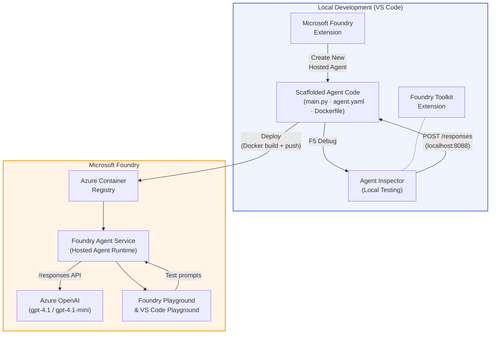

# Foundry Toolkit + Foundry Hosted Agents ワークショップ

[](https://www.python.org/)
[](https://github.com/microsoft/agents)
[](https://learn.microsoft.com/azure/foundry/agents/concepts/hosted-agents)
[](https://ai.azure.com/)
[](https://learn.microsoft.com/azure/ai-services/openai/)
[](https://learn.microsoft.com/cli/azure/install-azure-cli)
[](https://learn.microsoft.com/azure/developer/azure-developer-cli/install-azd)
[](https://www.docker.com/)
[](https://marketplace.visualstudio.com/items?itemName=ms-windows-ai-studio.windows-ai-studio)
[](../../LICENSE)

VS Code 上から **Microsoft Foundry extension** と **Foundry Toolkit** を使用して、**Microsoft Foundry Agent Service** に **Hosted Agents** として AI エージェントを構築、テスト、デプロイします。

> **Hosted Agents は現在プレビュー中です。** サポートされているリージョンは限られています - 詳細は [リージョンの可用性](https://learn.microsoft.com/azure/foundry/agents/concepts/hosted-agents#region-availability) をご覧ください。

> 各ラボ内の `agent/` フォルダーは Foundry 拡張機能によって <strong>自動的に作成されます</strong> - その後コードをカスタマイズし、ローカルでテストして、デプロイします。

### 🌐 マルチ言語サポート

#### GitHub Action によるサポート（自動化 & 常に最新）

<!-- CO-OP TRANSLATOR LANGUAGES TABLE START -->
[アラビア語](../ar/README.md) | [ベンガル語](../bn/README.md) | [ブルガリア語](../bg/README.md) | [ビルマ語 (ミャンマー)](../my/README.md) | [中国語 (簡体字)](../zh-CN/README.md) | [中国語 (繁体字, 香港)](../zh-HK/README.md) | [中国語 (繁体字, マカオ)](../zh-MO/README.md) | [中国語 (繁体字, 台湾)](../zh-TW/README.md) | [クロアチア語](../hr/README.md) | [チェコ語](../cs/README.md) | [デンマーク語](../da/README.md) | [オランダ語](../nl/README.md) | [エストニア語](../et/README.md) | [フィンランド語](../fi/README.md) | [フランス語](../fr/README.md) | [ドイツ語](../de/README.md) | [ギリシャ語](../el/README.md) | [ヘブライ語](../he/README.md) | [ヒンディー語](../hi/README.md) | [ハンガリー語](../hu/README.md) | [インドネシア語](../id/README.md) | [イタリア語](../it/README.md) | [日本語](./README.md) | [カンナダ語](../kn/README.md) | [クメール語](../km/README.md) | [韓国語](../ko/README.md) | [リトアニア語](../lt/README.md) | [マレー語](../ms/README.md) | [マラヤーラム語](../ml/README.md) | [マラーティー語](../mr/README.md) | [ネパール語](../ne/README.md) | [ナイジェリア・ピジン語](../pcm/README.md) | [ノルウェー語](../no/README.md) | [ペルシア語 (ファルシ語)](../fa/README.md) | [ポーランド語](../pl/README.md) | [ポルトガル語 (ブラジル)](../pt-BR/README.md) | [ポルトガル語 (ポルトガル)](../pt-PT/README.md) | [パンジャブ語 (グルムキー)](../pa/README.md) | [ルーマニア語](../ro/README.md) | [ロシア語](../ru/README.md) | [セルビア語 (キリル文字)](../sr/README.md) | [スロバキア語](../sk/README.md) | [スロベニア語](../sl/README.md) | [スペイン語](../es/README.md) | [スワヒリ語](../sw/README.md) | [スウェーデン語](../sv/README.md) | [タガログ語 (フィリピノ語)](../tl/README.md) | [タミル語](../ta/README.md) | [テルグ語](../te/README.md) | [タイ語](../th/README.md) | [トルコ語](../tr/README.md) | [ウクライナ語](../uk/README.md) | [ウルドゥー語](../ur/README.md) | [ベトナム語](../vi/README.md)

> **ローカルにクローンするのがよいですか？**
>
> このリポジトリには50以上の言語翻訳が含まれており、ダウンロードサイズが大幅に増加します。翻訳を含めずにクローンするには、sparse checkoutを使用してください:
>
> **Bash / macOS / Linux:**
> ```bash
> git clone --filter=blob:none --sparse https://github.com/microsoft-foundry/Foundry_Toolkit_for_VSCode_Lab.git
> cd Foundry_Toolkit_for_VSCode_Lab
> git sparse-checkout set --no-cone '/*' '!translations' '!translated_images'
> ```
>
> **CMD (Windows):**
> ```cmd
> git clone --filter=blob:none --sparse https://github.com/microsoft-foundry/Foundry_Toolkit_for_VSCode_Lab.git
> cd Foundry_Toolkit_for_VSCode_Lab
> git sparse-checkout set --no-cone "/*" "!translations" "!translated_images"
> ```
>
> これにより、コースを完了するために必要なすべてが、はるかに高速なダウンロードで取得できます。
<!-- CO-OP TRANSLATOR LANGUAGES TABLE END -->

---

## アーキテクチャ



**Flow:** Foundry extension がエージェントをスキャフォールドします → あなたがコードと指示をカスタマイズ → Agent Inspector でローカルテスト → Foundry にデプロイ（Docker イメージを ACR にプッシュ） → Playground で検証。

---

## あなたが作るもの

| ラボ | 説明 | ステータス |
|-----|-------------|--------|
| **Lab 01 - Single Agent** | **「経営幹部向けに説明する」エージェント** を構築し、ローカルでテストして Foundry にデプロイします | ✅ 利用可能 |
| **Lab 02 - Multi-Agent Workflow** | **「履歴書 → 職務適合評価」** を構築 — 4 つのエージェントが協力して履歴書の適合度を評価し、学習ロードマップを生成します | ✅ 利用可能 |

---

## Executive Agent をご紹介します

このワークショップでは **「経営幹部向けに説明する」エージェント** を構築します — 難解な技術用語を受け取り、落ち着いた取締役会向けの要約に翻訳するAIエージェントです。率直に言って、C-suite の誰も "thread pool exhaustion caused by synchronous calls introduced in v3.2." のような話は聞きたくありません。

私はこのエージェントを、完璧に作成したポストモーテムに対して *"So... is the website down or not?"* という反応が何度もあった後に作りました。

### 仕組み

技術的な更新を入力すると、エグゼクティブサマリーを返します — 箇条書き3点、専門用語なし、スタックトレースなし、不要な不安もなし。要点は <strong>何が起きたか</strong>、<strong>ビジネスへの影響</strong>、および <strong>次のステップ</strong> です。

### 実際の動作を見る

**あなたが言う:**
> "The API latency increased due to thread pool exhaustion caused by synchronous calls introduced in v3.2."

**エージェントの応答:**

> **エグゼクティブサマリー:**
> - **何が起きたか:** 最新のリリース後、システムの速度が低下しました。
> - **ビジネスへの影響:** 一部のユーザーがサービス利用時に遅延を経験しました。
> - **次のステップ:** 変更はロールバックされ、再デプロイ前に修正が準備されています。

### なぜこのエージェントなのか

これは非常にシンプルで単一目的のエージェントです — 複雑なツールチェーンに煩わされることなく、ホスト型エージェントのワークフローをエンドツーエンドで学ぶのに最適です。正直なところ、どのエンジニアリングチームにも1つあると役立ちます。

---

## ワークショップの構成

```
📂 Foundry_Toolkit_for_VSCode_Lab/
├── 📄 README.md                      ← You are here
└── 📂 workshop/
    ├── 📂 lab01-single-agent/        ← Full lab: docs + agent code
    │   ├── README.md                 ← Hands-on lab instructions
    │   ├── 📂 docs/                  ← Step-by-step tutorial modules
    │   │   ├── 00-prerequisites.md
    │   │   ├── 01-setup.md
    │   │   ├── 02-create-hosted-agent.md
    │   │   ├── 03-configure-and-code.md
    │   │   ├── 04-test-locally.md
    │   │   ├── 05-deploy-to-foundry.md
    │   │   ├── 06-verify-in-playground.md
    │   │   ├── 07-summary.md
    │   │   └── 08-troubleshooting.md
    │   └── 📂 agent/                 ← Reference solution (auto-scaffolded by Foundry extension)
    │       ├── agent.yaml
    │       ├── Dockerfile
    │       ├── main.py
    │       └── requirements.txt
    └── 📂 lab02-multi-agent/         ← Resume → Job Fit Evaluator
        ├── README.md                 ← Hands-on lab instructions (end-to-end)
        ├── 📂 docs/                  ← Step-by-step tutorial modules
        │   ├── 00-prerequisites.md
        │   ├── 01-understand-multi-agent.md
        │   ├── 02-scaffold-multi-agent.md
        │   ├── 03-configure-agents.md
        │   ├── 04-orchestration-patterns.md
        │   ├── 05-test-locally.md
        │   ├── 06-deploy-to-foundry.md
        │   ├── 07-verify-in-playground.md
        │   └── 08-troubleshooting.md
        └── 📂 PersonalCareerCopilot/ ← Reference solution (multi-agent workflow)
            ├── agent.yaml
            ├── Dockerfile
            ├── main.py
            └── requirements.txt
```

> **注:** The `agent/` folder inside each lab is what the **Microsoft Foundry extension** generates when you run `Microsoft Foundry: Create a New Hosted Agent` from the Command Palette. The files are then customized with your agent's instructions, tools, and configuration. Lab 01 walks you through recreating this from scratch.

---

## はじめに

### 1. リポジトリをクローンする

```bash
git clone https://github.com/microsoft-foundry/Foundry_Toolkit_for_VSCode_Lab.git
cd Foundry_Toolkit_for_VSCode_Lab
```

### 2. Python の仮想環境を設定する

```bash
python -m venv venv
```

有効化してください:

- **Windows (PowerShell):**
  ```powershell
  .\venv\Scripts\Activate.ps1
  ```
- **macOS / Linux:**
  ```bash
  source venv/bin/activate
  ```

### 3. 依存関係をインストール

```bash
pip install -r workshop/lab01-single-agent/agent/requirements.txt
```

### 4. 環境変数を設定する

エージェントフォルダ内にあるサンプル `.env` ファイルをコピーし、値を入力してください:

```bash
cp workshop/lab01-single-agent/agent/.env.example workshop/lab01-single-agent/agent/.env
```

`workshop/lab01-single-agent/agent/.env` を編集してください:

```env
AZURE_AI_PROJECT_ENDPOINT=https://<your-account>.services.ai.azure.com/api/projects/<your-project>
AZURE_AI_MODEL_DEPLOYMENT_NAME=<your-model-deployment-name>
```

### 5. ワークショップのラボに従う

各ラボは個別のモジュールで完結しています。基礎を学ぶためにまず **Lab 01** から始め、その後マルチエージェントのワークフローについては **Lab 02** に進んでください。

#### Lab 01 - シングルエージェント ([詳細手順](workshop/lab01-single-agent/README.md))

| # | モジュール | リンク |
|---|--------|------|
| 1 | 前提条件を読む | [00-prerequisites.md](workshop/lab01-single-agent/docs/00-prerequisites.md) |
| 2 | Foundry Toolkit と Foundry extension をインストールする | [01-setup.md](workshop/lab01-single-agent/docs/01-setup.md) |
| 3 | Foundry プロジェクトを作成する | [01-setup.md](workshop/lab01-single-agent/docs/01-setup.md) |
| 4 | ホストされたエージェントを作成する | [02-create-hosted-agent.md](workshop/lab01-single-agent/docs/02-create-hosted-agent.md) |
| 5 | 指示と環境を設定する | [03-configure-and-code.md](workshop/lab01-single-agent/docs/03-configure-and-code.md) |
| 6 | ローカルでテストする | [04-test-locally.md](workshop/lab01-single-agent/docs/04-test-locally.md) |
| 7 | Foundry にデプロイする | [05-deploy-to-foundry.md](workshop/lab01-single-agent/docs/05-deploy-to-foundry.md) |
| 8 | playground で確認する | [06-verify-in-playground.md](workshop/lab01-single-agent/docs/06-verify-in-playground.md) |
| 9 | トラブルシューティング | [08-troubleshooting.md](workshop/lab01-single-agent/docs/08-troubleshooting.md) |

#### Lab 02 - マルチエージェントワークフロー ([詳細手順](workshop/lab02-multi-agent/README.md))

| # | モジュール | リンク |
|---|--------|------|
| 1 | 前提条件 (Lab 02) | [00-prerequisites.md](workshop/lab02-multi-agent/docs/00-prerequisites.md) |
| 2 | マルチエージェントのアーキテクチャを理解する | [01-understand-multi-agent.md](workshop/lab02-multi-agent/docs/01-understand-multi-agent.md) |
| 3 | マルチエージェントプロジェクトのひな形を作成する | [02-scaffold-multi-agent.md](workshop/lab02-multi-agent/docs/02-scaffold-multi-agent.md) |
| 4 | エージェントと環境を設定する | [03-configure-agents.md](workshop/lab02-multi-agent/docs/03-configure-agents.md) |
| 5 | オーケストレーションパターン | [04-orchestration-patterns.md](workshop/lab02-multi-agent/docs/04-orchestration-patterns.md) |
| 6 | ローカルでテストする (マルチエージェント) | [05-test-locally.md](workshop/lab02-multi-agent/docs/05-test-locally.md) |
| 7 | Foundry にデプロイする | [06-deploy-to-foundry.md](workshop/lab02-multi-agent/docs/06-deploy-to-foundry.md) |
| 8 | playground で確認する | [07-verify-in-playground.md](workshop/lab02-multi-agent/docs/07-verify-in-playground.md) |
| 9 | トラブルシューティング (マルチエージェント) | [08-troubleshooting.md](workshop/lab02-multi-agent/docs/08-troubleshooting.md) |

---

## メンテナー

<table>
<tr>
    <td align="center"><a href="https://github.com/ShivamGoyal03">
        <br />
        <sub><b>Shivam Goyal</b></sub>
    </a><br />
    </td>
</tr>
</table>

---

## 必要な権限（クイック参照）

| シナリオ | 必要なロール |
|----------|---------------|
| 新しい Foundry プロジェクトの作成 | Foundry リソース上の **Azure AI Owner** |
| 既存プロジェクトにデプロイする（新しいリソース） | サブスクリプション上の **Azure AI Owner** + **Contributor** |
| 完全に構成済みのプロジェクトにデプロイする | アカウント上の **Reader** + プロジェクト上の **Azure AI User** |

> **重要:** Azure `Owner` と `Contributor` のロールには <em>管理</em> 権限のみが含まれ、<em>開発</em> (データアクション) 権限は含まれません。エージェントを構築およびデプロイするには **Azure AI User** または **Azure AI Owner** が必要です。

---

## 参考文献

- [クイックスタート: 最初のホステッド エージェントをデプロイする (VS Code)](https://learn.microsoft.com/azure/foundry/agents/quickstarts/quickstart-hosted-agent)
- [ホステッド エージェントとは何ですか?](https://learn.microsoft.com/azure/foundry/agents/concepts/hosted-agents)
- [VS Code でホステッド エージェントのワークフローを作成する](https://learn.microsoft.com/azure/foundry/agents/how-to/vs-code-agents-workflow-pro-code)
- [ホステッド エージェントをデプロイする](https://learn.microsoft.com/azure/foundry/agents/how-to/deploy-hosted-agent)
- [Microsoft Foundry の RBAC](https://learn.microsoft.com/azure/foundry/concepts/rbac-foundry)
- [アーキテクチャ レビュー エージェント サンプル](https://github.com/Azure-Samples/agent-architecture-review-sample) - 実運用のホステッド エージェント（MCP ツール、Excalidraw 図、および二重デプロイを含む）

---


## ライセンス

[MIT](../../LICENSE)

---

<!-- CO-OP TRANSLATOR DISCLAIMER START -->
**免責事項**：
本書類は AI 翻訳サービス [Co-op Translator](https://github.com/Azure/co-op-translator) を使用して翻訳されています。正確性を期していますが、自動翻訳には誤りや不正確な部分が含まれる可能性があることをご承知おきください。原文の原語版が正式な情報源とみなされるべきです。重要な情報については、専門の人間による翻訳を推奨します。本翻訳の利用により生じたいかなる誤解や解釈違いについても、当方は責任を負いかねます。
<!-- CO-OP TRANSLATOR DISCLAIMER END -->
